# GPU学习笔记

<!-- 自动生成，请不要编辑！ -->

> 一个超级大的矩阵乘法，怎样才能算得快？
> 版本：v2026.11.08


<div style="page-break-after: always;"></div>

## 第 1 章　矩阵乘法

矩阵乘法是今天人工智能的头号计算：不管是训练一个大模型，还是用它来回答问题，背后的计算大部分都是矩阵乘法，本章后面会具体说明这一点。所以，这本书想回答一个问题：一个超级大的矩阵乘法，怎样才能算得快？围绕这个问题，我们会从CPU出发，一路走到GPU、CUDA、Tensor Core，最后走到多块GPU。不过在动手加速之前，得先把要加速的东西本身弄清楚。所以这一章不碰GPU，也不谈优化，只讨论矩阵乘法这个计算本身。

具体来说，我们先看矩阵乘法的定义，以及理解它的三种视角。接着估算一次矩阵乘法要算多少、要搬多少数据，这两个数字的比值是全书一切优化的出发点。然后说明矩阵乘法为什么值得花一整本书去优化。再往后，我们看矩阵在内存里是怎样摆放的，这件事在后面的章节里会反复影响性能。最后，我们约定一个贯穿全书的基准问题，后面每一章都拿它来衡量自己的进步。

本章的随书代码在`code/ch01/`目录下，一共三个小脚本，都可以用`uv run 脚本名.py`直接运行。


### 什么是矩阵乘法

设矩阵 $\mathbf{A}$ 的形状是 $M \times K$ ，矩阵 $\mathbf{B}$ 的形状是 $K \times N$ ，它们的乘积 $\mathbf{C} = \mathbf{A}\mathbf{B}$ 是一个 $M \times N$ 的矩阵。注意 $\mathbf{A}$ 的列数和 $\mathbf{B}$ 的行数必须相等，都是 $K$ ，否则无法相乘。 $\mathbf{C}$ 中第 $i$ 行第 $j$ 列的元素按下面的公式计算：

$$
c_{ij} = \sum_{k=0}^{K-1} a_{ik} \, b_{kj}
$$

本书沿用常见的记法：粗体大写字母表示矩阵，比如 $\mathbf{A}$ ；不加粗的小写字母加下标表示矩阵中的元素，比如 $a_{ik}$ 。为了和代码保持一致，下标一律从0开始。

举一个具体的例子。设 $\mathbf{A}$ 是 $2 \times 3$ 的矩阵，第一行是1、2、3，第二行是4、5、6； $\mathbf{B}$ 是 $3 \times 2$ 的矩阵，三行分别是7和8、9和10、11和12。那么 $c_{00} = 1 \times 7 + 2 \times 9 + 3 \times 11 = 58$ ，其余三个元素可以照此算出，最终得到的 $\mathbf{C}$ 是一个 $2 \times 2$ 的矩阵，第一行是58和64，第二行是139和154。

上面的公式只有一种写法，但理解它的角度却不止一种。下面介绍三种视角，它们算出来的结果完全相同，只是计算的组织方式不同。后面的章节会看到，组织方式的不同，恰恰决定了算得快还是慢。


#### 点积视角

最直接的理解是： $c_{ij}$ 就是 $\mathbf{A}$ 的第 $i$ 行和 $\mathbf{B}$ 的第 $j$ 列这两个向量的**点积**（Dot Product）。要算出整个 $\mathbf{C}$ ，就对每一对 $(i, j)$ 各做一次点积，一共做 $M \times N$ 次。写成Python代码，就是我们熟悉的三重循环。本节三种视角的代码，都在随书代码`code/ch01/three_views.py`里：

```python
def matmul_dot(A, B):
    M, K, N = len(A), len(B), len(B[0])
    C = [[0.0] * N for _ in range(M)]
    for i in range(M):
        for j in range(N):
            for k in range(K):
                C[i][j] += A[i][k] * B[k][j]
    return C
```

这个视角的好处是每个输出元素彼此独立：算 $c_{00}$ 不需要知道 $c_{01}$ 是多少。换句话说， $M \times N$ 个点积可以同时进行，谁先谁后都无所谓。我们在第5章写第一个GPU程序时，用的正是这个视角，让每个线程负责算一个输出元素。

为了把这个过程看得更直观，我写了一个小工具，放在随书源代码的`tools/matmul-demo/`目录下，用浏览器直接打开`index.html`就能用，不需要安装任何东西。页面上， $\mathbf{A}$ 、 $\mathbf{B}$ 、 $\mathbf{C}$ 从左到右排成一行，计算 $\mathbf{C}$ 中的某个元素时， $\mathbf{A}$ 中用到的那一行标成红色， $\mathbf{B}$ 中用到的那一列标成绿色。 $M$ 、 $K$ 、 $N$ 都可以随意调整，点击播放，就能看到 $\mathbf{C}$ 的元素按点积视角被一个一个算出来，每一步做一次乘法和一次加法。它默认的数值，正是前面手算的那个例子。页面上方可以切换视角，下面要讲的外积视角和分块视角，它也都能演示。

下图就是用这个工具导出的动画， $\mathbf{A}$ 是 $3 \times 4$ 的矩阵， $\mathbf{B}$ 是 $4 \times 3$ 的矩阵。每一帧做一次乘加：红色是 $\mathbf{A}$ 中正在用的那一行，绿色是 $\mathbf{B}$ 中正在用的那一列，橙色是 $\mathbf{C}$ 中正在累加的元素；一个元素算完以后变成灰色，再去算下一个。它是一个GIF动画，在打印版或PDF里只能看到其中一帧，想看完整的过程，可以用浏览器打开`tools/matmul-demo/`亲自运行。

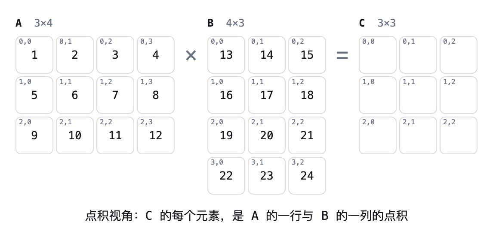


#### 外积视角

换一个角度。取出 $\mathbf{A}$ 的第 $k$ 列（一个长度为 $M$ 的列向量）和 $\mathbf{B}$ 的第 $k$ 行（一个长度为 $N$ 的行向量），二者相乘得到一个 $M \times N$ 的矩阵，这叫做**外积**（Outer Product）。 $k$ 从0取到 $K-1$ ，一共得到 $K$ 个外积， $\mathbf{C}$ 就是它们的和：

$$
\mathbf{C} = \sum_{k=0}^{K-1} \mathbf{a}_{:,k} \, \mathbf{b}_{k,:}
$$

其中 $\mathbf{a}_{:,k}$ 表示 $\mathbf{A}$ 的第 $k$ 列， $\mathbf{b}_{k,:}$ 表示 $\mathbf{B}$ 的第 $k$ 行。写成代码，你会发现它和点积视角几乎一模一样，只是把 $k$ 那一层循环挪到了最外面：

```python
def matmul_outer(A, B):
    M, K, N = len(A), len(B), len(B[0])
    C = [[0.0] * N for _ in range(M)]
    for k in range(K):
        for i in range(M):
            for j in range(N):
                C[i][j] += A[i][k] * B[k][j]
    return C
```

这个视角的特点是，每一步都用 $\mathbf{A}$ 的一列和 $\mathbf{B}$ 的一行，去更新整个 $\mathbf{C}$ 。一个 $a_{ik}$ 取出来之后，会和 $\mathbf{B}$ 第 $k$ 行的全部 $N$ 个元素各乘一次。数据取一次、用很多次，这正是高性能矩阵乘法追求的东西。第9章做寄存器分块时，每个线程内部算的就是一个个小外积。

在`tools/matmul-demo/`里切换到外积视角，取消勾选“逐次乘加”，每点一次“下一步”，就会看到一个完整的外积被加到 $\mathbf{C}$ 上，而 $\mathbf{C}$ 的所有元素要等到最后一个外积加完才算完成。下图是勾选了“逐次乘加”的动画，同样是 $3 \times 4$ 乘以 $4 \times 3$ ：红色的 $\mathbf{A}$ 的第 $k$ 列和绿色的 $\mathbf{B}$ 的第 $k$ 行保持不动，橙色的高亮依次扫过 $\mathbf{C}$ 的每一个元素，把这一个外积加上去；扫完一遍， $k$ 加一，再扫下一遍。和点积视角的动画对比一下，就能看出两者只是循环的顺序不同。

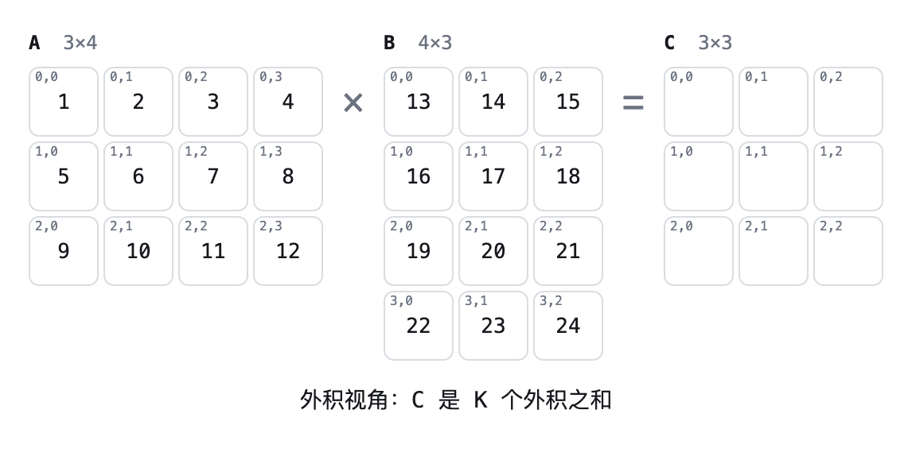


#### 分块视角

第三种视角是把矩阵切成小块。比如把 $\mathbf{A}$ 、 $\mathbf{B}$ 、 $\mathbf{C}$ 都按 $4 \times 4$ 切开，每个小块本身也是一个矩阵。神奇的是，小块之间的运算规则，和元素之间的完全一样：

$$
\mathbf{C}_{IJ} = \sum_{L} \mathbf{A}_{IL} \, \mathbf{B}_{LJ}
$$

这里大写的 $I$ 、 $J$ 、 $L$ 是小块的编号，而 $\mathbf{A}_{IL} \mathbf{B}_{LJ}$ 是两个小块之间的矩阵乘法。也就是说，把原公式里的元素换成小块，把元素的乘法换成小块的矩阵乘法，公式依然成立。随书代码`three_views.py`中的分块版本用NumPy来做小块的矩阵乘法：

```python
def matmul_block(A, B, bs):
    M, K, N = A.shape[0], A.shape[1], B.shape[1]
    C = np.zeros((M, N), dtype=A.dtype)
    for i in range(0, M, bs):
        for j in range(0, N, bs):
            for k in range(0, K, bs):
                C[i:i+bs, j:j+bs] += A[i:i+bs, k:k+bs] @ B[k:k+bs, j:j+bs]
    return C
```

分块视角是整本书最重要的一个视角。一个超级大的矩阵乘法，可以拆成许多小矩阵乘法；小块足够小，就能整个放进速度快、容量小的存储里，在那里被反复使用。第2章在CPU上分块，“快的存储”是CPU的**缓存**（Cache）；第8章在GPU上分块，“快的存储”变成了共享内存；第17章把矩阵分到多块GPU上，每块GPU负责其中几个小块。思想始终是同一个。在`tools/matmul-demo/`里切换到分块视角，可以选择块大小，看小块之间是怎样逐对相乘再累加的；块大小取1×1时，它就退化成了点积视角。

下图是块大小取 $2 \times 2$ 时的动画。矩阵的边长3不能被2整除，所以靠边的小块小一些。每一帧做一次小矩阵乘法：红色的 $\mathbf{A}$ 的一个小块乘以绿色的 $\mathbf{B}$ 的一个小块，结果加到 $\mathbf{C}$ 中橙色的那个小块上。

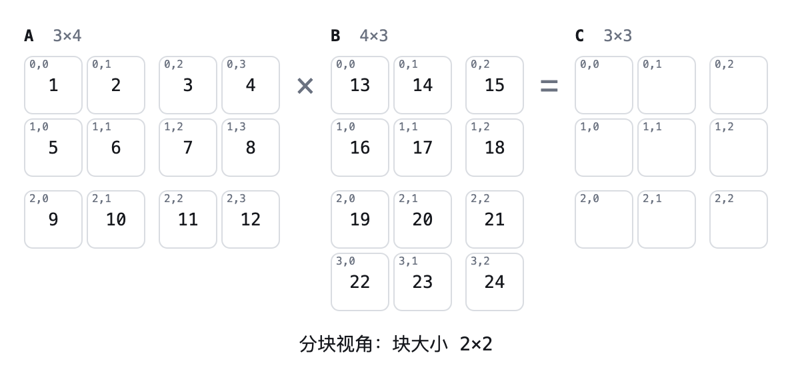

运行`three_views.py`，可以验证三种视角的结果和NumPy一致：

```
点积视角: [[58.0, 64.0], [139.0, 154.0]]
外积视角: [[58.0, 64.0], [139.0, 154.0]]
NumPy   : [[58, 64], [139, 154]]
分块视角与NumPy的最大差异: 4.7683716e-07
```

前三行就是前面手算的那个例子。最后一行用的是 $8 \times 8$ 的随机FP32矩阵。FP32指32位的单精度浮点数，也就是C语言里的`float`，它的格式由IEEE 754标准规定，第12章会详细介绍它和其他几种浮点格式。这个例子中，分块的结果和NumPy并不完全相等，最大相差大约 $5 \times 10^{-7}$ 。这不是代码写错了，而是浮点数的加法不满足结合律： $(a + b) + c$ 和 $a + (b + c)$ 在浮点运算里可能差上最后一位。分块改变了累加的顺序，结果就会有微小的差别。后面每一章的优化都会改变累加顺序，所以从第5章开始，我们判断结果是否正确时，比较的是“误差是否足够小”，而不是“是否完全相等”。


### 算多少，搬多少

要判断一个矩阵乘法算得快不快，先得知道它一共要算多少。回到定义，每个 $c_{ij}$ 需要 $K$ 次乘法和 $K$ 次加法（从0开始累加），一共 $2K$ 次浮点运算。 $\mathbf{C}$ 有 $M \times N$ 个元素，所以总的运算次数是 $2MNK$ 。浮点运算次数的单位记作**FLOP**（Floating-Point Operation），每秒完成的浮点运算次数记作**FLOPS**（FLOP per Second）。本书用FLOP表示计算量，用FLOPS表示速度，两者只差一个S，含义完全不同，需要留意。速度通常很大，所以常用GFLOPS（每秒十亿次）和TFLOPS（每秒万亿次）。

再看数据量。 $\mathbf{A}$ 有 $MK$ 个元素， $\mathbf{B}$ 有 $KN$ 个元素，要读进来； $\mathbf{C}$ 有 $MN$ 个元素，要写出去。合起来至少要搬运 $MK + KN + MN$ 个元素。用FP32存储时，每个元素占4个字节。

为了方便讨论，本书的基准问题取方阵，也就是 $M = N = K = n$ 。这时计算量是 $2n^3$ ，数据量是 $3n^2$ 个元素，也就是 $12n^2$ 个字节。二者相除，每搬运一个字节，要做 $n/6$ 次浮点运算。随书代码`sizes.py`算出了几个常见规模下的数字：

```
     n                   FLOP      GFLOP          数据量(字节)      MiB    FLOP/字节
   256             33,554,432        0.0          786,432        1       42.7
   512            268,435,456        0.3        3,145,728        3       85.3
  1024          2,147,483,648        2.1       12,582,912       12      170.7
  2048         17,179,869,184       17.2       50,331,648       48      341.3
  4096        137,438,953,472      137.4      201,326,592      192      682.7
  8192      1,099,511,627,776     1099.5      805,306,368      768     1365.3
```

请重点看最后一列。 $n$ 每翻一倍，计算量变成原来的8倍，数据量只变成原来的4倍，于是每个字节对应的运算次数也翻一倍。以 $n = 4096$ 为例，三个矩阵加起来不过192MiB，计算量却高达1374亿次。原因在于矩阵中的每个元素都会被反复使用： $\mathbf{A}$ 中的每个元素要参与 $N$ 次乘法， $\mathbf{B}$ 中的每个元素要参与 $M$ 次乘法。

作为对比，看看两个长度为 $n$ 的向量相加。它要读两个向量、写一个向量，一共 $12n$ 个字节，却只做 $n$ 次加法，每个字节只摊到 $1/12$ 次运算。不管 $n$ 多大，这个比值都不会变，因为每个元素只用一次。

这两个数字的差别，决定了后面整本书的走向。现代硬件的计算速度远远快于搬运数据的速度，像向量加法这样“算得少、搬得多”的计算，再怎么优化，也只能跑到内存带宽的上限；而矩阵乘法每个字节对应几百上千次运算，只要数据组织得好，就有机会让计算单元满负荷运转。第3章会把这个比值正式定义为**算术强度**（Arithmetic Intensity），并用它来判断一段程序的瓶颈在哪里。

不过，上表的数据量是一个理想值，它假设每个元素只从内存里读一次。前面那个朴素的三重循环可做不到这一点：每算一个 $c_{ij}$ ，就要把 $\mathbf{A}$ 的一行和 $\mathbf{B}$ 的一列各读一遍，总共读 $2n^3$ 个元素。如果没有任何缓存帮忙，在 $n = 4096$ 时，这相当于搬运大约512GiB的数据，是理想值192MiB的两千多倍。理想与现实之间的这道鸿沟，就是后面十几章要一点一点填平的东西。


### 为什么矩阵乘法这么重要

矩阵乘法是科学计算里最古老、也最核心的运算之一。早在上世纪七八十年代，数值计算领域就把常用的线性代数运算整理成了一套标准接口，叫做**BLAS**（Basic Linear Algebra Subprograms）。其中矩阵乘法对应的函数叫**GEMM**（General Matrix Multiply），它算的是 $\mathbf{C} = \alpha \mathbf{A}\mathbf{B} + \beta \mathbf{C}$ ，比本章的定义多了两个标量系数，但核心仍然是 $\mathbf{A}\mathbf{B}$ 。几十年来，每一款新的CPU和GPU问世，厂商几乎都会提供自己高度优化的GEMM，它是衡量一款芯片计算能力最常用的标尺。

真正让矩阵乘法成为“头号计算”的，是深度学习。神经网络中最基本的**线性层**（Linear Layer），做的就是 $\mathbf{Y} = \mathbf{X}\mathbf{W}$ 。其中 $\mathbf{W}$ 是一个 $d \times d$ 的权重矩阵； $\mathbf{X}$ 的每一行是一个输入，比如大模型里的一个**词元**（Token），每个词元用一个长度为 $d$ 的向量表示， $d$ 通常是几千。一次处理 $T$ 个词元，就是一个 $T \times d$ 的矩阵乘以一个 $d \times d$ 的矩阵。Transformer中的注意力机制也离不开矩阵乘法，计算注意力分数的 $\mathbf{Q}\mathbf{K}^\top$ 和加权求和的 $\mathbf{P}\mathbf{V}$ 都是矩阵乘法。就连卷积神经网络中的卷积，也常常先改写成矩阵乘法再计算。

我们可以粗略估算一下矩阵乘法在其中的分量。对于一个词元，一个 $d \times d$ 的线性层要做 $2d^2$ 次运算；而归一化、激活函数、残差相加这类逐元素操作，每次大约只做 $d$ 量级的运算。按`sizes.py`的计算，当 $d = 4096$ 时，前者是33,554,432次，二者相差约8000倍。虽然逐元素操作的个数更多，但从计算量上看，大模型的训练和推理几乎就是在做矩阵乘法。

所以，把矩阵乘法算快，就等于把大部分计算算快。这也解释了为什么NVIDIA要在GPU里专门加入只为矩阵乘法服务的硬件单元Tensor Core，我们会在第13章认识它。


### 矩阵在内存中的样子

在数学上，矩阵是一张二维的表格；但计算机的内存是一维的，只有一个接一个的地址。要把二维的矩阵放进一维的内存，就必须决定元素的排列顺序。常见的排法有两种。

一种是**行主序**（Row-Major Order）：先把第0行从左到右依次放好，再接着放第1行，依此类推。C语言的二维数组、NumPy和PyTorch默认都采用行主序。另一种是**列主序**（Column-Major Order）：先把第0列从上到下放好，再放第1列。Fortran采用列主序，经典的BLAS以及NVIDIA的cuBLAS库也沿用了列主序的约定，第5章调用cuBLAS时我们会再碰到这件事。

对于一个行主序的 $M \times K$ 矩阵，元素 $a_{ik}$ 存放在第 $i \times K + k$ 个位置上。也就是说，同一行中相邻的两个元素在内存中也相邻，而同一列中相邻的两个元素之间隔着 $K$ 个元素。随书代码`layout.py`用一个 $2 \times 3$ 的矩阵观察了这一点：

```
A =
 [[0. 1. 2.]
 [3. 4. 5.]]
行主序在内存中的顺序: [0.0, 1.0, 2.0, 3.0, 4.0, 5.0]
shape: (2, 3)  strides: (12, 4)
列主序在内存中的顺序: [0.0, 3.0, 1.0, 4.0, 2.0, 5.0]
shape: (2, 3)  strides: (4, 8)
```

输出中的strides叫做**步长**（Stride），表示沿着某一维走一步，在内存中要跳过多少个字节。行主序的步长是`(12, 4)`：同一行里往右走一步，跳过4个字节，正好是一个FP32；往下走一行，要跳过12个字节，也就是一整行的3个元素。列主序则反过来，往下走一步只跳4个字节，往右走一步要跳8个字节。

有了步长的概念，就可以理解一个很有用的事实：转置不一定需要搬运数据。继续看`layout.py`的输出：

```
A.T =
 [[0. 3.]
 [1. 4.]
 [2. 5.]]
A.T shape: (3, 2)  strides: (4, 12)
A.T和A共享内存: True
```

可以看到，NumPy在转置时并没有复制数据，只是把形状和步长对调了一下，得到的 $\mathbf{A}^\top$ 和 $\mathbf{A}$ 共享同一块内存。同一块内存，用不同的步长去解读，既可以看成一个行主序的 $2 \times 3$ 矩阵，也可以看成一个列主序的 $3 \times 2$ 矩阵。下图把这个 $2 \times 3$ 的矩阵画了出来：上半部分是行主序，下半部分是列主序。左边是矩阵本身，蓝色箭头表示元素在内存中的存放顺序；右边是它们在内存中的实际排列，下面标出了每个元素的字节偏移。格子按行着色，第0行是蓝色，第1行是黄色，可以看到列主序下两行的元素是交替存放的。内存上方的两条弧线标出了步长：往右走一格、往下走一行，地址各要增加多少字节。

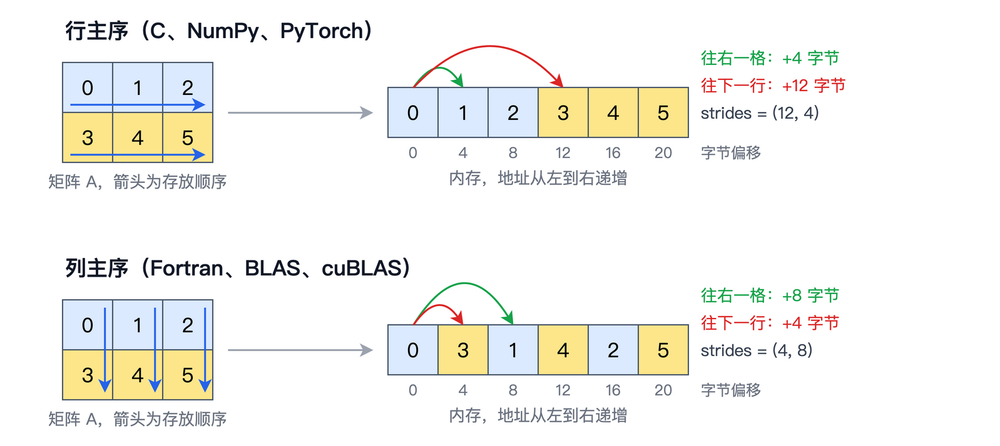

内存布局为什么重要？回到点积视角的三重循环，看最内层的 $k$ 循环：它沿着 $\mathbf{A}$ 的一行往右走，访问的地址是连续的；同时沿着 $\mathbf{B}$ 的一列往下走，每一步都要跳过一整行。在数学上，这两种访问没有任何区别；但对硬件来说，连续访问和跳跃访问的速度可能相差很多倍。第2章我们会在CPU上亲眼看到，仅仅调换循环的顺序，计算量一点没变，速度却能差出好几倍；第7章则会在GPU上遇到同样的问题，只是换了一个名字，叫做访存合并。


### 本书的基准问题

为了让每一章的进步都能被量化，我们约定一个贯穿全书的基准问题：

- **问题**：计算 $\mathbf{C} = \mathbf{A}\mathbf{B}$ ，三个矩阵都是 $n \times n$ 的方阵，采用行主序存储。
- **规模**： $n$ 从1024取到8192，主要关注 $n = 4096$ 。在纯Python等很慢的实现上，会改用较小的规模。
- **数据类型**：前三部分使用FP32。第四部分引入FP16、BF16等低精度格式，到时候再扩展基准。
- **数据**：矩阵元素取标准正态分布的随机数。
- **正确性**：每个实现的结果都要和一个可靠的参考结果比对，误差在允许范围内才算正确。
- **速度**：测出一次矩阵乘法的耗时 $t$ （秒），换算成 $2n^3 / t$ ，单位是GFLOPS或TFLOPS。

光有GFLOPS还不够，因为同样是1000GFLOPS，在一台笔记本上可能已经接近极限，在一块数据中心GPU上可能还不到百分之一。所以每个实现除了记录GFLOPS，还要记录它达到了所在硬件理论峰值的百分之多少。理论峰值怎么算，是第3章的内容。

从下一章开始，每一章结束时，我们都会在同一张基准表里添上几行，记录本章实现的成绩。这张表从CPU上的Python三重循环开始，最终会走到GPU上的Tensor Core。回头看这张表，就能看到一个矩阵乘法是怎样一步步变快的。


### 本章小结

这一章我们只讨论了矩阵乘法本身，没有涉及任何硬件。矩阵乘法的定义只有一个公式，但可以从三个视角来理解：点积视角让每个输出元素独立计算，天然适合并行；外积视角让取出的数据被反复使用；分块视角把大矩阵乘法拆成小矩阵乘法，是后面所有优化的核心思想。三种视角的结果在数学上相同，在浮点运算中可能因为累加顺序不同而有微小差异。

一个 $n \times n$ 的矩阵乘法要做 $2n^3$ 次浮点运算，却只需要搬运 $3n^2$ 个元素。计算量比数据量增长得快，平均每个字节对应 $n/6$ 次运算，这是矩阵乘法能被大幅加速的根本原因。但朴素的实现会反复读取同一份数据，实际搬运量远远超过理想值。

矩阵乘法是BLAS中的GEMM，也是深度学习中绝大部分计算的来源，所以值得花一整本书去优化它。矩阵在内存中有行主序和列主序两种布局，借助步长，转置可以不搬运数据。最后，我们约定了全书的基准问题：FP32的方阵乘法，以GFLOPS和峰值占比衡量速度。

下一章，我们就在CPU上把这个基准问题跑起来，从最慢的Python三重循环开始，看看同一个算法的不同写法，速度能差多少。

<div style="page-break-after: always;"></div>

## 第 2 章　在CPU上算矩阵乘法

上一章我们把矩阵乘法这个问题本身弄清楚了：一个 $n \times n$ 的矩阵乘法要做 $2n^3$ 次浮点运算，速度用GFLOPS来衡量。我们还约定了一个贯穿全书的基准问题。这一章，我们就在CPU上把这个基准问题跑起来。

这一章会从最慢的写法出发，一步一步换成更快的写法。所有写法做的都是同一个计算，浮点运算次数一次不多、一次不少，但最慢的和最快的之间，速度相差了上千倍。我们先用纯Python写一个三重循环，学会怎样测速；然后把它翻译成C语言，看看编译器能帮多少忙；接着调换循环的顺序，第一次体会到访存对速度的影响；再打开SIMD，让一条指令同时处理多个数；然后认识CPU的缓存，用分块的办法把数据留在缓存里；之后用上多个CPU核心；最后看看NumPy为什么比我们写的所有版本都快。

本章的随书代码在`code/ch02/`目录下。`matmul.c`实现了C语言的几个版本，`make`可以编译出三个程序，分别对应三种编译选项；`python_loop.py`和`numpy_bench.py`是两个Python脚本；`bench.sh`会一次跑完本章的全部实验，把结果写进`results.txt`。本章引用的所有数字都来自这个文件。

这些数字是在我的笔记本电脑上测的，CPU是Intel Core i7-9750H，6个核心，12个线程。笔记本的性能会随温度、电源和后台程序明显波动，同一个实验前后跑两次，相差一两倍也不奇怪。为了减小波动，较快的实验我都跑了好几遍，取最快的一次。即便如此，你在自己的机器上跑出的数字肯定会不一样，也不必在意个位数上的差别，重点是数量级，以及不同写法之间相差多少倍。


### Python三重循环

我们从最直接的写法开始，也就是第1章点积视角里的那个三重循环。`python_loop.py`中的实现如下：

```python
def matmul(A, B):
    n = len(A)
    C = [[0.0] * n for _ in range(n)]
    for i in range(n):
        for j in range(n):
            s = 0.0
            for k in range(n):
                s += A[i][k] * B[k][j]
            C[i][j] = s
    return C
```

测速的方法很简单：记下开始和结束的时间，二者相减得到耗时 $t$ ，再用 $2n^3 / t$ 换算成每秒的浮点运算次数。Python中计时要用`time.perf_counter()`，它的精度比`time.time()`高，也不会因为系统校正时钟而跳变。运行这个脚本，结果如下：

```
n=64      0.016 秒  0.0324 GFLOPS  与NumPy的最大差异 8.9e-15
n=128     0.118 秒  0.0354 GFLOPS  与NumPy的最大差异 2.5e-14
n=256     1.267 秒  0.0265 GFLOPS  与NumPy的最大差异 7.1e-14
```

最后一列说明结果是对的，和NumPy算出来的只差最后几位。速度则只有每秒0.03GFLOPS左右，也就是每秒三千万次浮点运算。这个数字听上去不小，但换算一下就知道有多慢：按这个速度，第1章约定的 $n = 4096$ 的基准问题要算1374亿次，需要大约一个半小时；就连 $n = 2048$ 也要十多分钟。所以，纯Python版本只测到 $n = 256$ 为止。

顺便一提，Python的浮点数是64位的双精度数，也就是FP64，对应C语言里的`double`；而本书的基准问题用的是32位的FP32。这一点对Python版本的速度几乎没有影响，因为它慢的原因根本不在浮点运算上。最内层那一行`s += A[i][k] * B[k][j]`，在CPU看来远不止一次乘法和一次加法：解释器要逐条解释字节码，要两次查列表的下标，要从Python的浮点对象里取出数值，算完再包装成新的浮点对象。真正的乘加只占其中极小的一部分，大部分时间都花在了解释器的这些杂务上。


### 换成C语言

要去掉解释器的开销，最直接的办法是换成编译型语言。`matmul.c`里的第一个版本，就是把上面的Python代码原样翻译成C语言：

```c
void matmul_ijk(int n, const float *A, const float *B, float *C) {
    for (int i = 0; i < n; i++)
        for (int j = 0; j < n; j++) {
            float sum = 0.0f;
            for (int k = 0; k < n; k++)
                sum += A[i * n + k] * B[k * n + j];
            C[i * n + j] = sum;
        }
}
```

矩阵按第1章说的行主序存放在一维数组里，所以 $a_{ik}$ 写成`A[i * n + k]`。按 $i$ 、 $j$ 、 $k$ 三个下标的循环顺序，我们把这个版本叫做ijk版本。从这一节开始，C语言版本都在 $n = 2048$ 上测量，这个规模下三个矩阵一共48MiB，已经比CPU的缓存大得多，后面会看到这一点很重要。

对C程序来说，速度和编译选项关系很大。`Makefile`用clang编译出了几个程序，其中`matmul_O0`使用`-O0`，也就是不做任何优化；`matmul`使用`-O2`，这是最常用的优化级别（这里还额外关掉了自动向量化，原因下一节再说）。两个程序运行ijk版本的结果如下：

```
ijk      n=2048  bs=64   threads=1     117.224 秒      0.15 GFLOPS
ijk      n=2048  bs=64   threads=1      56.748 秒      0.30 GFLOPS
```

即使不开优化，C语言版本也比Python快了5倍多；打开`-O2`之后，速度又翻了一倍，达到0.30GFLOPS。不开优化时，编译器会老老实实地把`sum`、`i`、`j`、`k`这些变量放在内存里，每用一次就读一次、写一次；开了优化，它们就都待在CPU的寄存器里，循环里多余的计算也被省掉了。

但0.30GFLOPS依然很慢。这颗CPU每个核心每秒能完成几十亿次乘加，而我们的程序每秒只做了一亿五千万次乘加。下一节会看到，问题出在一个看上去完全无关的地方：循环的顺序。


### 循环顺序

在第1章，我们看到点积视角和外积视角的代码几乎一样，只是循环的顺序不同。三重循环一共有六种排列方式，它们算出来的结果完全相同，计算量也完全相同。我们把ijk版本中 $j$ 和 $k$ 两层循环对调，得到ikj版本：

```c
void matmul_ikj(int n, const float *A, const float *B, float *C) {
    memset(C, 0, sizeof(float) * n * n);
    for (int i = 0; i < n; i++)
        for (int k = 0; k < n; k++) {
            float a = A[i * n + k];
            for (int j = 0; j < n; j++)
                C[i * n + j] += a * B[k * n + j];
        }
}
```

这个版本先取出一个 $a_{ik}$ ，然后用它乘以 $\mathbf{B}$ 的第 $k$ 行，累加到 $\mathbf{C}$ 的第 $i$ 行上。同样用`-O2`编译，运行结果如下：

```
ikj      n=2048  bs=64   threads=1       4.640 秒      3.70 GFLOPS
```

从0.30GFLOPS到3.70GFLOPS，只是调换了两行代码的顺序，速度就提高了12倍。原因就在第1章讲过的内存布局上。看ijk版本的最内层循环：每走一步， $k$ 加一，`A[i * n + k]`在 $\mathbf{A}$ 的一行上往右挪一个位置，访问是连续的；但`B[k * n + j]`是在 $\mathbf{B}$ 的一列上往下走，每一步都要跳过一整行，也就是2048个float、8KiB。ikj版本的最内层循环则是 $j$ 在变，`C[i * n + j]`和`B[k * n + j]`都在各自的一行上往右走，访问全是连续的。

下图把两个版本的最内层循环画了出来，浅色的格子是最内层循环走一轮会碰到的元素，箭头是访问的方向。ijk版本里，红色箭头沿着 $\mathbf{A}$ 的一行往右走，绿色箭头却沿着 $\mathbf{B}$ 的一列往下走， $\mathbf{C}$ 从头到尾只用一个元素；ikj版本里， $\mathbf{A}$ 只用一个元素，绿色和橙色两个箭头都沿着一行往右走。矩阵在内存里按行存放，沿一行走，就是沿着内存地址连续地走；沿一列走，每一步都要跳过一整行。

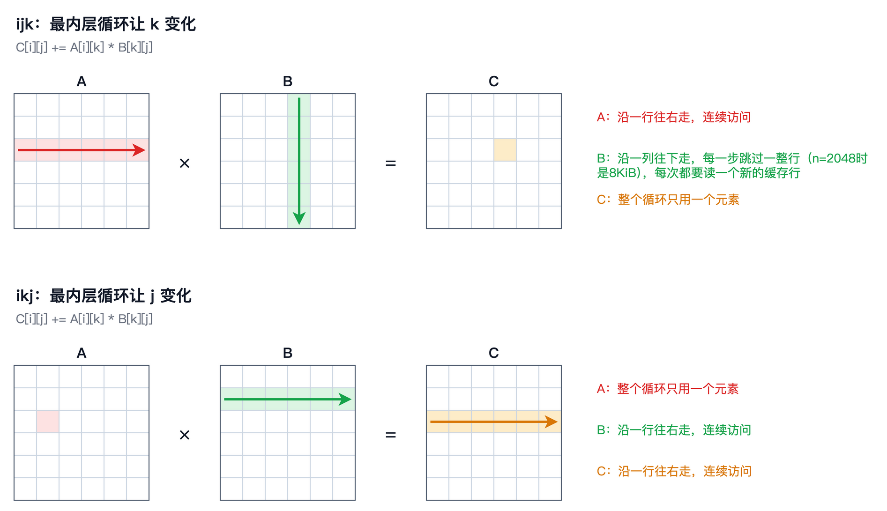

图里只画了最内层循环的一轮。想看完整的过程，可以打开随书代码里的`tools/loop-order/`，和第1章的工具一样，用浏览器直接打开`index.html`就能用。页面上可以在六种循环顺序之间切换，一步一步地播放。除了三个矩阵，它还把每个矩阵按行主序摊成一维数组，用箭头标出每一步访问的地址比上一步跳了多远，并统计连续访问和跳跃访问各有多少次。切到ijk， $\mathbf{B}$ 每一步都在跳；切到ikj， $\mathbf{B}$ 和 $\mathbf{C}$ 几乎全是连续的。六种顺序里，ijk就是第1章的点积视角，kij就是外积视角。kij和ikj只差最外面两层的顺序，最内层循环的访存完全一样，区别在于kij每一轮都要把整个 $\mathbf{C}$ 读写一遍，ikj则只盯着 $\mathbf{C}$ 的一行。

为什么连续访问会快这么多？这是因为CPU从内存读数据时，一次读一整块，叫做**缓存行**（Cache Line），在这颗CPU上是64字节，正好装得下16个float。读来的缓存行会暂存在CPU内部的**缓存**（Cache）里，下次再访问同一块数据，就不用再去内存了。连续访问时，读一次缓存行，接下来的15个float都可以直接从缓存里取；而跳跃访问时，每读一个float都要换一个新的缓存行，读进来的64字节只用上了4字节，其余的全浪费了。

这是我们第一次亲眼看到：计算量一点没变，仅仅因为访问内存的方式不同，速度就能差出一个数量级。这个现象会贯穿全书。在GPU上，同样的问题换了一个名字，叫做访存合并，第7章会专门讨论。


### SIMD

现代CPU还有一个提速的手段，叫做**SIMD**（Single Instruction, Multiple Data），意思是一条指令同时处理多个数据。x86 CPU上的SIMD指令是一代一代扩展出来的：早期的SSE使用128位的寄存器；AVX（Advanced Vector Extensions）把寄存器加宽到256位；AVX2是AVX的第二版，2013年随Intel的Haswell架构推出，AMD的CPU后来也支持；更新的AVX-512则加宽到512位。这颗CPU支持AVX2，它的寄存器有256位宽，可以同时装下8个float，一条指令就能把8对float同时相加或相乘。它还支持FMA（Fused Multiply-Add）指令，一条指令完成一次乘法加一次加法。二者结合，一条指令就能完成8次乘加，也就是16次浮点运算。

上一节的`matmul`程序特意用`-fno-vectorize`关掉了编译器的自动向量化，所以它只用普通的标量指令，一次算一个数。现在换成`matmul_simd`，它用`-O3 -march=native`编译，`-march=native`允许编译器使用本机CPU支持的全部指令，包括AVX2和FMA。用`objdump`反汇编ikj版本的最内层循环，可以看到下面这样的指令：

```
vmovups	-0x20(%r9,%rsi), %ymm3
vmovups	(%r9,%rsi), %ymm4
vfmadd213ps	-0x60(%r12,%rsi), %ymm0, %ymm1 ## ymm1 = (ymm0 * ymm1) + mem
vfmadd213ps	-0x40(%r12,%rsi), %ymm0, %ymm2 ## ymm2 = (ymm0 * ymm2) + mem
vfmadd213ps	-0x20(%r12,%rsi), %ymm0, %ymm3 ## ymm3 = (ymm0 * ymm3) + mem
vfmadd213ps	(%r12,%rsi), %ymm0, %ymm4 ## ymm4 = (ymm0 * ymm4) + mem
```

其中，`ymm`开头的就是256位的寄存器，`vfmadd213ps`就是对8个float同时做乘加的FMA指令。编译器还把循环展开了4次，一轮循环处理32个float。我们一行代码都没改，只是换了编译选项，编译器就自动把ikj版本的内层循环改写成了SIMD指令。在 $n = 2048$ 上测量的结果却有点让人失望：

```
ijk      n=2048  bs=64   threads=1      72.830 秒      0.24 GFLOPS
ikj      n=2048  bs=64   threads=1       4.013 秒      4.28 GFLOPS
```

可以看到，ikj版本只从3.70GFLOPS提高到4.28GFLOPS，几乎没有变化。ijk版本则根本没有用上SIMD，这是因为它的内层循环是把 $n$ 个乘积累加到同一个`sum`上，要向量化，就得把这些加法分成8组同时进行，最后再合并，这会改变加法的顺序。第1章说过，浮点数的加法不满足结合律，改变顺序就可能改变结果，所以编译器不敢擅自这样做。ikj版本没有这个问题，它的内层循环是对 $\mathbf{C}$ 一行中的不同元素分别做乘加，彼此独立，怎么并行都不影响结果。

那为什么ikj版本用上了SIMD，却没有变快呢？换成小一点的矩阵试试：

```
ikj      n=256   bs=64   threads=1       0.008 秒      4.07 GFLOPS
ikj      n=256   bs=64   threads=1       0.002 秒     22.13 GFLOPS
ikj      n=512   bs=64   threads=1       0.070 秒      3.82 GFLOPS
ikj      n=512   bs=64   threads=1       0.012 秒     22.88 GFLOPS
```

每个规模的两行，前一行是标量版本，后一行是SIMD版本。在 $n = 256$ 和 $n = 512$ 时，SIMD让速度提高了5到6倍，效果非常明显。可到了 $n = 2048$ ，这个提升就消失了。这说明在大矩阵上，瓶颈已经不在计算了：计算单元在等数据，算得再快也没有用。


### 缓存与分块

要理解大矩阵为什么慢，得先认识CPU的**内存层次**（Memory Hierarchy）。CPU和内存之间，隔着好几级缓存：离计算单元越近，速度越快，容量越小。这颗CPU每个核心有自己的一级缓存（L1 Cache，数据部分32KiB）和二级缓存（L2 Cache，256KiB），6个核心还共享一个12MiB的三级缓存（L3 Cache），再往外才是16GiB的内存。后面把这三级缓存分别简称为L1、L2、L3。从L1读数据只需要几个时钟周期，从内存读则要上百个时钟周期。

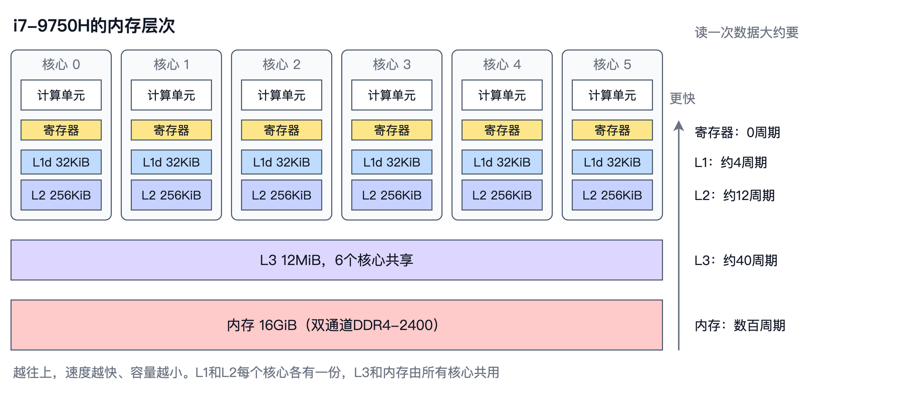

现在回头看ikj版本。计算 $\mathbf{C}$ 的第 $i$ 行时， $k$ 从0走到 $n-1$ ，每一步都要读 $\mathbf{B}$ 的一整行，所以算完 $\mathbf{C}$ 的一行，就把整个 $\mathbf{B}$ 从头到尾读了一遍。下一行又要把整个 $\mathbf{B}$ 再读一遍。 $\mathbf{B}$ 放得进缓存时，这没什么问题，从第二行开始， $\mathbf{B}$ 都可以从缓存里读；可一旦 $\mathbf{B}$ 大到放不进缓存，每一行都只能重新从内存里读。在 $n = 2048$ 时， $\mathbf{B}$ 有16MiB，已经超过了12MiB的L3。而最内层循环每做一次乘加（2次浮点运算），就要读一个4字节的 $b_{kj}$ ，4.28GFLOPS相当于每秒从内存读8.6GB的数据，这差不多就是单个核心能从内存拿到数据的极限了。

解决的办法，就是第1章介绍过的分块视角。我们把三个矩阵都切成 $bs \times bs$ 的小块，每次只算一个小块对另一个小块的贡献。在算这一对小块的时候，用到的数据只有三个小块，可以全部放进缓存，在缓存里被反复使用。`matmul.c`中的分块版本如下：

```c
for (int ii = 0; ii < n; ii += bs)
    for (int kk = 0; kk < n; kk += bs)
        for (int jj = 0; jj < n; jj += bs)
            for (int i = ii; i < ii + bs; i++)
                for (int k = kk; k < kk + bs; k++) {
                    float a = A[i * n + k];
                    for (int j = jj; j < jj + bs; j++)
                        C[i * n + j] += a * B[k * n + j];
                }
```

为了看得清楚，这里省略了矩阵尺寸不是 $bs$ 的整数倍时的边界处理，完整代码见`matmul.c`。外面三层循环挑出一对小块，里面三层循环就是一个小号的ikj版本。当 $bs = 64$ 时，一个小块是 $64 \times 64$ 个float，16KiB，三个小块加起来48KiB，可以放进L2。 $\mathbf{B}$ 的一个小块载入缓存之后，会被 $\mathbf{A}$ 的一个小块的64行反复使用，而不是用一次就被挤出去。

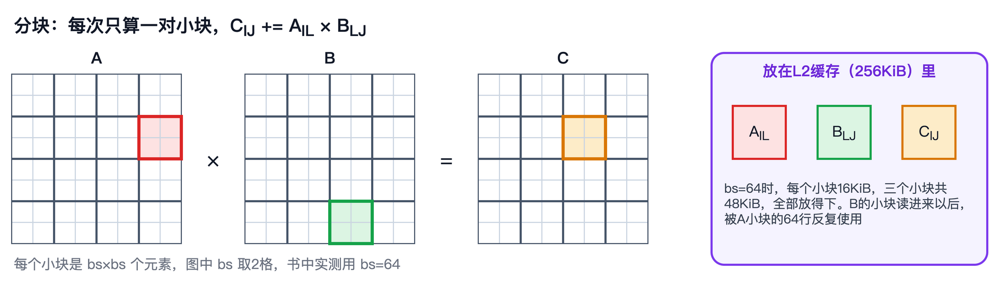

下面是ikj版本和分块版本（ $bs = 64$ ）在不同规模上的对比，两者都用`-O3 -march=native`编译：

```
ikj      n=256   bs=64   threads=1       0.001 秒     26.11 GFLOPS
blocked  n=256   bs=64   threads=1       0.002 秒     20.64 GFLOPS
ikj      n=512   bs=64   threads=1       0.012 秒     23.08 GFLOPS
blocked  n=512   bs=64   threads=1       0.014 秒     19.81 GFLOPS
ikj      n=1024  bs=64   threads=1       0.283 秒      7.60 GFLOPS
blocked  n=1024  bs=64   threads=1       0.141 秒     15.28 GFLOPS
ikj      n=2048  bs=64   threads=1       4.014 秒      4.28 GFLOPS
blocked  n=2048  bs=64   threads=1       1.283 秒     13.39 GFLOPS
ikj      n=4096  bs=64   threads=1      33.076 秒      4.16 GFLOPS
blocked  n=4096  bs=64   threads=1      11.434 秒     12.02 GFLOPS
```

从结果来看，ikj版本在矩阵较小时很快，在 $n = 1024$ 时开始掉速，到 $n = 2048$ 以后就稳定在4GFLOPS出头。 $n = 1024$ 时 $\mathbf{B}$ 只有4MiB，按说放得进12MiB的L3，但L3是6个核心和所有程序共用的，实际能留给我们的没有那么多。分块版本在小矩阵上反而稍慢一点，因为这时数据本来就在缓存里，多出来的三层循环只是额外的开销；但它在大矩阵上一直保持在12到15GFLOPS，是ikj版本的3倍左右。

块大小也会影响速度。在 $n = 2048$ 上试了几种块大小：

```
blocked  n=2048  bs=16   threads=1      11.866 秒      1.45 GFLOPS
blocked  n=2048  bs=32   threads=1       1.356 秒     12.67 GFLOPS
blocked  n=2048  bs=64   threads=1       1.557 秒     11.03 GFLOPS
blocked  n=2048  bs=128  threads=1       1.480 秒     11.61 GFLOPS
blocked  n=2048  bs=256  threads=1       1.111 秒     15.46 GFLOPS
```

块大小从32到256，速度都在11到15GFLOPS之间，彼此的差别还不如测量本身的波动大（同样是 $bs = 64$ ，这里测出11.03，上面测出13.39）。唯独 $bs = 16$ 慢得出奇，只有1.45GFLOPS。原因藏在前面那段汇编里：编译器生成的SIMD循环一轮要处理32个float，而块大小为16时，最内层循环一共只有16次，凑不满一轮，于是只能退回到逐个计算的标量代码。可见块大小既要小到放得进缓存，又要大到不妨碍SIMD发挥作用。

分块是这一章最重要的思想，我们会在GPU上再见到它。第8章在GPU上做分块时，“快的存储”从缓存换成了GPU上的共享内存，但道理完全相同：把一小块数据搬到快的地方，在那里尽可能多地使用它。


### 多线程

到目前为止，我们的程序都只用了一个CPU核心，而这颗CPU有6个核心。要把它们都用上，最简单的办法是把 $\mathbf{C}$ 的行平均分给几个线程，每个线程负责其中一段，各自做分块计算。不同线程写的是 $\mathbf{C}$ 中不同的行，互不干扰，不需要任何同步。`matmul.c`用pthread实现了这个版本，核心部分只有几行：

```c
for (int t = 0; t < nt; t++) {
    task[t] = (Task){n, bs, n * t / nt, n * (t + 1) / nt, A, B, C};
    pthread_create(&tid[t], NULL, worker, &task[t]);
}
for (int t = 0; t < nt; t++) pthread_join(tid[t], NULL);
```

每个线程负责第`n * t / nt`行到第`n * (t + 1) / nt`行。在 $n = 2048$ 、 $bs = 64$ 时，不同线程数的结果如下：

```
threads  n=2048  bs=64   threads=1       1.334 秒     12.88 GFLOPS
threads  n=2048  bs=64   threads=2       0.672 秒     25.57 GFLOPS
threads  n=2048  bs=64   threads=3       0.524 秒     32.78 GFLOPS
threads  n=2048  bs=64   threads=6       0.349 秒     49.30 GFLOPS
threads  n=2048  bs=64   threads=12      0.332 秒     51.73 GFLOPS
```

用2个线程时，速度几乎正好翻倍；但到了6个线程，速度只是单线程的3.8倍，而不是6倍。原因有好几个：多个核心要共享L3和内存带宽；同时工作的核心越多，CPU为了控制发热，主频也会降得越多；而我的笔记本上同时还开着别的程序。至于12个线程，它用上了CPU的**超线程**（Hyper-Threading），让每个核心同时运行两个线程，但同一个核心上的两个线程共用同一套计算单元，所以速度几乎没有提高。总之，多线程把我们的最好成绩推到了50GFLOPS左右。这已经是Python版本的近两千倍了，但离NumPy还有不小的距离。


### NumPy为什么快

最后，我们看看NumPy。用NumPy算矩阵乘法只需要一行代码`A @ B`，`numpy_bench.py`测量了它在FP32下的速度。NumPy默认会使用全部CPU核心，脚本可以用环境变量限制线程数，下面分别是单线程和默认线程数的结果：

```
NumPy 2.5.4，BLAS：accelerate unknown，线程数：1
n=512      0.006 秒      41.6 GFLOPS
n=1024     0.053 秒      40.3 GFLOPS
n=2048     0.431 秒      39.9 GFLOPS
n=4096     2.694 秒      51.0 GFLOPS
NumPy 2.5.4，BLAS：accelerate unknown，线程数：默认
n=512      0.001 秒     202.4 GFLOPS
n=1024     0.012 秒     177.5 GFLOPS
n=2048     0.106 秒     161.9 GFLOPS
n=4096     0.832 秒     165.2 GFLOPS
```

在 $n = 2048$ 上，NumPy单线程大约40GFLOPS，是我们单线程分块版本的3倍；多线程大约160GFLOPS，也是我们多线程版本的3倍。这两组数字的波动也很大，我在不同时候测过几次，单线程的结果从40到100GFLOPS都出现过，但无论哪一次，NumPy都明显快于我们自己写的版本。而且，它在大矩阵上也不掉速，显然没有被缓存的问题困住。

实际上，NumPy本身并不实现矩阵乘法。它把这个计算交给第1章提到的BLAS库，调用其中的单精度矩阵乘法函数`sgemm`。BLAS只是一套接口标准，实现它的库有很多：Linux上的NumPy通常使用开源的OpenBLAS，Intel提供了MKL，而在macOS上，NumPy使用的是苹果自带的Accelerate，上面的输出就显示了这一点。这些库都花了大量的工夫，为各种CPU专门调优矩阵乘法。

它们用到的技术，在Goto和van de Geijn的论文《Anatomy of High-Performance Matrix Multiplication》（ACM Transactions on Mathematical Software，2008）中有详细的描述，主要有以下几点：

- **多级分块**（Multi-level Blocking）：不只分一次块，而是针对L1、L2、L3各级缓存的容量分别选择块的大小，让每一级缓存里都放着最该被复用的数据。
- **打包**（Packing）：计算前先把要用的小块复制到一块连续的内存里，并按照计算的顺序重新排列。这样做多花了一次复制，但之后的访问全是连续的。
- **寄存器分块**（Register Blocking）与**微内核**（Micro-kernel）：最内层用手工编写的汇编代码，一次计算 $\mathbf{C}$ 的一个小块，例如 $6 \times 16$ 个元素，把它们全部放在寄存器里。每次从 $\mathbf{A}$ 取一列中的6个数、从 $\mathbf{B}$ 取一行中的16个数，做一次外积，累加到这96个元素上。读进寄存器的每个数都被用了很多次，计算单元几乎不用等数据。
- **多线程**：在多个层次上划分任务，让多个核心协同工作，同时尽量减少它们对缓存和内存带宽的争抢。

其中第三点值得多说一句。我们的ikj版本和分块版本，每做一次乘加，都要从缓存里读一个 $b_{kj}$ ，再读写一次 $c_{ij}$ ；而微内核让 $\mathbf{C}$ 的小块一直留在寄存器里，每读进一个数就用上十几次。这正是第1章外积视角的用法：数据取一次、用很多次。分块解决的是内存和缓存之间的问题，寄存器分块解决的是缓存和计算单元之间的问题。到了GPU上，我们会在第8章和第9章，把这两层分块再各做一遍。


### 基准表

到这里，我们可以把第1章约定的基准表填上第一批数据了。除了Python版本只测到 $n = 256$ ，其余都是 $n = 2048$ 的结果：

| 版本 | 规模 | GFLOPS |
|---|---|---|
| Python三重循环 | $n = 256$ | 0.03 |
| C，ijk，`-O0` | $n = 2048$ | 0.15 |
| C，ijk，`-O2` | $n = 2048$ | 0.30 |
| C，ikj，`-O2` | $n = 2048$ | 3.70 |
| C，ikj，SIMD | $n = 2048$ | 4.28 |
| C，分块，SIMD | $n = 2048$ | 13.39 |
| C，分块，SIMD，6线程 | $n = 2048$ | 49.30 |
| NumPy，单线程 | $n = 2048$ | 39.9 |
| NumPy，多线程 | $n = 2048$ | 161.9 |

从第一行到最后一行，速度提高了六千多倍；就算从C语言的第一个版本算起，也有一千多倍。而这些版本做的浮点运算次数完全一样。第1章说过，基准表里除了GFLOPS，还要记录它达到了硬件理论峰值的百分之多少。这颗CPU的理论峰值是多少，NumPy离它还有多远，我们自己写的版本又差在哪里，这些问题要等下一章学会计算峰值和画roofline之后才能回答。


### 本章小结

这一章，我们在CPU上把同一个矩阵乘法写了好几遍，速度从0.03GFLOPS一路提高到160GFLOPS左右，而浮点运算的次数始终没变。纯Python慢在解释器的开销上，换成C语言并打开编译优化，就能快上十倍。调换循环的顺序，让最内层循环连续地访问内存，又快了十多倍，因为CPU总是以64字节的缓存行为单位读取内存。打开SIMD之后，一条指令可以同时完成8次乘加，小矩阵快了5到6倍，大矩阵却几乎没有变化，因为瓶颈已经从计算转移到了访存上。分块让数据留在缓存里反复使用，解决了大矩阵的访存问题；多线程则把6个核心都用了起来。

至于NumPy，它把矩阵乘法交给BLAS库，后者用多级分块、打包、寄存器分块的微内核和多线程，把CPU的潜力发挥得比我们好得多。贯穿这一切的，是同一个道理：计算本身很便宜，搬运数据才是昂贵的；要算得快，就要让数据待在离计算单元近的地方，并且尽可能多地使用它。

下一章，我们暂时不写新的代码，而是从硬件参数出发，算出一颗芯片最快能有多快，并用roofline模型把“计算”和“访存”这两种瓶颈放在同一张图上来看。

<div style="page-break-after: always;"></div>

## 第 3 章　性能的天花板

上一章，我们在CPU上把矩阵乘法写了好几遍，最慢的0.03GFLOPS，最快的160GFLOPS左右。但这些数字到底算快还是算慢，我们其实说不清楚。160GFLOPS离这颗CPU的极限还有多远？分块版本为什么停在了13GFLOPS，再往上的阻碍是什么？还有上一章留下的那个疑问：SIMD让小矩阵快了5到6倍，为什么对大矩阵几乎没有作用？

这一章就来回答这些问题。我们暂时不写新的矩阵乘法，而是从硬件出发，搞清楚一颗芯片有两块“天花板”：一块是它每秒最多能做多少次浮点运算，叫做**峰值算力**（Peak Performance）；另一块是它每秒最多能从内存搬运多少数据，叫做**内存带宽**（Memory Bandwidth）。然后，我们引入算术强度的概念，把这两块天花板拼成一张图，这就是roofline模型。有了这张图，任何一段程序是被计算卡住还是被访存卡住，离天花板还有多远，都可以一眼看出来。

本章的随书代码在`code/ch03/`目录下。`peak.c`和`bandwidth.c`是两个小测试程序，分别实测峰值算力和内存带宽；`bench.sh`会把它们都跑一遍，结果写进`results.txt`；`plot_roofline.py`读取这份结果和上一章的结果，画出本章的roofline图。和上一章一样，书中引用的数字都来自这两个结果文件。


### 峰值算力

先看第一块天花板。峰值算力说的是一颗芯片每秒最多能做多少次浮点运算，这个上限由硬件决定，程序写得再好也不可能超过它。它取决于三样东西：有几个核心，每个核心的时钟跑多快，每个核心在一个时钟周期里能完成多少次浮点运算。三者相乘，就得到估算峰值算力的公式：

$$
\text{峰值算力} = \text{核心数} \times \text{主频} \times \text{每个核心每个时钟周期的浮点运算次数}
$$

前两项很容易查到。我的CPU是Intel Core i7-9750H，有6个核心，标称主频2.6GHz。第三项要看CPU的微架构。上一章说过，这颗CPU支持AVX2和FMA指令，一条FMA指令可以对8个float同时做乘加，也就是16次浮点运算。而它的每个核心里有两个能执行FMA指令的计算单元，每个时钟周期各能完成一条。所以，每个核心每个时钟周期最多可以完成 $2 \times 8 \times 2 = 32$ 次单精度浮点运算。

代入公式，峰值算力是 $6 \times 2.6 \times 32 = 499.2$ GFLOPS。不过，这个数字并不准确，因为主频不是一个固定的值。现代CPU有**睿频**（Turbo Boost）功能，在温度和功耗允许时会自动提高主频，这颗CPU单核最高可以达到4.5GHz；但同时工作的核心越多，发热越大，能维持的主频就越低。所以，它的“理论峰值”取决于你按哪个主频来算，从499.2GFLOPS到 $6 \times 4.5 \times 32 = 864$ GFLOPS都说得通，后者是在所有核心都跑在最高主频时才能达到的，实际上做不到。

既然理论值说不清楚，不如直接测。`peak.c`的思路很简单：让CPU反复执行大量FMA指令，既不访问内存，也不做别的事情，看看每秒能完成多少次浮点运算。它的核心循环如下：

```c
for (long i = 0; i < ITERS; i++)
    for (int c = 0; c < CHAINS; c++) {
        acc[c] = _mm256_fmadd_ps(acc[c], x, y);
        __asm__ volatile("" : "+x"(acc[c]));
    }
```

代码中的`_mm256_fmadd_ps`，是AVX2的FMA指令在C语言里的写法，它对8个float同时计算`acc * x + y`。这里有两个细节。第一，循环里同时维护了 $\text{CHAINS} = 12$ 个互不相关的累加器。一条FMA指令从开始到出结果需要4个时钟周期，如果只有一个累加器，下一条FMA必须等上一条算完才能开始，两个计算单元大部分时间都在空等。至少要有 $4 \times 2 = 8$ 条互不依赖的FMA同时在执行，才能把两个计算单元都喂饱。第二，那行`__asm__ volatile`是写给编译器看的，它不产生任何指令，作用是阻止编译器发现这个循环的结果没什么用，从而把整个循环优化掉。我第一次写这个程序时就没有加它，结果测出了每秒几百万亿次运算，显然是循环根本没有执行。

用`bench.sh`跑一遍，结果如下：

```
scalar threads=1     0.314 秒      15.3 GFLOPS
avx2   threads=1     0.313 秒     122.7 GFLOPS
avx2   threads=2     0.322 秒     238.3 GFLOPS
avx2   threads=3     0.341 秒     337.5 GFLOPS
avx2   threads=6     0.381 秒     605.3 GFLOPS
avx2   threads=12    0.732 秒     629.7 GFLOPS
```

第一行是标量FMA，一条指令只算一个数；后面几行是AVX2的FMA，线程数从1到12。单核的122.7GFLOPS除以32，相当于主频3.83GHz，说明单核运行时，CPU处在睿频状态。6个核心一起跑时是605.3GFLOPS，平均到每个核心，相当于主频3.15GHz，比单核时低了不少。标量和SIMD正好差8倍左右，这就是一条指令同时算8个数的效果。12个线程比6个线程几乎没有提高，原因和上一章一样，超线程并不增加计算单元。

本书以后就把实测的这两个数，当作这颗CPU实际可以达到的峰值：单核122.7GFLOPS，6核605.3GFLOPS。注意，要达到这个峰值，需要同时满足好几个条件：用上SIMD，用上FMA，有足够多互不依赖的运算，用上所有核心。少了任何一条，天花板就会低很多。比如上一章那个关掉了自动向量化的`matmul`程序，它的单核天花板只有标量FMA的15.3GFLOPS，而且它的代码里乘法和加法是分开的，连这个数也达不到。


### 内存带宽

第二块天花板是内存带宽，也就是每秒能在内存和CPU之间搬运多少字节。它同样可以从硬件参数估算：

$$
\text{内存带宽} = \text{通道数} \times \text{每个通道的位宽} \times \text{每秒传输次数}
$$

这台电脑插了两条DDR4-2400的内存，组成双通道。DDR4每个通道的位宽是64位，也就是8个字节；“2400”是指每秒传输2400百万次（系统信息里常常把它写成2400 MHz，其实单位应该是MT/s）。所以理论带宽是 $2 \times 8 \times 2400 \times 10^6 = 38.4 \times 10^9$ 字节每秒，也就是38.4GB/s。注意这里的GB是 $10^9$ 字节，而不是 $2^{30}$ 字节的GiB，带宽习惯上都用前者。

同样，我们也实测一下。`bandwidth.c`分配了三个各256MiB的数组，远远大于12MiB的L3，所以每次访问都要真正读写内存。它测了三种操作：只读（把一个数组的所有元素加起来）、复制（把一个数组复制到另一个）、向量加法（把两个数组逐个相加，写进第三个）。结果如下：

```
read  threads=1    0.0182 秒    14.7 GB/s
read  threads=6    0.0122 秒    22.0 GB/s
copy  threads=1    0.0401 秒    13.4 GB/s
copy  threads=6    0.0328 秒    16.4 GB/s
add   threads=1    0.0607 秒    13.3 GB/s    1.10 GFLOPS
add   threads=6    0.0601 秒    13.4 GB/s    1.12 GFLOPS
```

只读时，单个核心能达到14.7GB/s，6个核心一起读能达到22.0GB/s，大约是理论值的57%。实测带宽达不到理论值是常态，内存控制器的调度、刷新等都会占用一部分；单个核心则受限于它同时能发出的读请求数量，拿不满整个带宽。复制和向量加法测出的带宽更低一些，这是因为CPU往内存写数据时，通常要先把目标所在的缓存行读进缓存，再修改、写回，实际搬运的字节数比程序“看上去”的要多。所以，我们就把只读的结果当作这台机器实际可以达到的带宽：单核14.7GB/s，6核22.0GB/s。

现在把两块天花板放在一起比较一下。6个核心每秒能做605.3G次浮点运算，却只能从内存读22.0G个字节，也就是5.5G个float。换句话说，从内存里读来的每一个float，平均要参与110次浮点运算，计算单元才不会闲着。这就是现代硬件的基本处境：计算很便宜，搬运数据很昂贵。上一章反复看到的现象，根源就在这里。


### 算术强度

一段程序能不能喂饱计算单元，取决于它每搬运一个字节的数据，要做多少次浮点运算。这个比值叫做**算术强度**（Arithmetic Intensity），单位是FLOP/字节：

$$
\text{算术强度} = \frac{\text{浮点运算次数}}{\text{在内存和芯片之间搬运的字节数}}
$$

第1章其实已经算过两个例子。两个长度为 $n$ 的FP32向量相加，要做 $n$ 次加法，读两个向量、写一个向量，一共搬运 $12n$ 个字节，算术强度是 $1/12$ ，而且不管 $n$ 多大都不会变。 $n \times n$ 的矩阵乘法要做 $2n^3$ 次运算，最少只需搬运 $12n^2$ 个字节，算术强度是 $n/6$ ，矩阵越大，算术强度越高。 $n = 2048$ 时，它是341 FLOP/字节，远远超过上一节算出的110次运算每float，也就是27.5 FLOP/字节。

但是要注意， $n/6$ 只是矩阵乘法这个算法在理想情况下的算术强度，前提是每个元素只从内存读一次。程序实际达到的算术强度，取决于它怎样访问数据。同一个矩阵乘法，不同的写法，实际搬运的字节数可以相差几百倍。我们来估算一下上一章几个版本在 $n = 2048$ 时的实际算术强度。

先看ijk版本。它的最内层循环沿着 $\mathbf{B}$ 的一列往下走，每一步都要读一个新的64字节缓存行，却只用到其中的4个字节。 $\mathbf{A}$ 的那一行是连续访问的，可以忽略。所以，它每做一次乘加（2次浮点运算），就要从内存搬运64个字节，算术强度只有 $2/64 = 1/32$ 。

再看ikj版本。上一章分析过，它每算 $\mathbf{C}$ 的一行，就要把整个 $\mathbf{B}$ 读一遍，而 $\mathbf{B}$ 有16MiB，放不进缓存。 $\mathbf{C}$ 的那一行只有8KiB，一直待在缓存里。所以它每做一次乘加，要从内存读一个4字节的 $b_{kj}$ ，算术强度是 $2/4 = 1/2$ 。

最后看分块版本。块大小为 $bs$ 时， $\mathbf{B}$ 的每个小块被读进缓存之后，会被 $bs$ 行反复使用，所以整个 $\mathbf{B}$ 只需从内存读 $n/bs$ 遍，而不是 $n$ 遍。 $\mathbf{C}$ 的每一块也要读写 $n/bs$ 遍。粗略地说，总的搬运量大约是 $3 \times (n/bs) \times n^2$ 个float，也就是 $12n^3/bs$ 个字节，算术强度大约是 $bs/6$ 。 $bs = 64$ 时，大约是10.7 FLOP/字节。

这三个估算都比较粗糙，但足以说明问题：从ijk到ikj再到分块，算术强度从 $1/32$ 提高到 $1/2$ ，再提高到10.7，每一步都提高了一个数量级以上。上一章的每一次提速，本质上都是在提高程序实际的算术强度。


### Roofline模型

有了峰值算力、内存带宽和算术强度，就可以算出一段程序最快能有多快。设峰值算力为 $P$ ，内存带宽为 $B$ ，程序的算术强度为 $I$ 。一方面，程序的速度不可能超过 $P$ ；另一方面，它每秒最多只能拿到 $B$ 个字节的数据，每个字节对应 $I$ 次运算，所以速度也不可能超过 $B \times I$ 。二者取较小的一个：

$$
\text{可达到的性能} = \min(P, \; B \times I)
$$

以算术强度为横轴，性能为纵轴，把这个公式画出来，就是**roofline模型**，它由Williams、Waterman和Patterson在2009年的论文《Roofline: An Insightful Visual Performance Model for Multicore Architectures》（Communications of the ACM）中提出。两个坐标轴通常都取对数刻度，这样 $B \times I$ 是一条斜线， $P$ 是一条水平线，二者连起来，就像一个屋顶，roofline这个名字就是这么来的。

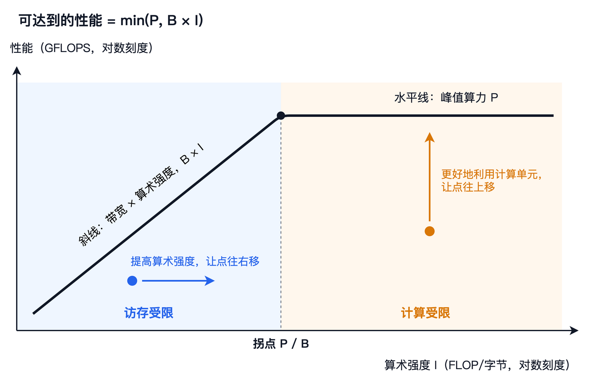

斜线和水平线的交点叫做**拐点**（Ridge Point），它对应的算术强度是 $P / B$ 。拐点把整张图分成两半：

- 算术强度低于拐点的程序落在斜线下面，叫做**访存受限**（Memory-Bound）。它的速度由内存带宽决定，计算单元再快也没有用。要提速，只能减少搬运的数据，也就是提高算术强度，让点往右移。
- 算术强度高于拐点的程序落在水平线下面，叫做**计算受限**（Compute-Bound）。它的速度上限由峰值算力决定。要提速，就要更好地利用计算单元，让点往上移。

对我的CPU来说，6核的拐点是 $605.3 / 22.0 \approx 27.5$ FLOP/字节，就是前面说的“每个float要参与110次运算”；单核的拐点是 $122.7 / 14.7 \approx 8.3$ FLOP/字节。算术强度低于这个值的程序，无论怎么优化计算部分，都不可能达到峰值。


### 把程序放到roofline上

现在，我们把上一章的几个版本，连同本章测量的向量加法，都放到这颗CPU的roofline上。`plot_roofline.py`画出了下面这张图。图中实线是6核的屋顶，虚线是单核的屋顶；红色圆点是单线程的程序，应该和虚线比较，蓝色方块是多线程的程序，应该和实线比较：

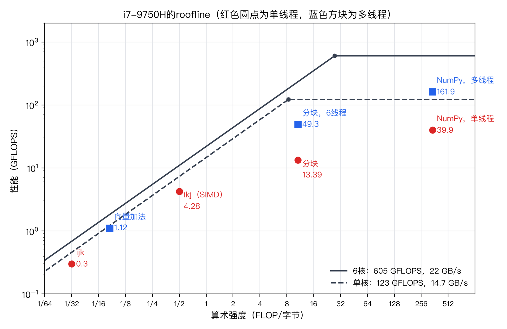

这个脚本还算出了每个点离它的屋顶有多远：

```
向量加法         算术强度    0.083  实测    1.12  屋顶     1.8  达到屋顶的  61.1%
ijk          算术强度    0.031  实测    0.30  屋顶     0.5  达到屋顶的  65.3%
ikj（SIMD）    算术强度    0.500  实测    4.28  屋顶     7.3  达到屋顶的  58.2%
分块           算术强度   10.667  实测   13.39  屋顶   122.7  达到屋顶的  10.9%
分块，6线程       算术强度   10.667  实测   49.30  屋顶   234.7  达到屋顶的  21.0%
NumPy，单线程    算术强度  341.333  实测   39.90  屋顶   122.7  达到屋顶的  32.5%
NumPy，多线程    算术强度  341.333  实测  161.90  屋顶   605.3  达到屋顶的  26.7%
```

先看左下角的三个点。向量加法、ijk和ikj都落在斜线下方，而且都达到了屋顶的六成左右，这说明它们都是访存受限的，速度基本由内存带宽决定。向量加法用了6个线程，也只有1.12GFLOPS，因为它的屋顶只有1.8GFLOPS，不管怎么优化都不可能更快；而且前面说过，写数据时实际搬运的字节比程序“看上去”的多，它的实际算术强度比 $1/12$ 还要低。ijk版本的估算屋顶是0.46GFLOPS，实测0.30GFLOPS，二者相当接近，这说明“每次乘加读一整个缓存行”这个估算是靠谱的。

上一章留下的疑问，在这里也有了答案。ikj版本在 $n = 2048$ 时的屋顶只有 $14.7 \times 0.5 = 7.3$ GFLOPS，而不打开SIMD时，它已经跑到了3.70GFLOPS。打开SIMD只是抬高了水平那部分屋顶，可ikj版本根本不在水平线下面，它头顶上是那条斜线，所以SIMD几乎帮不上忙。而小矩阵能放进缓存，数据不必从内存搬运，内存带宽这块天花板对它不起作用，SIMD的效果就充分体现出来了。

再看分块版本。它的算术强度大约是10.7，已经越过了单核的拐点8.3，进入了计算受限的区域，屋顶是122.7GFLOPS。可它实际只跑到了13.39GFLOPS，不到屋顶的11%。它既没有碰到斜线，也离水平线很远，这说明拖住它的是第三样东西。上一章其实已经提到了：它每做一次乘加，都要从L1读一个 $b_{kj}$ ，读一个 $c_{ij}$ ，再写回 $c_{ij}$ ，一共三次访存，缓存和寄存器之间的搬运成了新的瓶颈。我们这张图只画了内存这一层的带宽，看不到缓存这一层的天花板。如果把L1、L2的带宽也画成斜线，就能看到它。这种多层的roofline也很常用，本书就不展开了。解决的办法，就是上一章介绍的寄存器分块：让 $\mathbf{C}$ 的一小块一直留在寄存器里。

最右边是NumPy。它的算术强度我们按理想值 $n/6$ 画在了341的位置上，实际会低一些，但肯定远远越过了拐点，是计算受限的。单线程版本达到了单核屋顶的32.5%，多线程版本达到了6核屋顶的26.7%。这个比例比我预想的要低，可能和这台笔记本的散热有关，也可能是Accelerate库在这颗老CPU上调优得不够好。上一章说过，NumPy的测量结果波动很大，我在机器状态较好时，测到过单线程100GFLOPS以上、多线程400GFLOPS以上，那就相当于屋顶的八成和七成左右了。

至于Python版本，它只有0.03GFLOPS，比图上所有的点都低得多。它既不受内存带宽限制，也不受峰值算力限制，瓶颈在解释器上，roofline模型对它没有什么意义。

从这张图可以得出一个重要的结论：矩阵乘法“天生”适合加速，因为它的理想算术强度 $n/6$ 很高，远远超过拐点，有资格冲到计算受限的水平线下面。但这只是资格，不是结果。一个实现能不能用上这个资格，取决于它是否真的让数据被反复使用。ijk、ikj和分块版本算的是同一个矩阵乘法，在图上却分布在相差几百倍的不同位置。优化矩阵乘法的过程，就是先想办法让点往右移，越过拐点；再想办法让点往上移，贴近屋顶。


### 补全基准表

现在可以给上一章的基准表补上峰值占比这一列了。这里统一以整颗CPU的实测峰值605.3GFLOPS为基准，单线程版本的峰值占比因此天然不会超过五分之一左右，因为一个核心最多只能贡献122.7GFLOPS：

| 版本 | 规模 | GFLOPS | 峰值占比 |
|---|---|---|---|
| Python三重循环 | $n = 256$ | 0.03 | 0.004% |
| C，ijk，`-O0` | $n = 2048$ | 0.15 | 0.025% |
| C，ijk，`-O2` | $n = 2048$ | 0.30 | 0.050% |
| C，ikj，`-O2` | $n = 2048$ | 3.70 | 0.61% |
| C，ikj，SIMD | $n = 2048$ | 4.28 | 0.71% |
| C，分块，SIMD | $n = 2048$ | 13.39 | 2.2% |
| C，分块，SIMD，6线程 | $n = 2048$ | 49.30 | 8.1% |
| NumPy，单线程 | $n = 2048$ | 39.9 | 6.6% |
| NumPy，多线程 | $n = 2048$ | 161.9 | 26.7% |

看了这一列，上一章那些看上去很大的提速倍数，就显得没那么了不起了。我们自己写得最好的版本，也只用上了这颗CPU不到十分之一的计算能力。


### 本章小结

这一章，我们认识了一颗芯片的两块天花板。峰值算力等于核心数、主频和每周期运算次数三者的乘积，我的CPU实测单核122.7GFLOPS、6核605.3GFLOPS，前提是用上SIMD、FMA和所有核心。内存带宽等于通道数、位宽和传输速率三者的乘积，理论值38.4GB/s，实测单核14.7GB/s、6核22.0GB/s。二者一比，从内存读来的每个float都要参与110次运算，计算单元才不会闲着。

算术强度是一段程序每搬运一个字节所做的浮点运算次数。roofline模型把峰值算力、内存带宽和算术强度画在同一张图上：可达到的性能等于峰值算力与“带宽乘以算术强度”二者中较小的一个。拐点左边是访存受限，右边是计算受限。矩阵乘法的理想算术强度是 $n/6$ ，远远越过拐点，但实际的算术强度取决于实现。ijk、ikj和分块三个版本，实际算术强度从 $1/32$ 提高到10.7，正好解释了上一章它们之间的速度差距，也解释了为什么SIMD对大矩阵上的ikj版本没有作用。

到这里，第一部分就结束了。我们有了一个问题，一张基准表，和一个分析性能的工具。下一章，我们终于要转向GPU。我们会用同样的方法，算出一块GPU的峰值算力和内存带宽，你会看到，它的两块天花板都比CPU高出一个数量级以上，而它们之间的比例，也就是拐点的位置，却和CPU处在同一个量级。

<div style="page-break-after: always;"></div>

## 第 4 章　为什么是GPU

前三章，我们在CPU上把矩阵乘法从0.03GFLOPS一路推到了160GFLOPS左右，也弄清楚了这颗CPU的两块天花板：6个核心的实测峰值算力是605.3GFLOPS，内存带宽是22.0GB/s。就算我们写出和NumPy一样好的代码，把计算单元喂得满满的，算一次 $n = 4096$ 的基准问题也要227毫秒。要想再快一个数量级，就得换一种硬件。

这一章，我们认识这种硬件：GPU。本书选用的实验GPU，是Google Colab免费提供的NVIDIA T4（2018年发布，基于Turing架构），读者不花钱就能复现书中的所有实验。这一章还不写代码，先回答三个问题：GPU的设计思路和CPU有什么不同，一块GPU由哪些部分组成，以及它和CPU怎样配合工作。最后，我们用上一章的方法算出T4的两块天花板，画出它的roofline，和CPU放在一起比较。

本章的随书代码在`code/ch04/`目录下。`specs.py`根据T4的规格参数，算出本章用到的所有数字，只依赖Python标准库；`plot_roofline.py`把CPU和T4的roofline画在同一张图上。T4的参数来自NVIDIA的T4数据手册和Turing架构白皮书。


### CPU的设计取舍

先回头看看我们熟悉的CPU。它要运行操作系统、浏览器、编辑器、编译器，这些程序大多是一条接一条的指令，后一条往往要用到前一条的结果，中间夹着大量的条件判断和函数调用。对于这样的程序，最重要的是让每一条指令尽快完成，用户点一下鼠标，界面就要马上有反应。从发出一个请求到得到结果所花的时间，叫做**延迟**（Latency）。CPU的设计目标，就是降低单个任务的延迟。

为了这个目标，CPU在每个核心里放了很多“聪明”的部件。第一是主频高：这颗i7-9750H单核能跑到4.5GHz，每个时钟周期都很短。第二是大容量的缓存：第2章看到，它每个核心有32KiB的L1和256KiB的L2，6个核心还共享12MiB的L3，尽量让数据在需要时已经在手边，避免花上百纳秒去内存里取。第三是**乱序执行**（Out-of-Order Execution）：如果下一条指令要等数据，CPU会先去执行后面那些不相关的指令，不让计算单元闲着。第四是**分支预测**（Branch Prediction）：遇到`if`时，CPU不等条件算出来，就先猜一个方向执行下去，猜对了就省下等待的时间，猜错了再撤销。

这些部件都很有用，但它们占用了大量的芯片面积和功耗，而且它们本身并不做任何浮点运算。真正做运算的，是第3章数过的那些FMA单元：每个核心两个，每个一次处理8个float。整颗CPU加起来，每个时钟周期最多做 $6 \times 32 = 192$ 次浮点运算。芯片的大部分面积，花在了让这192次运算尽量不停顿上，而不是用来增加运算的次数。

下面这张示意图把CPU和GPU的芯片面积分配画在了一起。左边的CPU有6个核心，每个核心里，橙色的控制逻辑（取指令、译码、乱序执行、分支预测等）和蓝色的缓存占了大半，绿色的计算单元只有小小的两块。右边的GPU正好反过来：绿色的计算单元铺满了芯片，每一行只配了一小块控制逻辑和缓存，下一节会讲它为什么这样设计。图中的比例并非实测，只表示两者在面积分配上的倾向。

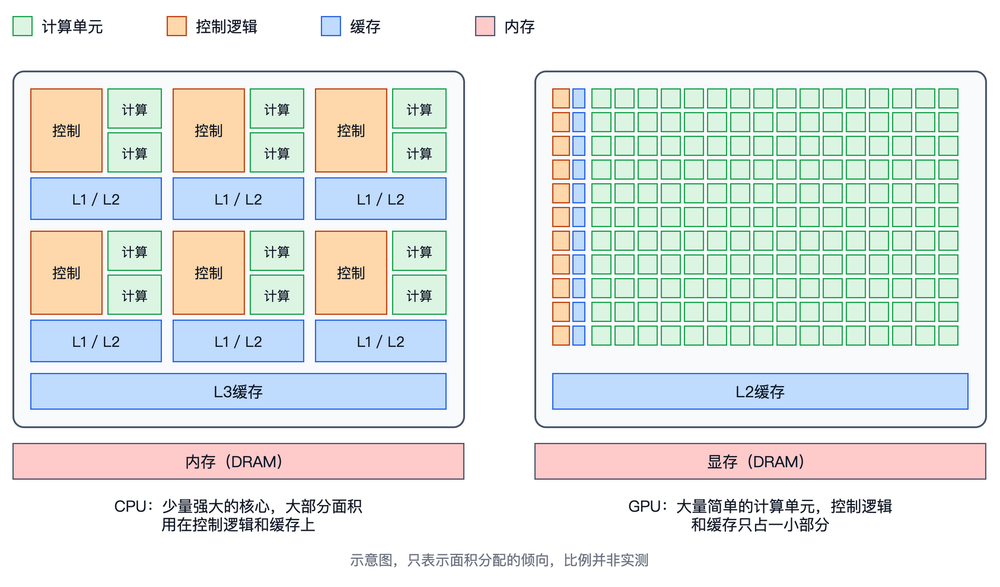

对于矩阵乘法这样的计算，CPU的很多“聪明”都用不上。矩阵乘法里几乎没有条件判断，分支预测器没什么可猜的；要做的运算一开始就全部确定了，彼此之间也几乎没有依赖，用不着乱序执行去发掘。它需要的只是大量的乘加运算，以及持续不断地把数据送到计算单元。


### GPU的设计取舍

最初，GPU是为图形渲染设计的。渲染一帧画面，要对几百万个像素分别计算颜色，每个像素的计算都差不多，彼此之间又几乎独立。这样的任务，在乎的是单位时间内一共完成多少工作，叫做**吞吐量**（Throughput）；至于其中某一个像素早算完几微秒还是晚算完几微秒，没有人关心。GPU的设计目标，就是提高整体的吞吐量。

所以，GPU把芯片面积的大头花在了计算单元上。每个计算单元都很简单，没有分支预测，也没有乱序执行，主频也比CPU低，T4最高只有1.59GHz。但它的数量非常多：T4一共有2560个FP32计算单元，每个时钟周期能完成 $2560 \times 2 = 5120$ 次浮点运算，是CPU的192次的26.7倍。

省掉了那些“聪明”的部件，一个问题就随之而来：计算单元要等数据怎么办？从显存里取一个数，要等几百个时钟周期。CPU的办法是用大缓存和乱序执行，尽量不让等待发生；GPU的办法是让等待发生，但在等待的同时去做别的事情。一块GPU上同时驻留着成千上万个线程，T4最多可以同时驻留40960个。某些线程在等数据时，硬件就切换到另一些数据已经到位的线程去执行，这个切换几乎没有代价。只要线程足够多，计算单元就总有活干。这种做法叫做**延迟隐藏**（Latency Hiding），它是理解GPU性能的一把钥匙，后面会反复遇到。

可以粗略估算一下，需要多少数据“在路上”才能把显存带宽用满。假设一次显存访问要等400个时钟周期（第6章会实测这个数字），在1.59GHz下大约是250纳秒。T4的显存带宽是每秒320GB，要在250纳秒的延迟下维持这个速度，任何时刻都要有大约 $320 \times 10^9 \times 250 \times 10^{-9} = 80000$ 字节，也就是80KB的数据正在从显存往芯片上送。一个线程一次只读几个字节，这就需要上万个读请求同时在路上，也就需要上万个线程。CPU上我们最多开12个线程，在GPU上，几万个线程才是常态。

当然，这样的设计也有代价。单看一个线程，GPU比CPU慢得多：主频低，没有乱序执行，遇到分支还会互相拖累。如果一个任务没法拆成大量独立的小任务，放到GPU上反而会更慢。GPU擅长的，是矩阵乘法这样有海量独立运算、计算方式又很规整的任务。第1章说过，点积视角下 $\mathbf{C}$ 的 $M \times N$ 个元素彼此独立，基准问题里就有1600多万个，正好可以分给成千上万个线程同时去算。


### GPU的整体结构

现在来看一块GPU里面有什么。下面以T4为例，它基于NVIDIA的Turing架构。不同代际的GPU在细节上有很多变化，但整体结构大同小异。随书代码里有两个交互式小工具，用浏览器直接打开`index.html`就能用：`tools/t4-explorer/`从下面这张T4的全局图开始，可以一层一层点进去，一直看到SM、处理块、Tensor Core和寄存器文件，每个部件都附有说明和关键数字；`tools/gpu-arch/`则把NVIDIA数据中心GPU从Tesla到Blackwell的各代架构排成一列，用左右键切换，方便比较它们的异同。

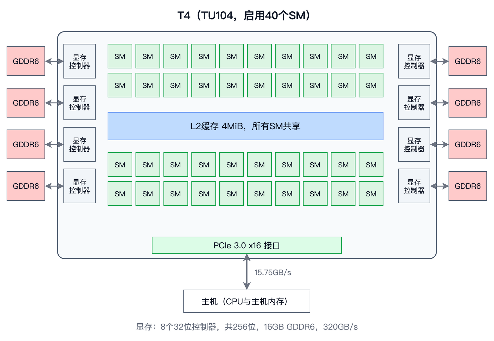

一块GPU的基本组成单位是**流式多处理器**（Streaming Multiprocessor，SM）。T4有40个SM，它们是完全相同的，大致可以看成40个“核心”。每个SM又分成4个**处理块**（Processing Block），每个处理块里有一个调度器、16个FP32计算单元、16个整数计算单元、2个Tensor Core，以及64KiB的寄存器文件。把这些数加起来，每个SM有64个FP32计算单元、8个Tensor Core和256KiB的寄存器文件。此外，每个SM还有96KiB的片上存储，可以按需划分成L1和**共享内存**（Shared Memory）。共享内存由程序员自己管理，是第8章优化矩阵乘法的主角。

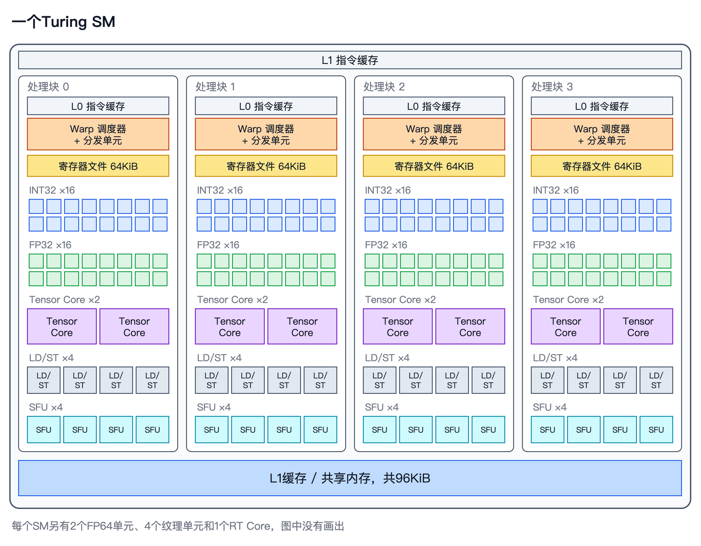

每个FP32计算单元，NVIDIA把它叫做一个**CUDA Core**，T4的2560个CUDA Core就是这么数出来的： $40 \times 64 = 2560$ 。这个名字容易让人误会，以为它和CPU的核心是一回事。其实一个CUDA Core只是一条能做乘加的运算通道，既没有自己的指令调度，也不能独立执行程序。更贴切的类比是：一个处理块相当于一个CPU核心，16个CUDA Core相当于这个核心的SIMD宽度。第2章的AVX2一次处理8个float，处理块则一次处理一组32个线程，叫做一个**warp**（中文资料里常译作“线程束”，本书沿用英文），分两个周期在16个通道上执行完。这样看，T4相当于一颗有160个核心、每个核心都带着很宽SIMD单元的处理器。warp是GPU执行的基本单位，第6章会详细讨论。

处理块里的**Tensor Core**，是专门为矩阵乘法设计的计算单元。一个CUDA Core每个周期做一次乘加，一个Tensor Core每个周期则能完成一次小矩阵乘法，在T4上相当于64次FP16乘加。T4一共有320个Tensor Core，FP16的峰值算力因此是FP32的8倍。这样的计算单元专门为矩阵乘法而生，这也从侧面说明了矩阵乘法在今天有多重要。不过它只接受FP16这样的低精度格式，用法也特殊，我们要到第12、13章才会用上它。

存储方面，最靠近计算单元的是寄存器。T4每个SM有256KiB寄存器，40个SM加起来是10MiB。作为对比，CPU每个线程能用的AVX2寄存器只有16个，一共512字节。GPU的寄存器总量甚至比它的L2还大，这是因为几万个线程各自都要有寄存器，切换线程时不需要保存和恢复，延迟隐藏才能几乎没有代价。再往外是每个SM各自的L1和共享内存，然后是所有SM共享的L2，T4上是4MiB。最外层是**显存**（Device Memory），T4配了16GB的GDDR6显存。数据中心的高端GPU用的是另一种显存，叫做**HBM**（High Bandwidth Memory），它把内存芯片和GPU封装在一起，带宽能高出好几倍。

和CPU对比一下，GPU的存储层次有一个明显的特点：越往外走，平均到每个计算单元的容量越小。CPU的每个核心有32KiB的L1、256KiB的L2，还能分到2MiB的L3；T4的每个SM带着64个计算单元，却只有96KiB的L1和共享内存，平均到每个SM的L2也只有100KiB左右。GPU不指望靠大缓存把数据留住，复用数据的责任，很大程度上落在了程序员身上。这正是第8到11章要做的事情。

最后，把T4和我们的CPU并排放在一起看看：

| | i7-9750H | T4 |
|---|---|---|
| 核心 | 6个核心 | 40个SM，2560个CUDA Core |
| 最高主频 | 4.5GHz | 1.59GHz |
| 每周期FP32运算次数 | 192 | 5120 |
| 同时运行的线程 | 12 | 最多40960 |
| 最大的片上缓存 | 12MiB（L3） | 4MiB（L2） |
| 内存 | 16GB DDR4，双通道 | 16GB GDDR6，256位 |
| 功耗 | 45W | 70W |

这块T4的功耗只有70W，算是一块小卡，主要用于推理。以它为实验卡，好处是任何人都能在Colab上免费用到；不足是它的架构比较老，没有新一代GPU上的一些硬件特性。第14章讲Hopper架构时，我们会另外租一块H100来做实验。


### CPU与GPU如何协作

一块GPU不能单独工作，它要插在一台电脑上，由CPU来指挥。在CUDA的术语里，CPU和它的内存叫做**主机**（Host），GPU和它的显存叫做**设备**（Device）。主机和设备各有各的内存，二者通过**PCIe**（Peripheral Component Interconnect Express）总线连接。GPU上的程序只能访问显存里的数据，不能直接读主机内存；反过来，CPU也不能直接读显存。

下图画出了这种分工。左边是主机，右边是设备，两边各有自己的内存，中间唯一的通道是PCIe，每秒15.75GB；而设备内部，GPU读写显存的带宽是每秒320GB。图中带编号的四个箭头，就是马上要说的四个步骤。

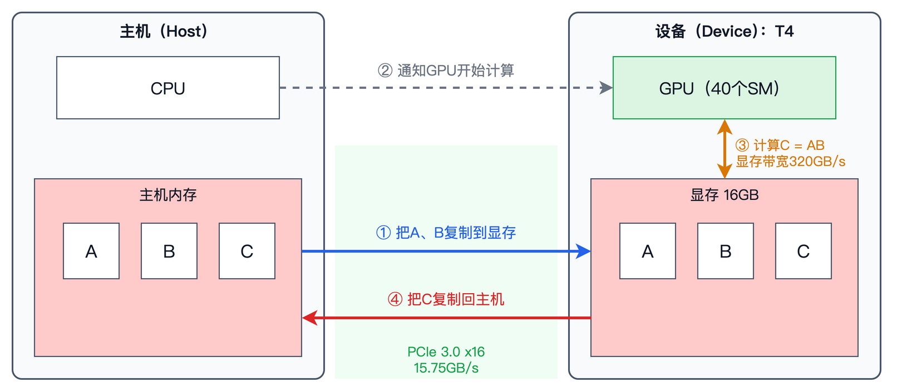

所以，在GPU上算一次矩阵乘法，一般要经过这样几步：CPU在显存里分配好三个矩阵的空间，把 $\mathbf{A}$ 和 $\mathbf{B}$ 从主机内存复制到显存，然后通知GPU开始计算，等GPU算完，再把 $\mathbf{C}$ 从显存复制回主机内存。第5章写第一个CUDA程序时，就是按这几步来写的。

这里面的复制是有代价的。T4用的是PCIe 3.0 x16接口，它有16条通道，每条每秒传输8G次，扣掉编码的开销，理论带宽是15.75GB/s，只有显存带宽的二十分之一。以基准问题为例，三个 $4096 \times 4096$ 的float矩阵一共192MiB，通过PCIe传一遍至少要12.8毫秒；而T4按FP32峰值算完这个矩阵乘法，只要16.9毫秒，两者差不多长。矩阵小一些，情况更糟：在 $n = 1024$ 时，传输要0.80毫秒，计算只要0.26毫秒，传输时间是计算时间的3倍。

道理和第1章算的一样：数据量随 $n^2$ 增长，计算量随 $n^3$ 增长，矩阵越大，传输的占比越小。实际应用中，常用的办法是让数据一直留在显存里。比如训练一个大模型，权重从头到尾都在显存里，一次矩阵乘法的输出直接作为下一次的输入，中间不用回到主机。所以，本书测量GPU上矩阵乘法的速度时，只统计计算本身的时间，不包括主机和设备之间的复制。但读者要记住这笔开销：如果数据要在CPU和GPU之间来回搬，GPU算得再快也可能白搭。


### GPU的roofline

现在用第3章的方法，算出T4的两块天花板。

先算峰值算力。公式和CPU一样，是计算单元个数、主频和每个单元每周期运算次数的乘积。T4有2560个FP32计算单元，每个每周期做一次乘加，也就是2次浮点运算，最高主频1.59GHz，所以FP32峰值算力是 $2560 \times 2 \times 1.59 = 8141$ GFLOPS，约8.1TFLOPS（1TFLOPS是1000GFLOPS）。Tensor Core的FP16峰值算力，是 $320 \times 64 \times 2 \times 1.59 = 65126$ GFLOPS，约65TFLOPS。这两个数和NVIDIA数据手册上写的一致。

再算显存带宽。公式也和CPU一样，是位宽和每秒传输次数的乘积。T4的显存位宽是256位，也就是32个字节；GDDR6每根数据线每秒传输100亿次。所以显存带宽是 $32 \times 10 = 320$ GB/s。

两个拐点也就随之确定。FP32的拐点是 $8141 / 320 = 25.4$ FLOP/字节，Tensor Core的拐点是 $65126 / 320 = 204$ FLOP/字节。把它们和CPU的roofline画在同一张图上：

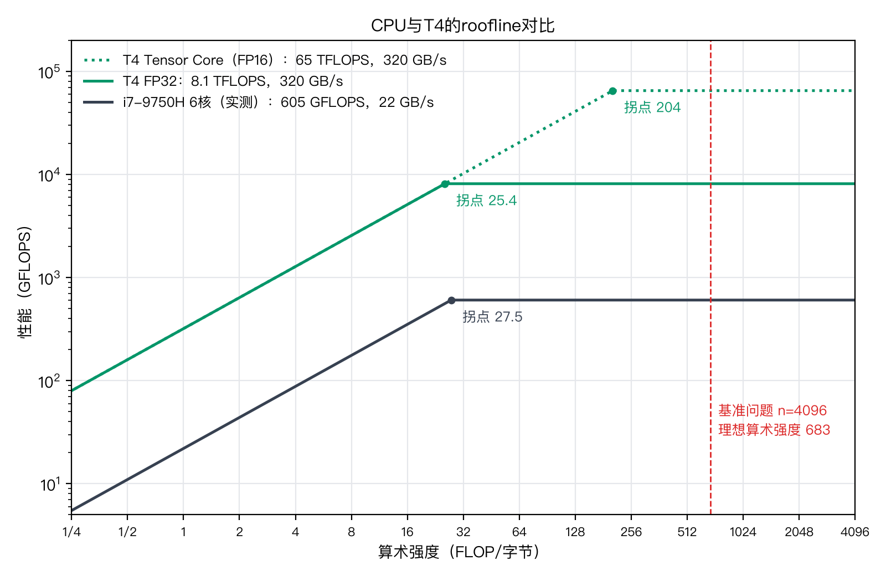

这张图里有三点值得注意。第一，两块天花板都整体抬高了一个数量级以上。T4的FP32峰值算力是CPU的13.4倍，显存带宽是CPU的14.5倍。也就是说，不管一段程序是访存受限还是计算受限，搬到GPU上都有机会快一个数量级。

第二，T4的FP32拐点是25.4，CPU是27.5，几乎在同一个位置。这并非巧合，算力和带宽是一起设计的，两者大体按同样的比例增长。所以，第3章关于算术强度的所有结论，在GPU上依然成立：ijk那样的写法，每个字节只做 $1/32$ 次运算，放到GPU上照样被死死压在斜线上；要想冲到水平线，算术强度同样要越过二十多。只是在GPU上，“慢”的代价更大：屋顶高了一个数量级，跑不到屋顶浪费掉的算力也多了一个数量级。

第三，Tensor Core把水平线又抬高了8倍，拐点也随之右移到204。这意味着要用满Tensor Core，算术强度要比用满CUDA Core高8倍。算力增长得比带宽快，这是近十年来GPU发展的总趋势，越新的GPU，拐点越靠右，对数据复用的要求也越高。

图中的红色虚线是基准问题的理想算术强度683，它远在三个拐点的右边。理论上，基准问题在T4上完全是计算受限的，按FP32峰值，16.9毫秒就能算完，比CPU的227毫秒快13倍多。这就是我们从第5章开始要追的目标。

要提醒的是，这里CPU的两块天花板是实测的，而T4的是按规格算出来的理论值。第3章看到，CPU的实测带宽只有理论值的57%，T4多半也一样。T4的功耗上限只有70W，满负荷运行时往往维持不住1.59GHz的最高主频，实际峰值算力也会打折扣。等到第5章，我们有了在GPU上运行代码的能力，再实测这两个数字。


### 本章小结

这一章，我们认识了GPU。CPU为降低单个任务的延迟而设计，把大量芯片面积花在缓存、乱序执行和分支预测上，计算单元相对较少；GPU为提高整体吞吐量而设计，把面积花在大量简单的计算单元上，靠同时驻留成千上万个线程来隐藏访存的延迟。矩阵乘法有海量独立的运算，计算方式又很规整，正是GPU擅长的任务。

一块GPU由许多个SM组成。T4有40个SM，每个SM有64个CUDA Core、8个Tensor Core、256KiB的寄存器文件和96KiB的L1与共享内存，所有SM共享4MiB的L2和16GB的GDDR6显存。CUDA Core只是一条运算通道，一个处理块更接近CPU的一个核心，它以32个线程组成的warp为单位执行指令。GPU和CPU各有各的内存，通过PCIe连接，数据传输的速度远低于显存带宽，所以数据要尽量留在显存里。

按规格计算，T4的FP32峰值算力是8.1TFLOPS，Tensor Core的FP16峰值算力是65TFLOPS，显存带宽是320GB/s。它的两块天花板都比CPU高出一个数量级以上，FP32拐点却和CPU几乎相同，所以第3章的分析方法可以原样搬到GPU上。下一章，我们打开Colab，写出第一个CUDA程序，在T4上把矩阵乘法跑起来。

<div style="page-break-after: always;"></div>

## 第 5 章　第一个CUDA程序

上一章，我们从规格表上认识了T4：40个SM，FP32峰值算力约8.1TFLOPS，显存带宽320GB/s。纸面上，它的两块天花板都比CPU高出一个数量级。这一章，我们第一次在GPU上写代码，把这些数字变成实际跑出来的结果。

本章会先搭好实验环境，然后用一个最简单的向量加法，认识CUDA的编程模型：主机和设备怎样分工，数据怎样在两块内存之间搬运，成千上万个线程怎样组织起来。接着，我们把第1章的点积视角搬到GPU上，写出一个朴素的矩阵乘法kernel，验证它算得对不对，学会正确地给它计时。最后，我们实测T4的峰值算力和显存带宽，兑现上一章“到第5章再实测”的承诺，并请出NVIDIA自己的矩阵乘法库cuBLAS，看看我们的朴素kernel离它有多远。

先说说标题里的CUDA。它是NVIDIA在2007年推出的GPU编程平台，全称是Compute Unified Device Architecture（统一计算设备架构），不过今天已经很少有人提这个全称了。CUDA包括对C++语言的扩展、编译器、运行时库，以及cuBLAS这样的数学库，本书的GPU程序都是用CUDA C++写的。在CUDA的术语里，在GPU上运行的函数叫做**kernel**（中文资料里常译作“核函数”，本书沿用英文），它和操作系统的内核没有关系，后面会细说。

本章的随书代码在`code/ch05/`目录下。`common.cuh`是几个程序共用的小工具，`vector_add.cu`是向量加法，`matmul.cu`是朴素kernel和cuBLAS，`peak.cu`和`bandwidth.cu`分别实测峰值算力和显存带宽。`bench.sh`把它们全部编译、运行一遍，结果写进`results.txt`，书中引用的数字都来自这个文件。


### 实验环境

本书的GPU实验都在Google Colab上完成。Colab是Google提供的在线**Jupyter Notebook**环境，免费版就能分到一块T4。这里的Notebook指的是一种交互式文档，由一个个单元格组成，代码和它的运行结果混排在一起，在浏览器里就能编辑和运行，和笔记本电脑无关。打开随书代码里的`code/ch05/colab.ipynb`，在菜单“代码执行程序”里把运行时类型改成T4 GPU，然后从上到下依次运行各个单元格即可：先用`nvidia-smi`看一眼分到的GPU，再上传本章的源文件，最后运行`bench.sh`。整个过程只要几分钟。

命令`nvidia-smi`是NVIDIA驱动自带的命令行工具，可以查看GPU的型号、显存、主频、温度和功耗。`bench.sh`在开头用它记录了这次实验的环境：

```
# GPU：Tesla T4, 580.82.07, 15360 MiB, 1590 MHz, 5001 MHz, 70.00 W
# CUDA：Cuda compilation tools, release 13.0, V13.0.88
# CPU：Intel(R) Xeon(R) CPU @ 2.00GHz，2个逻辑CPU
```

第一行依次是GPU型号、驱动版本、显存容量、SM的最高主频、显存的最高主频和功耗上限。显存显示为15360MiB而不是16GiB，是因为T4开启了ECC纠错，有十六分之一的显存用来存放校验位， $16384 \times 15 / 16 = 15360$ 。第二行是编译器`nvcc`的版本，它是CUDA工具包的一部分，负责把`.cu`源文件编译成GPU能执行的程序。第三行说明Colab分给我们的主机只有2个逻辑CPU，这对后面的实验没有影响，计算都在GPU上进行。

和第2、3章一样，每个实验都有一个可以单独运行的程序，用`make`编译。`Makefile`里给`nvcc`传了`-arch=sm_75`，意思是生成在计算能力7.5的GPU上运行的代码。**计算能力**（Compute Capability）是NVIDIA给每一代GPU架构编的版本号，Turing是7.5，Ampere是8.0和8.6，Hopper是9.0。


### 主机与设备

上一章说过，CPU和它的内存叫做主机，GPU和它的显存叫做设备，两边各有各的内存。所以，一个CUDA程序要做的第一件事，就是在显存里分配空间，再把数据从主机内存复制过去。`vector_add.cu`的主体是这样的：

```c
float *da, *db, *dc;
CHECK(cudaMalloc(&da, bytes));
CHECK(cudaMalloc(&db, bytes));
CHECK(cudaMalloc(&dc, bytes));

CHECK(cudaMemcpy(da, a, bytes, cudaMemcpyHostToDevice));
CHECK(cudaMemcpy(db, b, bytes, cudaMemcpyHostToDevice));

int blocks = (n + threads - 1) / threads;
vector_add<<<blocks, threads>>>(da, db, dc, n);

CHECK(cudaMemcpy(c, dc, bytes, cudaMemcpyDeviceToHost));
```

这几行代码和上一章画的四个步骤一一对应。`cudaMalloc`在显存里分配空间，用法和C语言的`malloc`差不多，只是分配到的地址指向显存，CPU不能直接读写。在CUDA的术语里，这样分配出来、所有线程都能访问的显存叫做**全局内存**（Global Memory），后面几章会经常用到这个说法。本书的习惯是给显存里的指针加一个前缀`d`（device），比如`da`，以免和主机内存里的`a`混淆。`cudaMemcpy`在两块内存之间复制数据，最后一个参数说明复制的方向。中间那一行`vector_add<<<blocks, threads>>>(...)`启动GPU计算，下一节详细解释。用完以后，再用`cudaFree`释放显存。

每个CUDA API调用都会返回一个错误码，`CHECK`是`common.cuh`里定义的一个宏，它检查这个错误码，出错时打印出错的位置并退出。GPU程序出错时常常不会崩溃，而是默默地算出一堆错误的结果，所以每个调用都检查一遍，是一个值得养成的习惯。

复制数据是有代价的。`vector_add`顺便测了一下复制的速度：

```
主机→设备  256MiB     58.748 毫秒       4.6 GB/s
设备→主机  256MiB     57.355 毫秒       4.7 GB/s
```

只有4.6GB/s左右，比上一章算出的PCIe 3.0 x16理论带宽15.75GB/s还低得多。一个原因是我们用`malloc`分配的是普通的主机内存，操作系统随时可能把它换出到磁盘，GPU不能直接从这样的内存里读数据，驱动要先把它复制到一块固定不动的内存里再传输，相当于多复制了一次。CUDA提供了`cudaMallocHost`来直接分配这种固定的内存，可以快不少，本书暂时用不到。无论如何，这个速度说明了上一章的结论：数据要尽量留在显存里，在主机和设备之间来回搬是很贵的。


### CUDA编程模型

在GPU上运行的函数叫做**kernel**。这个名字容易让人想到操作系统的内核，其实二者毫无关系。在高性能计算里，人们一向把程序中最核心、最耗时的那段计算叫做kernel，第2章提到的BLAS“微内核”（micro-kernel）就是这个意思。CUDA的直接来源是斯坦福大学2004年发布的Brook语言，它用GPU处理数据流，作用在数据流上的函数就叫kernel。Brook的作者Ian Buck后来加入NVIDIA，主导设计了CUDA，这个叫法也就沿用了下来。中文资料里有时把它译作“核函数”，本书直接称kernel，不做翻译。`vector_add.cu`里的kernel只有两行：

```c
__global__ void vector_add(const float *a, const float *b, float *c, int n) {
    int i = blockIdx.x * blockDim.x + threadIdx.x;
    if (i < n) c[i] = a[i] + b[i];
}
```

函数前面的`__global__`告诉编译器，这是一个kernel，它由CPU调用，在GPU上执行。除此之外，它看起来就是一个普通的C函数，只做了一件事：算出向量的一个元素。

关键在于，这个函数会被成千上万个线程同时执行，每个线程算一个元素。CUDA把这些线程组织成两个层次。若干个线程组成一个**线程块**（Thread Block），下文简称block；若干个block组成一个**网格**（Grid），下文简称grid。启动kernel时，尖括号里的两个数就是在说明这个组织方式：`<<<blocks, threads>>>`表示grid里有`blocks`个block，每个block里有`threads`个线程。

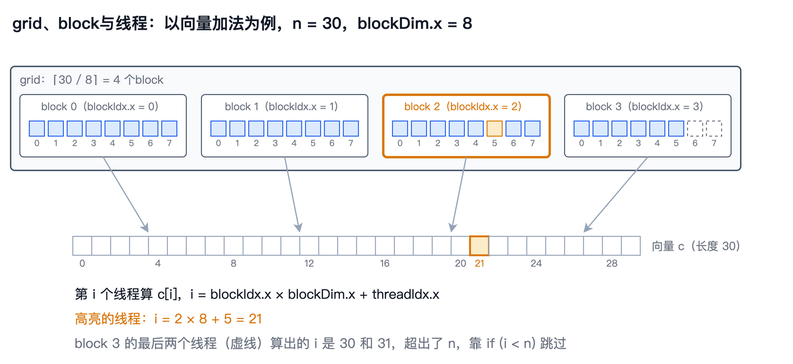

为什么要分两层？这和上一章讲的硬件结构有关。一个block里的所有线程，总是被放到同一个SM上执行，它们可以通过SM里的共享内存交换数据，也可以互相等待，第8章会用到这一点。不同的block之间则互不相干，GPU可以把它们以任意顺序分给任意的SM。这样一来，同一个程序既能在40个SM的T4上运行，也能在132个SM的H100上运行，SM越多，同时执行的block就越多，程序不用做任何修改。换句话说，block这一层把程序和硬件的规模解耦了：程序员只负责把工作切成许多个互不相干的block，至于同时执行多少个、按什么顺序执行，交给硬件决定。GPU因此可以一代一代地增加SM，而不必改写已有的程序，NVIDIA把这种性质叫做**自动可扩展性**（Automatic Scalability）。一个block里最多可以有1024个线程，grid里的block数则几乎没有限制。

每个线程执行的是同一段代码，那它怎么知道自己该算哪个元素呢？CUDA给每个线程提供了几个内置变量：`threadIdx`是线程在block里的编号，`blockIdx`是block在grid里的编号，`blockDim`是每个block有多少个线程，`gridDim`是grid里有多少个block。它们都有`.x`、`.y`、`.z`三个分量，可以组织成一维、二维或三维，向量加法只用到一维。所以，`blockIdx.x * blockDim.x + threadIdx.x`就是这个线程在整个grid里的编号：前面有`blockIdx.x`个完整的block，每个有`blockDim.x`个线程，再加上它在自己block里的编号。

为什么要有三个维度？这只是为了编号方便。处理矩阵或图像时，用行号和列号给线程编号，比用一个长长的序号直观得多；处理三维的体数据时，就用三个编号。硬件本身并不在乎维度，它总是把一个block里的线程按 $x$ 变化最快、 $y$ 其次、 $z$ 最慢的顺序排成一维，再依次32个一组分成warp。这个顺序在本章后面就会显出影响。本章的矩阵乘法会用到二维，第三个维度本书用得很少，比如同时计算一批矩阵乘法时，可以用 $z$ 方向的编号区分是第几个矩阵。

读到这里，名词已经不少了，有必要停下来理一理。这些名词分属两个层面。kernel、grid、block和线程是CUDA的软件概念，是程序员用来组织计算的：每启动一次kernel，就生成一个grid，它包含这次启动的全部线程；grid切成许多个block，每个block里再有许多个线程。上一章讲的SM、处理块和CUDA Core则是GPU的硬件，是真正执行计算的东西。两个层面的对应关系如下：

| 软件（程序里写的） | 硬件（执行它的） |
|---|---|
| 一次kernel启动，即一个grid | 整块GPU |
| 一个block | 一个SM，一个SM上可以同时驻留几个block |
| 32个线程组成的warp | 一个处理块，由其中的warp调度器发射 |
| 一个线程 | CUDA Core上的一条运算通道 |

这里面，warp正好处在两个层面的交界处。它是硬件发射指令的单位，程序里却不出现：CUDA代码只写一个block有多少个线程，硬件再把它们32个一组分成warp。所以，写程序时想的是grid、block和线程，分析性能时想的是SM和warp，第6章会把后者讲清楚。

最后一个细节是kernel里的`if (i < n)`。启动kernel时，block数是向上取整算出来的：`(n + threads - 1) / threads`。如果 $n$ 不是每个block线程数的整数倍，最后一个block里就会有几个多余的线程，它们算出的编号超出了向量的范围，必须什么都不做。这样的边界检查，几乎每个kernel里都会有。


### 第一个kernel：向量加法

现在运行`vector_add`。它的向量长度是 $2^{26}$ ，也就是6700多万个元素，每个向量256MiB。每个block取256个线程，一共需要 $2^{26} / 256 = 262144$ 个block。kernel只启动了一次，所以这26万多个block都属于同一个grid：

```
vector_add  n=67108864  block=256  grid=262144      3.056 毫秒     263.5 GB/s
检查：全部正确（0个元素不一致）
```

一共26万多个block、6700多万个线程，只花了3毫秒。这些block并不是同时在GPU上执行的：T4的每个SM最多同时驻留1024个线程，也就是4个这样的block，40个SM一次只能放下160个，其余的排队等待，前面的block做完一个，硬件就补上一个。GPU创建和调度线程的代价非常小，为每个元素启动一个线程是完全正常的做法，这和CPU上开线程的经验很不一样。程序最后把结果复制回主机，和CPU算的结果逐个比较，全部一致。浮点加法只做一次，不涉及运算顺序的问题，所以GPU和CPU的结果应该逐位相同。

速度怎么样？向量加法每个元素读两个数、写一个数，一共搬运12个字节，只做1次加法，算术强度只有 $1/12$ ，是一个典型的访存受限的程序。所以衡量它的指标是带宽：三个256MiB的向量，3.056毫秒搬完，相当于263.5GB/s。这已经接近T4的显存带宽了，本章后面实测的只读带宽是277.5GB/s。换句话说，这个只有两行的kernel，已经达到了实测带宽的95%。对于访存受限的程序，屋顶就是带宽，没有再快的余地了。

也可以从另一个角度看这个结果：同样的向量加法，第3章在CPU上用6个核心跑出了13.4GB/s，T4快了将近20倍。可如果算上前面的数据复制，两个输入向量传到显存就要将近120毫秒，结果传回来又要57毫秒，计算本身的3毫秒反而微不足道。在GPU上做这样一次向量加法，再把结果拿回来，其实比直接在CPU上算还慢。


### 朴素矩阵乘法kernel

现在把第1章的点积视角搬到GPU上：让每个线程算 $\mathbf{C}$ 的一个元素。 $\mathbf{C}$ 是一个二维的矩阵，所以线程也组织成二维的：每个block是一个 $32 \times 32$ 的线程方阵，grid也是一个二维的block方阵，正好覆盖整个 $\mathbf{C}$ 。`matmul.cu`中的朴素kernel如下：

```c
__global__ void matmul_naive(int n, const float *A, const float *B, float *C) {
    int i = blockIdx.x * blockDim.x + threadIdx.x;   // 行
    int j = blockIdx.y * blockDim.y + threadIdx.y;   // 列
    if (i < n && j < n) {
        float sum = 0.0f;
        for (int k = 0; k < n; k++)
            sum += A[i * n + k] * B[k * n + j];
        C[i * n + j] = sum;
    }
}
```

启动它的代码是这样的：

```c
dim3 block(bs, bs);
dim3 grid((n + bs - 1) / bs, (n + bs - 1) / bs);
matmul_naive<<<grid, block>>>(n, dA, dB, dC);
```

其中的`dim3`是CUDA里表示三维尺寸的类型，没写的分量默认是1。kernel里，线程用`.x`方向的编号算出自己负责第几行，用`.y`方向的编号算出第几列，然后用一个循环算出这一行和这一列的点积。和向量加法一样，矩阵的边长不一定是32的整数倍，所以要检查行号和列号都没有越界。

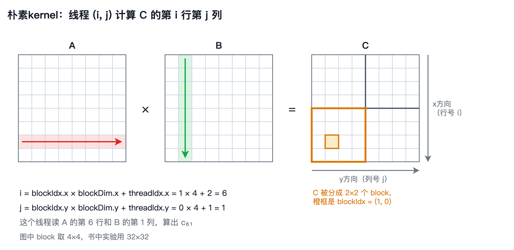

如果你把这个kernel和第2章的ijk版本对比，会发现最内层的循环一模一样，GPU版本只是把外面两层循环 $i$ 和 $j$ 去掉了，换成了线程的编号。原来要排着队一个一个算的 $n^2$ 个点积，现在由 $n^2$ 个线程同时去算。这就是GPU编程最基本的思路：找出彼此独立的工作，每份交给一个线程。

这里有一个细节，现在看起来无关紧要，后面却会很重要：我们让`.x`对应行、`.y`对应列，这是最直接的写法，因为习惯上 $x$ 写在前面， $i$ 也写在前面。至于这个选择对不对，我们先不管，跑一跑再说。


### 正确性验证

写完kernel，先确认它算得对。`matmul.cu`的`check`模式在CPU上用双精度算一遍同样的矩阵乘法，作为参考答案，再把朴素kernel和cuBLAS的结果分别和它比较：

```
check   n=1000  naive   最大绝对误差 8.392e-05   相对误差 1.558e-06
check   n=1000  cublas  最大绝对误差 2.289e-05   相对误差 4.250e-07
check   n=1024  naive   最大绝对误差 8.011e-05   相对误差 1.608e-06
check   n=1024  cublas  最大绝对误差 1.907e-05   相对误差 3.827e-07
```

这里特意测了 $n = 1000$ ，它不是32的整数倍，可以检验边界处理有没有写错。最大绝对误差是所有元素中误差最大的那一个，相对误差是它除以参考答案中绝对值最大的元素。两种实现的相对误差都在 $10^{-6}$ 量级或更小，可以认为算得是对的。

为什么不像向量加法那样要求逐位相同？第1章说过，浮点数的加法不满足结合律，运算顺序不同，结果就可能差最后几位。float只有24位有效二进制位，相邻两个数之间的相对间隔大约是 $1.2 \times 10^{-7}$ ，每做一次加法，就可能引入这么大的舍入误差。一个点积要连续累加1000多次，误差会一点点累积起来。所以验证矩阵乘法时，只能要求误差在一个合理的范围内，这个范围叫做**容差**（Tolerance）。

一个有意思的现象是，cuBLAS的误差比朴素kernel小了四倍左右。朴素kernel从头到尾用一个变量累加，加到后面，`sum`已经比较大，再加上一个较小的乘积，后者的低位就被舍掉了。如果把求和拆成几段分别累加，最后再把各段的部分和加起来，每次相加的两个数大小更接近，舍入误差通常会更小。cuBLAS内部具体怎样累加，NVIDIA没有公开，但它的误差更小，说明它的求和顺序很可能不是从头到尾一条链。至少在这里，算得快和算得准并不矛盾。


### 正确地计时

给GPU程序计时，要注意一个和CPU不同的地方：kernel的启动是**异步**（Asynchronous）的。CPU执行到`matmul_naive<<<grid, block>>>(...)`这一行时，只是把这个任务交给GPU，然后立刻返回，接着执行后面的代码，并不等GPU算完。如果像第2章那样，在启动前后各读一次CPU的时钟，测到的只是“布置任务”的时间，往往只有几微秒。

正确的做法是让GPU自己记录时间。CUDA提供了**事件**（Event）：在启动kernel之前和之后，各往GPU的任务队列里放一个事件，GPU执行到事件时会记下当时的时间，两个事件之间的时间差，就是kernel实际执行的时间。`common.cuh`里的`time_ms`就是这样做的：

```c
template <typename F>
static float time_ms(F work, int reps) {
    work();                                  // 预热
    CHECK(cudaDeviceSynchronize());
    cudaEvent_t start, stop;
    CHECK(cudaEventCreate(&start));
    CHECK(cudaEventCreate(&stop));
    CHECK(cudaEventRecord(start));
    for (int i = 0; i < reps; i++) work();
    CHECK(cudaEventRecord(stop));
    CHECK(cudaEventSynchronize(stop));      // 等GPU执行到stop
    float ms = 0;
    CHECK(cudaEventElapsedTime(&ms, start, stop));
    return ms / reps;
}
```

这里省略了错误检查和释放事件的代码。它先运行一次作为**预热**（Warm-up），因为第一次运行时，驱动要加载kernel的代码、做一些初始化，会比较慢，不能代表真实的速度。然后在两个事件之间连续运行若干次，取平均值。`cudaEventSynchronize`让CPU等到GPU执行完`stop`这个事件，此时两个事件的时间才都记录好了。`bench.sh`还会把每个实验完整地跑三遍，取最快的一次，和前几章的做法一样。


### 朴素kernel有多快

现在可以测速了。朴素kernel在不同规模下的结果如下：

```
naive   n=256  block=32x32        1.135 毫秒       29.6 GFLOPS
naive   n=512  block=32x32        4.730 毫秒       56.8 GFLOPS
naive   n=1024  block=32x32       35.148 毫秒       61.1 GFLOPS
naive   n=2048  block=32x32      277.734 毫秒       61.9 GFLOPS
naive   n=4096  block=32x32     2220.083 毫秒       61.9 GFLOPS
```

规模足够大以后，速度稳定在62GFLOPS左右，算一次 $n = 4096$ 的基准问题要2.2秒。这个数字比我们在CPU上写的最好的版本，也就是第2章6线程的分块版本（49.30GFLOPS）快了一点，但还不到NumPy在CPU上多线程速度（161.9GFLOPS）的四成。一块峰值算力十几倍于CPU的GPU，跑出来的矩阵乘法反而比CPU上的NumPy还慢。

矩阵为 $n = 256$ 时更慢，只有29.6GFLOPS，原因是线程不够多。 $256 \times 256$ 的矩阵只需要64个 $32 \times 32$ 的block，而T4上每个SM最多同时驻留1024个线程，正好是一个这样的block。40个SM同时处理40个block，剩下的24个要等第二轮，第二轮里有16个SM没活干。矩阵太小，喂不饱GPU，这一点在CPU上是不存在的。

更奇怪的是block大小的影响。在 $n = 4096$ 时换几种block大小：

```
naive   n=4096  block=8x8      818.884 毫秒      167.8 GFLOPS
naive   n=4096  block=16x16     1232.211 毫秒      111.5 GFLOPS
naive   n=4096  block=32x32     2244.808 毫秒       61.2 GFLOPS
```

计算量完全一样，每个线程做的事情也完全一样，只是换了一种分组方式，速度就差了2.7倍。在CPU上，我们从没遇到过这种现象。答案藏在上一章提到的warp里：GPU总是以32个线程为一组执行指令，而`.x`方向编号相邻的线程会被分到同一组。block是 $32 \times 32$ 时，同一个warp里的32个线程负责的是同一列、相邻的32行；block是 $8 \times 8$ 时，同一个warp负责的是8行、4列。这两种分组访问内存的方式很不一样。至于具体差在哪里，以及怎样才是最好的分组方式，要等第6章讲清楚线程是怎样执行的，第7章再专门回答。


### 实测T4的天花板

上一章按规格算出了T4的两块天花板，FP32峰值算力8141GFLOPS，显存带宽320GB/s，并说好到这一章再实测。实测的方法和第3章一样：`peak.cu`让每个线程同时维护8个互不相关的累加器，反复执行FMA，完全不访问显存；`bandwidth.cu`用一个256MiB的数组，远大于4MiB的L2，测只读和复制两种操作。结果如下：

```
fp32 FMA  blocks=640  threads=256      2.846 毫秒     7544.3 GFLOPS
read   256MiB      0.967 毫秒     277.5 GB/s   （理论值320 GB/s）
copy   256MiB      2.338 毫秒     229.6 GB/s   （理论值320 GB/s）
```

实测峰值算力是7544.3GFLOPS，是理论值的93%，相当于平均主频1.47GHz，略低于1.59GHz的最高主频。只读带宽是277.5GB/s，是理论值的87%，比CPU的57%高得多。复制的带宽低一些，原因和第3章一样，写数据要额外付出代价。

本书以后就把这两个实测值当作T4实际可以达到的天花板：峰值算力7544.3GFLOPS，显存带宽277.5GB/s。二者的比值，也就是拐点，是 $7544.3 / 277.5 \approx 27.2$ FLOP/字节，和CPU的27.5几乎一样，印证了上一章的判断。朴素kernel的62GFLOPS，还不到峰值的1%。


### cuBLAS：我们的目标

最后，看看NVIDIA自己写的矩阵乘法有多快。cuBLAS是NVIDIA随CUDA提供的线性代数库，它的SGEMM函数就是单精度的通用矩阵乘法，由NVIDIA的工程师针对每一代GPU精心优化。调用它只要一行：

```c
cublasSgemm(h, CUBLAS_OP_N, CUBLAS_OP_N, n, n, n, &alpha, dB, n, dA, n, &beta, dC, n);
```

注意 $\mathbf{A}$ 和 $\mathbf{B}$ 的顺序是反的。第1章说过，cuBLAS沿用了经典BLAS的列主序约定，而我们的矩阵是按行主序存放的。一个行主序的矩阵，按列主序去读，得到的正好是它的转置。所以在cuBLAS看来，我们传进去的是 $\mathbf{B}^\top$ 和 $\mathbf{A}^\top$ 。而 $\mathbf{B}^\top \mathbf{A}^\top = (\mathbf{A}\mathbf{B})^\top = \mathbf{C}^\top$ ，cuBLAS按列主序写出 $\mathbf{C}^\top$ ，我们按行主序去读，得到的恰好就是 $\mathbf{C}$ 。把两个矩阵的顺序调换一下，就省掉了所有的转置，这是调用cuBLAS时的一个常用技巧。

调用cuBLAS的结果如下：

```
cublas  n=256                     0.020 毫秒     1639.9 GFLOPS
cublas  n=512                     0.050 毫秒     5382.7 GFLOPS
cublas  n=1024                     0.372 毫秒     5776.7 GFLOPS
cublas  n=2048                     2.878 毫秒     5968.6 GFLOPS
cublas  n=4096                    41.637 毫秒     3300.9 GFLOPS
```

在 $n = 2048$ 时，cuBLAS达到了5968.6GFLOPS，是实测峰值的79%，是朴素kernel的96倍。这就是一个充分优化的矩阵乘法在T4上的样子，也是后面几章要追赶的目标。

奇怪的是 $n = 4096$ ，速度反而掉到了3300.9GFLOPS。这并不是cuBLAS的问题，而很可能是T4的功耗限制在起作用。T4的功耗上限只有70W，cuBLAS满负荷运行时，功耗很快就会顶到上限，GPU只好降低主频。 $n = 2048$ 时，每次计算不到3毫秒，一组测量很快就结束了； $n = 4096$ 时，一组测量要持续200多毫秒，降频的影响就显现出来了。`bench.sh`在全部实验结束后记录了GPU的状态，降频原因那一项的值是`0x4`，表示“软件功耗限制”，也就是因为功耗到了上限而降频。这也提醒我们，在T4这样的小卡上测量，持续时间越长，数字越低，比较两个实现时要在相同的条件下测。

无论如何，差距是巨大的。在基准问题上，cuBLAS比朴素kernel快53倍；在 $n = 2048$ 时则是96倍。我们的朴素kernel在算法上和cuBLAS做的是同一件事，浮点运算的次数一次不多、一次不少，差距完全来自怎样使用硬件。


### 补全基准表

把GPU的结果加进基准表。为了便于比较，这里列出前几章的主要结果，峰值占比都是相对于各自硬件的实测峰值：CPU是605.3GFLOPS，T4是7544.3GFLOPS。

| 版本 | 硬件 | 规模 | GFLOPS | 峰值占比 |
|---|---|---|---|---|
| Python三重循环 | CPU | $n = 256$ | 0.03 | 0.004% |
| C，ikj，SIMD | CPU | $n = 2048$ | 4.28 | 0.71% |
| C，分块，SIMD，6线程 | CPU | $n = 2048$ | 49.30 | 8.1% |
| NumPy，多线程 | CPU | $n = 2048$ | 161.9 | 26.7% |
| 朴素kernel | T4 | $n = 2048$ | 61.9 | 0.82% |
| 朴素kernel | T4 | $n = 4096$ | 61.9 | 0.82% |
| cuBLAS | T4 | $n = 2048$ | 5968.6 | 79.1% |
| cuBLAS | T4 | $n = 4096$ | 3300.9 | 43.8% |

这张表的后四行，就是接下来几章的起点和终点。朴素kernel只用上了T4不到1%的算力，cuBLAS则能用上八成左右。从第6章开始，我们会一步一步优化朴素kernel，每一步都回到这张表上，看看离cuBLAS还有多远。


### 本章小结

这一章，我们写出了第一批CUDA程序。一个CUDA程序在主机和设备两块内存之间工作：用`cudaMalloc`分配显存，用`cudaMemcpy`复制数据，用`<<<grid, block>>>`启动kernel。kernel由成千上万个线程同时执行，线程组成block，block组成grid，每个线程通过`blockIdx`、`blockDim`和`threadIdx`算出自己该处理哪个元素。同一个block的线程在同一个SM上执行，不同block之间互不相干。

向量加法跑出了263.5GB/s，接近显存带宽，但主机和设备之间的复制只有4.6GB/s，比计算本身慢几十倍。朴素矩阵乘法kernel让每个线程算 $\mathbf{C}$ 的一个元素，结果正确，相对误差在 $10^{-6}$ 量级，但只跑出了62GFLOPS，还不如CPU上的NumPy。给GPU程序计时要用CUDA事件，并且要预热。实测T4的峰值算力是7544.3GFLOPS，显存带宽是277.5GB/s；cuBLAS在 $n = 2048$ 时达到5968.6GFLOPS，是朴素kernel的96倍。

朴素kernel为什么这么慢？换一种block大小，为什么能快2.7倍？回答这些问题，需要先弄清楚GPU上成千上万个线程到底是怎样执行的。这就是下一章的内容。

<div style="page-break-after: always;"></div>

## 第 6 章　线程是怎样执行的

上一章留下了两个问题。朴素kernel只跑出了62GFLOPS，还不到T4峰值的1%；更奇怪的是，计算量一点不变，只是把block从 $32 \times 32$ 换成 $8 \times 8$ ，速度就快了2.7倍。要回答这些问题，先得弄清楚GPU上成千上万个线程，在硬件上到底是怎样跑起来的。

这一章不写新的矩阵乘法，而是用几个小实验，把GPU的执行方式一点一点看清楚：线程怎样组成warp，block怎样被分配到SM上，访问各级存储要等多久，GPU怎样用大量线程把等待藏起来，分支为什么会拖慢速度，以及决定能藏住多少等待的occupancy。occupancy可以粗略地理解为一个SM上的warp“坐满”了几成，坐得越满，能轮流上阵的warp就越多，后面会给出准确的定义。最后，我们把GPU的各级存储画成一张全景图，再回到朴素kernel，排除掉几个看似合理的原因。

本章的随书代码在`code/ch06/`目录下，一共五个实验程序：`blocks.cu`看block怎样分配到SM，`latency.cu`测各级存储的延迟，`warps.cu`测warp数对带宽和算力的影响，`divergence.cu`测分支分歧，`occupancy.cu`算occupancy并测它对带宽的影响。运行方法和上一章一样，书中引用的数字都来自`results.txt`。


### Warp与SIMT

第4章说过，GPU总是以32个线程为一组执行指令，这一组叫做warp。上一章又补充了一点：一个block里的线程，按 $x$ 变化最快、 $y$ 其次、 $z$ 最慢的顺序排成一列，然后每32个分成一个warp。一个256个线程的block，就是8个warp；一个 $8 \times 8$ 的block只有64个线程，是2个warp。

同一个warp里的32个线程，每次都执行同一条指令，只是各自处理各自的数据。这和第2章的SIMD很像：一条AVX2指令同时处理8个float，一条warp指令同时处理32个线程的数据。区别在于写程序的方式。用SIMD时，程序员要自己把数据装进向量寄存器，明确地写出“同时处理8个”；用CUDA时，程序员只写一个线程该做的事，把32个线程捆在一起执行，是硬件自动完成的。NVIDIA把这种方式叫做**SIMT**（Single Instruction, Multiple Threads），即单指令多线程。

每个线程都有自己的寄存器，也都可以执行自己的分支。从Volta（是否可以在括号内提一下年份，或者添加一个附录，列一下全部架构和年份）架构开始，每个线程还有自己的程序计数器，可以独立地前进，这叫做独立线程调度。但这并不意味着32个线程真的各跑各的：硬件仍然尽量把走到同一条指令的线程放在一起执行，只有在它们的路径分开时才分头执行。后面讲分支分歧时，我们会看到分头执行的代价。

为了更直观地看清线程怎样分成warp，随书代码的`tools/cuda-grid/`目录下有一个交互工具，可以任意设置grid和block的形状，看每个线程属于哪个warp、负责哪个数据元素。


### block如何分配到SM

启动一个kernel后，GPU上有一个调度单元，负责把grid里的block一个个分给SM。block是分配的最小单位：一个block的所有线程都在同一个SM上执行，从开始到结束都不会换到别的SM上。一个SM只要还有空余的资源，就可以同时驻留好几个block，T4上最多16个，同时驻留的线程总数最多1024个。

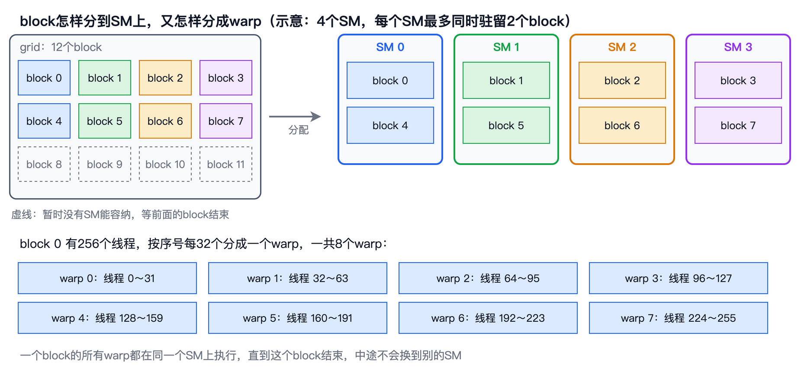

实验程序`blocks.cu`让每个block都做同样多的计算，并在block的0号线程里记下三件事：自己在哪个SM上执行，什么时候开始，什么时候结束。前一件读的是`%smid`，后两件读的是`%globaltimer`，它们都是GPU提供的特殊寄存器，用一行内联汇编就能读出来。结果如下：

```
blocks=40  threads=1024   用到40个SM，每个SM分到1～1个block   一个block约1188.0微秒，全部用时1188.1微秒
    第1轮： 40个block，在第    0.0微秒开始
blocks=64  threads=1024   用到40个SM，每个SM分到1～2个block   一个block约1005.9微秒，全部用时2027.5微秒
    第1轮： 40个block，在第    0.0微秒开始
    第2轮： 24个block，在第  988.8微秒开始
```

第一组是40个block，每个1024个线程。T4的每个SM最多驻留1024个线程，正好容得下一个这样的block，40个SM各分到一个，同时开始、同时结束。第二组有64个block，前40个先分下去，占满了所有SM；剩下的24个只能等，直到第988.8微秒，第一批block陆续算完，它们才开始执行，总用时差不多翻了一倍。这正是上一章分析 $n = 256$ 时朴素kernel为什么慢的原因：64个 $32 \times 32$ 的block要分两轮跑，第二轮有16个SM没活干。

再看block小一些的情况：

```
blocks=160  threads=256   用到40个SM，每个SM分到4～4个block   一个block约570.8微秒，全部用时901.3微秒
    第1轮：160个block，在第    0.0微秒开始
blocks=320  threads=256   用到40个SM，每个SM分到8～8个block   一个block约698.4微秒，全部用时1718.0微秒
    第1轮：200个block，在第    0.0微秒开始
    第2轮： 80个block，在第  448.3微秒开始
    第3轮： 40个block，在第  870.0微秒开始
```

每个block 256个线程时，一个SM可以同时驻留4个，160个block一次就全部分下去了。320个block时，按道理应该是两轮，每轮160个，但统计出来却是200、80、40三组。这说明block的调度并不是整整齐齐一轮一轮进行的：同一个SM上的几个block不一定同时结束，哪个先结束，就立刻补上一个新的。程序按开始时间分组，只是一种近似的统计方法，“轮”的边界本来就是模糊的。这些block的用时也各不相同，是因为同一个SM上的几个block在争抢同一批计算单元。顺带一提，这个实验是本章第一个运行的，GPU的主频可能还没有完全升上来，所以这里只看分配方式，不比较绝对的时间。


### 访存延迟有多长

第4章说过，CPU靠大缓存和乱序执行避免等待，GPU则靠大量线程把等待藏起来。在看它怎样藏之前，先测一测要藏的等待有多长。

测延迟的经典方法叫**指针追逐**（Pointer Chasing）。在一个数组里，每个元素存的是下一个要访问的元素的位置，然后只用一个线程，反复执行`j = next[j]`。下一次读哪个地址，要等这一次读回来才知道，所以每次访问都必须完整地等完一个延迟，没有任何重叠的可能。总时间除以访问次数，就是一次访问的延迟。`latency.cu`中的核心代码如下：

```c
long long t0 = clock64();
for (int i = 0; i < steps; i++) j = next[j];
long long t1 = clock64();
```

其中的`clock64()`读的是SM的时钟周期计数。数组中相邻两个被访问的元素相隔128字节，也就是一个缓存行，所以每次访问都会碰到一个新的缓存行。把数组从4KiB逐步增大到64MiB，数据就会依次从L1、L2一直落到显存里：

```
shared       4KiB     22.0 周期     13.8 纳秒
global       4KiB     40.0 周期     25.2 纳秒
global      32KiB     40.0 周期     25.2 纳秒
global      64KiB    109.9 周期     69.1 纳秒
global     128KiB    231.8 周期    145.8 纳秒
global       4MiB    233.4 周期    146.8 纳秒
global       8MiB    469.0 周期    295.0 纳秒
global      64MiB    494.6 周期    311.1 纳秒
```

这里只列出了几个有代表性的规模，完整结果见`results.txt`。纳秒数是按1.59GHz的最高主频换算的，周期数更可靠。

结果呈现出清晰的台阶。数组不超过32KiB时，延迟是40个周期，数据都在L1里；64KiB时是110个周期，一部分数据已经放不进L1了，这说明这次实验时L1的容量在32KiB到64KiB之间。第4章说过，T4每个SM有96KiB的片上存储，由L1和共享内存共用，具体怎样划分由驱动决定。从128KiB到4MiB，延迟稳定在232个周期左右，数据在4MiB的L2里。超过4MiB以后，L2也放不下了，延迟跳到470个周期以上，这才是从显存读数据的代价。32MiB以上又略有增加，可能是因为地址转换的开销也加了进来。第一行是共享内存，只要22个周期，比L1还快，第8章会用到它。

和第2章的CPU比一比：CPU从L1读数据只要4个周期左右，GPU要40个周期；GPU从显存读一个数要将近500个周期，按纳秒算也要300纳秒左右，比CPU读内存还慢。第4章粗算延迟隐藏时，假设一次显存访问要等400个周期，实际还要更长一些。GPU的单次访问并不快，它的高带宽完全是靠同时进行大量访问换来的。


### 用并发隐藏延迟

一次显存访问要等将近500个周期，在这段时间里，发出请求的warp什么都做不了。但SM上通常驻留着许多个warp，每个处理块的调度器每个周期都会检查一遍：哪些warp的下一条指令已经准备好了，就从中挑一个执行。一个warp在等数据，调度器就去执行另一个。所有warp的寄存器都一直留在寄存器文件里，切换时不需要保存和恢复任何东西，所以切换几乎没有代价。只要有足够多的warp轮流上阵，计算单元和显存就都不会闲着。

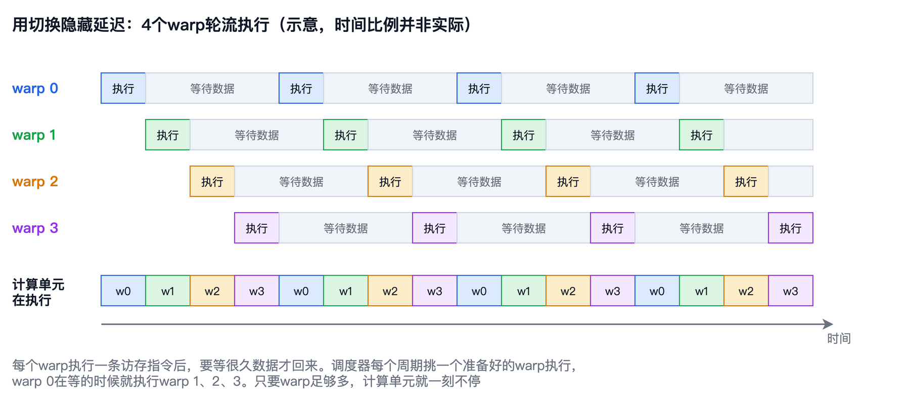

足够多是多少？`warps.cu`做了一个实验：启动的block数等于SM数，每个SM正好一个block，再把每个block的线程数从32调到1024，于是每个SM上就有1到32个warp。kernel里，每个线程读一个数，加到累加器上，再读下一个。加法要等数据读回来才能执行，而warp是按顺序执行指令的，所以每个warp同一时刻最多只有一个读请求在路上。结果如下：

```
read  每个SM  1个warp      17.365 毫秒      15.5 GB/s
read  每个SM  2个warp       8.732 毫秒      30.7 GB/s
read  每个SM  4个warp       4.429 毫秒      60.6 GB/s
read  每个SM  8个warp       2.388 毫秒     112.4 GB/s
read  每个SM 16个warp       1.447 毫秒     185.6 GB/s
read  每个SM 32个warp       1.185 毫秒     226.6 GB/s
```

每个SM上的warp数每翻一倍，带宽也几乎翻一倍，直到接近显存的上限。这个结果可以精确地算出来。每个SM只有一个warp时，全GPU一共40个warp，每个warp一次读32个连续的float，也就是128字节，所以同一时刻在路上的数据是 $40 \times 128 = 5120$ 字节。每次要等大约311纳秒才能拿到，带宽就是 $5120 / 311 \approx 16.5$ 字节每纳秒，也就是16.5GB/s，和实测的15.5GB/s非常接近。

这背后是一个很简单的关系，叫做**Little定律**（Little's Law）：带宽等于在路上的数据量除以延迟。延迟是硬件定死的，要想提高带宽，只能让更多的数据同时在路上。反过来，要用满上一章实测的277.5GB/s，在路上的数据要有 $277.5 \times 311 \approx 86000$ 字节，也就是大约86KB，相当于674个warp各有一个请求在路上，平均每个SM要将近17个warp。实测中，16个warp时达到185.6GB/s，32个warp时是226.6GB/s，比这个估算要差一些，因为显存忙起来以后，请求要排队，延迟会比空闲时更长。第4章估算时得到的是80KB，和这里实测的86KB已经相当接近了。

计算也有延迟。第3章说过，一条FMA从开始到出结果要几个周期，下一条依赖它的FMA必须等着。`warps.cu`的另一个实验，让每个线程做一条首尾相接的FMA链：

```
fma   每个SM  1个warp       0.184 毫秒     914.1 GFLOPS
fma   每个SM  2个warp       0.184 毫秒    1827.2 GFLOPS
fma   每个SM  4个warp       0.184 毫秒    3654.4 GFLOPS
fma   每个SM  8个warp       0.187 毫秒    7173.0 GFLOPS
fma   每个SM 16个warp       0.337 毫秒    7959.8 GFLOPS
fma   每个SM 32个warp       0.669 毫秒    8024.8 GFLOPS
```

从1个warp到8个warp，用时完全不变，算力随warp数线性增长；8个warp以后，用时开始随warp数增加，算力不再提高。1个warp时，每个SM每个周期只完成 $914.1 / (40 \times 1.59) \approx 14.4$ 次浮点运算，而一条warp级的FMA是 $32 \times 2 = 64$ 次运算，相当于每4.4个周期才执行一条，这正是FMA的延迟，大约4个周期。每个SM有4个处理块，每个处理块的16个FP32单元执行一条warp指令要2个周期，延迟是4个周期，所以每个处理块有2个warp交替执行，就能让FP32单元一刻不停，整个SM需要8个warp。实测正是在8个warp时达到了理论峰值8141GFLOPS的88%。

这里测到的最高算力是8024.8GFLOPS，比上一章实测的7544.3GFLOPS还高一些，相当于理论峰值的98.6%。这并不矛盾：T4的主频随温度和功耗不断变化，两次测量时的主频不同。本书仍然以上一章的7544.3GFLOPS作为T4峰值的基准，读者只要记住，在T4上测出的数字有百分之几的起伏是正常的。

这两个实验揭示了GPU性能的一条基本规律：要隐藏延迟，就要有足够多互不依赖的工作同时在进行。访存需要的并发远远多于计算，计算有8个warp就够了，访存却需要16到32个warp才能接近带宽上限。


### 分支分歧

同一个warp的32个线程执行同一条指令，那如果它们遇到`if`时走了不同的分支呢？硬件的做法是两条路都走：先让走`if`分支的线程执行，其他线程暂时停下；再让走`else`分支的线程执行，前一批线程停下。两条路都走完以后，32个线程再汇合到一起继续执行。这种现象叫做**分支分歧**（Warp Divergence）。

下面用`divergence.cu`做一个对比。两个分支做的FMA一样多，只是写法不同，免得编译器把它们合并：

```c
bool a_side = mode == 0 ? true : mode == 1 ? (t / 32) % 2 == 0 : t % 2 == 0;
if (a_side) {
    for (int i = 0; i < iters; i++) a = fmaf(a, x, y);
} else {
    for (int i = 0; i < iters / 2; i++) {
        a = fmaf(a, y, x);
        a = fmaf(a, x, y);
    }
}
```

三种模式分别是：所有线程都走A分支；按warp分支，偶数号warp走A、奇数号warp走B；在warp内分支，偶数号线程走A、奇数号线程走B。结果如下：

```
none      0.339 毫秒     7918.4 GFLOPS（按每个线程做的FMA计）
warp      0.340 毫秒     7890.1 GFLOPS（按每个线程做的FMA计）
lane      0.676 毫秒     3972.2 GFLOPS（按每个线程做的FMA计）
```

按warp分支时，同一个warp里的线程走向一致，没有任何代价，和不分支一样快。在warp内分支时，每个warp都要把两个分支各走一遍，每次只有一半的线程在干活，用时正好翻了一倍。所以，分支本身并不可怕，可怕的是同一个warp里的线程走了不同的路。写kernel时，如果分支不可避免，就尽量让分支的条件以warp为单位变化。矩阵乘法的kernel里几乎没有分支，只有边界检查那一个`if`，而且只在矩阵边缘的少数warp里才会分歧，所以它不是朴素kernel慢的原因。


### Occupancy

前面看到，SM上驻留的warp越多，越能把延迟藏起来。可是一个SM能驻留多少个warp，并不只由block的线程数决定。每个SM的资源是有限的，`occupancy.cu`查询到的T4的各项上限如下：

```
每个SM最多驻留的线程     1024（32个warp）
每个SM最多驻留的block    16
每个SM的32位寄存器       65536（256KiB）
每个SM的共享内存         64KiB
每个线程最多的寄存器     255
```

一个block要驻留在SM上，它的所有线程都要分到寄存器，它申请的共享内存也要分到，而且线程数和block数都不能超过上限。这几个条件中最紧的那一个，决定了一个SM实际能驻留多少个warp。实际驻留的warp数占上限的比例，叫做**occupancy**。中文资料里通常把它译作“占用率”，本书沿用英文，不做翻译。T4的上限是32个warp，驻留16个warp时，occupancy就是50%。

举一个例子。如果一个kernel的每个线程要用64个寄存器，一个warp就要 $32 \times 64 = 2048$ 个寄存器，65536个寄存器最多只够32个warp，还不会限制occupancy；如果每个线程要用128个寄存器，就只够16个warp，occupancy最多50%。共享内存也是一样：每个block申请24KiB，64KiB的共享内存只放得下2个block。

借助CUDA提供的函数`cudaOccupancyMaxActiveBlocksPerMultiprocessor`，`occupancy.cu`算出了上一章朴素kernel的occupancy：

```
naive  block= 8x8   每个线程49个寄存器   每个SM驻留16个block、32个warp   occupancy 100%
naive  block=16x16  每个线程49个寄存器   每个SM驻留 4个block、32个warp   occupancy 100%
naive  block=32x32  每个线程49个寄存器   每个SM驻留 1个block、32个warp   occupancy 100%
```

朴素kernel每个线程用49个寄存器，没有用共享内存，三种block大小下，每个SM都能驻留满32个warp，occupancy都是100%。 $8 \times 8$ 的block只有64个线程，但每个SM最多能驻留16个这样的block，加起来正好也是1024个线程。

如果occupancy降下来，会怎样？`occupancy.cu`的最后一个实验，用的是和前面一样的只读kernel，每个block 256个线程，只是让每个block额外申请一块共享内存，人为地压低occupancy：

```
smem  每个block  0KiB共享内存   每个SM驻留4个block、32个warp   occupancy 100%     217.4 GB/s
smem  每个block 16KiB共享内存   每个SM驻留4个block、32个warp   occupancy 100%     218.0 GB/s
smem  每个block 24KiB共享内存   每个SM驻留2个block、16个warp   occupancy  50%     175.0 GB/s
smem  每个block 48KiB共享内存   每个SM驻留1个block、 8个warp   occupancy  25%     102.1 GB/s
```

每个block申请16KiB时，4个block正好用完64KiB的共享内存，occupancy不受影响；24KiB时只能放下2个block，occupancy降到50%，带宽也随之下降；48KiB时只剩1个block，带宽只有一开始的一半左右。这和前面`warps.cu`的结果完全吻合：对于这种每个warp只有一个请求在路上的kernel，驻留的warp越少，带宽越低。

那么，occupancy是不是越高越好？并不一定。隐藏延迟真正需要的，是有足够多互不依赖的工作同时在进行，warp多只是其中一种办法。另一种办法，是让每个线程自己就有多个互不依赖的操作。前面的FMA实验里，每个SM只有8个warp，也就是25%的occupancy，就已经达到了峰值的88%。上一章的`peak.cu`让每个线程同时维护8条互不相关的FMA链，也是同样的道理。第9章的寄存器分块会故意让每个线程用更多的寄存器，occupancy因此降低，但每个线程能同时做的事情更多了，速度反而大幅提高。occupancy只是一个参考，不是目标。


### 内存层次全景

到这里，GPU上的各级存储都已经出场了。把它们放在一起看：

| 存储 | T4上的容量 | 延迟（周期） | 谁能访问 |
|---|---|---|---|
| 寄存器 | 每个SM 256KiB | 几乎为0 | 每个线程自己 |
| 共享内存 | 每个SM最多64KiB | 22 | 同一个block的线程 |
| L1 | 与共享内存共用每个SM的96KiB | 40 | 同一个SM上的线程，硬件自动管理 |
| L2 | 全GPU 4MiB | 约232 | 所有SM，硬件自动管理 |
| 显存（全局内存） | 16GB | 约470～495 | 所有线程，以及通过PCIe的主机 |

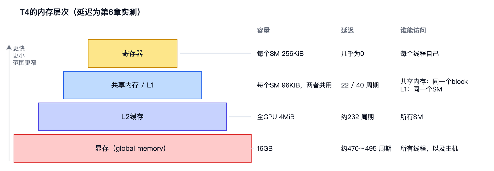

这张表里的延迟都是本章实测的，容量来自上一章和`occupancy.cu`的查询结果。和第2章CPU的内存层次相比，GPU的特点很鲜明：寄存器的总量比任何一级缓存都大，缓存却很小，平均到每个线程只有几十个字节，而访问每一级的延迟都比CPU长得多。GPU的设计假设是，程序员会通过共享内存和寄存器，自己安排数据的复用，而不是依赖缓存。

表的最后一列同样重要。CUDA程序里的变量放在哪里，决定了谁能看到它。kernel里普通的局部变量放在寄存器里，只有这个线程自己能用；用`__shared__`声明的变量放在共享内存里，同一个block的线程都能读写；`cudaMalloc`分配的显存，所有线程都能访问。第7章到第11章的优化，就是沿着这张表一级一级往上走：先让显存的访问更有效率，再把数据搬进共享内存反复使用，最后放进寄存器。


### 回到朴素kernel

现在回到本章开头的问题。朴素kernel用 $8 \times 8$ 的block比用 $32 \times 32$ 快2.7倍，原因是什么？

本章已经排除了几种可能。不是occupancy：三种block大小的occupancy都是100%，每个SM都驻留着32个warp。不是分支分歧：朴素kernel里只有边界检查一个分支，而 $n = 4096$ 正好是block大小的整数倍，根本没有线程越界。也不是block的分配：4096的矩阵会产生成千上万个block，每个SM都分得满满的。

剩下的嫌疑，就是访存的方式。第5章说过，block是 $32 \times 32$ 时，同一个warp的32个线程负责 $\mathbf{C}$ 的同一列、相邻的32行；block是 $8 \times 8$ 时，同一个warp负责8行、4列。warp的32个线程是一起执行的，它们的访存请求也是一起发出的。这32个请求落在哪些地址上，对显存来说差别很大。下一章，我们就用NVIDIA的性能分析工具，看看朴素kernel的访存到底出了什么问题。


### 本章小结

这一章，我们看清了GPU执行线程的方式。一个block里的线程按 $x$ 、 $y$ 、 $z$ 的顺序每32个组成一个warp，同一个warp执行同一条指令，这叫SIMT。block是分配到SM的最小单位，一个SM可以同时驻留多个block，放不下的block要等前面的block结束才能开始，调度是动态的。

在GPU上，访存的延迟很长：实测L1约40个周期，L2约232个周期，显存约470到495个周期，共享内存只要22个周期。GPU用大量warp轮流执行来隐藏延迟，带宽等于在路上的数据量除以延迟。实测中，每个SM的warp数从1增加到32，读带宽从15.5GB/s增加到226.6GB/s；而FMA链只要8个warp就能接近峰值。同一个warp里的线程走不同分支时，两条路要依次执行，实测用时翻倍。

所谓occupancy，是一个SM实际驻留的warp数占上限的比例，受寄存器、共享内存、线程数和block数的限制。occupancy降低时，靠warp数隐藏延迟的kernel会明显变慢，但隐藏延迟也可以靠每个线程内部互不依赖的操作，所以occupancy不是越高越好。朴素kernel的occupancy是100%，也没有分支分歧，它慢的原因要到访存的方式中去找，这就是下一章的内容。

<div style="page-break-after: always;"></div>

## 第 7 章　访存合并

上一章排除了几个嫌疑：朴素kernel的occupancy是100%，没有分支分歧，block也分配得满满的。剩下的嫌疑只有一个，就是访存的方式。block是 $32 \times 32$ 时，一个warp的32个线程负责 $\mathbf{C}$ 的同一列、相邻的32行；换成 $8 \times 8$ ，一个warp负责8行、4列，速度就快了2.7倍。同样的计算，只是同一个warp里的线程访问的地址不同，差别就这么大。

这一章，我们先请出NVIDIA的性能分析工具Nsight Compute，看看朴素kernel运行时，GPU的哪个部件最忙。然后弄清楚全局内存是怎样被访问的：一个warp的32个访存请求，怎样被合并成少量的数据块。有了这些知识，朴素kernel的问题就一目了然了，而修复它只需要改两行代码。

本章的随书代码在`code/ch07/`目录下。`coalesce.cu`是一个访存合并的微基准，`matmul.cu`包含第5章的朴素kernel和本章修改后的kernel，`bench.sh`跑完全部实验，并用Nsight Compute采集指标。和前两章一样，书中引用的数字都来自`results.txt`。


### 第一次使用Nsight Compute

随CUDA一起提供的，还有NVIDIA的kernel性能分析工具**Nsight Compute**。它可以读出GPU内部的上千个硬件计数器：执行了多少条指令，每一级缓存被访问了多少次，从显存搬了多少字节，各个部件忙到了什么程度。它有图形界面，也有命令行工具`ncu`，Colab上用的是后者。最简单的用法，是把要运行的程序放在`ncu`后面：

```
ncu --section SpeedOfLight ./matmul naive 2048 32 once
```

命令最后的`once`是`matmul`的参数，表示只运行一次kernel、不计时，免得`ncu`把预热和重复测量的每一次都分析一遍。`--section SpeedOfLight`表示只看“Speed Of Light”这一节，它把GPU主要部件的吞吐，表示成峰值的百分比，是分析一个kernel时首先要看的东西。朴素kernel在 $n = 2048$ 时的结果如下：

```
    DRAM Frequency                  Ghz           5.00
    SM Frequency                    Mhz         585.00
    Memory Throughput                 %          49.71
    DRAM Throughput                   %           0.93
    Duration                         ms         761.96
    L1/TEX Cache Throughput           %          99.42
    L2 Cache Throughput               %           0.39
    Compute (SM) Throughput           %           6.03
```

先看第二行，SM的主频只有585MHz，而T4的最高主频是1590MHz。这是`ncu`有意为之：为了让每次分析的结果可以重复，它默认把GPU的主频固定在基础频率上。所以，`ncu`报告的用时761.96毫秒，比第5章正常计时的278毫秒长得多。用`ncu`时，要看的是各种计数和百分比，不要拿它的用时和正常运行的用时比较。

再看各个部件的吞吐。计算单元只用到了峰值的6.03%，这在意料之中。出人意料的是存储：显存只用到了0.93%，L2只用到了0.39%，而L1却高达99.42%，几乎被压满了。也就是说，朴素kernel慢，并不是因为显存的带宽不够，数据其实大都在缓存里。真正的瓶颈是L1：它忙不过来了。`ncu`在最后还给出了一条建议，说这个kernel的计算和显存吞吐都偏低，通常意味着延迟方面的问题。这条建议是自动生成的，参考一下就好，L1的99.42%才是关键的线索。

为什么L1会这么忙？要回答这个问题，需要先弄清楚全局内存的访问是怎样进行的。


### 全局内存是怎样被访问的

上一章说过，一个warp的32个线程总是一起执行同一条指令。执行到一条读全局内存的指令时，32个线程各自给出一个地址，这32个地址被打包成一个**请求**（Request）交给L1。L1以32字节为单位处理这些地址，这个单位叫做**sector**，中文资料里有时译作“扇区”。L1先算出这32个地址一共落在几个不同的sector上，再一个sector一个sector地去取数据：如果数据已经在L1里，就直接取；不在，就向L2要，L2也没有，就向显存要。第2章讲过CPU的缓存行是64字节，GPU的L1缓存行是128字节，正好由4个sector组成。

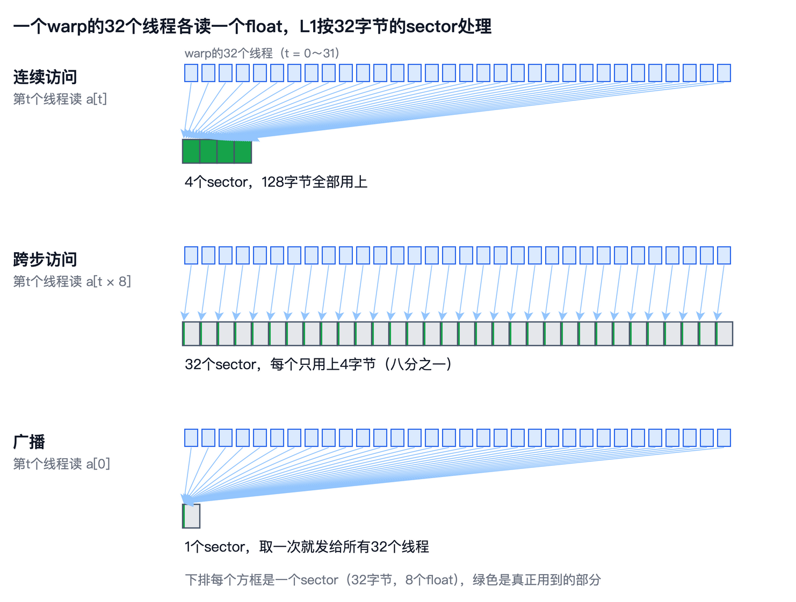

所以，一个请求的代价，取决于这32个地址分散在多少个sector上。最理想的情况，是32个线程访问32个连续的float，一共128字节，正好落在4个sector里，L1只要处理4次。如果32个线程访问的地址彼此相隔很远，就会落在32个不同的sector里，L1要处理32次，而每个sector里只有4个字节是真正用到的。同一个warp的访问被合并成尽量少的sector，这叫做**访存合并**（Memory Coalescing）。还有一种特殊的情况：32个线程访问同一个地址，只涉及1个sector，L1取一次就可以发给所有线程，这叫做**广播**（Broadcast）。

随书代码中的`coalesce.cu`用一个微基准，直观地展示了合并与不合并的差别。它让第 $t$ 个线程读`a[t * stride]`，`stride`从1增加到32。不管步长是多少，总共用到的数据都是4M个float，16MiB，变的只是这些数据在内存中有多分散。有效带宽是用到的字节数除以时间：

```
stride   1      0.075 毫秒   有效带宽   222.9 GB/s
stride   2      0.131 毫秒   有效带宽   127.8 GB/s
stride   4      0.246 毫秒   有效带宽    68.3 GB/s
stride   8      0.507 毫秒   有效带宽    33.1 GB/s
stride  16      1.007 毫秒   有效带宽    16.7 GB/s
stride  32      1.099 毫秒   有效带宽    15.3 GB/s
```

步长为1时，一个warp读的是32个连续的float，有效带宽是222.9GB/s。步长每翻一倍，有效带宽几乎减半：步长为2时，32个线程的地址分布在256字节里，要搬运的sector多了一倍，其中一半的数据用不上；步长为8时，相邻线程的地址相隔32字节，每个线程独占一个sector，搬来的数据只有八分之一是有用的。

按照sector的道理，步长超过8以后，每个线程已经各占一个sector，有效带宽不该再下降，可实测从8到16又减了一半，从16到32才基本持平。这说明从显存搬运数据时，实际的粒度比32字节还大：L2向显存要数据时，看起来一次总是取64字节，也就是两个相邻的sector。这个细节不影响本章的结论，只是提醒我们，不合并的访问浪费的带宽，可能比按sector算出来的还多。

访问的起始地址没有对齐，影响就小得多。让第 $t$ 个线程读`a[t + offset]`：

```
offset   0      0.075 毫秒   有效带宽   224.4 GB/s
offset   1      0.077 毫秒   有效带宽   216.7 GB/s
offset   8      0.077 毫秒   有效带宽   217.4 GB/s
offset  16      0.079 毫秒   有效带宽   212.4 GB/s
```

起始地址偏移一个float，一个warp的128字节就会跨到5个sector上，多出一个，有效带宽只下降了百分之几。所以，访存合并真正要紧的是同一个warp里相邻的线程访问相邻的地址，至于从哪里开始，没那么重要。


### 朴素kernel的问题

现在用这把尺子量一量朴素kernel。回顾一下它的写法：

```c
int i = blockIdx.x * blockDim.x + threadIdx.x;   // 行
int j = blockIdx.y * blockDim.y + threadIdx.y;   // 列
...
for (int k = 0; k < n; k++)
    sum += A[i * n + k] * B[k * n + j];
C[i * n + j] = sum;
```

当block是 $32 \times 32$ 时，同一个warp的32个线程， $x$ 方向的编号是0到31， $y$ 方向的编号相同，所以它们的 $i$ 是相邻的32个值， $j$ 都一样。循环的每一步，这32个线程要各读一个`A[i * n + k]`和一个`B[k * n + j]`。

读 $\mathbf{A}$ 时，32个线程的 $i$ 各不相同，读的是 $\mathbf{A}$ 的32个不同的行，相邻两个地址之间隔着一整行， $n$ 个float。这正是上面步长最大的情况，32个地址落在32个不同的sector上。读 $\mathbf{B}$ 时，32个线程的 $j$ 相同，读的是同一个地址，是一次广播，只涉及1个sector。平均下来，每个请求涉及 $(32 + 1) / 2 = 16.5$ 个sector。

这个数字可以用`ncu`验证。`bench.sh`让`ncu`采集了两个计数器：`l1tex__t_requests_pipe_lsu_mem_global_op_ld.sum`是读全局内存的请求数（名字里的`mem_global`指的就是全局内存），`l1tex__t_sectors_pipe_lsu_mem_global_op_ld.sum`是这些请求涉及的sector数。朴素kernel在 $n = 2048$ 、block为 $32 \times 32$ 时：

```
l1tex__t_requests_pipe_lsu_mem_global_op_ld.sum                536,870,912
l1tex__t_sectors_pipe_lsu_mem_global_op_ld.sum          sector 8,858,365,615
```

请求数是 $536870912 = 2 \times 2048^3 / 32$ ：每个warp在循环的每一步读一次 $\mathbf{A}$ 、读一次 $\mathbf{B}$ ，一共有 $2048^2 / 32$ 个warp，循环2048步。sector数除以请求数，是16.5，和上面算的一模一样。

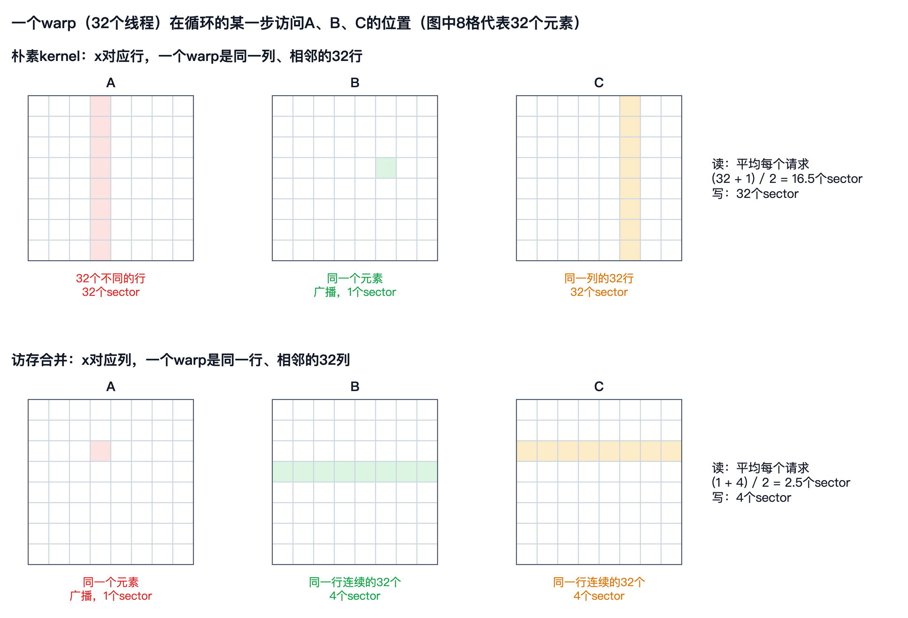

每个请求要处理16.5个sector，L1自然忙不过来，这就是L1吞吐99.42%的原因。数据其实大都在缓存里，显存几乎闲着，可L1光是把这些零散的sector一个个找出来，就已经满负荷了。写 $\mathbf{C}$ 时也一样，32个线程写的是同一列的32行，每个写请求涉及32个sector。`ncu`的计数也印证了这一点：写请求131072个，写的sector是4195836个，每个请求正好32个。

再看block为 $8 \times 8$ 的情况。一个warp是8行、4列：读 $\mathbf{A}$ 时涉及8个不同的行，也就是8个sector；读 $\mathbf{B}$ 时是同一行里相邻的4个元素，16个字节，落在1个sector里。平均每个请求 $(8 + 1) / 2 = 4.5$ 个sector。`ncu`测出的sector数是2415753008，除以同样的请求数，正是4.5。每个请求要处理的sector从16.5个降到4.5个，L1的负担减轻了不少，这就是 $8 \times 8$ 的block快2.7倍的原因。第5章留下的谜题，到这里终于有了答案。


### 调整线程映射

既然问题出在同一个warp的线程访问的地址太分散，解决的办法就很明显了：让 $x$ 方向对应列，而不是行。这样，同一个warp的32个线程， $j$ 是相邻的32个值， $i$ 都一样。修改后的kernel只改了前两行：

```c
__global__ void matmul_coalesced(int n, const float *A, const float *B, float *C) {
    int j = blockIdx.x * blockDim.x + threadIdx.x;   // 列
    int i = blockIdx.y * blockDim.y + threadIdx.y;   // 行
    if (i < n && j < n) {
        float sum = 0.0f;
        for (int k = 0; k < n; k++) sum += A[i * n + k] * B[k * n + j];
        C[i * n + j] = sum;
    }
}
```

现在，读 $\mathbf{A}$ 时32个线程的 $i$ 相同，读的是同一个地址，变成了广播，1个sector；读 $\mathbf{B}$ 时是同一行里连续的32个float，128字节，4个sector。平均每个请求 $(1 + 4) / 2 = 2.5$ 个sector。写 $\mathbf{C}$ 时也是同一行的32个连续元素，4个sector。`ncu`的计数完全符合预期：读的sector是1342177280个，正好是请求数的2.5倍；写的sector是524288个，正好是写请求数131072的4倍。

再看吞吐。修改后，L1不再是唯一的瓶颈，`ncu`报告的存储吞吐和计算吞吐都上升到了峰值的85.67%。同样在585MHz的主频下，kernel的用时从761.96毫秒降到了53.61毫秒。

实际的速度如何？在正常的主频下，两个版本的对比如下：

```
naive      n=1024  block=32x32       35.209 毫秒       61.0 GFLOPS
coalesced  n=1024  block=32x32        3.018 毫秒      711.5 GFLOPS
naive      n=2048  block=32x32      278.188 毫秒       61.8 GFLOPS
coalesced  n=2048  block=32x32       29.100 毫秒      590.4 GFLOPS
naive      n=4096  block=32x32     2216.005 毫秒       62.0 GFLOPS
coalesced  n=4096  block=32x32      246.560 毫秒      557.4 GFLOPS
```

只改了两行代码，速度就提高了9到12倍。在基准问题 $n = 4096$ 上，从62.0GFLOPS提高到557.4GFLOPS，是CPU上多线程NumPy的3倍多。这是我们在GPU上的第一次大幅提速，而计算量、算法、occupancy都没有任何变化，变的只是哪些线程被分到了同一个warp里。正确性也没有问题，两个版本和cuBLAS的相对误差都在 $10^{-6}$ 左右，而且彼此完全相同，因为每个线程做的计算和累加顺序一模一样。

换几种block大小看看：

```
naive      n=4096  block=8x8      778.840 毫秒      176.5 GFLOPS
coalesced  n=4096  block=8x8      561.567 毫秒      244.7 GFLOPS
naive      n=4096  block=16x16     1194.633 毫秒      115.0 GFLOPS
coalesced  n=4096  block=16x16      377.829 毫秒      363.8 GFLOPS
naive      n=4096  block=32x32     2216.457 毫秒       62.0 GFLOPS
coalesced  n=4096  block=32x32      267.829 毫秒      513.2 GFLOPS
```

对于修改后的kernel，block越宽越好。block是 $8 \times 8$ 时，一个warp覆盖4行、每行8个元素，读 $\mathbf{A}$ 时涉及4个不同的行，读 $\mathbf{B}$ 、写 $\mathbf{C}$ 时每行只有32字节，只用上了缓存行的四分之一，合并得不充分；block宽到32时，一个warp正好覆盖一行里的32个元素，合并得最充分。这里 $32 \times 32$ 测出的是513.2GFLOPS，和上面的557.4GFLOPS不一样，这两组数据是在不同时刻测的，相差8%左右，在T4上属于正常的波动。

那么，557.4GFLOPS离T4的峰值还有多远？只有7.4%。修改后的kernel虽然合并得很好，但每做一次乘加，仍然要从缓存里读两个数，算术强度太低。第3章说过，提高算术强度的办法，是让数据被反复使用。下一章，我们把 $\mathbf{A}$ 和 $\mathbf{B}$ 的小块搬进共享内存，让同一个block的线程共同使用。


### 补全基准表

把本章的结果加进基准表，峰值占比仍以T4实测的7544.3GFLOPS为基准：

| 版本 | 硬件 | 规模 | GFLOPS | 峰值占比 |
|---|---|---|---|---|
| NumPy，多线程 | CPU | $n = 2048$ | 161.9 | 26.7% |
| 朴素kernel | T4 | $n = 4096$ | 61.9 | 0.82% |
| 访存合并 | T4 | $n = 2048$ | 590.4 | 7.8% |
| 访存合并 | T4 | $n = 4096$ | 557.4 | 7.4% |
| cuBLAS | T4 | $n = 2048$ | 5968.6 | 79.1% |
| cuBLAS | T4 | $n = 4096$ | 3300.9 | 43.8% |

表中朴素kernel和cuBLAS的数字沿用第5章的测量，本章重测的朴素kernel是62.0GFLOPS，差别在测量误差之内。和cuBLAS相比，我们还差得很远：在 $n = 2048$ 时是它的十分之一，在 $n = 4096$ 时是它的六分之一。但比起朴素kernel，已经跨出了一大步。


### 本章小结

这一章，我们第一次用Nsight Compute分析kernel。它的Speed Of Light小节显示，朴素kernel的L1吞吐高达99.42%，而显存只用到了0.93%：瓶颈不在显存的带宽，而在L1处理请求的能力。用`ncu`分析时，GPU的主频被固定在基础频率，所以要看计数和百分比，而不是用时。

对全局内存的访问以warp为单位：32个线程的地址打包成一个请求，L1按32字节的sector处理。32个地址落在的sector越少，请求的代价越低。相邻线程访问相邻地址，叫做访存合并；所有线程访问同一个地址，叫做广播。微基准显示，步长每翻一倍，有效带宽几乎减半；起始地址不对齐则影响很小。

朴素kernel让 $x$ 方向对应行，一个warp读 $\mathbf{A}$ 时涉及32个sector，平均每个请求16.5个sector，和`ncu`的计数完全一致；block换成 $8 \times 8$ 后降到4.5个，这就是第5章那2.7倍的来历。把 $x$ 方向改成对应列，每个请求只涉及2.5个sector，速度提高9到12倍，在 $n = 4096$ 时达到557.4GFLOPS。但这只是T4峰值的7.4%，要再往上走，就要让数据在片上被反复使用，这是下一章的内容。

<div style="page-break-after: always;"></div>

## 第 8 章　共享内存分块

> 本章要回答的问题：怎样让同一份数据只从显存读一次，却被用很多次？

### 本章目标

- 理解数据复用的潜力
- 掌握 shared memory 和 block 内同步
- 写出分块矩阵乘法 kernel，并处理任意尺寸

### 小节

#### 8.1 数据复用

- 朴素 kernel 中，A 和 B 的每个元素被读了多少次
- 理论上最少需要读多少次
- 复用就是提高算术强度

#### 8.2 Shared memory

- 位于 SM 内部、block 内共享的高速存储
- 容量与速度
- 声明与使用方式

#### 8.3 Block 内同步

- 为什么需要同步
- `__syncthreads()` 的语义
- 同步放错位置会发生什么

#### 8.4 分块矩阵乘法 kernel

- 把 A、B 切成小块，依次载入 shared memory
- 每个线程在 shared memory 上完成部分计算
- 沿 K 方向滑动累加

#### 8.5 边界处理

- 矩阵尺寸不是分块大小整数倍时的处理
- 补零与条件判断

#### 8.6 回到 roofline

- 分块后的算术强度
- 分块大小对性能的影响

### 实验

- 不同分块大小下的 GFLOPS
- Nsight Compute 中 全局内存访问量的变化

### 配图

- 分块在 A、B、C 上的滑动过程
- 一个 block 内线程与 shared memory 的关系

### 基准里程碑

- 基准表新增：shared memory 分块版本

### 与后续章节的联系

- 呼应第 2 章的 CPU 分块：思想相同，只是“快的存储”从缓存变成了共享内存
- 瓶颈转移到 shared memory 的访问上，第 9 章解决

<div style="page-break-after: always;"></div>

## 第 9 章　寄存器分块

> 本章要回答的问题：shared memory 也成了瓶颈，还能把数据放到哪里？

### 本章目标

- 理解为什么 shared memory 带宽会成为新瓶颈
- 掌握让一个线程计算多个结果的方法
- 理解寄存器压力与 occupancy 的权衡

### 小节

#### 9.1 新的瓶颈

- 分析第 8 章 kernel：每次乘加需要几次 shared memory 读取
- 计算与访存指令的比例

#### 9.2 1D 寄存器分块

- 一个线程计算一列中的多个结果
- 一个 B 元素在寄存器中被复用多次

#### 9.3 2D 寄存器分块

- 一个线程计算一个小矩形块
- 外积形式的计算
- A、B 的元素都在寄存器中复用

#### 9.4 寄存器压力

- 每个线程能用多少寄存器
- 寄存器用多了 occupancy 会下降
- 寄存器溢出（spill）的代价

#### 9.5 参数选择

- block 分块大小与线程分块大小的组合
- 如何在复用与并发之间取平衡

### 实验

- 1D 与 2D 分块的 GFLOPS 对比
- 不同参数组合下的性能与寄存器使用量

### 配图

- 线程级分块的外积示意
- 三层数据流：global → shared → register

### 基准里程碑

- 基准表新增：1D 分块、2D 分块版本

### 与后续章节的联系

- 计算部分已经很高效，剩下的损耗在数据搬运的细节里，第 10 章处理

<div style="page-break-after: always;"></div>

## 第 10 章　向量化访存与 bank conflict

> 本章要回答的问题：数据搬运的细节里，还藏着哪些浪费？

### 本章目标

- 掌握向量化访存
- 理解 shared memory 的 bank 结构和 bank conflict
- 学会用转置和 padding 消除冲突

### 小节

#### 10.1 向量化访存

- 一条指令读取 128 位
- 使用 float4 的条件：对齐
- 对全局内存与共享内存的影响

#### 10.2 Shared memory 的 bank

- shared memory 被分成多个 bank
- 地址如何映射到 bank
- 同一 warp 访问同一 bank 的不同地址会怎样

#### 10.3 发现 bank conflict

- 在 Nsight Compute 中查看冲突指标
- 分析当前 kernel 的访问模式

#### 10.4 消除 bank conflict

- 在载入 shared memory 时转置 A
- padding
- swizzle（简述）

### 实验

- 向量化前后的 GFLOPS
- 消除冲突前后的 bank conflict 指标与 GFLOPS

### 配图

- shared memory 的 bank 映射
- 有冲突与无冲突的访问模式对比

### 基准里程碑

- 基准表新增：向量化版本、消除 bank conflict 版本

### 与后续章节的联系

- 线程级优化基本到位，第 11 章从 warp 层面重新组织计算

<div style="page-break-after: always;"></div>

## 第 11 章　Warp 分块与流水线

> 本章要回答的问题：离 cuBLAS 只差最后一段路，剩下的差距在哪里？

### 本章目标

- 理解 block、warp、thread 三级分块结构
- 掌握双缓冲，让访存与计算重叠
- 学会用参数搜索寻找最优配置
- 与 cuBLAS 做一次完整对比

### 小节

#### 11.1 三级分块

- 为什么要在 block 和 thread 之间再加一层 warp
- warp 分块对寄存器复用和调度的好处

#### 11.2 双缓冲

- 载入和计算串行执行的浪费
- 两块缓冲区交替使用
- 异步拷贝（简述）

#### 11.3 自动调优

- 需要调的参数有哪些
- 搜索参数空间
- 不同矩阵尺寸下的最优参数可能不同

#### 11.4 与 cuBLAS 对比

- 各种规模下的对比
- 非方阵、非整数倍尺寸的对比
- 剩余差距的来源

#### 11.5 第三部分回顾

- 完整的基准表
- 每一步优化解决了什么瓶颈
- 每一步优化在 roofline 上的位置

### 实验

- 三级分块 kernel 的 GFLOPS
- 双缓冲前后对比
- 自动调优的结果
- 与 cuBLAS 在多种尺寸下的对比

### 配图

- block / warp / thread 三级分块结构
- 双缓冲时间线
- 第三部分各版本的性能阶梯图

### 基准里程碑

- 基准表新增：warp 分块版本、双缓冲版本、调优后版本
- FP32 部分的最终结果

### 与后续章节的联系

- CUDA Core 上的 FP32 已接近极限，第四部分转向 Tensor Core 和低精度

<div style="page-break-after: always;"></div>

## 第 12 章　浮点格式与精度

> 本章要回答的问题：用更少的位数表示一个数，换来了什么，又付出了什么？

### 本章目标

- 理解浮点数的表示方法
- 认识深度学习中常用的浮点格式
- 理解混合精度的思想

### 小节

#### 12.1 浮点数是怎样表示的

- 符号位、指数位、尾数位
- 范围由指数决定，精度由尾数决定

#### 12.2 常见格式

- FP32
- TF32
- FP16
- BF16
- FP8（E4M3 与 E5M2）

#### 12.3 精度与范围的取舍

- 溢出与下溢
- 舍入误差的累积
- 为什么深度学习能容忍低精度

#### 12.4 混合精度

- 低精度相乘，高精度累加
- 对矩阵乘法结果的影响

#### 12.5 低精度带来的收益

- 数据量减半，带宽压力减半
- 硬件为低精度提供的更高峰值
- 回到 roofline：低精度对应的新屋顶

### 实验

- 用不同精度计算同一个矩阵乘法，比较误差

### 配图

- 各浮点格式的位布局对比
- 不同精度下的误差随矩阵规模的变化

### 与后续章节的联系

- 第 13 章的 Tensor Core 正是为低精度矩阵乘法设计的

<div style="page-break-after: always;"></div>

## 第 13 章　Tensor Core

> 本章要回答的问题：专门为矩阵乘法设计的硬件单元，该怎样使用？

### 本章目标

- 理解 Tensor Core 的工作方式
- 用 WMMA API 写出第一个 Tensor Core kernel
- 了解更底层的 mma 指令
- 把第三部分的分块结构迁移到 Tensor Core 上

### 小节

#### 13.1 Tensor Core 是什么

- 一条指令完成一个小矩阵乘加
- 与 CUDA Core 的峰值对比
- 各代 GPU 的 Tensor Core 演进（简述）

#### 13.2 WMMA API

- fragment 的概念
- 载入、计算、存回
- 第一个 Tensor Core 矩阵乘法 kernel

#### 13.3 更底层的接口

- PTX 中的 mma 指令
- ldmatrix
- fragment 在线程间的分布

#### 13.4 迁移分块结构

- block 分块、warp 分块在 Tensor Core 下的对应
- shared memory 布局与 bank conflict
- 双缓冲

#### 13.5 与 cuBLAS 对比

- FP16 / BF16 下与 cuBLAS 的对比
- 与第三部分 FP32 结果的对比

### 实验

- WMMA 版本的 TFLOPS
- 分块与双缓冲后的 TFLOPS
- cuBLAS FP16 / BF16 的 TFLOPS

### 配图

- Tensor Core 一次运算的矩阵片段
- fragment 在 warp 内线程间的分布

### 基准里程碑

- 基准表新增：WMMA 版本、优化后的 Tensor Core 版本、cuBLAS 低精度

### 与后续章节的联系

- 手写 Tensor Core kernel 很复杂，第 14 章介绍工业界的做法与新架构特性

<div style="page-break-after: always;"></div>

## 第 14 章　CUTLASS 与新架构

> 本章要回答的问题：工业级的矩阵乘法是怎样组织的？新一代 GPU 又改变了什么？

### 本章目标

- 了解 CUTLASS 和 CuTe 的设计思路
- 了解 Hopper 架构为矩阵乘法新增的硬件特性
- 了解 Blackwell 的主要变化

### 小节

#### 14.1 CUTLASS

- 为什么需要模板库
- 分层结构：与第三部分的三级分块一一对应
- 用 CUTLASS 实现一个矩阵乘法

#### 14.2 CuTe

- layout 与 tensor 的抽象
- 用 layout 描述数据在线程和内存中的分布

#### 14.3 Hopper 的新特性

- TMA：硬件负责的异步数据搬运
- WGMMA：以 warpgroup 为单位的矩阵乘法
- 线程块集群与分布式 shared memory
- warp 特化：生产者与消费者

#### 14.4 调度与 L2

- persistent kernel
- 计算块的调度顺序对 L2 命中率的影响

#### 14.5 Blackwell 的变化（概览）

- 更大的 Tensor Core 运算粒度
- 更低精度的格式支持

### 实验

- 用 CUTLASS 实现矩阵乘法并与 cuBLAS 对比
- 在 H100 上运行 TMA + WGMMA 示例（如有条件）

### 配图

- CUTLASS 分层结构与本书三级分块的对应
- Hopper 上生产者 / 消费者 warp 的流水线

### 基准里程碑

- 基准表新增：CUTLASS 版本、Hopper 版本（如有条件）

### 与后续章节的联系

- 矩阵乘法本身讲到这里结束，第五部分把视野扩展到其他算子和多 GPU

<div style="page-break-after: always;"></div>

## 第 15 章　算子

> 本章要回答的问题：除了矩阵乘法，GPU 上还要算哪些东西？它们的瓶颈在哪里？

### 本章目标

- 理解深度学习框架中“算子”的概念
- 分析访存受限算子的性能特征
- 理解算子融合的价值

### 小节

#### 15.1 什么是算子

- 框架中的基本计算单元
- 一个模型由哪些算子组成
- 矩阵乘法在其中的占比

#### 15.2 访存受限的算子

- 逐元素运算
- 归约
- softmax
- LayerNorm / RMSNorm
- 在 roofline 上的位置

#### 15.3 写好一个访存受限算子

- 目标是接近带宽上限
- 以归约为例：warp 级归约、block 级归约

#### 15.4 算子融合

- 每个算子都要读写一遍显存的代价
- 把多个算子合成一个 kernel
- 矩阵乘法与后续逐元素运算的融合（epilogue）

#### 15.5 融合的 attention

- 标准 attention 的计算与访存
- FlashAttention 的思路：分块 + 在线 softmax

### 实验

- 逐元素运算与归约的带宽利用率
- 融合前后的性能对比

### 配图

- 访存受限与计算受限算子在 roofline 上的分布
- 算子融合前后的显存读写对比
- FlashAttention 的分块计算示意

### 与后续章节的联系

- 第 16 章用 Triton 更简单地写出这些算子

<div style="page-break-after: always;"></div>

## 第 16 章　用 Triton 写算子

> 本章要回答的问题：有没有更简单的方法写出高性能 kernel？

### 本章目标

- 理解 Triton 的编程模型
- 用 Triton 重写矩阵乘法和其他算子
- 理解 Triton 帮我们做了什么，又没做什么

### 小节

#### 16.1 Triton 的编程模型

- 以 block 为单位思考，而不是以线程为单位
- 与 CUDA 编程模型的对比

#### 16.2 第一个 Triton kernel

- 向量加法
- 启动与调用方式

#### 16.3 用 Triton 写矩阵乘法

- 分块矩阵乘法
- 自动使用 Tensor Core
- 自动调优

#### 16.4 用 Triton 写其他算子

- softmax
- 融合算子

#### 16.5 Triton 做了什么

- 编译器替我们完成的优化：合并访存、shared memory、流水线
- 回顾第三部分：哪些手工优化被自动化了

### 实验

- Triton 矩阵乘法与手写 CUDA、cuBLAS 的对比
- Triton softmax 的带宽利用率

### 配图

- CUDA 与 Triton 编程模型对比

### 基准里程碑

- 基准表新增：Triton 版本

### 与后续章节的联系

- 到这里，单张 GPU 上的问题已经讲完，第 17 章回到“超级大的矩阵”

<div style="page-break-after: always;"></div>

## 第 17 章　当矩阵放不下一张卡

> 本章要回答的问题：矩阵大到一张 GPU 放不下、算不完时，该怎么办？

### 本章目标

- 理解单卡显存与算力的上限
- 掌握分布式矩阵乘法的几种切分方式
- 理解 GPU 间通信与集合通信的成本
- 理解计算与通信重叠

### 小节

#### 17.1 单卡的上限

- 显存容量能放多大的矩阵
- 单卡算力下的耗时估算

#### 17.2 GPU 之间如何通信

- PCIe、NVLink、NVSwitch
- 跨机器的网络
- 各种互连的带宽对比

#### 17.3 集合通信

- AllReduce、AllGather、ReduceScatter
- 各操作的通信量与耗时估算
- NCCL

#### 17.4 分布式矩阵乘法

- 按行切分
- 按列切分
- 按 K 维切分
- 二维切分
- 每种切分需要的通信

#### 17.5 计算与通信重叠

- 把通信隐藏在计算后面
- 分块流水线

#### 17.6 与大模型并行的联系

- 张量并行就是分布式矩阵乘法
- 数据并行、流水线并行（简述）

### 实验

- 多卡矩阵乘法（如有条件）
- 测量通信带宽

### 配图

- 矩阵切分到多卡的几种方式
- 集合通信示意
- 计算与通信重叠的时间线

### 与后续章节的联系

- 全书结束：回到第 1 章的问题，回顾一个超级大的矩阵乘法从 CPU 到多 GPU 的完整旅程

<div style="page-break-after: always;"></div>

## 附录

### 附录 A　实验环境搭建

- Google Colab 的使用
- 云 GPU 的租用与配置
- CUDA 工具链安装
- Nsight Compute 的安装与远程使用
- 本书代码仓库的结构与运行方式

### 附录 B　基准测试数据

- 测试方法与环境说明
- 全书各版本的完整基准表
- 不同 GPU 上的结果对比

### 附录 C　参考资料

- 书籍
- 博客与 worklog
- 官方文档
- 代码仓库
- 详见 [research.md](./research.md)
