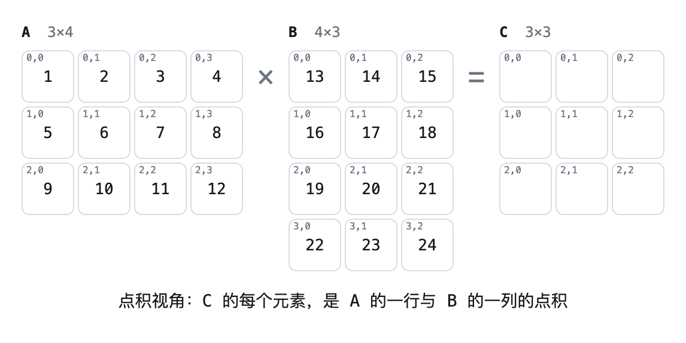
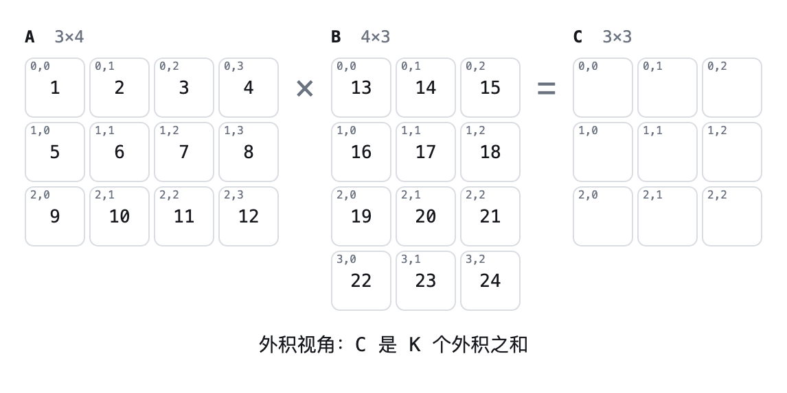
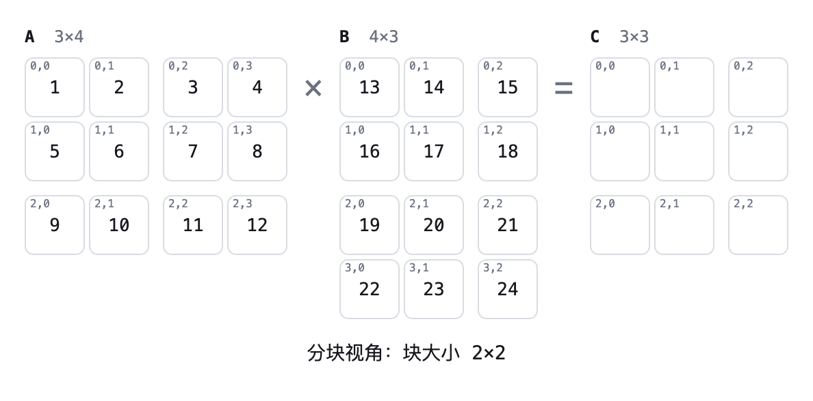
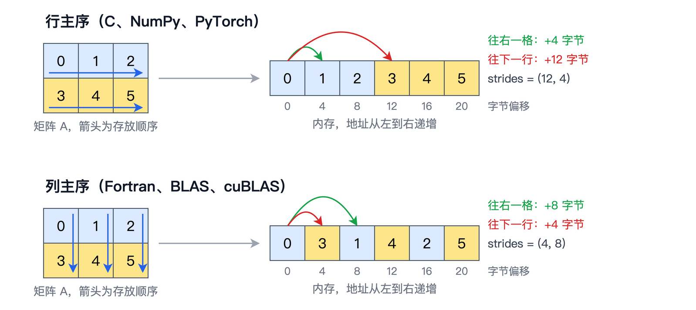

# 第 1 章　矩阵乘法

矩阵乘法是今天人工智能的头号计算：不管是训练一个大模型，还是用它来回答问题，背后的计算大部分都是矩阵乘法，本章后面会具体说明这一点。所以，这本书想回答一个问题：一个超级大的矩阵乘法，怎样才能算得快？围绕这个问题，我们会从CPU出发，一路走到GPU、CUDA、Tensor Core，最后走到多块GPU。不过在动手加速之前，得先把要加速的东西本身弄清楚。所以这一章不碰GPU，也不谈优化，只讨论矩阵乘法这个计算本身。

具体来说，我们先看矩阵乘法的定义，以及理解它的三种视角。接着估算一次矩阵乘法要算多少、要搬多少数据，这两个数字的比值是全书一切优化的出发点。然后说明矩阵乘法为什么值得花一整本书去优化。再往后，我们看矩阵在内存里是怎样摆放的，这件事在后面的章节里会反复影响性能。最后，我们约定一个贯穿全书的基准问题，后面每一章都拿它来衡量自己的进步。

本章的随书代码在`code/ch01/`目录下，一共三个小脚本，都可以用`uv run 脚本名.py`直接运行。


## 什么是矩阵乘法

设矩阵 $\mathbf{A}$ 的形状是 $M \times K$ ，矩阵 $\mathbf{B}$ 的形状是 $K \times N$ ，它们的乘积 $\mathbf{C} = \mathbf{A}\mathbf{B}$ 是一个 $M \times N$ 的矩阵。注意 $\mathbf{A}$ 的列数和 $\mathbf{B}$ 的行数必须相等，都是 $K$ ，否则无法相乘。 $\mathbf{C}$ 中第 $i$ 行第 $j$ 列的元素按下面的公式计算：

$$
c_{ij} = \sum_{k=0}^{K-1} a_{ik} \, b_{kj}
$$

本书沿用常见的记法：粗体大写字母表示矩阵，比如 $\mathbf{A}$ ；不加粗的小写字母加下标表示矩阵中的元素，比如 $a_{ik}$ 。为了和代码保持一致，下标一律从0开始。

举一个具体的例子。设 $\mathbf{A}$ 是 $2 \times 3$ 的矩阵，第一行是1、2、3，第二行是4、5、6； $\mathbf{B}$ 是 $3 \times 2$ 的矩阵，三行分别是7和8、9和10、11和12。那么 $c_{00} = 1 \times 7 + 2 \times 9 + 3 \times 11 = 58$ ，其余三个元素可以照此算出，最终得到的 $\mathbf{C}$ 是一个 $2 \times 2$ 的矩阵，第一行是58和64，第二行是139和154。

上面的公式只有一种写法，但理解它的角度却不止一种。下面介绍三种视角，它们算出来的结果完全相同，只是计算的组织方式不同。后面的章节会看到，组织方式的不同，恰恰决定了算得快还是慢。


### 点积视角

最直接的理解是： $c_{ij}$ 就是 $\mathbf{A}$ 的第 $i$ 行和 $\mathbf{B}$ 的第 $j$ 列这两个向量的**点积**（Dot Product）。要算出整个 $\mathbf{C}$ ，就对每一对 $(i, j)$ 各做一次点积，一共做 $M \times N$ 次。写成Python代码，就是我们熟悉的三重循环。本节三种视角的代码，都在随书代码`code/ch01/three_views.py`里：

```python
def matmul_dot(A, B):
    M, K, N = len(A), len(B), len(B[0])
    C = [[0.0] * N for _ in range(M)]
    for i in range(M):
        for j in range(N):
            for k in range(K):
                C[i][j] += A[i][k] * B[k][j]
    return C
```

这个视角的好处是每个输出元素彼此独立：算 $c_{00}$ 不需要知道 $c_{01}$ 是多少。换句话说， $M \times N$ 个点积可以同时进行，谁先谁后都无所谓。我们在第5章写第一个GPU程序时，用的正是这个视角，让每个线程负责算一个输出元素。

为了把这个过程看得更直观，我写了一个小工具，放在随书源代码的`tools/matmul-demo/`目录下，用浏览器直接打开`index.html`就能用，不需要安装任何东西。页面上， $\mathbf{A}$ 、 $\mathbf{B}$ 、 $\mathbf{C}$ 从左到右排成一行，计算 $\mathbf{C}$ 中的某个元素时， $\mathbf{A}$ 中用到的那一行标成红色， $\mathbf{B}$ 中用到的那一列标成绿色。 $M$ 、 $K$ 、 $N$ 都可以随意调整，点击播放，就能看到 $\mathbf{C}$ 的元素按点积视角被一个一个算出来，每一步做一次乘法和一次加法。它默认的数值，正是前面手算的那个例子。页面上方可以切换视角，下面要讲的外积视角和分块视角，它也都能演示。

下图就是用这个工具导出的动画， $\mathbf{A}$ 是 $3 \times 4$ 的矩阵， $\mathbf{B}$ 是 $4 \times 3$ 的矩阵。每一帧做一次乘加：红色是 $\mathbf{A}$ 中正在用的那一行，绿色是 $\mathbf{B}$ 中正在用的那一列，橙色是 $\mathbf{C}$ 中正在累加的元素；一个元素算完以后变成灰色，再去算下一个。它是一个GIF动画，在打印版或PDF里只能看到其中一帧，想看完整的过程，可以用浏览器打开`tools/matmul-demo/`亲自运行。




### 外积视角

换一个角度。取出 $\mathbf{A}$ 的第 $k$ 列（一个长度为 $M$ 的列向量）和 $\mathbf{B}$ 的第 $k$ 行（一个长度为 $N$ 的行向量），二者相乘得到一个 $M \times N$ 的矩阵，这叫做**外积**（Outer Product）。 $k$ 从0取到 $K-1$ ，一共得到 $K$ 个外积， $\mathbf{C}$ 就是它们的和：

$$
\mathbf{C} = \sum_{k=0}^{K-1} \mathbf{a}_{:,k} \, \mathbf{b}_{k,:}
$$

其中 $\mathbf{a}_{:,k}$ 表示 $\mathbf{A}$ 的第 $k$ 列， $\mathbf{b}_{k,:}$ 表示 $\mathbf{B}$ 的第 $k$ 行。写成代码，你会发现它和点积视角几乎一模一样，只是把 $k$ 那一层循环挪到了最外面：

```python
def matmul_outer(A, B):
    M, K, N = len(A), len(B), len(B[0])
    C = [[0.0] * N for _ in range(M)]
    for k in range(K):
        for i in range(M):
            for j in range(N):
                C[i][j] += A[i][k] * B[k][j]
    return C
```

这个视角的特点是，每一步都用 $\mathbf{A}$ 的一列和 $\mathbf{B}$ 的一行，去更新整个 $\mathbf{C}$ 。一个 $a_{ik}$ 取出来之后，会和 $\mathbf{B}$ 第 $k$ 行的全部 $N$ 个元素各乘一次。数据取一次、用很多次，这正是高性能矩阵乘法追求的东西。第9章做寄存器分块时，每个线程内部算的就是一个个小外积。

在`tools/matmul-demo/`里切换到外积视角，取消勾选“逐次乘加”，每点一次“下一步”，就会看到一个完整的外积被加到 $\mathbf{C}$ 上，而 $\mathbf{C}$ 的所有元素要等到最后一个外积加完才算完成。下图是勾选了“逐次乘加”的动画，同样是 $3 \times 4$ 乘以 $4 \times 3$ ：红色的 $\mathbf{A}$ 的第 $k$ 列和绿色的 $\mathbf{B}$ 的第 $k$ 行保持不动，橙色的高亮依次扫过 $\mathbf{C}$ 的每一个元素，把这一个外积加上去；扫完一遍， $k$ 加一，再扫下一遍。和点积视角的动画对比一下，就能看出两者只是循环的顺序不同。




### 分块视角

第三种视角是把矩阵切成小块。比如把 $\mathbf{A}$ 、 $\mathbf{B}$ 、 $\mathbf{C}$ 都按 $4 \times 4$ 切开，每个小块本身也是一个矩阵。神奇的是，小块之间的运算规则，和元素之间的完全一样：

$$
\mathbf{C}_{IJ} = \sum_{L} \mathbf{A}_{IL} \, \mathbf{B}_{LJ}
$$

这里大写的 $I$ 、 $J$ 、 $L$ 是小块的编号，而 $\mathbf{A}_{IL} \mathbf{B}_{LJ}$ 是两个小块之间的矩阵乘法。也就是说，把原公式里的元素换成小块，把元素的乘法换成小块的矩阵乘法，公式依然成立。随书代码`three_views.py`中的分块版本用NumPy来做小块的矩阵乘法：

```python
def matmul_block(A, B, bs):
    M, K, N = A.shape[0], A.shape[1], B.shape[1]
    C = np.zeros((M, N), dtype=A.dtype)
    for i in range(0, M, bs):
        for j in range(0, N, bs):
            for k in range(0, K, bs):
                C[i:i+bs, j:j+bs] += A[i:i+bs, k:k+bs] @ B[k:k+bs, j:j+bs]
    return C
```

分块视角是整本书最重要的一个视角。一个超级大的矩阵乘法，可以拆成许多小矩阵乘法；小块足够小，就能整个放进速度快、容量小的存储里，在那里被反复使用。第2章在CPU上分块，“快的存储”是CPU的**缓存**（Cache）；第8章在GPU上分块，“快的存储”变成了共享内存；第17章把矩阵分到多块GPU上，每块GPU负责其中几个小块。思想始终是同一个。在`tools/matmul-demo/`里切换到分块视角，可以选择块大小，看小块之间是怎样逐对相乘再累加的；块大小取1×1时，它就退化成了点积视角。

下图是块大小取 $2 \times 2$ 时的动画。矩阵的边长3不能被2整除，所以靠边的小块小一些。每一帧做一次小矩阵乘法：红色的 $\mathbf{A}$ 的一个小块乘以绿色的 $\mathbf{B}$ 的一个小块，结果加到 $\mathbf{C}$ 中橙色的那个小块上。



运行`three_views.py`，可以验证三种视角的结果和NumPy一致：

```
点积视角: [[58.0, 64.0], [139.0, 154.0]]
外积视角: [[58.0, 64.0], [139.0, 154.0]]
NumPy   : [[58, 64], [139, 154]]
分块视角与NumPy的最大差异: 4.7683716e-07
```

前三行就是前面手算的那个例子。最后一行用的是 $8 \times 8$ 的随机FP32矩阵。FP32指32位的单精度浮点数，也就是C语言里的`float`，它的格式由IEEE 754标准规定，第12章会详细介绍它和其他几种浮点格式。这个例子中，分块的结果和NumPy并不完全相等，最大相差大约 $5 \times 10^{-7}$ 。这不是代码写错了，而是浮点数的加法不满足结合律： $(a + b) + c$ 和 $a + (b + c)$ 在浮点运算里可能差上最后一位。分块改变了累加的顺序，结果就会有微小的差别。后面每一章的优化都会改变累加顺序，所以从第5章开始，我们判断结果是否正确时，比较的是“误差是否足够小”，而不是“是否完全相等”。


## 算多少，搬多少

要判断一个矩阵乘法算得快不快，先得知道它一共要算多少。回到定义，每个 $c_{ij}$ 需要 $K$ 次乘法和 $K$ 次加法（从0开始累加），一共 $2K$ 次浮点运算。 $\mathbf{C}$ 有 $M \times N$ 个元素，所以总的运算次数是 $2MNK$ 。浮点运算次数的单位记作**FLOP**（Floating-Point Operation），每秒完成的浮点运算次数记作**FLOPS**（FLOP per Second）。本书用FLOP表示计算量，用FLOPS表示速度，两者只差一个S，含义完全不同，需要留意。速度通常很大，所以常用GFLOPS（每秒十亿次）和TFLOPS（每秒万亿次）。

再看数据量。 $\mathbf{A}$ 有 $MK$ 个元素， $\mathbf{B}$ 有 $KN$ 个元素，要读进来； $\mathbf{C}$ 有 $MN$ 个元素，要写出去。合起来至少要搬运 $MK + KN + MN$ 个元素。用FP32存储时，每个元素占4个字节。

为了方便讨论，本书的基准问题取方阵，也就是 $M = N = K = n$ 。这时计算量是 $2n^3$ ，数据量是 $3n^2$ 个元素，也就是 $12n^2$ 个字节。二者相除，每搬运一个字节，要做 $n/6$ 次浮点运算。随书代码`sizes.py`算出了几个常见规模下的数字：

```
     n                   FLOP      GFLOP          数据量(字节)      MiB    FLOP/字节
   256             33,554,432        0.0          786,432        1       42.7
   512            268,435,456        0.3        3,145,728        3       85.3
  1024          2,147,483,648        2.1       12,582,912       12      170.7
  2048         17,179,869,184       17.2       50,331,648       48      341.3
  4096        137,438,953,472      137.4      201,326,592      192      682.7
  8192      1,099,511,627,776     1099.5      805,306,368      768     1365.3
```

请重点看最后一列。 $n$ 每翻一倍，计算量变成原来的8倍，数据量只变成原来的4倍，于是每个字节对应的运算次数也翻一倍。以 $n = 4096$ 为例，三个矩阵加起来不过192MiB，计算量却高达1374亿次。原因在于矩阵中的每个元素都会被反复使用： $\mathbf{A}$ 中的每个元素要参与 $N$ 次乘法， $\mathbf{B}$ 中的每个元素要参与 $M$ 次乘法。

作为对比，看看两个长度为 $n$ 的向量相加。它要读两个向量、写一个向量，一共 $12n$ 个字节，却只做 $n$ 次加法，每个字节只摊到 $1/12$ 次运算。不管 $n$ 多大，这个比值都不会变，因为每个元素只用一次。

这两个数字的差别，决定了后面整本书的走向。现代硬件的计算速度远远快于搬运数据的速度，像向量加法这样“算得少、搬得多”的计算，再怎么优化，也只能跑到内存带宽的上限；而矩阵乘法每个字节对应几百上千次运算，只要数据组织得好，就有机会让计算单元满负荷运转。第3章会把这个比值正式定义为**算术强度**（Arithmetic Intensity），并用它来判断一段程序的瓶颈在哪里。

不过，上表的数据量是一个理想值，它假设每个元素只从内存里读一次。前面那个朴素的三重循环可做不到这一点：每算一个 $c_{ij}$ ，就要把 $\mathbf{A}$ 的一行和 $\mathbf{B}$ 的一列各读一遍，总共读 $2n^3$ 个元素。如果没有任何缓存帮忙，在 $n = 4096$ 时，这相当于搬运大约512GiB的数据，是理想值192MiB的两千多倍。理想与现实之间的这道鸿沟，就是后面十几章要一点一点填平的东西。


## 为什么矩阵乘法这么重要

矩阵乘法是科学计算里最古老、也最核心的运算之一。早在上世纪七八十年代，数值计算领域就把常用的线性代数运算整理成了一套标准接口，叫做**BLAS**（Basic Linear Algebra Subprograms）。其中矩阵乘法对应的函数叫**GEMM**（General Matrix Multiply），它算的是 $\mathbf{C} = \alpha \mathbf{A}\mathbf{B} + \beta \mathbf{C}$ ，比本章的定义多了两个标量系数，但核心仍然是 $\mathbf{A}\mathbf{B}$ 。几十年来，每一款新的CPU和GPU问世，厂商几乎都会提供自己高度优化的GEMM，它是衡量一款芯片计算能力最常用的标尺。

真正让矩阵乘法成为“头号计算”的，是深度学习。神经网络中最基本的**线性层**（Linear Layer），做的就是 $\mathbf{Y} = \mathbf{X}\mathbf{W}$ 。其中 $\mathbf{W}$ 是一个 $d \times d$ 的权重矩阵； $\mathbf{X}$ 的每一行是一个输入，比如大模型里的一个**词元**（Token），每个词元用一个长度为 $d$ 的向量表示， $d$ 通常是几千。一次处理 $T$ 个词元，就是一个 $T \times d$ 的矩阵乘以一个 $d \times d$ 的矩阵。Transformer中的注意力机制也离不开矩阵乘法，计算注意力分数的 $\mathbf{Q}\mathbf{K}^\top$ 和加权求和的 $\mathbf{P}\mathbf{V}$ 都是矩阵乘法。就连卷积神经网络中的卷积，也常常先改写成矩阵乘法再计算。

我们可以粗略估算一下矩阵乘法在其中的分量。对于一个词元，一个 $d \times d$ 的线性层要做 $2d^2$ 次运算；而归一化、激活函数、残差相加这类逐元素操作，每次大约只做 $d$ 量级的运算。按`sizes.py`的计算，当 $d = 4096$ 时，前者是33,554,432次，二者相差约8000倍。虽然逐元素操作的个数更多，但从计算量上看，大模型的训练和推理几乎就是在做矩阵乘法。

所以，把矩阵乘法算快，就等于把大部分计算算快。这也解释了为什么NVIDIA要在GPU里专门加入只为矩阵乘法服务的硬件单元Tensor Core，我们会在第13章认识它。


## 矩阵在内存中的样子

在数学上，矩阵是一张二维的表格；但计算机的内存是一维的，只有一个接一个的地址。要把二维的矩阵放进一维的内存，就必须决定元素的排列顺序。常见的排法有两种。

一种是**行主序**（Row-Major Order）：先把第0行从左到右依次放好，再接着放第1行，依此类推。C语言的二维数组、NumPy和PyTorch默认都采用行主序。另一种是**列主序**（Column-Major Order）：先把第0列从上到下放好，再放第1列。Fortran采用列主序，经典的BLAS以及NVIDIA的cuBLAS库也沿用了列主序的约定，第5章调用cuBLAS时我们会再碰到这件事。

对于一个行主序的 $M \times K$ 矩阵，元素 $a_{ik}$ 存放在第 $i \times K + k$ 个位置上。也就是说，同一行中相邻的两个元素在内存中也相邻，而同一列中相邻的两个元素之间隔着 $K$ 个元素。随书代码`layout.py`用一个 $2 \times 3$ 的矩阵观察了这一点：

```
A =
 [[0. 1. 2.]
 [3. 4. 5.]]
行主序在内存中的顺序: [0.0, 1.0, 2.0, 3.0, 4.0, 5.0]
shape: (2, 3)  strides: (12, 4)
列主序在内存中的顺序: [0.0, 3.0, 1.0, 4.0, 2.0, 5.0]
shape: (2, 3)  strides: (4, 8)
```

输出中的strides叫做**步长**（Stride），表示沿着某一维走一步，在内存中要跳过多少个字节。行主序的步长是`(12, 4)`：同一行里往右走一步，跳过4个字节，正好是一个FP32；往下走一行，要跳过12个字节，也就是一整行的3个元素。列主序则反过来，往下走一步只跳4个字节，往右走一步要跳8个字节。

有了步长的概念，就可以理解一个很有用的事实：转置不一定需要搬运数据。继续看`layout.py`的输出：

```
A.T =
 [[0. 3.]
 [1. 4.]
 [2. 5.]]
A.T shape: (3, 2)  strides: (4, 12)
A.T和A共享内存: True
```

可以看到，NumPy在转置时并没有复制数据，只是把形状和步长对调了一下，得到的 $\mathbf{A}^\top$ 和 $\mathbf{A}$ 共享同一块内存。同一块内存，用不同的步长去解读，既可以看成一个行主序的 $2 \times 3$ 矩阵，也可以看成一个列主序的 $3 \times 2$ 矩阵。下图把这个 $2 \times 3$ 的矩阵画了出来：上半部分是行主序，下半部分是列主序。左边是矩阵本身，蓝色箭头表示元素在内存中的存放顺序；右边是它们在内存中的实际排列，下面标出了每个元素的字节偏移。格子按行着色，第0行是蓝色，第1行是黄色，可以看到列主序下两行的元素是交替存放的。内存上方的两条弧线标出了步长：往右走一格、往下走一行，地址各要增加多少字节。



内存布局为什么重要？回到点积视角的三重循环，看最内层的 $k$ 循环：它沿着 $\mathbf{A}$ 的一行往右走，访问的地址是连续的；同时沿着 $\mathbf{B}$ 的一列往下走，每一步都要跳过一整行。在数学上，这两种访问没有任何区别；但对硬件来说，连续访问和跳跃访问的速度可能相差很多倍。第2章我们会在CPU上亲眼看到，仅仅调换循环的顺序，计算量一点没变，速度却能差出好几倍；第7章则会在GPU上遇到同样的问题，只是换了一个名字，叫做访存合并。


## 本书的基准问题

为了让每一章的进步都能被量化，我们约定一个贯穿全书的基准问题：

- **问题**：计算 $\mathbf{C} = \mathbf{A}\mathbf{B}$ ，三个矩阵都是 $n \times n$ 的方阵，采用行主序存储。
- **规模**： $n$ 从1024取到8192，主要关注 $n = 4096$ 。在纯Python等很慢的实现上，会改用较小的规模。
- **数据类型**：前三部分使用FP32。第四部分引入FP16、BF16等低精度格式，到时候再扩展基准。
- **数据**：矩阵元素取标准正态分布的随机数。
- **正确性**：每个实现的结果都要和一个可靠的参考结果比对，误差在允许范围内才算正确。
- **速度**：测出一次矩阵乘法的耗时 $t$ （秒），换算成 $2n^3 / t$ ，单位是GFLOPS或TFLOPS。

光有GFLOPS还不够，因为同样是1000GFLOPS，在一台笔记本上可能已经接近极限，在一块数据中心GPU上可能还不到百分之一。所以每个实现除了记录GFLOPS，还要记录它达到了所在硬件理论峰值的百分之多少。理论峰值怎么算，是第3章的内容。

从下一章开始，每一章结束时，我们都会在同一张基准表里添上几行，记录本章实现的成绩。这张表从CPU上的Python三重循环开始，最终会走到GPU上的Tensor Core。回头看这张表，就能看到一个矩阵乘法是怎样一步步变快的。


## 本章小结

这一章我们只讨论了矩阵乘法本身，没有涉及任何硬件。矩阵乘法的定义只有一个公式，但可以从三个视角来理解：点积视角让每个输出元素独立计算，天然适合并行；外积视角让取出的数据被反复使用；分块视角把大矩阵乘法拆成小矩阵乘法，是后面所有优化的核心思想。三种视角的结果在数学上相同，在浮点运算中可能因为累加顺序不同而有微小差异。

一个 $n \times n$ 的矩阵乘法要做 $2n^3$ 次浮点运算，却只需要搬运 $3n^2$ 个元素。计算量比数据量增长得快，平均每个字节对应 $n/6$ 次运算，这是矩阵乘法能被大幅加速的根本原因。但朴素的实现会反复读取同一份数据，实际搬运量远远超过理想值。

矩阵乘法是BLAS中的GEMM，也是深度学习中绝大部分计算的来源，所以值得花一整本书去优化它。矩阵在内存中有行主序和列主序两种布局，借助步长，转置可以不搬运数据。最后，我们约定了全书的基准问题：FP32的方阵乘法，以GFLOPS和峰值占比衡量速度。

下一章，我们就在CPU上把这个基准问题跑起来，从最慢的Python三重循环开始，看看同一个算法的不同写法，速度能差多少。
