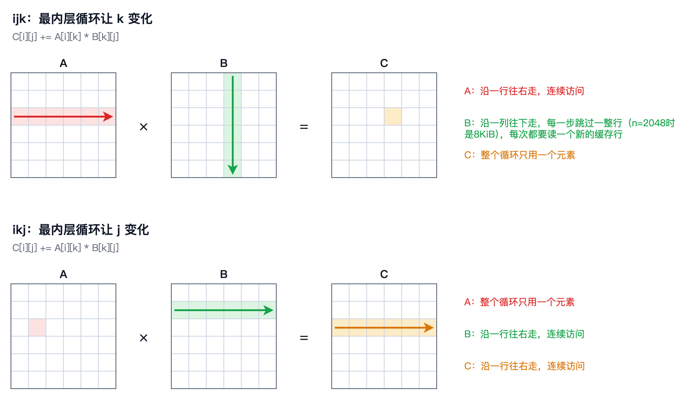
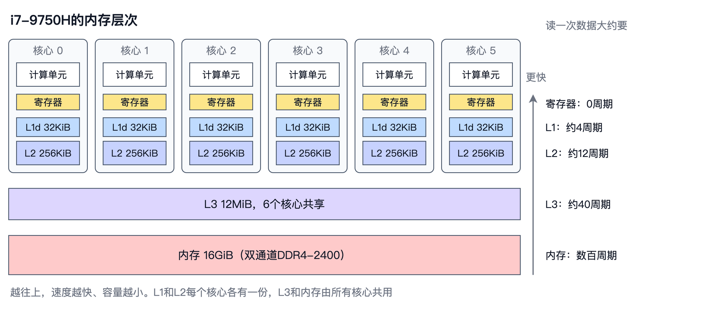
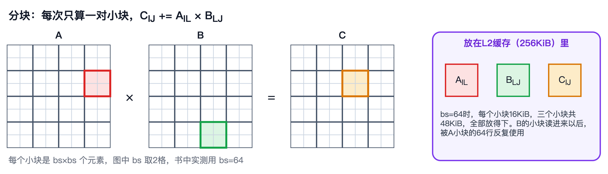

# 第 2 章　在CPU上算矩阵乘法

上一章我们把矩阵乘法这个问题本身弄清楚了：一个 $n \times n$ 的矩阵乘法要做 $2n^3$ 次浮点运算，速度用GFLOPS来衡量。我们还约定了一个贯穿全书的基准问题。这一章，我们就在CPU上把这个基准问题跑起来。

这一章会从最慢的写法出发，一步一步换成更快的写法。所有写法做的都是同一个计算，浮点运算次数一次不多、一次不少，但最慢的和最快的之间，速度相差了上千倍。我们先用纯Python写一个三重循环，学会怎样测速；然后把它翻译成C语言，看看编译器能帮多少忙；接着调换循环的顺序，第一次体会到访存对速度的影响；再打开SIMD，让一条指令同时处理多个数；然后认识CPU的缓存，用分块的办法把数据留在缓存里；之后用上多个CPU核心；最后看看NumPy为什么比我们写的所有版本都快。

本章的随书代码在`code/ch02/`目录下。`matmul.c`实现了C语言的几个版本，`make`可以编译出三个程序，分别对应三种编译选项；`python_loop.py`和`numpy_bench.py`是两个Python脚本；`bench.sh`会一次跑完本章的全部实验，把结果写进`results.txt`。本章引用的所有数字都来自这个文件。

这些数字是在我的笔记本电脑上测的，CPU是Intel Core i7-9750H，6个核心，12个线程。笔记本的性能会随温度、电源和后台程序明显波动，同一个实验前后跑两次，相差一两倍也不奇怪。为了减小波动，较快的实验我都跑了好几遍，取最快的一次。即便如此，你在自己的机器上跑出的数字肯定会不一样，也不必在意个位数上的差别，重点是数量级，以及不同写法之间相差多少倍。


## Python三重循环

我们从最直接的写法开始，也就是第1章点积视角里的那个三重循环。`python_loop.py`中的实现如下：

```python
def matmul(A, B):
    n = len(A)
    C = [[0.0] * n for _ in range(n)]
    for i in range(n):
        for j in range(n):
            s = 0.0
            for k in range(n):
                s += A[i][k] * B[k][j]
            C[i][j] = s
    return C
```

测速的方法很简单：记下开始和结束的时间，二者相减得到耗时 $t$ ，再用 $2n^3 / t$ 换算成每秒的浮点运算次数。Python中计时要用`time.perf_counter()`，它的精度比`time.time()`高，也不会因为系统校正时钟而跳变。运行这个脚本，结果如下：

```
n=64      0.016 秒  0.0324 GFLOPS  与NumPy的最大差异 8.9e-15
n=128     0.118 秒  0.0354 GFLOPS  与NumPy的最大差异 2.5e-14
n=256     1.267 秒  0.0265 GFLOPS  与NumPy的最大差异 7.1e-14
```

最后一列说明结果是对的，和NumPy算出来的只差最后几位。速度则只有每秒0.03GFLOPS左右，也就是每秒三千万次浮点运算。这个数字听上去不小，但换算一下就知道有多慢：按这个速度，第1章约定的 $n = 4096$ 的基准问题要算1374亿次，需要大约一个半小时；就连 $n = 2048$ 也要十多分钟。所以，纯Python版本只测到 $n = 256$ 为止。

顺便一提，Python的浮点数是64位的双精度数，也就是FP64，对应C语言里的`double`；而本书的基准问题用的是32位的FP32。这一点对Python版本的速度几乎没有影响，因为它慢的原因根本不在浮点运算上。最内层那一行`s += A[i][k] * B[k][j]`，在CPU看来远不止一次乘法和一次加法：解释器要逐条解释字节码，要两次查列表的下标，要从Python的浮点对象里取出数值，算完再包装成新的浮点对象。真正的乘加只占其中极小的一部分，大部分时间都花在了解释器的这些杂务上。


## 换成C语言

要去掉解释器的开销，最直接的办法是换成编译型语言。`matmul.c`里的第一个版本，就是把上面的Python代码原样翻译成C语言：

```c
void matmul_ijk(int n, const float *A, const float *B, float *C) {
    for (int i = 0; i < n; i++)
        for (int j = 0; j < n; j++) {
            float sum = 0.0f;
            for (int k = 0; k < n; k++)
                sum += A[i * n + k] * B[k * n + j];
            C[i * n + j] = sum;
        }
}
```

矩阵按第1章说的行主序存放在一维数组里，所以 $a_{ik}$ 写成`A[i * n + k]`。按 $i$ 、 $j$ 、 $k$ 三个下标的循环顺序，我们把这个版本叫做ijk版本。从这一节开始，C语言版本都在 $n = 2048$ 上测量，这个规模下三个矩阵一共48MiB，已经比CPU的缓存大得多，后面会看到这一点很重要。

对C程序来说，速度和编译选项关系很大。`Makefile`用clang编译出了几个程序，其中`matmul_O0`使用`-O0`，也就是不做任何优化；`matmul`使用`-O2`，这是最常用的优化级别（这里还额外关掉了自动向量化，原因下一节再说）。两个程序运行ijk版本的结果如下：

```
ijk      n=2048  bs=64   threads=1     117.224 秒      0.15 GFLOPS
ijk      n=2048  bs=64   threads=1      56.748 秒      0.30 GFLOPS
```

即使不开优化，C语言版本也比Python快了5倍多；打开`-O2`之后，速度又翻了一倍，达到0.30GFLOPS。不开优化时，编译器会老老实实地把`sum`、`i`、`j`、`k`这些变量放在内存里，每用一次就读一次、写一次；开了优化，它们就都待在CPU的寄存器里，循环里多余的计算也被省掉了。

但0.30GFLOPS依然很慢。这颗CPU每个核心每秒能完成几十亿次乘加，而我们的程序每秒只做了一亿五千万次乘加。下一节会看到，问题出在一个看上去完全无关的地方：循环的顺序。


## 循环顺序

在第1章，我们看到点积视角和外积视角的代码几乎一样，只是循环的顺序不同。三重循环一共有六种排列方式，它们算出来的结果完全相同，计算量也完全相同。我们把ijk版本中 $j$ 和 $k$ 两层循环对调，得到ikj版本：

```c
void matmul_ikj(int n, const float *A, const float *B, float *C) {
    memset(C, 0, sizeof(float) * n * n);
    for (int i = 0; i < n; i++)
        for (int k = 0; k < n; k++) {
            float a = A[i * n + k];
            for (int j = 0; j < n; j++)
                C[i * n + j] += a * B[k * n + j];
        }
}
```

这个版本先取出一个 $a_{ik}$ ，然后用它乘以 $\mathbf{B}$ 的第 $k$ 行，累加到 $\mathbf{C}$ 的第 $i$ 行上。同样用`-O2`编译，运行结果如下：

```
ikj      n=2048  bs=64   threads=1       4.640 秒      3.70 GFLOPS
```

从0.30GFLOPS到3.70GFLOPS，只是调换了两行代码的顺序，速度就提高了12倍。原因就在第1章讲过的内存布局上。看ijk版本的最内层循环：每走一步， $k$ 加一，`A[i * n + k]`在 $\mathbf{A}$ 的一行上往右挪一个位置，访问是连续的；但`B[k * n + j]`是在 $\mathbf{B}$ 的一列上往下走，每一步都要跳过一整行，也就是2048个float、8KiB。ikj版本的最内层循环则是 $j$ 在变，`C[i * n + j]`和`B[k * n + j]`都在各自的一行上往右走，访问全是连续的。

下图把两个版本的最内层循环画了出来，浅色的格子是最内层循环走一轮会碰到的元素，箭头是访问的方向。ijk版本里，红色箭头沿着 $\mathbf{A}$ 的一行往右走，绿色箭头却沿着 $\mathbf{B}$ 的一列往下走， $\mathbf{C}$ 从头到尾只用一个元素；ikj版本里， $\mathbf{A}$ 只用一个元素，绿色和橙色两个箭头都沿着一行往右走。矩阵在内存里按行存放，沿一行走，就是沿着内存地址连续地走；沿一列走，每一步都要跳过一整行。



图里只画了最内层循环的一轮。想看完整的过程，可以打开随书代码里的`tools/loop-order/`，和第1章的工具一样，用浏览器直接打开`index.html`就能用。页面上可以在六种循环顺序之间切换，一步一步地播放。除了三个矩阵，它还把每个矩阵按行主序摊成一维数组，用箭头标出每一步访问的地址比上一步跳了多远，并统计连续访问和跳跃访问各有多少次。切到ijk， $\mathbf{B}$ 每一步都在跳；切到ikj， $\mathbf{B}$ 和 $\mathbf{C}$ 几乎全是连续的。六种顺序里，ijk就是第1章的点积视角，kij就是外积视角。kij和ikj只差最外面两层的顺序，最内层循环的访存完全一样，区别在于kij每一轮都要把整个 $\mathbf{C}$ 读写一遍，ikj则只盯着 $\mathbf{C}$ 的一行。

为什么连续访问会快这么多？这是因为CPU从内存读数据时，一次读一整块，叫做**缓存行**（Cache Line），在这颗CPU上是64字节，正好装得下16个float。读来的缓存行会暂存在CPU内部的**缓存**（Cache）里，下次再访问同一块数据，就不用再去内存了。连续访问时，读一次缓存行，接下来的15个float都可以直接从缓存里取；而跳跃访问时，每读一个float都要换一个新的缓存行，读进来的64字节只用上了4字节，其余的全浪费了。

这是我们第一次亲眼看到：计算量一点没变，仅仅因为访问内存的方式不同，速度就能差出一个数量级。这个现象会贯穿全书。在GPU上，同样的问题换了一个名字，叫做访存合并，第7章会专门讨论。


## SIMD

现代CPU还有一个提速的手段，叫做**SIMD**（Single Instruction, Multiple Data），意思是一条指令同时处理多个数据。x86 CPU上的SIMD指令是一代一代扩展出来的：早期的SSE使用128位的寄存器；AVX（Advanced Vector Extensions）把寄存器加宽到256位；AVX2是AVX的第二版，2013年随Intel的Haswell架构推出，AMD的CPU后来也支持；更新的AVX-512则加宽到512位。这颗CPU支持AVX2，它的寄存器有256位宽，可以同时装下8个float，一条指令就能把8对float同时相加或相乘。它还支持FMA（Fused Multiply-Add）指令，一条指令完成一次乘法加一次加法。二者结合，一条指令就能完成8次乘加，也就是16次浮点运算。

上一节的`matmul`程序特意用`-fno-vectorize`关掉了编译器的自动向量化，所以它只用普通的标量指令，一次算一个数。现在换成`matmul_simd`，它用`-O3 -march=native`编译，`-march=native`允许编译器使用本机CPU支持的全部指令，包括AVX2和FMA。用`objdump`反汇编ikj版本的最内层循环，可以看到下面这样的指令：

```
vmovups	-0x20(%r9,%rsi), %ymm3
vmovups	(%r9,%rsi), %ymm4
vfmadd213ps	-0x60(%r12,%rsi), %ymm0, %ymm1 ## ymm1 = (ymm0 * ymm1) + mem
vfmadd213ps	-0x40(%r12,%rsi), %ymm0, %ymm2 ## ymm2 = (ymm0 * ymm2) + mem
vfmadd213ps	-0x20(%r12,%rsi), %ymm0, %ymm3 ## ymm3 = (ymm0 * ymm3) + mem
vfmadd213ps	(%r12,%rsi), %ymm0, %ymm4 ## ymm4 = (ymm0 * ymm4) + mem
```

其中，`ymm`开头的就是256位的寄存器，`vfmadd213ps`就是对8个float同时做乘加的FMA指令。编译器还把循环展开了4次，一轮循环处理32个float。我们一行代码都没改，只是换了编译选项，编译器就自动把ikj版本的内层循环改写成了SIMD指令。在 $n = 2048$ 上测量的结果却有点让人失望：

```
ijk      n=2048  bs=64   threads=1      72.830 秒      0.24 GFLOPS
ikj      n=2048  bs=64   threads=1       4.013 秒      4.28 GFLOPS
```

可以看到，ikj版本只从3.70GFLOPS提高到4.28GFLOPS，几乎没有变化。ijk版本则根本没有用上SIMD，这是因为它的内层循环是把 $n$ 个乘积累加到同一个`sum`上，要向量化，就得把这些加法分成8组同时进行，最后再合并，这会改变加法的顺序。第1章说过，浮点数的加法不满足结合律，改变顺序就可能改变结果，所以编译器不敢擅自这样做。ikj版本没有这个问题，它的内层循环是对 $\mathbf{C}$ 一行中的不同元素分别做乘加，彼此独立，怎么并行都不影响结果。

那为什么ikj版本用上了SIMD，却没有变快呢？换成小一点的矩阵试试：

```
ikj      n=256   bs=64   threads=1       0.008 秒      4.07 GFLOPS
ikj      n=256   bs=64   threads=1       0.002 秒     22.13 GFLOPS
ikj      n=512   bs=64   threads=1       0.070 秒      3.82 GFLOPS
ikj      n=512   bs=64   threads=1       0.012 秒     22.88 GFLOPS
```

每个规模的两行，前一行是标量版本，后一行是SIMD版本。在 $n = 256$ 和 $n = 512$ 时，SIMD让速度提高了5到6倍，效果非常明显。可到了 $n = 2048$ ，这个提升就消失了。这说明在大矩阵上，瓶颈已经不在计算了：计算单元在等数据，算得再快也没有用。


## 缓存与分块

要理解大矩阵为什么慢，得先认识CPU的**内存层次**（Memory Hierarchy）。CPU和内存之间，隔着好几级缓存：离计算单元越近，速度越快，容量越小。这颗CPU每个核心有自己的一级缓存（L1 Cache，数据部分32KiB）和二级缓存（L2 Cache，256KiB），6个核心还共享一个12MiB的三级缓存（L3 Cache），再往外才是16GiB的内存。后面把这三级缓存分别简称为L1、L2、L3。从L1读数据只需要几个时钟周期，从内存读则要上百个时钟周期。



现在回头看ikj版本。计算 $\mathbf{C}$ 的第 $i$ 行时， $k$ 从0走到 $n-1$ ，每一步都要读 $\mathbf{B}$ 的一整行，所以算完 $\mathbf{C}$ 的一行，就把整个 $\mathbf{B}$ 从头到尾读了一遍。下一行又要把整个 $\mathbf{B}$ 再读一遍。 $\mathbf{B}$ 放得进缓存时，这没什么问题，从第二行开始， $\mathbf{B}$ 都可以从缓存里读；可一旦 $\mathbf{B}$ 大到放不进缓存，每一行都只能重新从内存里读。在 $n = 2048$ 时， $\mathbf{B}$ 有16MiB，已经超过了12MiB的L3。而最内层循环每做一次乘加（2次浮点运算），就要读一个4字节的 $b_{kj}$ ，4.28GFLOPS相当于每秒从内存读8.6GB的数据，这差不多就是单个核心能从内存拿到数据的极限了。

解决的办法，就是第1章介绍过的分块视角。我们把三个矩阵都切成 $bs \times bs$ 的小块，每次只算一个小块对另一个小块的贡献。在算这一对小块的时候，用到的数据只有三个小块，可以全部放进缓存，在缓存里被反复使用。`matmul.c`中的分块版本如下：

```c
for (int ii = 0; ii < n; ii += bs)
    for (int kk = 0; kk < n; kk += bs)
        for (int jj = 0; jj < n; jj += bs)
            for (int i = ii; i < ii + bs; i++)
                for (int k = kk; k < kk + bs; k++) {
                    float a = A[i * n + k];
                    for (int j = jj; j < jj + bs; j++)
                        C[i * n + j] += a * B[k * n + j];
                }
```

为了看得清楚，这里省略了矩阵尺寸不是 $bs$ 的整数倍时的边界处理，完整代码见`matmul.c`。外面三层循环挑出一对小块，里面三层循环就是一个小号的ikj版本。当 $bs = 64$ 时，一个小块是 $64 \times 64$ 个float，16KiB，三个小块加起来48KiB，可以放进L2。 $\mathbf{B}$ 的一个小块载入缓存之后，会被 $\mathbf{A}$ 的一个小块的64行反复使用，而不是用一次就被挤出去。



下面是ikj版本和分块版本（ $bs = 64$ ）在不同规模上的对比，两者都用`-O3 -march=native`编译：

```
ikj      n=256   bs=64   threads=1       0.001 秒     26.11 GFLOPS
blocked  n=256   bs=64   threads=1       0.002 秒     20.64 GFLOPS
ikj      n=512   bs=64   threads=1       0.012 秒     23.08 GFLOPS
blocked  n=512   bs=64   threads=1       0.014 秒     19.81 GFLOPS
ikj      n=1024  bs=64   threads=1       0.283 秒      7.60 GFLOPS
blocked  n=1024  bs=64   threads=1       0.141 秒     15.28 GFLOPS
ikj      n=2048  bs=64   threads=1       4.014 秒      4.28 GFLOPS
blocked  n=2048  bs=64   threads=1       1.283 秒     13.39 GFLOPS
ikj      n=4096  bs=64   threads=1      33.076 秒      4.16 GFLOPS
blocked  n=4096  bs=64   threads=1      11.434 秒     12.02 GFLOPS
```

从结果来看，ikj版本在矩阵较小时很快，在 $n = 1024$ 时开始掉速，到 $n = 2048$ 以后就稳定在4GFLOPS出头。 $n = 1024$ 时 $\mathbf{B}$ 只有4MiB，按说放得进12MiB的L3，但L3是6个核心和所有程序共用的，实际能留给我们的没有那么多。分块版本在小矩阵上反而稍慢一点，因为这时数据本来就在缓存里，多出来的三层循环只是额外的开销；但它在大矩阵上一直保持在12到15GFLOPS，是ikj版本的3倍左右。

块大小也会影响速度。在 $n = 2048$ 上试了几种块大小：

```
blocked  n=2048  bs=16   threads=1      11.866 秒      1.45 GFLOPS
blocked  n=2048  bs=32   threads=1       1.356 秒     12.67 GFLOPS
blocked  n=2048  bs=64   threads=1       1.557 秒     11.03 GFLOPS
blocked  n=2048  bs=128  threads=1       1.480 秒     11.61 GFLOPS
blocked  n=2048  bs=256  threads=1       1.111 秒     15.46 GFLOPS
```

块大小从32到256，速度都在11到15GFLOPS之间，彼此的差别还不如测量本身的波动大（同样是 $bs = 64$ ，这里测出11.03，上面测出13.39）。唯独 $bs = 16$ 慢得出奇，只有1.45GFLOPS。原因藏在前面那段汇编里：编译器生成的SIMD循环一轮要处理32个float，而块大小为16时，最内层循环一共只有16次，凑不满一轮，于是只能退回到逐个计算的标量代码。可见块大小既要小到放得进缓存，又要大到不妨碍SIMD发挥作用。

分块是这一章最重要的思想，我们会在GPU上再见到它。第8章在GPU上做分块时，“快的存储”从缓存换成了GPU上的共享内存，但道理完全相同：把一小块数据搬到快的地方，在那里尽可能多地使用它。


## 多线程

到目前为止，我们的程序都只用了一个CPU核心，而这颗CPU有6个核心。要把它们都用上，最简单的办法是把 $\mathbf{C}$ 的行平均分给几个线程，每个线程负责其中一段，各自做分块计算。不同线程写的是 $\mathbf{C}$ 中不同的行，互不干扰，不需要任何同步。`matmul.c`用pthread实现了这个版本，核心部分只有几行：

```c
for (int t = 0; t < nt; t++) {
    task[t] = (Task){n, bs, n * t / nt, n * (t + 1) / nt, A, B, C};
    pthread_create(&tid[t], NULL, worker, &task[t]);
}
for (int t = 0; t < nt; t++) pthread_join(tid[t], NULL);
```

每个线程负责第`n * t / nt`行到第`n * (t + 1) / nt`行。在 $n = 2048$ 、 $bs = 64$ 时，不同线程数的结果如下：

```
threads  n=2048  bs=64   threads=1       1.334 秒     12.88 GFLOPS
threads  n=2048  bs=64   threads=2       0.672 秒     25.57 GFLOPS
threads  n=2048  bs=64   threads=3       0.524 秒     32.78 GFLOPS
threads  n=2048  bs=64   threads=6       0.349 秒     49.30 GFLOPS
threads  n=2048  bs=64   threads=12      0.332 秒     51.73 GFLOPS
```

用2个线程时，速度几乎正好翻倍；但到了6个线程，速度只是单线程的3.8倍，而不是6倍。原因有好几个：多个核心要共享L3和内存带宽；同时工作的核心越多，CPU为了控制发热，主频也会降得越多；而我的笔记本上同时还开着别的程序。至于12个线程，它用上了CPU的**超线程**（Hyper-Threading），让每个核心同时运行两个线程，但同一个核心上的两个线程共用同一套计算单元，所以速度几乎没有提高。总之，多线程把我们的最好成绩推到了50GFLOPS左右。这已经是Python版本的近两千倍了，但离NumPy还有不小的距离。


## NumPy为什么快

最后，我们看看NumPy。用NumPy算矩阵乘法只需要一行代码`A @ B`，`numpy_bench.py`测量了它在FP32下的速度。NumPy默认会使用全部CPU核心，脚本可以用环境变量限制线程数，下面分别是单线程和默认线程数的结果：

```
NumPy 2.5.4，BLAS：accelerate unknown，线程数：1
n=512      0.006 秒      41.6 GFLOPS
n=1024     0.053 秒      40.3 GFLOPS
n=2048     0.431 秒      39.9 GFLOPS
n=4096     2.694 秒      51.0 GFLOPS
NumPy 2.5.4，BLAS：accelerate unknown，线程数：默认
n=512      0.001 秒     202.4 GFLOPS
n=1024     0.012 秒     177.5 GFLOPS
n=2048     0.106 秒     161.9 GFLOPS
n=4096     0.832 秒     165.2 GFLOPS
```

在 $n = 2048$ 上，NumPy单线程大约40GFLOPS，是我们单线程分块版本的3倍；多线程大约160GFLOPS，也是我们多线程版本的3倍。这两组数字的波动也很大，我在不同时候测过几次，单线程的结果从40到100GFLOPS都出现过，但无论哪一次，NumPy都明显快于我们自己写的版本。而且，它在大矩阵上也不掉速，显然没有被缓存的问题困住。

实际上，NumPy本身并不实现矩阵乘法。它把这个计算交给第1章提到的BLAS库，调用其中的单精度矩阵乘法函数`sgemm`。BLAS只是一套接口标准，实现它的库有很多：Linux上的NumPy通常使用开源的OpenBLAS，Intel提供了MKL，而在macOS上，NumPy使用的是苹果自带的Accelerate，上面的输出就显示了这一点。这些库都花了大量的工夫，为各种CPU专门调优矩阵乘法。

它们用到的技术，在Goto和van de Geijn的论文《Anatomy of High-Performance Matrix Multiplication》（ACM Transactions on Mathematical Software，2008）中有详细的描述，主要有以下几点：

- **多级分块**（Multi-level Blocking）：不只分一次块，而是针对L1、L2、L3各级缓存的容量分别选择块的大小，让每一级缓存里都放着最该被复用的数据。
- **打包**（Packing）：计算前先把要用的小块复制到一块连续的内存里，并按照计算的顺序重新排列。这样做多花了一次复制，但之后的访问全是连续的。
- **寄存器分块**（Register Blocking）与**微内核**（Micro-kernel）：最内层用手工编写的汇编代码，一次计算 $\mathbf{C}$ 的一个小块，例如 $6 \times 16$ 个元素，把它们全部放在寄存器里。每次从 $\mathbf{A}$ 取一列中的6个数、从 $\mathbf{B}$ 取一行中的16个数，做一次外积，累加到这96个元素上。读进寄存器的每个数都被用了很多次，计算单元几乎不用等数据。
- **多线程**：在多个层次上划分任务，让多个核心协同工作，同时尽量减少它们对缓存和内存带宽的争抢。

其中第三点值得多说一句。我们的ikj版本和分块版本，每做一次乘加，都要从缓存里读一个 $b_{kj}$ ，再读写一次 $c_{ij}$ ；而微内核让 $\mathbf{C}$ 的小块一直留在寄存器里，每读进一个数就用上十几次。这正是第1章外积视角的用法：数据取一次、用很多次。分块解决的是内存和缓存之间的问题，寄存器分块解决的是缓存和计算单元之间的问题。到了GPU上，我们会在第8章和第9章，把这两层分块再各做一遍。


## 基准表

到这里，我们可以把第1章约定的基准表填上第一批数据了。除了Python版本只测到 $n = 256$ ，其余都是 $n = 2048$ 的结果：

| 版本 | 规模 | GFLOPS |
|---|---|---|
| Python三重循环 | $n = 256$ | 0.03 |
| C，ijk，`-O0` | $n = 2048$ | 0.15 |
| C，ijk，`-O2` | $n = 2048$ | 0.30 |
| C，ikj，`-O2` | $n = 2048$ | 3.70 |
| C，ikj，SIMD | $n = 2048$ | 4.28 |
| C，分块，SIMD | $n = 2048$ | 13.39 |
| C，分块，SIMD，6线程 | $n = 2048$ | 49.30 |
| NumPy，单线程 | $n = 2048$ | 39.9 |
| NumPy，多线程 | $n = 2048$ | 161.9 |

从第一行到最后一行，速度提高了六千多倍；就算从C语言的第一个版本算起，也有一千多倍。而这些版本做的浮点运算次数完全一样。第1章说过，基准表里除了GFLOPS，还要记录它达到了硬件理论峰值的百分之多少。这颗CPU的理论峰值是多少，NumPy离它还有多远，我们自己写的版本又差在哪里，这些问题要等下一章学会计算峰值和画roofline之后才能回答。


## 本章小结

这一章，我们在CPU上把同一个矩阵乘法写了好几遍，速度从0.03GFLOPS一路提高到160GFLOPS左右，而浮点运算的次数始终没变。纯Python慢在解释器的开销上，换成C语言并打开编译优化，就能快上十倍。调换循环的顺序，让最内层循环连续地访问内存，又快了十多倍，因为CPU总是以64字节的缓存行为单位读取内存。打开SIMD之后，一条指令可以同时完成8次乘加，小矩阵快了5到6倍，大矩阵却几乎没有变化，因为瓶颈已经从计算转移到了访存上。分块让数据留在缓存里反复使用，解决了大矩阵的访存问题；多线程则把6个核心都用了起来。

至于NumPy，它把矩阵乘法交给BLAS库，后者用多级分块、打包、寄存器分块的微内核和多线程，把CPU的潜力发挥得比我们好得多。贯穿这一切的，是同一个道理：计算本身很便宜，搬运数据才是昂贵的；要算得快，就要让数据待在离计算单元近的地方，并且尽可能多地使用它。

下一章，我们暂时不写新的代码，而是从硬件参数出发，算出一颗芯片最快能有多快，并用roofline模型把“计算”和“访存”这两种瓶颈放在同一张图上来看。
