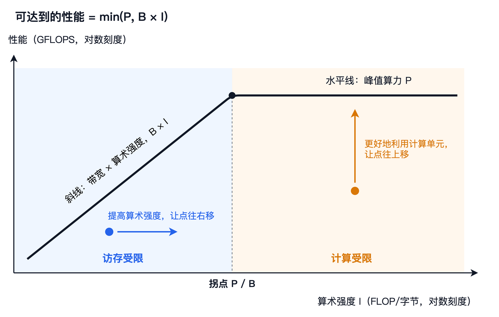
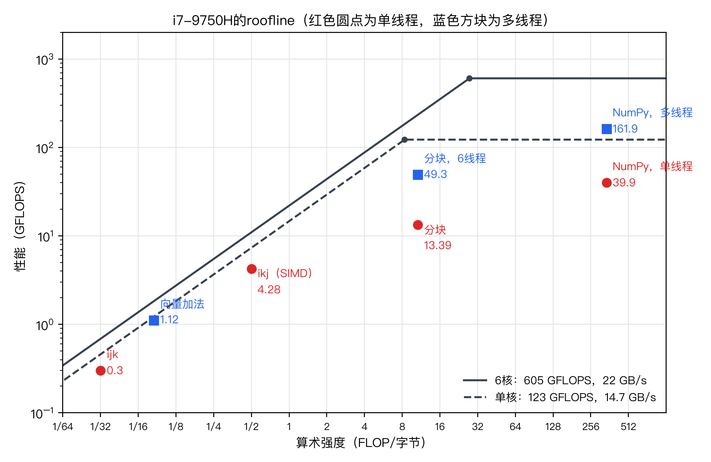

# 第 3 章　性能的天花板

上一章，我们在CPU上把矩阵乘法写了好几遍，最慢的0.03GFLOPS，最快的160GFLOPS左右。但这些数字到底算快还是算慢，我们其实说不清楚。160GFLOPS离这颗CPU的极限还有多远？分块版本为什么停在了13GFLOPS，再往上的阻碍是什么？还有上一章留下的那个疑问：SIMD让小矩阵快了5到6倍，为什么对大矩阵几乎没有作用？

这一章就来回答这些问题。我们暂时不写新的矩阵乘法，而是从硬件出发，搞清楚一颗芯片有两块“天花板”：一块是它每秒最多能做多少次浮点运算，叫做**峰值算力**（Peak Performance）；另一块是它每秒最多能从内存搬运多少数据，叫做**内存带宽**（Memory Bandwidth）。然后，我们引入算术强度的概念，把这两块天花板拼成一张图，这就是roofline模型。有了这张图，任何一段程序是被计算卡住还是被访存卡住，离天花板还有多远，都可以一眼看出来。

本章的随书代码在`code/ch03/`目录下。`peak.c`和`bandwidth.c`是两个小测试程序，分别实测峰值算力和内存带宽；`bench.sh`会把它们都跑一遍，结果写进`results.txt`；`plot_roofline.py`读取这份结果和上一章的结果，画出本章的roofline图。和上一章一样，书中引用的数字都来自这两个结果文件。


## 峰值算力

先看第一块天花板。峰值算力说的是一颗芯片每秒最多能做多少次浮点运算，这个上限由硬件决定，程序写得再好也不可能超过它。它取决于三样东西：有几个核心，每个核心的时钟跑多快，每个核心在一个时钟周期里能完成多少次浮点运算。三者相乘，就得到估算峰值算力的公式：

$$
\text{峰值算力} = \text{核心数} \times \text{主频} \times \text{每个核心每个时钟周期的浮点运算次数}
$$

前两项很容易查到。我的CPU是Intel Core i7-9750H，有6个核心，标称主频2.6GHz。第三项要看CPU的微架构。上一章说过，这颗CPU支持AVX2和FMA指令，一条FMA指令可以对8个float同时做乘加，也就是16次浮点运算。而它的每个核心里有两个能执行FMA指令的计算单元，每个时钟周期各能完成一条。所以，每个核心每个时钟周期最多可以完成 $2 \times 8 \times 2 = 32$ 次单精度浮点运算。

代入公式，峰值算力是 $6 \times 2.6 \times 32 = 499.2$ GFLOPS。不过，这个数字并不准确，因为主频不是一个固定的值。现代CPU有**睿频**（Turbo Boost）功能，在温度和功耗允许时会自动提高主频，这颗CPU单核最高可以达到4.5GHz；但同时工作的核心越多，发热越大，能维持的主频就越低。所以，它的“理论峰值”取决于你按哪个主频来算，从499.2GFLOPS到 $6 \times 4.5 \times 32 = 864$ GFLOPS都说得通，后者是在所有核心都跑在最高主频时才能达到的，实际上做不到。

既然理论值说不清楚，不如直接测。`peak.c`的思路很简单：让CPU反复执行大量FMA指令，既不访问内存，也不做别的事情，看看每秒能完成多少次浮点运算。它的核心循环如下：

```c
for (long i = 0; i < ITERS; i++)
    for (int c = 0; c < CHAINS; c++) {
        acc[c] = _mm256_fmadd_ps(acc[c], x, y);
        __asm__ volatile("" : "+x"(acc[c]));
    }
```

代码中的`_mm256_fmadd_ps`，是AVX2的FMA指令在C语言里的写法，它对8个float同时计算`acc * x + y`。这里有两个细节。第一，循环里同时维护了 $\text{CHAINS} = 12$ 个互不相关的累加器。一条FMA指令从开始到出结果需要4个时钟周期，如果只有一个累加器，下一条FMA必须等上一条算完才能开始，两个计算单元大部分时间都在空等。至少要有 $4 \times 2 = 8$ 条互不依赖的FMA同时在执行，才能把两个计算单元都喂饱。第二，那行`__asm__ volatile`是写给编译器看的，它不产生任何指令，作用是阻止编译器发现这个循环的结果没什么用，从而把整个循环优化掉。我第一次写这个程序时就没有加它，结果测出了每秒几百万亿次运算，显然是循环根本没有执行。

用`bench.sh`跑一遍，结果如下：

```
scalar threads=1     0.314 秒      15.3 GFLOPS
avx2   threads=1     0.313 秒     122.7 GFLOPS
avx2   threads=2     0.322 秒     238.3 GFLOPS
avx2   threads=3     0.341 秒     337.5 GFLOPS
avx2   threads=6     0.381 秒     605.3 GFLOPS
avx2   threads=12    0.732 秒     629.7 GFLOPS
```

第一行是标量FMA，一条指令只算一个数；后面几行是AVX2的FMA，线程数从1到12。单核的122.7GFLOPS除以32，相当于主频3.83GHz，说明单核运行时，CPU处在睿频状态。6个核心一起跑时是605.3GFLOPS，平均到每个核心，相当于主频3.15GHz，比单核时低了不少。标量和SIMD正好差8倍左右，这就是一条指令同时算8个数的效果。12个线程比6个线程几乎没有提高，原因和上一章一样，超线程并不增加计算单元。

本书以后就把实测的这两个数，当作这颗CPU实际可以达到的峰值：单核122.7GFLOPS，6核605.3GFLOPS。注意，要达到这个峰值，需要同时满足好几个条件：用上SIMD，用上FMA，有足够多互不依赖的运算，用上所有核心。少了任何一条，天花板就会低很多。比如上一章那个关掉了自动向量化的`matmul`程序，它的单核天花板只有标量FMA的15.3GFLOPS，而且它的代码里乘法和加法是分开的，连这个数也达不到。


## 内存带宽

第二块天花板是内存带宽，也就是每秒能在内存和CPU之间搬运多少字节。它同样可以从硬件参数估算：

$$
\text{内存带宽} = \text{通道数} \times \text{每个通道的位宽} \times \text{每秒传输次数}
$$

这台电脑插了两条DDR4-2400的内存，组成双通道。DDR4每个通道的位宽是64位，也就是8个字节；“2400”是指每秒传输2400百万次（系统信息里常常把它写成2400 MHz，其实单位应该是MT/s）。所以理论带宽是 $2 \times 8 \times 2400 \times 10^6 = 38.4 \times 10^9$ 字节每秒，也就是38.4GB/s。注意这里的GB是 $10^9$ 字节，而不是 $2^{30}$ 字节的GiB，带宽习惯上都用前者。

同样，我们也实测一下。`bandwidth.c`分配了三个各256MiB的数组，远远大于12MiB的L3，所以每次访问都要真正读写内存。它测了三种操作：只读（把一个数组的所有元素加起来）、复制（把一个数组复制到另一个）、向量加法（把两个数组逐个相加，写进第三个）。结果如下：

```
read  threads=1    0.0182 秒    14.7 GB/s
read  threads=6    0.0122 秒    22.0 GB/s
copy  threads=1    0.0401 秒    13.4 GB/s
copy  threads=6    0.0328 秒    16.4 GB/s
add   threads=1    0.0607 秒    13.3 GB/s    1.10 GFLOPS
add   threads=6    0.0601 秒    13.4 GB/s    1.12 GFLOPS
```

只读时，单个核心能达到14.7GB/s，6个核心一起读能达到22.0GB/s，大约是理论值的57%。实测带宽达不到理论值是常态，内存控制器的调度、刷新等都会占用一部分；单个核心则受限于它同时能发出的读请求数量，拿不满整个带宽。复制和向量加法测出的带宽更低一些，这是因为CPU往内存写数据时，通常要先把目标所在的缓存行读进缓存，再修改、写回，实际搬运的字节数比程序“看上去”的要多。所以，我们就把只读的结果当作这台机器实际可以达到的带宽：单核14.7GB/s，6核22.0GB/s。

现在把两块天花板放在一起比较一下。6个核心每秒能做605.3G次浮点运算，却只能从内存读22.0G个字节，也就是5.5G个float。换句话说，从内存里读来的每一个float，平均要参与110次浮点运算，计算单元才不会闲着。这就是现代硬件的基本处境：计算很便宜，搬运数据很昂贵。上一章反复看到的现象，根源就在这里。


## 算术强度

一段程序能不能喂饱计算单元，取决于它每搬运一个字节的数据，要做多少次浮点运算。这个比值叫做**算术强度**（Arithmetic Intensity），单位是FLOP/字节：

$$
\text{算术强度} = \frac{\text{浮点运算次数}}{\text{在内存和芯片之间搬运的字节数}}
$$

第1章其实已经算过两个例子。两个长度为 $n$ 的FP32向量相加，要做 $n$ 次加法，读两个向量、写一个向量，一共搬运 $12n$ 个字节，算术强度是 $1/12$ ，而且不管 $n$ 多大都不会变。 $n \times n$ 的矩阵乘法要做 $2n^3$ 次运算，最少只需搬运 $12n^2$ 个字节，算术强度是 $n/6$ ，矩阵越大，算术强度越高。 $n = 2048$ 时，它是341 FLOP/字节，远远超过上一节算出的110次运算每float，也就是27.5 FLOP/字节。

但是要注意， $n/6$ 只是矩阵乘法这个算法在理想情况下的算术强度，前提是每个元素只从内存读一次。程序实际达到的算术强度，取决于它怎样访问数据。同一个矩阵乘法，不同的写法，实际搬运的字节数可以相差几百倍。我们来估算一下上一章几个版本在 $n = 2048$ 时的实际算术强度。

先看ijk版本。它的最内层循环沿着 $\mathbf{B}$ 的一列往下走，每一步都要读一个新的64字节缓存行，却只用到其中的4个字节。 $\mathbf{A}$ 的那一行是连续访问的，可以忽略。所以，它每做一次乘加（2次浮点运算），就要从内存搬运64个字节，算术强度只有 $2/64 = 1/32$ 。

再看ikj版本。上一章分析过，它每算 $\mathbf{C}$ 的一行，就要把整个 $\mathbf{B}$ 读一遍，而 $\mathbf{B}$ 有16MiB，放不进缓存。 $\mathbf{C}$ 的那一行只有8KiB，一直待在缓存里。所以它每做一次乘加，要从内存读一个4字节的 $b_{kj}$ ，算术强度是 $2/4 = 1/2$ 。

最后看分块版本。块大小为 $bs$ 时， $\mathbf{B}$ 的每个小块被读进缓存之后，会被 $bs$ 行反复使用，所以整个 $\mathbf{B}$ 只需从内存读 $n/bs$ 遍，而不是 $n$ 遍。 $\mathbf{C}$ 的每一块也要读写 $n/bs$ 遍。粗略地说，总的搬运量大约是 $3 \times (n/bs) \times n^2$ 个float，也就是 $12n^3/bs$ 个字节，算术强度大约是 $bs/6$ 。 $bs = 64$ 时，大约是10.7 FLOP/字节。

这三个估算都比较粗糙，但足以说明问题：从ijk到ikj再到分块，算术强度从 $1/32$ 提高到 $1/2$ ，再提高到10.7，每一步都提高了一个数量级以上。上一章的每一次提速，本质上都是在提高程序实际的算术强度。


## Roofline模型

有了峰值算力、内存带宽和算术强度，就可以算出一段程序最快能有多快。设峰值算力为 $P$ ，内存带宽为 $B$ ，程序的算术强度为 $I$ 。一方面，程序的速度不可能超过 $P$ ；另一方面，它每秒最多只能拿到 $B$ 个字节的数据，每个字节对应 $I$ 次运算，所以速度也不可能超过 $B \times I$ 。二者取较小的一个：

$$
\text{可达到的性能} = \min(P, \; B \times I)
$$

以算术强度为横轴，性能为纵轴，把这个公式画出来，就是**roofline模型**，它由Williams、Waterman和Patterson在2009年的论文《Roofline: An Insightful Visual Performance Model for Multicore Architectures》（Communications of the ACM）中提出。两个坐标轴通常都取对数刻度，这样 $B \times I$ 是一条斜线， $P$ 是一条水平线，二者连起来，就像一个屋顶，roofline这个名字就是这么来的。



斜线和水平线的交点叫做**拐点**（Ridge Point），它对应的算术强度是 $P / B$ 。拐点把整张图分成两半：

- 算术强度低于拐点的程序落在斜线下面，叫做**访存受限**（Memory-Bound）。它的速度由内存带宽决定，计算单元再快也没有用。要提速，只能减少搬运的数据，也就是提高算术强度，让点往右移。
- 算术强度高于拐点的程序落在水平线下面，叫做**计算受限**（Compute-Bound）。它的速度上限由峰值算力决定。要提速，就要更好地利用计算单元，让点往上移。

对我的CPU来说，6核的拐点是 $605.3 / 22.0 \approx 27.5$ FLOP/字节，就是前面说的“每个float要参与110次运算”；单核的拐点是 $122.7 / 14.7 \approx 8.3$ FLOP/字节。算术强度低于这个值的程序，无论怎么优化计算部分，都不可能达到峰值。


## 把程序放到roofline上

现在，我们把上一章的几个版本，连同本章测量的向量加法，都放到这颗CPU的roofline上。`plot_roofline.py`画出了下面这张图。图中实线是6核的屋顶，虚线是单核的屋顶；红色圆点是单线程的程序，应该和虚线比较，蓝色方块是多线程的程序，应该和实线比较：



这个脚本还算出了每个点离它的屋顶有多远：

```
向量加法         算术强度    0.083  实测    1.12  屋顶     1.8  达到屋顶的  61.1%
ijk          算术强度    0.031  实测    0.30  屋顶     0.5  达到屋顶的  65.3%
ikj（SIMD）    算术强度    0.500  实测    4.28  屋顶     7.3  达到屋顶的  58.2%
分块           算术强度   10.667  实测   13.39  屋顶   122.7  达到屋顶的  10.9%
分块，6线程       算术强度   10.667  实测   49.30  屋顶   234.7  达到屋顶的  21.0%
NumPy，单线程    算术强度  341.333  实测   39.90  屋顶   122.7  达到屋顶的  32.5%
NumPy，多线程    算术强度  341.333  实测  161.90  屋顶   605.3  达到屋顶的  26.7%
```

先看左下角的三个点。向量加法、ijk和ikj都落在斜线下方，而且都达到了屋顶的六成左右，这说明它们都是访存受限的，速度基本由内存带宽决定。向量加法用了6个线程，也只有1.12GFLOPS，因为它的屋顶只有1.8GFLOPS，不管怎么优化都不可能更快；而且前面说过，写数据时实际搬运的字节比程序“看上去”的多，它的实际算术强度比 $1/12$ 还要低。ijk版本的估算屋顶是0.46GFLOPS，实测0.30GFLOPS，二者相当接近，这说明“每次乘加读一整个缓存行”这个估算是靠谱的。

上一章留下的疑问，在这里也有了答案。ikj版本在 $n = 2048$ 时的屋顶只有 $14.7 \times 0.5 = 7.3$ GFLOPS，而不打开SIMD时，它已经跑到了3.70GFLOPS。打开SIMD只是抬高了水平那部分屋顶，可ikj版本根本不在水平线下面，它头顶上是那条斜线，所以SIMD几乎帮不上忙。而小矩阵能放进缓存，数据不必从内存搬运，内存带宽这块天花板对它不起作用，SIMD的效果就充分体现出来了。

再看分块版本。它的算术强度大约是10.7，已经越过了单核的拐点8.3，进入了计算受限的区域，屋顶是122.7GFLOPS。可它实际只跑到了13.39GFLOPS，不到屋顶的11%。它既没有碰到斜线，也离水平线很远，这说明拖住它的是第三样东西。上一章其实已经提到了：它每做一次乘加，都要从L1读一个 $b_{kj}$ ，读一个 $c_{ij}$ ，再写回 $c_{ij}$ ，一共三次访存，缓存和寄存器之间的搬运成了新的瓶颈。我们这张图只画了内存这一层的带宽，看不到缓存这一层的天花板。如果把L1、L2的带宽也画成斜线，就能看到它。这种多层的roofline也很常用，本书就不展开了。解决的办法，就是上一章介绍的寄存器分块：让 $\mathbf{C}$ 的一小块一直留在寄存器里。

最右边是NumPy。它的算术强度我们按理想值 $n/6$ 画在了341的位置上，实际会低一些，但肯定远远越过了拐点，是计算受限的。单线程版本达到了单核屋顶的32.5%，多线程版本达到了6核屋顶的26.7%。这个比例比我预想的要低，可能和这台笔记本的散热有关，也可能是Accelerate库在这颗老CPU上调优得不够好。上一章说过，NumPy的测量结果波动很大，我在机器状态较好时，测到过单线程100GFLOPS以上、多线程400GFLOPS以上，那就相当于屋顶的八成和七成左右了。

至于Python版本，它只有0.03GFLOPS，比图上所有的点都低得多。它既不受内存带宽限制，也不受峰值算力限制，瓶颈在解释器上，roofline模型对它没有什么意义。

从这张图可以得出一个重要的结论：矩阵乘法“天生”适合加速，因为它的理想算术强度 $n/6$ 很高，远远超过拐点，有资格冲到计算受限的水平线下面。但这只是资格，不是结果。一个实现能不能用上这个资格，取决于它是否真的让数据被反复使用。ijk、ikj和分块版本算的是同一个矩阵乘法，在图上却分布在相差几百倍的不同位置。优化矩阵乘法的过程，就是先想办法让点往右移，越过拐点；再想办法让点往上移，贴近屋顶。


## 补全基准表

现在可以给上一章的基准表补上峰值占比这一列了。这里统一以整颗CPU的实测峰值605.3GFLOPS为基准，单线程版本的峰值占比因此天然不会超过五分之一左右，因为一个核心最多只能贡献122.7GFLOPS：

| 版本 | 规模 | GFLOPS | 峰值占比 |
|---|---|---|---|
| Python三重循环 | $n = 256$ | 0.03 | 0.004% |
| C，ijk，`-O0` | $n = 2048$ | 0.15 | 0.025% |
| C，ijk，`-O2` | $n = 2048$ | 0.30 | 0.050% |
| C，ikj，`-O2` | $n = 2048$ | 3.70 | 0.61% |
| C，ikj，SIMD | $n = 2048$ | 4.28 | 0.71% |
| C，分块，SIMD | $n = 2048$ | 13.39 | 2.2% |
| C，分块，SIMD，6线程 | $n = 2048$ | 49.30 | 8.1% |
| NumPy，单线程 | $n = 2048$ | 39.9 | 6.6% |
| NumPy，多线程 | $n = 2048$ | 161.9 | 26.7% |

看了这一列，上一章那些看上去很大的提速倍数，就显得没那么了不起了。我们自己写得最好的版本，也只用上了这颗CPU不到十分之一的计算能力。


## 本章小结

这一章，我们认识了一颗芯片的两块天花板。峰值算力等于核心数、主频和每周期运算次数三者的乘积，我的CPU实测单核122.7GFLOPS、6核605.3GFLOPS，前提是用上SIMD、FMA和所有核心。内存带宽等于通道数、位宽和传输速率三者的乘积，理论值38.4GB/s，实测单核14.7GB/s、6核22.0GB/s。二者一比，从内存读来的每个float都要参与110次运算，计算单元才不会闲着。

算术强度是一段程序每搬运一个字节所做的浮点运算次数。roofline模型把峰值算力、内存带宽和算术强度画在同一张图上：可达到的性能等于峰值算力与“带宽乘以算术强度”二者中较小的一个。拐点左边是访存受限，右边是计算受限。矩阵乘法的理想算术强度是 $n/6$ ，远远越过拐点，但实际的算术强度取决于实现。ijk、ikj和分块三个版本，实际算术强度从 $1/32$ 提高到10.7，正好解释了上一章它们之间的速度差距，也解释了为什么SIMD对大矩阵上的ikj版本没有作用。

到这里，第一部分就结束了。我们有了一个问题，一张基准表，和一个分析性能的工具。下一章，我们终于要转向GPU。我们会用同样的方法，算出一块GPU的峰值算力和内存带宽，你会看到，它的两块天花板都比CPU高出一个数量级以上，而它们之间的比例，也就是拐点的位置，却和CPU处在同一个量级。
