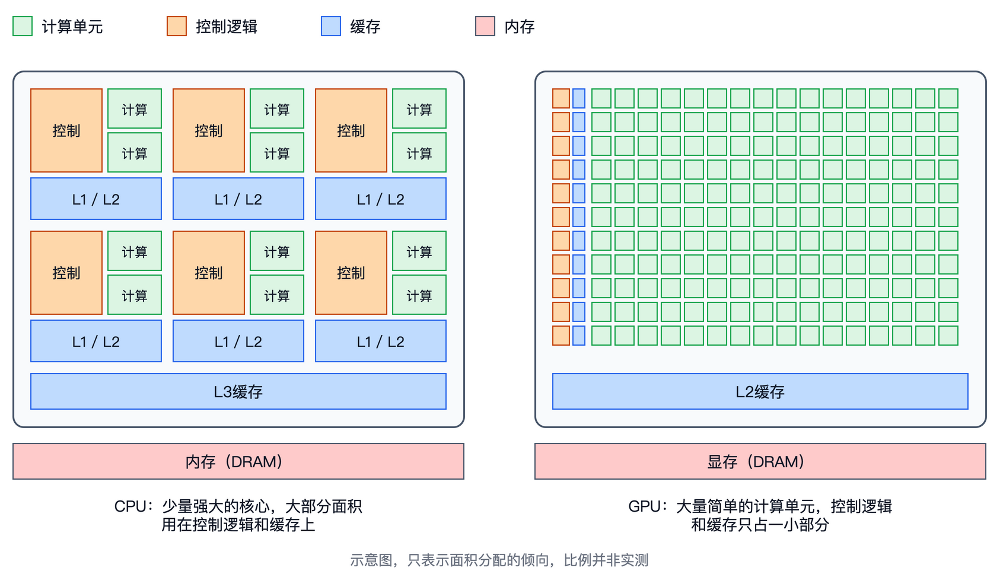
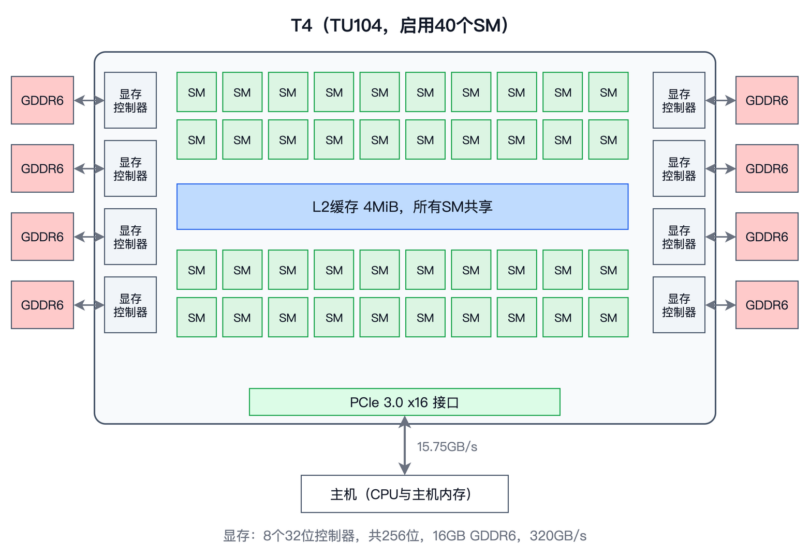
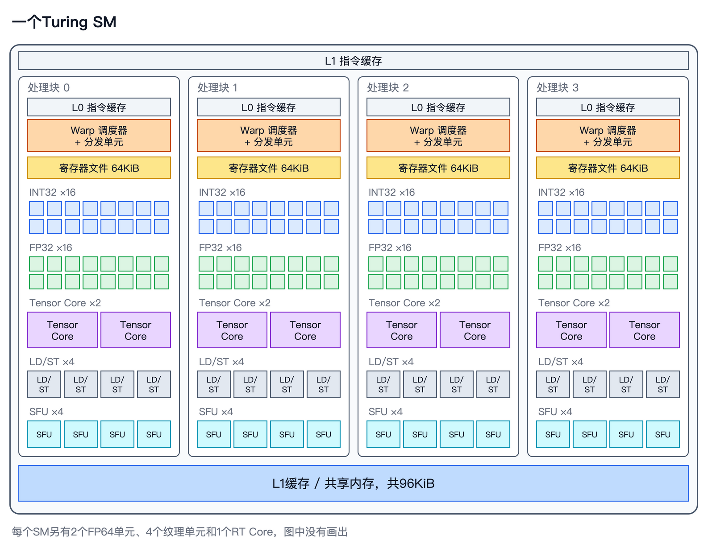
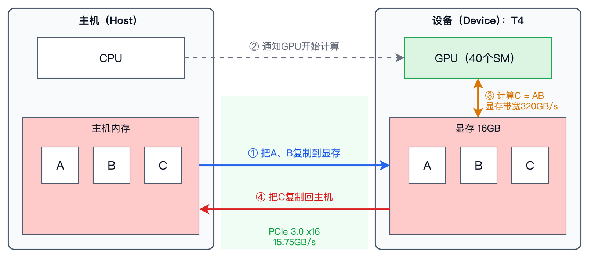
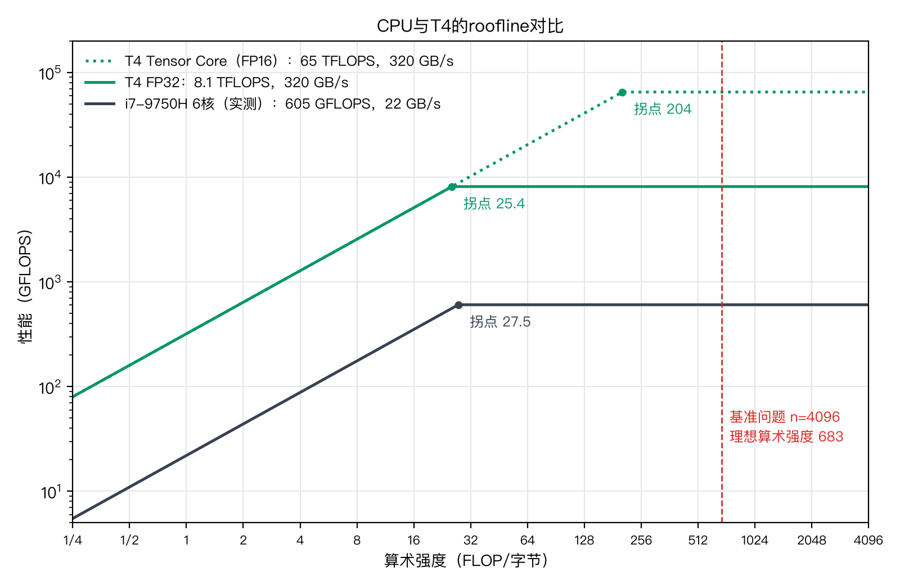

# 第 4 章　为什么是GPU

前三章，我们在CPU上把矩阵乘法从0.03GFLOPS一路推到了160GFLOPS左右，也弄清楚了这颗CPU的两块天花板：6个核心的实测峰值算力是605.3GFLOPS，内存带宽是22.0GB/s。就算我们写出和NumPy一样好的代码，把计算单元喂得满满的，算一次 $n = 4096$ 的基准问题也要227毫秒。要想再快一个数量级，就得换一种硬件。

这一章，我们认识这种硬件：GPU。本书选用的实验GPU，是Google Colab免费提供的NVIDIA T4（2018年发布，基于Turing架构），读者不花钱就能复现书中的所有实验。这一章还不写代码，先回答三个问题：GPU的设计思路和CPU有什么不同，一块GPU由哪些部分组成，以及它和CPU怎样配合工作。最后，我们用上一章的方法算出T4的两块天花板，画出它的roofline，和CPU放在一起比较。

本章的随书代码在`code/ch04/`目录下。`specs.py`根据T4的规格参数，算出本章用到的所有数字，只依赖Python标准库；`plot_roofline.py`把CPU和T4的roofline画在同一张图上。T4的参数来自NVIDIA的T4数据手册和Turing架构白皮书。

## CPU的设计取舍

先回头看看我们熟悉的CPU。它要运行操作系统、浏览器、编辑器、编译器，这些程序大多是一条接一条的指令，后一条往往要用到前一条的结果，中间夹着大量的条件判断和函数调用。对于这样的程序，最重要的是让每一条指令尽快完成，用户点一下鼠标，界面就要马上有反应。从发出一个请求到得到结果所花的时间，叫做**延迟**（Latency）。CPU的设计目标，就是降低单个任务的延迟。

为了这个目标，CPU在每个核心里放了很多“聪明”的部件。第一是主频高：这颗i7-9750H单核能跑到4.5GHz，每个时钟周期都很短。第二是大容量的缓存：第2章看到，它每个核心有32KiB的L1和256KiB的L2，6个核心还共享12MiB的L3，尽量让数据在需要时已经在手边，避免花上百纳秒去内存里取。第三是**乱序执行**（Out-of-Order Execution）：如果下一条指令要等数据，CPU会先去执行后面那些不相关的指令，不让计算单元闲着。第四是**分支预测**（Branch Prediction）：遇到`if`时，CPU不等条件算出来，就先猜一个方向执行下去，猜对了就省下等待的时间，猜错了再撤销。

这些部件都很有用，但它们占用了大量的芯片面积和功耗，而且它们本身并不做任何浮点运算。真正做运算的，是第3章数过的那些FMA单元：每个核心两个，每个一次处理8个float。整颗CPU加起来，每个时钟周期最多做 $6 \times 32 = 192$ 次浮点运算。芯片的大部分面积，花在了让这192次运算尽量不停顿上，而不是用来增加运算的次数。

下面这张示意图把CPU和GPU的芯片面积分配画在了一起。左边的CPU有6个核心，每个核心里，橙色的控制逻辑（取指令、译码、乱序执行、分支预测等）和蓝色的缓存占了大半，绿色的计算单元只有小小的两块。右边的GPU正好反过来：绿色的计算单元铺满了芯片，每一行只配了一小块控制逻辑和缓存，下一节会讲它为什么这样设计。图中的比例并非实测，只表示两者在面积分配上的倾向。

对于矩阵乘法这样的计算，CPU的很多“聪明”都用不上。矩阵乘法里几乎没有条件判断，分支预测器没什么可猜的；要做的运算一开始就全部确定了，彼此之间也几乎没有依赖，用不着乱序执行去发掘。它需要的只是大量的乘加运算，以及持续不断地把数据送到计算单元。

## GPU的设计取舍

最初，GPU是为图形渲染设计的。渲染一帧画面，要对几百万个像素分别计算颜色，每个像素的计算都差不多，彼此之间又几乎独立。这样的任务，在乎的是单位时间内一共完成多少工作，叫做**吞吐量**（Throughput）；至于其中某一个像素早算完几微秒还是晚算完几微秒，没有人关心。GPU的设计目标，就是提高整体的吞吐量。

所以，GPU把芯片面积的大头花在了计算单元上。每个计算单元都很简单，没有分支预测，也没有乱序执行，主频也比CPU低，T4最高只有1.59GHz。但它的数量非常多：T4一共有2560个FP32计算单元，每个时钟周期能完成 $2560 \times 2 = 5120$ 次浮点运算，是CPU的192次的26.7倍。

省掉了那些“聪明”的部件，一个问题就随之而来：计算单元要等数据怎么办？从显存里取一个数，要等几百个时钟周期。CPU的办法是用大缓存和乱序执行，尽量不让等待发生；GPU的办法是让等待发生，但在等待的同时去做别的事情。一块GPU上同时驻留着成千上万个线程，T4最多可以同时驻留40960个。某些线程在等数据时，硬件就切换到另一些数据已经到位的线程去执行，这个切换几乎没有代价。只要线程足够多，计算单元就总有活干。这种做法叫做**延迟隐藏**（Latency Hiding），它是理解GPU性能的一把钥匙，后面会反复遇到。

可以粗略估算一下，需要多少数据“在路上”才能把显存带宽用满。假设一次显存访问要等400个时钟周期（第6章会实测这个数字），在1.59GHz下大约是250纳秒。T4的显存带宽是每秒320GB，要在250纳秒的延迟下维持这个速度，任何时刻都要有大约 $320 \times 10^9 \times 250 \times 10^{-9} = 80000$ 字节，也就是80KB的数据正在从显存往芯片上送。一个线程一次只读几个字节，这就需要上万个读请求同时在路上，也就需要上万个线程。CPU上我们最多开12个线程，在GPU上，几万个线程才是常态。

当然，这样的设计也有代价。单看一个线程，GPU比CPU慢得多：主频低，没有乱序执行，遇到分支还会互相拖累。如果一个任务没法拆成大量独立的小任务，放到GPU上反而会更慢。GPU擅长的，是矩阵乘法这样有海量独立运算、计算方式又很规整的任务。第1章说过，点积视角下 $\mathbf{C}$ 的 $M \times N$ 个元素彼此独立，基准问题里就有1600多万个，正好可以分给成千上万个线程同时去算。

## GPU的整体结构

现在来看一块GPU里面有什么。下面以T4为例，它基于NVIDIA的Turing架构。不同代际的GPU在细节上有很多变化，但整体结构大同小异。随书代码里有两个交互式小工具，用浏览器直接打开`index.html`就能用：`tools/t4-explorer/`从下面这张T4的全局图开始，可以一层一层点进去，一直看到SM、处理块、Tensor Core和寄存器文件，每个部件都附有说明和关键数字；`tools/gpu-arch/`则把NVIDIA数据中心GPU从Tesla到Blackwell的各代架构排成一列，用左右键切换，方便比较它们的异同。

一块GPU的基本组成单位是**流式多处理器**（Streaming Multiprocessor，SM）。T4有40个SM，它们是完全相同的，大致可以看成40个“核心”。每个SM又分成4个**处理块**（Processing Block），每个处理块里有一个调度器、16个FP32计算单元、16个整数计算单元、2个Tensor Core，以及64KiB的寄存器文件。把这些数加起来，每个SM有64个FP32计算单元、8个Tensor Core和256KiB的寄存器文件。此外，每个SM还有96KiB的片上存储，可以按需划分成L1和**共享内存**（Shared Memory）。共享内存由程序员自己管理，是第8章优化矩阵乘法的主角。

每个FP32计算单元，NVIDIA把它叫做一个**CUDA Core**，T4的2560个CUDA Core就是这么数出来的： $40 \times 64 = 2560$ 。这个名字容易让人误会，以为它和CPU的核心是一回事。其实一个CUDA Core只是一条能做乘加的运算通道，既没有自己的指令调度，也不能独立执行程序。更贴切的类比是：一个处理块相当于一个CPU核心，16个CUDA Core相当于这个核心的SIMD宽度。第2章的AVX2一次处理8个float，处理块则一次处理一组32个线程，叫做一个**warp**（中文资料里常译作“线程束”，本书沿用英文），分两个周期在16个通道上执行完。这样看，T4相当于一颗有160个核心、每个核心都带着很宽SIMD单元的处理器。warp是GPU执行的基本单位，第6章会详细讨论。

处理块里的**Tensor Core**，是专门为矩阵乘法设计的计算单元。一个CUDA Core每个周期做一次乘加，一个Tensor Core每个周期则能完成一次小矩阵乘法，在T4上相当于64次FP16乘加。T4一共有320个Tensor Core，FP16的峰值算力因此是FP32的8倍。这样的计算单元专门为矩阵乘法而生，这也从侧面说明了矩阵乘法在今天有多重要。不过它只接受FP16这样的低精度格式，用法也特殊，我们要到第12、13章才会用上它。

存储方面，最靠近计算单元的是寄存器。T4每个SM有256KiB寄存器，40个SM加起来是10MiB。作为对比，CPU每个线程能用的AVX2寄存器只有16个，一共512字节。GPU的寄存器总量甚至比它的L2还大，这是因为几万个线程各自都要有寄存器，切换线程时不需要保存和恢复，延迟隐藏才能几乎没有代价。再往外是每个SM各自的L1和共享内存，然后是所有SM共享的L2，T4上是4MiB。最外层是**显存**（Device Memory），T4配了16GB的GDDR6显存。数据中心的高端GPU用的是另一种显存，叫做**HBM**（High Bandwidth Memory），它把内存芯片和GPU封装在一起，带宽能高出好几倍。

和CPU对比一下，GPU的存储层次有一个明显的特点：越往外走，平均到每个计算单元的容量越小。CPU的每个核心有32KiB的L1、256KiB的L2，还能分到2MiB的L3；T4的每个SM带着64个计算单元，却只有96KiB的L1和共享内存，平均到每个SM的L2也只有100KiB左右。GPU不指望靠大缓存把数据留住，复用数据的责任，很大程度上落在了程序员身上。这正是第8到11章要做的事情。

最后，把T4和我们的CPU并排放在一起看看：

| | i7-9750H | T4 |
|---|---|---|
| 核心 | 6个核心 | 40个SM，2560个CUDA Core |
| 最高主频 | 4.5GHz | 1.59GHz |
| 每周期FP32运算次数 | 192 | 5120 |
| 同时运行的线程 | 12 | 最多40960 |
| 最大的片上缓存 | 12MiB（L3） | 4MiB（L2） |
| 内存 | 16GB DDR4，双通道 | 16GB GDDR6，256位 |
| 功耗 | 45W | 70W |

这块T4的功耗只有70W，算是一块小卡，主要用于推理。以它为实验卡，好处是任何人都能在Colab上免费用到；不足是它的架构比较老，没有新一代GPU上的一些硬件特性。第14章讲Hopper架构时，我们会另外租一块H100来做实验。

## CPU与GPU如何协作

一块GPU不能单独工作，它要插在一台电脑上，由CPU来指挥。在CUDA的术语里，CPU和它的内存叫做**主机**（Host），GPU和它的显存叫做**设备**（Device）。主机和设备各有各的内存，二者通过**PCIe**（Peripheral Component Interconnect Express）总线连接。GPU上的程序只能访问显存里的数据，不能直接读主机内存；反过来，CPU也不能直接读显存。

下图画出了这种分工。左边是主机，右边是设备，两边各有自己的内存，中间唯一的通道是PCIe，每秒15.75GB；而设备内部，GPU读写显存的带宽是每秒320GB。图中带编号的四个箭头，就是马上要说的四个步骤。

所以，在GPU上算一次矩阵乘法，一般要经过这样几步：CPU在显存里分配好三个矩阵的空间，把 $\mathbf{A}$ 和 $\mathbf{B}$ 从主机内存复制到显存，然后通知GPU开始计算，等GPU算完，再把 $\mathbf{C}$ 从显存复制回主机内存。第5章写第一个CUDA程序时，就是按这几步来写的。

这里面的复制是有代价的。T4用的是PCIe 3.0 x16接口，它有16条通道，每条每秒传输8G次，扣掉编码的开销，理论带宽是15.75GB/s，只有显存带宽的二十分之一。以基准问题为例，三个 $4096 \times 4096$ 的float矩阵一共192MiB，通过PCIe传一遍至少要12.8毫秒；而T4按FP32峰值算完这个矩阵乘法，只要16.9毫秒，两者差不多长。矩阵小一些，情况更糟：在 $n = 1024$ 时，传输要0.80毫秒，计算只要0.26毫秒，传输时间是计算时间的3倍。

道理和第1章算的一样：数据量随 $n^2$ 增长，计算量随 $n^3$ 增长，矩阵越大，传输的占比越小。实际应用中，常用的办法是让数据一直留在显存里。比如训练一个大模型，权重从头到尾都在显存里，一次矩阵乘法的输出直接作为下一次的输入，中间不用回到主机。所以，本书测量GPU上矩阵乘法的速度时，只统计计算本身的时间，不包括主机和设备之间的复制。但读者要记住这笔开销：如果数据要在CPU和GPU之间来回搬，GPU算得再快也可能白搭。

## GPU的roofline

现在用第3章的方法，算出T4的两块天花板。

先算峰值算力。公式和CPU一样，是计算单元个数、主频和每个单元每周期运算次数的乘积。T4有2560个FP32计算单元，每个每周期做一次乘加，也就是2次浮点运算，最高主频1.59GHz，所以FP32峰值算力是 $2560 \times 2 \times 1.59 = 8141$ GFLOPS，约8.1TFLOPS（1TFLOPS是1000GFLOPS）。Tensor Core的FP16峰值算力，是 $320 \times 64 \times 2 \times 1.59 = 65126$ GFLOPS，约65TFLOPS。这两个数和NVIDIA数据手册上写的一致。

再算显存带宽。公式也和CPU一样，是位宽和每秒传输次数的乘积。T4的显存位宽是256位，也就是32个字节；GDDR6每根数据线每秒传输100亿次。所以显存带宽是 $32 \times 10 = 320$ GB/s。

两个拐点也就随之确定。FP32的拐点是 $8141 / 320 = 25.4$ FLOP/字节，Tensor Core的拐点是 $65126 / 320 = 204$ FLOP/字节。把它们和CPU的roofline画在同一张图上：

这张图里有三点值得注意。第一，两块天花板都整体抬高了一个数量级以上。T4的FP32峰值算力是CPU的13.4倍，显存带宽是CPU的14.5倍。也就是说，不管一段程序是访存受限还是计算受限，搬到GPU上都有机会快一个数量级。

第二，T4的FP32拐点是25.4，CPU是27.5，几乎在同一个位置。这并非巧合，算力和带宽是一起设计的，两者大体按同样的比例增长。所以，第3章关于算术强度的所有结论，在GPU上依然成立：ijk那样的写法，每个字节只做 $1/32$ 次运算，放到GPU上照样被死死压在斜线上；要想冲到水平线，算术强度同样要越过二十多。只是在GPU上，“慢”的代价更大：屋顶高了一个数量级，跑不到屋顶浪费掉的算力也多了一个数量级。

第三，Tensor Core把水平线又抬高了8倍，拐点也随之右移到204。这意味着要用满Tensor Core，算术强度要比用满CUDA Core高8倍。算力增长得比带宽快，这是近十年来GPU发展的总趋势，越新的GPU，拐点越靠右，对数据复用的要求也越高。

图中的红色虚线是基准问题的理想算术强度683，它远在三个拐点的右边。理论上，基准问题在T4上完全是计算受限的，按FP32峰值，16.9毫秒就能算完，比CPU的227毫秒快13倍多。这就是我们从第5章开始要追的目标。

要提醒的是，这里CPU的两块天花板是实测的，而T4的是按规格算出来的理论值。第3章看到，CPU的实测带宽只有理论值的57%，T4多半也一样。T4的功耗上限只有70W，满负荷运行时往往维持不住1.59GHz的最高主频，实际峰值算力也会打折扣。等到第5章，我们有了在GPU上运行代码的能力，再实测这两个数字。

## 本章小结

这一章，我们认识了GPU。CPU为降低单个任务的延迟而设计，把大量芯片面积花在缓存、乱序执行和分支预测上，计算单元相对较少；GPU为提高整体吞吐量而设计，把面积花在大量简单的计算单元上，靠同时驻留成千上万个线程来隐藏访存的延迟。矩阵乘法有海量独立的运算，计算方式又很规整，正是GPU擅长的任务。

一块GPU由许多个SM组成。T4有40个SM，每个SM有64个CUDA Core、8个Tensor Core、256KiB的寄存器文件和96KiB的L1与共享内存，所有SM共享4MiB的L2和16GB的GDDR6显存。CUDA Core只是一条运算通道，一个处理块更接近CPU的一个核心，它以32个线程组成的warp为单位执行指令。GPU和CPU各有各的内存，通过PCIe连接，数据传输的速度远低于显存带宽，所以数据要尽量留在显存里。

按规格计算，T4的FP32峰值算力是8.1TFLOPS，Tensor Core的FP16峰值算力是65TFLOPS，显存带宽是320GB/s。它的两块天花板都比CPU高出一个数量级以上，FP32拐点却和CPU几乎相同，所以第3章的分析方法可以原样搬到GPU上。下一章，我们打开Colab，写出第一个CUDA程序，在T4上把矩阵乘法跑起来。
