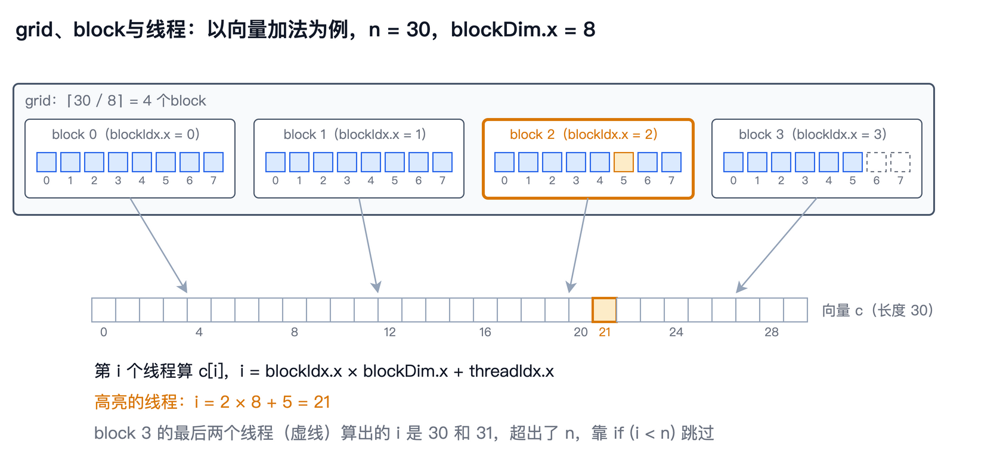
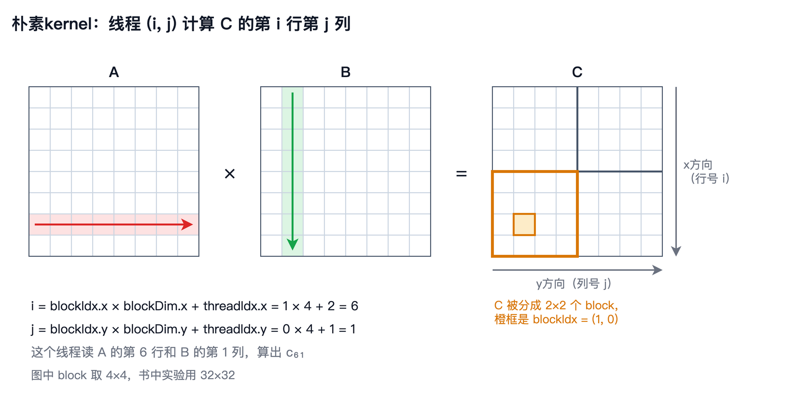

# 第 5 章　第一个CUDA程序

上一章，我们从规格表上认识了T4：40个SM，FP32峰值算力约8.1TFLOPS，显存带宽320GB/s。纸面上，它的两块天花板都比CPU高出一个数量级。这一章，我们第一次在GPU上写代码，把这些数字变成实际跑出来的结果。

本章会先搭好实验环境，然后用一个最简单的向量加法，认识CUDA的编程模型：主机和设备怎样分工，数据怎样在两块内存之间搬运，成千上万个线程怎样组织起来。接着，我们把第1章的点积视角搬到GPU上，写出一个朴素的矩阵乘法kernel，验证它算得对不对，学会正确地给它计时。最后，我们实测T4的峰值算力和显存带宽，兑现上一章“到第5章再实测”的承诺，并请出NVIDIA自己的矩阵乘法库cuBLAS，看看我们的朴素kernel离它有多远。

先说说标题里的CUDA。它是NVIDIA在2007年推出的GPU编程平台，全称是Compute Unified Device Architecture（统一计算设备架构），不过今天已经很少有人提这个全称了。CUDA包括对C++语言的扩展、编译器、运行时库，以及cuBLAS这样的数学库，本书的GPU程序都是用CUDA C++写的。在CUDA的术语里，在GPU上运行的函数叫做**kernel**（中文资料里常译作“核函数”，本书沿用英文），它和操作系统的内核没有关系，后面会细说。

本章的随书代码在`code/ch05/`目录下。`common.cuh`是几个程序共用的小工具，`vector_add.cu`是向量加法，`matmul.cu`是朴素kernel和cuBLAS，`peak.cu`和`bandwidth.cu`分别实测峰值算力和显存带宽。`bench.sh`把它们全部编译、运行一遍，结果写进`results.txt`，书中引用的数字都来自这个文件。


## 实验环境

本书的GPU实验都在Google Colab上完成。Colab是Google提供的在线**Jupyter Notebook**环境，免费版就能分到一块T4。这里的Notebook指的是一种交互式文档，由一个个单元格组成，代码和它的运行结果混排在一起，在浏览器里就能编辑和运行，和笔记本电脑无关。打开随书代码里的`code/ch05/colab.ipynb`，在菜单“代码执行程序”里把运行时类型改成T4 GPU，然后从上到下依次运行各个单元格即可：先用`nvidia-smi`看一眼分到的GPU，再上传本章的源文件，最后运行`bench.sh`。整个过程只要几分钟。

命令`nvidia-smi`是NVIDIA驱动自带的命令行工具，可以查看GPU的型号、显存、主频、温度和功耗。`bench.sh`在开头用它记录了这次实验的环境：

```
# GPU：Tesla T4, 580.82.07, 15360 MiB, 1590 MHz, 5001 MHz, 70.00 W
# CUDA：Cuda compilation tools, release 13.0, V13.0.88
# CPU：Intel(R) Xeon(R) CPU @ 2.00GHz，2个逻辑CPU
```

第一行依次是GPU型号、驱动版本、显存容量、SM的最高主频、显存的最高主频和功耗上限。显存显示为15360MiB而不是16GiB，是因为T4开启了ECC纠错，有十六分之一的显存用来存放校验位， $16384 \times 15 / 16 = 15360$ 。第二行是编译器`nvcc`的版本，它是CUDA工具包的一部分，负责把`.cu`源文件编译成GPU能执行的程序。第三行说明Colab分给我们的主机只有2个逻辑CPU，这对后面的实验没有影响，计算都在GPU上进行。

和第2、3章一样，每个实验都有一个可以单独运行的程序，用`make`编译。`Makefile`里给`nvcc`传了`-arch=sm_75`，意思是生成在计算能力7.5的GPU上运行的代码。**计算能力**（Compute Capability）是NVIDIA给每一代GPU架构编的版本号，Turing是7.5，Ampere是8.0和8.6，Hopper是9.0。


## 主机与设备

上一章说过，CPU和它的内存叫做主机，GPU和它的显存叫做设备，两边各有各的内存。所以，一个CUDA程序要做的第一件事，就是在显存里分配空间，再把数据从主机内存复制过去。`vector_add.cu`的主体是这样的：

```c
float *da, *db, *dc;
CHECK(cudaMalloc(&da, bytes));
CHECK(cudaMalloc(&db, bytes));
CHECK(cudaMalloc(&dc, bytes));

CHECK(cudaMemcpy(da, a, bytes, cudaMemcpyHostToDevice));
CHECK(cudaMemcpy(db, b, bytes, cudaMemcpyHostToDevice));

int blocks = (n + threads - 1) / threads;
vector_add<<<blocks, threads>>>(da, db, dc, n);

CHECK(cudaMemcpy(c, dc, bytes, cudaMemcpyDeviceToHost));
```

这几行代码和上一章画的四个步骤一一对应。`cudaMalloc`在显存里分配空间，用法和C语言的`malloc`差不多，只是分配到的地址指向显存，CPU不能直接读写。在CUDA的术语里，这样分配出来、所有线程都能访问的显存叫做**全局内存**（Global Memory），后面几章会经常用到这个说法。本书的习惯是给显存里的指针加一个前缀`d`（device），比如`da`，以免和主机内存里的`a`混淆。`cudaMemcpy`在两块内存之间复制数据，最后一个参数说明复制的方向。中间那一行`vector_add<<<blocks, threads>>>(...)`启动GPU计算，下一节详细解释。用完以后，再用`cudaFree`释放显存。

每个CUDA API调用都会返回一个错误码，`CHECK`是`common.cuh`里定义的一个宏，它检查这个错误码，出错时打印出错的位置并退出。GPU程序出错时常常不会崩溃，而是默默地算出一堆错误的结果，所以每个调用都检查一遍，是一个值得养成的习惯。

复制数据是有代价的。`vector_add`顺便测了一下复制的速度：

```
主机→设备  256MiB     58.748 毫秒       4.6 GB/s
设备→主机  256MiB     57.355 毫秒       4.7 GB/s
```

只有4.6GB/s左右，比上一章算出的PCIe 3.0 x16理论带宽15.75GB/s还低得多。一个原因是我们用`malloc`分配的是普通的主机内存，操作系统随时可能把它换出到磁盘，GPU不能直接从这样的内存里读数据，驱动要先把它复制到一块固定不动的内存里再传输，相当于多复制了一次。CUDA提供了`cudaMallocHost`来直接分配这种固定的内存，可以快不少，本书暂时用不到。无论如何，这个速度说明了上一章的结论：数据要尽量留在显存里，在主机和设备之间来回搬是很贵的。


## CUDA编程模型

在GPU上运行的函数叫做**kernel**。这个名字容易让人想到操作系统的内核，其实二者毫无关系。在高性能计算里，人们一向把程序中最核心、最耗时的那段计算叫做kernel，第2章提到的BLAS“微内核”（micro-kernel）就是这个意思。CUDA的直接来源是斯坦福大学2004年发布的Brook语言，它用GPU处理数据流，作用在数据流上的函数就叫kernel。Brook的作者Ian Buck后来加入NVIDIA，主导设计了CUDA，这个叫法也就沿用了下来。中文资料里有时把它译作“核函数”，本书直接称kernel，不做翻译。`vector_add.cu`里的kernel只有两行：

```c
__global__ void vector_add(const float *a, const float *b, float *c, int n) {
    int i = blockIdx.x * blockDim.x + threadIdx.x;
    if (i < n) c[i] = a[i] + b[i];
}
```

函数前面的`__global__`告诉编译器，这是一个kernel，它由CPU调用，在GPU上执行。除此之外，它看起来就是一个普通的C函数，只做了一件事：算出向量的一个元素。

关键在于，这个函数会被成千上万个线程同时执行，每个线程算一个元素。CUDA把这些线程组织成两个层次。若干个线程组成一个**线程块**（Thread Block），下文简称block；若干个block组成一个**网格**（Grid），下文简称grid。启动kernel时，尖括号里的两个数就是在说明这个组织方式：`<<<blocks, threads>>>`表示grid里有`blocks`个block，每个block里有`threads`个线程。



为什么要分两层？这和上一章讲的硬件结构有关。一个block里的所有线程，总是被放到同一个SM上执行，它们可以通过SM里的共享内存交换数据，也可以互相等待，第8章会用到这一点。不同的block之间则互不相干，GPU可以把它们以任意顺序分给任意的SM。这样一来，同一个程序既能在40个SM的T4上运行，也能在132个SM的H100上运行，SM越多，同时执行的block就越多，程序不用做任何修改。换句话说，block这一层把程序和硬件的规模解耦了：程序员只负责把工作切成许多个互不相干的block，至于同时执行多少个、按什么顺序执行，交给硬件决定。GPU因此可以一代一代地增加SM，而不必改写已有的程序，NVIDIA把这种性质叫做**自动可扩展性**（Automatic Scalability）。一个block里最多可以有1024个线程，grid里的block数则几乎没有限制。

每个线程执行的是同一段代码，那它怎么知道自己该算哪个元素呢？CUDA给每个线程提供了几个内置变量：`threadIdx`是线程在block里的编号，`blockIdx`是block在grid里的编号，`blockDim`是每个block有多少个线程，`gridDim`是grid里有多少个block。它们都有`.x`、`.y`、`.z`三个分量，可以组织成一维、二维或三维，向量加法只用到一维。所以，`blockIdx.x * blockDim.x + threadIdx.x`就是这个线程在整个grid里的编号：前面有`blockIdx.x`个完整的block，每个有`blockDim.x`个线程，再加上它在自己block里的编号。

为什么要有三个维度？这只是为了编号方便。处理矩阵或图像时，用行号和列号给线程编号，比用一个长长的序号直观得多；处理三维的体数据时，就用三个编号。硬件本身并不在乎维度，它总是把一个block里的线程按 $x$ 变化最快、 $y$ 其次、 $z$ 最慢的顺序排成一维，再依次32个一组分成warp。这个顺序在本章后面就会显出影响。本章的矩阵乘法会用到二维，第三个维度本书用得很少，比如同时计算一批矩阵乘法时，可以用 $z$ 方向的编号区分是第几个矩阵。

读到这里，名词已经不少了，有必要停下来理一理。这些名词分属两个层面。kernel、grid、block和线程是CUDA的软件概念，是程序员用来组织计算的：每启动一次kernel，就生成一个grid，它包含这次启动的全部线程；grid切成许多个block，每个block里再有许多个线程。上一章讲的SM、处理块和CUDA Core则是GPU的硬件，是真正执行计算的东西。两个层面的对应关系如下：

| 软件（程序里写的） | 硬件（执行它的） |
|---|---|
| 一次kernel启动，即一个grid | 整块GPU |
| 一个block | 一个SM，一个SM上可以同时驻留几个block |
| 32个线程组成的warp | 一个处理块，由其中的warp调度器发射 |
| 一个线程 | CUDA Core上的一条运算通道 |

这里面，warp正好处在两个层面的交界处。它是硬件发射指令的单位，程序里却不出现：CUDA代码只写一个block有多少个线程，硬件再把它们32个一组分成warp。所以，写程序时想的是grid、block和线程，分析性能时想的是SM和warp，第6章会把后者讲清楚。

最后一个细节是kernel里的`if (i < n)`。启动kernel时，block数是向上取整算出来的：`(n + threads - 1) / threads`。如果 $n$ 不是每个block线程数的整数倍，最后一个block里就会有几个多余的线程，它们算出的编号超出了向量的范围，必须什么都不做。这样的边界检查，几乎每个kernel里都会有。


## 第一个kernel：向量加法

现在运行`vector_add`。它的向量长度是 $2^{26}$ ，也就是6700多万个元素，每个向量256MiB。每个block取256个线程，一共需要 $2^{26} / 256 = 262144$ 个block。kernel只启动了一次，所以这26万多个block都属于同一个grid：

```
vector_add  n=67108864  block=256  grid=262144      3.056 毫秒     263.5 GB/s
检查：全部正确（0个元素不一致）
```

一共26万多个block、6700多万个线程，只花了3毫秒。这些block并不是同时在GPU上执行的：T4的每个SM最多同时驻留1024个线程，也就是4个这样的block，40个SM一次只能放下160个，其余的排队等待，前面的block做完一个，硬件就补上一个。GPU创建和调度线程的代价非常小，为每个元素启动一个线程是完全正常的做法，这和CPU上开线程的经验很不一样。程序最后把结果复制回主机，和CPU算的结果逐个比较，全部一致。浮点加法只做一次，不涉及运算顺序的问题，所以GPU和CPU的结果应该逐位相同。

速度怎么样？向量加法每个元素读两个数、写一个数，一共搬运12个字节，只做1次加法，算术强度只有 $1/12$ ，是一个典型的访存受限的程序。所以衡量它的指标是带宽：三个256MiB的向量，3.056毫秒搬完，相当于263.5GB/s。这已经接近T4的显存带宽了，本章后面实测的只读带宽是277.5GB/s。换句话说，这个只有两行的kernel，已经达到了实测带宽的95%。对于访存受限的程序，屋顶就是带宽，没有再快的余地了。

也可以从另一个角度看这个结果：同样的向量加法，第3章在CPU上用6个核心跑出了13.4GB/s，T4快了将近20倍。可如果算上前面的数据复制，两个输入向量传到显存就要将近120毫秒，结果传回来又要57毫秒，计算本身的3毫秒反而微不足道。在GPU上做这样一次向量加法，再把结果拿回来，其实比直接在CPU上算还慢。


## 朴素矩阵乘法kernel

现在把第1章的点积视角搬到GPU上：让每个线程算 $\mathbf{C}$ 的一个元素。 $\mathbf{C}$ 是一个二维的矩阵，所以线程也组织成二维的：每个block是一个 $32 \times 32$ 的线程方阵，grid也是一个二维的block方阵，正好覆盖整个 $\mathbf{C}$ 。`matmul.cu`中的朴素kernel如下：

```c
__global__ void matmul_naive(int n, const float *A, const float *B, float *C) {
    int i = blockIdx.x * blockDim.x + threadIdx.x;   // 行
    int j = blockIdx.y * blockDim.y + threadIdx.y;   // 列
    if (i < n && j < n) {
        float sum = 0.0f;
        for (int k = 0; k < n; k++)
            sum += A[i * n + k] * B[k * n + j];
        C[i * n + j] = sum;
    }
}
```

启动它的代码是这样的：

```c
dim3 block(bs, bs);
dim3 grid((n + bs - 1) / bs, (n + bs - 1) / bs);
matmul_naive<<<grid, block>>>(n, dA, dB, dC);
```

其中的`dim3`是CUDA里表示三维尺寸的类型，没写的分量默认是1。kernel里，线程用`.x`方向的编号算出自己负责第几行，用`.y`方向的编号算出第几列，然后用一个循环算出这一行和这一列的点积。和向量加法一样，矩阵的边长不一定是32的整数倍，所以要检查行号和列号都没有越界。



如果你把这个kernel和第2章的ijk版本对比，会发现最内层的循环一模一样，GPU版本只是把外面两层循环 $i$ 和 $j$ 去掉了，换成了线程的编号。原来要排着队一个一个算的 $n^2$ 个点积，现在由 $n^2$ 个线程同时去算。这就是GPU编程最基本的思路：找出彼此独立的工作，每份交给一个线程。

这里有一个细节，现在看起来无关紧要，后面却会很重要：我们让`.x`对应行、`.y`对应列，这是最直接的写法，因为习惯上 $x$ 写在前面， $i$ 也写在前面。至于这个选择对不对，我们先不管，跑一跑再说。


## 正确性验证

写完kernel，先确认它算得对。`matmul.cu`的`check`模式在CPU上用双精度算一遍同样的矩阵乘法，作为参考答案，再把朴素kernel和cuBLAS的结果分别和它比较：

```
check   n=1000  naive   最大绝对误差 8.392e-05   相对误差 1.558e-06
check   n=1000  cublas  最大绝对误差 2.289e-05   相对误差 4.250e-07
check   n=1024  naive   最大绝对误差 8.011e-05   相对误差 1.608e-06
check   n=1024  cublas  最大绝对误差 1.907e-05   相对误差 3.827e-07
```

这里特意测了 $n = 1000$ ，它不是32的整数倍，可以检验边界处理有没有写错。最大绝对误差是所有元素中误差最大的那一个，相对误差是它除以参考答案中绝对值最大的元素。两种实现的相对误差都在 $10^{-6}$ 量级或更小，可以认为算得是对的。

为什么不像向量加法那样要求逐位相同？第1章说过，浮点数的加法不满足结合律，运算顺序不同，结果就可能差最后几位。float只有24位有效二进制位，相邻两个数之间的相对间隔大约是 $1.2 \times 10^{-7}$ ，每做一次加法，就可能引入这么大的舍入误差。一个点积要连续累加1000多次，误差会一点点累积起来。所以验证矩阵乘法时，只能要求误差在一个合理的范围内，这个范围叫做**容差**（Tolerance）。

一个有意思的现象是，cuBLAS的误差比朴素kernel小了四倍左右。朴素kernel从头到尾用一个变量累加，加到后面，`sum`已经比较大，再加上一个较小的乘积，后者的低位就被舍掉了。如果把求和拆成几段分别累加，最后再把各段的部分和加起来，每次相加的两个数大小更接近，舍入误差通常会更小。cuBLAS内部具体怎样累加，NVIDIA没有公开，但它的误差更小，说明它的求和顺序很可能不是从头到尾一条链。至少在这里，算得快和算得准并不矛盾。


## 正确地计时

给GPU程序计时，要注意一个和CPU不同的地方：kernel的启动是**异步**（Asynchronous）的。CPU执行到`matmul_naive<<<grid, block>>>(...)`这一行时，只是把这个任务交给GPU，然后立刻返回，接着执行后面的代码，并不等GPU算完。如果像第2章那样，在启动前后各读一次CPU的时钟，测到的只是“布置任务”的时间，往往只有几微秒。

正确的做法是让GPU自己记录时间。CUDA提供了**事件**（Event）：在启动kernel之前和之后，各往GPU的任务队列里放一个事件，GPU执行到事件时会记下当时的时间，两个事件之间的时间差，就是kernel实际执行的时间。`common.cuh`里的`time_ms`就是这样做的：

```c
template <typename F>
static float time_ms(F work, int reps) {
    work();                                  // 预热
    CHECK(cudaDeviceSynchronize());
    cudaEvent_t start, stop;
    CHECK(cudaEventCreate(&start));
    CHECK(cudaEventCreate(&stop));
    CHECK(cudaEventRecord(start));
    for (int i = 0; i < reps; i++) work();
    CHECK(cudaEventRecord(stop));
    CHECK(cudaEventSynchronize(stop));      // 等GPU执行到stop
    float ms = 0;
    CHECK(cudaEventElapsedTime(&ms, start, stop));
    return ms / reps;
}
```

这里省略了错误检查和释放事件的代码。它先运行一次作为**预热**（Warm-up），因为第一次运行时，驱动要加载kernel的代码、做一些初始化，会比较慢，不能代表真实的速度。然后在两个事件之间连续运行若干次，取平均值。`cudaEventSynchronize`让CPU等到GPU执行完`stop`这个事件，此时两个事件的时间才都记录好了。`bench.sh`还会把每个实验完整地跑三遍，取最快的一次，和前几章的做法一样。


## 朴素kernel有多快

现在可以测速了。朴素kernel在不同规模下的结果如下：

```
naive   n=256  block=32x32        1.135 毫秒       29.6 GFLOPS
naive   n=512  block=32x32        4.730 毫秒       56.8 GFLOPS
naive   n=1024  block=32x32       35.148 毫秒       61.1 GFLOPS
naive   n=2048  block=32x32      277.734 毫秒       61.9 GFLOPS
naive   n=4096  block=32x32     2220.083 毫秒       61.9 GFLOPS
```

规模足够大以后，速度稳定在62GFLOPS左右，算一次 $n = 4096$ 的基准问题要2.2秒。这个数字比我们在CPU上写的最好的版本，也就是第2章6线程的分块版本（49.30GFLOPS）快了一点，但还不到NumPy在CPU上多线程速度（161.9GFLOPS）的四成。一块峰值算力十几倍于CPU的GPU，跑出来的矩阵乘法反而比CPU上的NumPy还慢。

矩阵为 $n = 256$ 时更慢，只有29.6GFLOPS，原因是线程不够多。 $256 \times 256$ 的矩阵只需要64个 $32 \times 32$ 的block，而T4上每个SM最多同时驻留1024个线程，正好是一个这样的block。40个SM同时处理40个block，剩下的24个要等第二轮，第二轮里有16个SM没活干。矩阵太小，喂不饱GPU，这一点在CPU上是不存在的。

更奇怪的是block大小的影响。在 $n = 4096$ 时换几种block大小：

```
naive   n=4096  block=8x8      818.884 毫秒      167.8 GFLOPS
naive   n=4096  block=16x16     1232.211 毫秒      111.5 GFLOPS
naive   n=4096  block=32x32     2244.808 毫秒       61.2 GFLOPS
```

计算量完全一样，每个线程做的事情也完全一样，只是换了一种分组方式，速度就差了2.7倍。在CPU上，我们从没遇到过这种现象。答案藏在上一章提到的warp里：GPU总是以32个线程为一组执行指令，而`.x`方向编号相邻的线程会被分到同一组。block是 $32 \times 32$ 时，同一个warp里的32个线程负责的是同一列、相邻的32行；block是 $8 \times 8$ 时，同一个warp负责的是8行、4列。这两种分组访问内存的方式很不一样。至于具体差在哪里，以及怎样才是最好的分组方式，要等第6章讲清楚线程是怎样执行的，第7章再专门回答。


## 实测T4的天花板

上一章按规格算出了T4的两块天花板，FP32峰值算力8141GFLOPS，显存带宽320GB/s，并说好到这一章再实测。实测的方法和第3章一样：`peak.cu`让每个线程同时维护8个互不相关的累加器，反复执行FMA，完全不访问显存；`bandwidth.cu`用一个256MiB的数组，远大于4MiB的L2，测只读和复制两种操作。结果如下：

```
fp32 FMA  blocks=640  threads=256      2.846 毫秒     7544.3 GFLOPS
read   256MiB      0.967 毫秒     277.5 GB/s   （理论值320 GB/s）
copy   256MiB      2.338 毫秒     229.6 GB/s   （理论值320 GB/s）
```

实测峰值算力是7544.3GFLOPS，是理论值的93%，相当于平均主频1.47GHz，略低于1.59GHz的最高主频。只读带宽是277.5GB/s，是理论值的87%，比CPU的57%高得多。复制的带宽低一些，原因和第3章一样，写数据要额外付出代价。

本书以后就把这两个实测值当作T4实际可以达到的天花板：峰值算力7544.3GFLOPS，显存带宽277.5GB/s。二者的比值，也就是拐点，是 $7544.3 / 277.5 \approx 27.2$ FLOP/字节，和CPU的27.5几乎一样，印证了上一章的判断。朴素kernel的62GFLOPS，还不到峰值的1%。


## cuBLAS：我们的目标

最后，看看NVIDIA自己写的矩阵乘法有多快。cuBLAS是NVIDIA随CUDA提供的线性代数库，它的SGEMM函数就是单精度的通用矩阵乘法，由NVIDIA的工程师针对每一代GPU精心优化。调用它只要一行：

```c
cublasSgemm(h, CUBLAS_OP_N, CUBLAS_OP_N, n, n, n, &alpha, dB, n, dA, n, &beta, dC, n);
```

注意 $\mathbf{A}$ 和 $\mathbf{B}$ 的顺序是反的。第1章说过，cuBLAS沿用了经典BLAS的列主序约定，而我们的矩阵是按行主序存放的。一个行主序的矩阵，按列主序去读，得到的正好是它的转置。所以在cuBLAS看来，我们传进去的是 $\mathbf{B}^\top$ 和 $\mathbf{A}^\top$ 。而 $\mathbf{B}^\top \mathbf{A}^\top = (\mathbf{A}\mathbf{B})^\top = \mathbf{C}^\top$ ，cuBLAS按列主序写出 $\mathbf{C}^\top$ ，我们按行主序去读，得到的恰好就是 $\mathbf{C}$ 。把两个矩阵的顺序调换一下，就省掉了所有的转置，这是调用cuBLAS时的一个常用技巧。

调用cuBLAS的结果如下：

```
cublas  n=256                     0.020 毫秒     1639.9 GFLOPS
cublas  n=512                     0.050 毫秒     5382.7 GFLOPS
cublas  n=1024                     0.372 毫秒     5776.7 GFLOPS
cublas  n=2048                     2.878 毫秒     5968.6 GFLOPS
cublas  n=4096                    41.637 毫秒     3300.9 GFLOPS
```

在 $n = 2048$ 时，cuBLAS达到了5968.6GFLOPS，是实测峰值的79%，是朴素kernel的96倍。这就是一个充分优化的矩阵乘法在T4上的样子，也是后面几章要追赶的目标。

奇怪的是 $n = 4096$ ，速度反而掉到了3300.9GFLOPS。这并不是cuBLAS的问题，而很可能是T4的功耗限制在起作用。T4的功耗上限只有70W，cuBLAS满负荷运行时，功耗很快就会顶到上限，GPU只好降低主频。 $n = 2048$ 时，每次计算不到3毫秒，一组测量很快就结束了； $n = 4096$ 时，一组测量要持续200多毫秒，降频的影响就显现出来了。`bench.sh`在全部实验结束后记录了GPU的状态，降频原因那一项的值是`0x4`，表示“软件功耗限制”，也就是因为功耗到了上限而降频。这也提醒我们，在T4这样的小卡上测量，持续时间越长，数字越低，比较两个实现时要在相同的条件下测。

无论如何，差距是巨大的。在基准问题上，cuBLAS比朴素kernel快53倍；在 $n = 2048$ 时则是96倍。我们的朴素kernel在算法上和cuBLAS做的是同一件事，浮点运算的次数一次不多、一次不少，差距完全来自怎样使用硬件。


## 补全基准表

把GPU的结果加进基准表。为了便于比较，这里列出前几章的主要结果，峰值占比都是相对于各自硬件的实测峰值：CPU是605.3GFLOPS，T4是7544.3GFLOPS。

| 版本 | 硬件 | 规模 | GFLOPS | 峰值占比 |
|---|---|---|---|---|
| Python三重循环 | CPU | $n = 256$ | 0.03 | 0.004% |
| C，ikj，SIMD | CPU | $n = 2048$ | 4.28 | 0.71% |
| C，分块，SIMD，6线程 | CPU | $n = 2048$ | 49.30 | 8.1% |
| NumPy，多线程 | CPU | $n = 2048$ | 161.9 | 26.7% |
| 朴素kernel | T4 | $n = 2048$ | 61.9 | 0.82% |
| 朴素kernel | T4 | $n = 4096$ | 61.9 | 0.82% |
| cuBLAS | T4 | $n = 2048$ | 5968.6 | 79.1% |
| cuBLAS | T4 | $n = 4096$ | 3300.9 | 43.8% |

这张表的后四行，就是接下来几章的起点和终点。朴素kernel只用上了T4不到1%的算力，cuBLAS则能用上八成左右。从第6章开始，我们会一步一步优化朴素kernel，每一步都回到这张表上，看看离cuBLAS还有多远。


## 本章小结

这一章，我们写出了第一批CUDA程序。一个CUDA程序在主机和设备两块内存之间工作：用`cudaMalloc`分配显存，用`cudaMemcpy`复制数据，用`<<<grid, block>>>`启动kernel。kernel由成千上万个线程同时执行，线程组成block，block组成grid，每个线程通过`blockIdx`、`blockDim`和`threadIdx`算出自己该处理哪个元素。同一个block的线程在同一个SM上执行，不同block之间互不相干。

向量加法跑出了263.5GB/s，接近显存带宽，但主机和设备之间的复制只有4.6GB/s，比计算本身慢几十倍。朴素矩阵乘法kernel让每个线程算 $\mathbf{C}$ 的一个元素，结果正确，相对误差在 $10^{-6}$ 量级，但只跑出了62GFLOPS，还不如CPU上的NumPy。给GPU程序计时要用CUDA事件，并且要预热。实测T4的峰值算力是7544.3GFLOPS，显存带宽是277.5GB/s；cuBLAS在 $n = 2048$ 时达到5968.6GFLOPS，是朴素kernel的96倍。

朴素kernel为什么这么慢？换一种block大小，为什么能快2.7倍？回答这些问题，需要先弄清楚GPU上成千上万个线程到底是怎样执行的。这就是下一章的内容。
