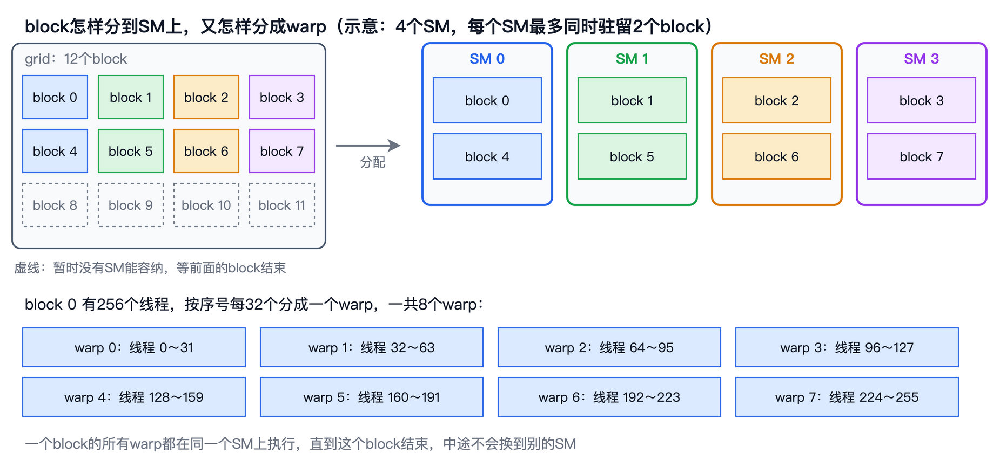
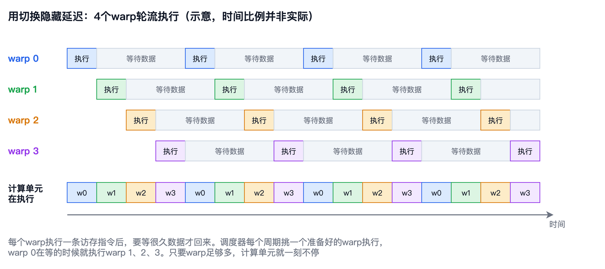
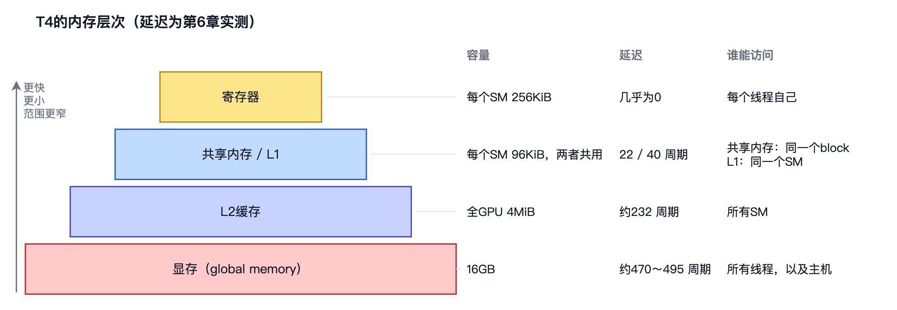

# 第 6 章　线程是怎样执行的

上一章留下了两个问题。朴素kernel只跑出了62GFLOPS，还不到T4峰值的1%；更奇怪的是，计算量一点不变，只是把block从 $32 \times 32$ 换成 $8 \times 8$ ，速度就快了2.7倍。要回答这些问题，先得弄清楚GPU上成千上万个线程，在硬件上到底是怎样跑起来的。

这一章不写新的矩阵乘法，而是用几个小实验，把GPU的执行方式一点一点看清楚：线程怎样组成warp，block怎样被分配到SM上，访问各级存储要等多久，GPU怎样用大量线程把等待藏起来，分支为什么会拖慢速度，以及决定能藏住多少等待的occupancy。Occupancy可以粗略地理解为一个SM上的warp“坐满”了几成，坐得越满，能轮流上阵的warp就越多，后面会给出准确的定义。最后，我们把GPU的各级存储画成一张全景图，再回到朴素kernel，排除掉几个看似合理的原因。

本章的随书代码在`code/ch06/`目录下，一共五个实验程序：`blocks.cu`看block怎样分配到SM，`latency.cu`测各级存储的延迟，`warps.cu`测warp数对带宽和算力的影响，`divergence.cu`测分支分歧，`occupancy.cu`算occupancy并测它对带宽的影响。运行方法和上一章一样，书中引用的数字都来自`results.txt`。


## Warp与SIMT

第4章说过，GPU总是以32个线程为一组执行指令，这一组叫做warp。上一章又补充了一点：一个block里的线程，按 $x$ 变化最快、 $y$ 其次、 $z$ 最慢的顺序排成一列，然后每32个分成一个warp。一个256个线程的block，就是8个warp；一个 $8 \times 8$ 的block只有64个线程，是2个warp。

同一个warp里的32个线程，每次都执行同一条指令，只是各自处理各自的数据。这和第2章的SIMD很像：一条AVX2指令同时处理8个float，一条warp指令同时处理32个线程的数据。区别在于写程序的方式。用SIMD时，程序员要自己把数据装进向量寄存器，明确地写出“同时处理8个”；用CUDA时，程序员只写一个线程该做的事，把32个线程捆在一起执行，是硬件自动完成的。NVIDIA把这种方式叫做**SIMT**（Single Instruction, Multiple Threads），即单指令多线程。

每个线程都有自己的寄存器，也都可以执行自己的分支。从Volta架构（2017年，T4所用的Turing的上一代）开始，每个线程还有自己的程序计数器，可以独立地前进，这叫做独立线程调度。但这并不意味着32个线程真的各跑各的：硬件仍然尽量把走到同一条指令的线程放在一起执行，只有在它们的路径分开时才分头执行。后面讲分支分歧时，我们会看到分头执行的代价。

为了更直观地看清线程怎样分成warp，随书代码的`tools/cuda-grid/`目录下有一个交互工具，可以任意设置grid和block的形状，看每个线程属于哪个warp、负责哪个数据元素。


## block如何分配到SM

启动一个kernel后，GPU上有一个调度单元，负责把grid里的block一个个分给SM。block是分配的最小单位：一个block的所有线程都在同一个SM上执行，从开始到结束都不会换到别的SM上。一个SM只要还有空余的资源，就可以同时驻留好几个block，T4上最多16个，同时驻留的线程总数最多1024个。

下图是一个示意。假设GPU只有4个SM，每个SM最多同时驻留2个block，grid里一共有12个block。调度单元先把block 0到block 7分给4个SM，每个SM两个；block 8到block 11画成虚线，它们暂时没有地方去，要等某个SM上的block结束、腾出资源，才会被分配上去。图里按轮流的顺序分配，实际的分配顺序由硬件决定，程序不能依赖它。图的下半部分把block 0展开：它有256个线程，按编号每32个一组，分成8个warp，这8个warp都在SM 0上执行，直到block 0结束。真实的T4有40个SM，每个SM最多驻留16个block，道理是一样的。



实验程序`blocks.cu`让每个block都做同样多的计算，并在block的0号线程里记下三件事：自己在哪个SM上执行，什么时候开始，什么时候结束。前一件读的是`%smid`，后两件读的是`%globaltimer`，它们都是GPU提供的特殊寄存器，用一行内联汇编就能读出来。结果如下：

```
blocks=40  threads=1024   用到40个SM，每个SM分到1～1个block   一个block约1188.0微秒，全部用时1188.1微秒
    第1轮： 40个block，在第    0.0微秒开始
blocks=64  threads=1024   用到40个SM，每个SM分到1～2个block   一个block约1005.9微秒，全部用时2027.5微秒
    第1轮： 40个block，在第    0.0微秒开始
    第2轮： 24个block，在第  988.8微秒开始
```

第一组是40个block，每个1024个线程。T4的每个SM最多驻留1024个线程，正好容得下一个这样的block，40个SM各分到一个，同时开始、同时结束。第二组有64个block，前40个先分下去，占满了所有SM；剩下的24个只能等，直到第988.8微秒，第一批block陆续算完，它们才开始执行，总用时差不多翻了一倍。这正是上一章分析 $n = 256$ 时朴素kernel为什么慢的原因：64个 $32 \times 32$ 的block要分两轮跑，第二轮有16个SM没活干。

再看block小一些的情况：

```
blocks=160  threads=256   用到40个SM，每个SM分到4～4个block   一个block约570.8微秒，全部用时901.3微秒
    第1轮：160个block，在第    0.0微秒开始
blocks=320  threads=256   用到40个SM，每个SM分到8～8个block   一个block约698.4微秒，全部用时1718.0微秒
    第1轮：200个block，在第    0.0微秒开始
    第2轮： 80个block，在第  448.3微秒开始
    第3轮： 40个block，在第  870.0微秒开始
```

每个block 256个线程时，一个SM可以同时驻留4个，160个block一次就全部分下去了。320个block时，按道理应该是两轮，每轮160个，但统计出来却是200、80、40三组。这说明block的调度并不是整整齐齐一轮一轮进行的：同一个SM上的几个block不一定同时结束，哪个先结束，就立刻补上一个新的。程序按开始时间分组，只是一种近似的统计方法，“轮”的边界本来就是模糊的。这些block的用时也各不相同，是因为同一个SM上的几个block在争抢同一批计算单元。顺带一提，这个实验是本章第一个运行的，GPU的主频可能还没有完全升上来，所以这里只看分配方式，不比较绝对的时间。


## 访存延迟有多长

第4章说过，CPU靠大缓存和乱序执行避免等待，GPU则靠大量线程把等待藏起来。在看它怎样藏之前，先测一测要藏的等待有多长。

测延迟的经典方法叫**指针追逐**（Pointer Chasing）。在一个数组里，每个元素存的是下一个要访问的元素的位置，然后只用一个线程，反复执行`j = next[j]`。下一次读哪个地址，要等这一次读回来才知道，所以每次访问都必须完整地等完一个延迟，没有任何重叠的可能。总时间除以访问次数，就是一次访问的延迟。`latency.cu`中的核心代码如下：

```c
long long t0 = clock64();
for (int i = 0; i < steps; i++) j = next[j];
long long t1 = clock64();
```

其中的`clock64()`读的是SM的时钟周期计数。数组中相邻两个被访问的元素相隔128字节，也就是一个缓存行，所以每次访问都会碰到一个新的缓存行。把数组从4KiB逐步增大到64MiB，数据就会依次从L1、L2一直落到显存里：

```
shared       4KiB     22.0 周期     13.8 纳秒
global       4KiB     40.0 周期     25.2 纳秒
global      32KiB     40.0 周期     25.2 纳秒
global      64KiB    109.9 周期     69.1 纳秒
global     128KiB    231.8 周期    145.8 纳秒
global       4MiB    233.4 周期    146.8 纳秒
global       8MiB    469.0 周期    295.0 纳秒
global      64MiB    494.6 周期    311.1 纳秒
```

这里只列出了几个有代表性的规模，完整结果见`results.txt`。纳秒数是按1.59GHz的最高主频换算的，周期数更可靠。

结果呈现出清晰的台阶。数组不超过32KiB时，延迟是40个周期，数据都在L1里；64KiB时是110个周期，一部分数据已经放不进L1了，这说明这次实验时L1的容量在32KiB到64KiB之间。第4章说过，T4每个SM有96KiB的片上存储，由L1和共享内存共用，具体怎样划分由驱动决定。从128KiB到4MiB，延迟稳定在232个周期左右，数据在4MiB的L2里。超过4MiB以后，L2也放不下了，延迟跳到470个周期以上，这才是从显存读数据的代价。32MiB以上又略有增加，可能是因为地址转换的开销也加了进来。第一行是共享内存，只要22个周期，比L1还快，第8章会用到它。

和第2章的CPU比一比：CPU从L1读数据只要4个周期左右，GPU要40个周期；GPU从显存读一个数要将近500个周期，按纳秒算也要300纳秒左右，比CPU读内存还慢。第4章粗算延迟隐藏时，假设一次显存访问要等400个周期，实际还要更长一些。GPU的单次访问并不快，它的高带宽完全是靠同时进行大量访问换来的。


## 用并发隐藏延迟

一次显存访问要等将近500个周期，在这段时间里，发出请求的warp什么都做不了。但SM上通常驻留着许多个warp，每个处理块的调度器每个周期都会检查一遍：哪些warp的下一条指令已经准备好了，就从中挑一个执行。一个warp在等数据，调度器就去执行另一个。所有warp的寄存器都一直留在寄存器文件里，切换时不需要保存和恢复任何东西，所以切换几乎没有代价。只要有足够多的warp轮流上阵，计算单元和显存就都不会闲着。

下图画的是4个warp在一个处理块上轮流执行的情形。每个warp执行一条访存指令之后，要等很久数据才能回来，图里把等待画成执行的三倍长，实际要长得多。warp 0发出请求、开始等待，调度器就换上warp 1，接着是warp 2和warp 3；warp 3执行完时，warp 0的数据正好回来，又轮到它。看最下面一行：单看任何一个warp，大部分时间都在等，但计算单元每个时刻都有warp可以执行，一刻也不闲。如果只有2个warp，计算单元就有一半时间空着；等待越长，需要的warp就越多。



足够多是多少？`warps.cu`做了一个实验：启动的block数等于SM数，每个SM正好一个block，再把每个block的线程数从32调到1024，于是每个SM上就有1到32个warp。kernel里，每个线程读一个数，加到累加器上，再读下一个。加法要等数据读回来才能执行，而warp是按顺序执行指令的，所以每个warp同一时刻最多只有一个读请求在路上。结果如下：

```
read  每个SM  1个warp      17.365 毫秒      15.5 GB/s
read  每个SM  2个warp       8.732 毫秒      30.7 GB/s
read  每个SM  4个warp       4.429 毫秒      60.6 GB/s
read  每个SM  8个warp       2.388 毫秒     112.4 GB/s
read  每个SM 16个warp       1.447 毫秒     185.6 GB/s
read  每个SM 32个warp       1.185 毫秒     226.6 GB/s
```

每个SM上的warp数每翻一倍，带宽也几乎翻一倍，直到接近显存的上限。这个结果可以精确地算出来。每个SM只有一个warp时，全GPU一共40个warp，每个warp一次读32个连续的float，也就是128字节，所以同一时刻在路上的数据是 $40 \times 128 = 5120$ 字节。每次要等大约311纳秒才能拿到，带宽就是 $5120 / 311 \approx 16.5$ 字节每纳秒，也就是16.5GB/s，和实测的15.5GB/s非常接近。

这背后是一个很简单的关系，叫做**Little定律**（Little's Law）：带宽等于在路上的数据量除以延迟。延迟是硬件定死的，要想提高带宽，只能让更多的数据同时在路上。反过来，要用满上一章实测的277.5GB/s，在路上的数据要有 $277.5 \times 311 \approx 86000$ 字节，也就是大约86KB，相当于674个warp各有一个请求在路上，平均每个SM要将近17个warp。实测中，16个warp时达到185.6GB/s，32个warp时是226.6GB/s，比这个估算要差一些，因为显存忙起来以后，请求要排队，延迟会比空闲时更长。第4章估算时得到的是80KB，和这里实测的86KB已经相当接近了。

计算也有延迟。第3章说过，一条FMA从开始到出结果要几个周期，下一条依赖它的FMA必须等着。`warps.cu`的另一个实验，让每个线程做一条首尾相接的FMA链：

```
fma   每个SM  1个warp       0.184 毫秒     914.1 GFLOPS
fma   每个SM  2个warp       0.184 毫秒    1827.2 GFLOPS
fma   每个SM  4个warp       0.184 毫秒    3654.4 GFLOPS
fma   每个SM  8个warp       0.187 毫秒    7173.0 GFLOPS
fma   每个SM 16个warp       0.337 毫秒    7959.8 GFLOPS
fma   每个SM 32个warp       0.669 毫秒    8024.8 GFLOPS
```

从1个warp到8个warp，用时完全不变，算力随warp数线性增长；8个warp以后，用时开始随warp数增加，算力不再提高。1个warp时，每个SM每个周期只完成 $914.1 / (40 \times 1.59) \approx 14.4$ 次浮点运算，而一条warp级的FMA是 $32 \times 2 = 64$ 次运算，相当于每4.4个周期才执行一条，这正是FMA的延迟，大约4个周期。每个SM有4个处理块，每个处理块的16个FP32单元执行一条warp指令要2个周期，延迟是4个周期，所以每个处理块有2个warp交替执行，就能让FP32单元一刻不停，整个SM需要8个warp。实测正是在8个warp时达到了理论峰值8141GFLOPS的88%。

这里测到的最高算力是8024.8GFLOPS，比上一章实测的7544.3GFLOPS还高一些，相当于理论峰值的98.6%。这并不矛盾：T4的主频随温度和功耗不断变化，两次测量时的主频不同。本书仍然以上一章的7544.3GFLOPS作为T4峰值的基准，读者只要记住，在T4上测出的数字有百分之几的起伏是正常的。

这两个实验揭示了GPU性能的一条基本规律：要隐藏延迟，就要有足够多互不依赖的工作同时在进行。访存需要的并发远远多于计算，计算有8个warp就够了，访存却需要16到32个warp才能接近带宽上限。


## 分支分歧

同一个warp的32个线程执行同一条指令，那如果它们遇到`if`时走了不同的分支呢？硬件的做法是两条路都走：先让走`if`分支的线程执行，其他线程暂时停下；再让走`else`分支的线程执行，前一批线程停下。两条路都走完以后，32个线程再汇合到一起继续执行。这种现象叫做**分支分歧**（Warp Divergence）。

下面用`divergence.cu`做一个对比。两个分支做的FMA一样多，只是写法不同，免得编译器把它们合并：

```c
bool a_side = mode == 0 ? true : mode == 1 ? (t / 32) % 2 == 0 : t % 2 == 0;
if (a_side) {
    for (int i = 0; i < iters; i++) a = fmaf(a, x, y);
} else {
    for (int i = 0; i < iters / 2; i++) {
        a = fmaf(a, y, x);
        a = fmaf(a, x, y);
    }
}
```

三种模式分别是：所有线程都走A分支；按warp分支，偶数号warp走A、奇数号warp走B；在warp内分支，偶数号线程走A、奇数号线程走B。结果如下：

```
none      0.339 毫秒     7918.4 GFLOPS（按每个线程做的FMA计）
warp      0.340 毫秒     7890.1 GFLOPS（按每个线程做的FMA计）
lane      0.676 毫秒     3972.2 GFLOPS（按每个线程做的FMA计）
```

按warp分支时，同一个warp里的线程走向一致，没有任何代价，和不分支一样快。在warp内分支时，每个warp都要把两个分支各走一遍，每次只有一半的线程在干活，用时正好翻了一倍。所以，分支本身并不可怕，可怕的是同一个warp里的线程走了不同的路。写kernel时，如果分支不可避免，就尽量让分支的条件以warp为单位变化。矩阵乘法的kernel里几乎没有分支，只有边界检查那一个`if`，而且只在矩阵边缘的少数warp里才会分歧，所以它不是朴素kernel慢的原因。


## Occupancy

前面看到，SM上驻留的warp越多，越能把延迟藏起来。可是一个SM能驻留多少个warp，并不只由block的线程数决定。每个SM的资源是有限的，`occupancy.cu`查询到的T4的各项上限如下：

```
每个SM最多驻留的线程     1024（32个warp）
每个SM最多驻留的block    16
每个SM的32位寄存器       65536（256KiB）
每个SM的共享内存         64KiB
每个线程最多的寄存器     255
```

一个block要驻留在SM上，它的所有线程都要分到寄存器，它申请的共享内存也要分到，而且线程数和block数都不能超过上限。这几个条件中最紧的那一个，决定了一个SM实际能驻留多少个warp。实际驻留的warp数占上限的比例，叫做**occupancy**。中文资料里通常把它译作“占用率”，本书沿用英文，不做翻译。T4的上限是32个warp，驻留16个warp时，occupancy就是50%。

举一个例子。如果一个kernel的每个线程要用64个寄存器，一个warp就要 $32 \times 64 = 2048$ 个寄存器，65536个寄存器最多只够32个warp，还不会限制occupancy；如果每个线程要用128个寄存器，就只够16个warp，occupancy最多50%。共享内存也是一样：每个block申请24KiB，64KiB的共享内存只放得下2个block。

借助CUDA提供的函数`cudaOccupancyMaxActiveBlocksPerMultiprocessor`，`occupancy.cu`算出了上一章朴素kernel的occupancy：

```
naive  block= 8x8   每个线程49个寄存器   每个SM驻留16个block、32个warp   occupancy 100%
naive  block=16x16  每个线程49个寄存器   每个SM驻留 4个block、32个warp   occupancy 100%
naive  block=32x32  每个线程49个寄存器   每个SM驻留 1个block、32个warp   occupancy 100%
```

朴素kernel每个线程用49个寄存器，没有用共享内存，三种block大小下，每个SM都能驻留满32个warp，occupancy都是100%。 $8 \times 8$ 的block只有64个线程，但每个SM最多能驻留16个这样的block，加起来正好也是1024个线程。

如果occupancy降下来，会怎样？`occupancy.cu`的最后一个实验，用的是和前面一样的只读kernel，每个block 256个线程，只是让每个block额外申请一块共享内存，人为地压低occupancy：

```
smem  每个block  0KiB共享内存   每个SM驻留4个block、32个warp   occupancy 100%     217.4 GB/s
smem  每个block 16KiB共享内存   每个SM驻留4个block、32个warp   occupancy 100%     218.0 GB/s
smem  每个block 24KiB共享内存   每个SM驻留2个block、16个warp   occupancy  50%     175.0 GB/s
smem  每个block 48KiB共享内存   每个SM驻留1个block、 8个warp   occupancy  25%     102.1 GB/s
```

每个block申请16KiB时，4个block正好用完64KiB的共享内存，occupancy不受影响；24KiB时只能放下2个block，occupancy降到50%，带宽也随之下降；48KiB时只剩1个block，带宽只有一开始的一半左右。这和前面`warps.cu`的结果完全吻合：对于这种每个warp只有一个请求在路上的kernel，驻留的warp越少，带宽越低。

那么，occupancy是不是越高越好？并不一定。隐藏延迟真正需要的，是有足够多互不依赖的工作同时在进行，warp多只是其中一种办法。另一种办法，是让每个线程自己就有多个互不依赖的操作。前面的FMA实验里，每个SM只有8个warp，也就是25%的occupancy，就已经达到了峰值的88%。上一章的`peak.cu`让每个线程同时维护8条互不相关的FMA链，也是同样的道理。第9章的寄存器分块会故意让每个线程用更多的寄存器，occupancy因此降低，但每个线程能同时做的事情更多了，速度反而大幅提高。occupancy只是一个参考，不是目标。


## 内存层次全景

到这里，GPU上的各级存储都已经出场了。把它们放在一起看：

| 存储 | T4上的容量 | 延迟（周期） | 谁能访问 |
|---|---|---|---|
| 寄存器 | 每个SM 256KiB | 几乎为0 | 每个线程自己 |
| 共享内存 | 每个SM最多64KiB | 22 | 同一个block的线程 |
| L1 | 与共享内存共用每个SM的96KiB | 40 | 同一个SM上的线程，硬件自动管理 |
| L2 | 全GPU 4MiB | 约232 | 所有SM，硬件自动管理 |
| 显存（全局内存） | 16GB | 约470～495 | 所有线程，以及通过PCIe的主机 |



这张表里的延迟都是本章实测的，容量来自上一章和`occupancy.cu`的查询结果。和第2章CPU的内存层次相比，GPU的特点很鲜明：寄存器的总量比任何一级缓存都大，缓存却很小，平均到每个线程只有几十个字节，而访问每一级的延迟都比CPU长得多。GPU的设计假设是，程序员会通过共享内存和寄存器，自己安排数据的复用，而不是依赖缓存。

表的最后一列同样重要。CUDA程序里的变量放在哪里，决定了谁能看到它。kernel里普通的局部变量放在寄存器里，只有这个线程自己能用；用`__shared__`声明的变量放在共享内存里，同一个block的线程都能读写；`cudaMalloc`分配的显存，所有线程都能访问。第7章到第11章的优化，就是沿着这张表一级一级往上走：先让显存的访问更有效率，再把数据搬进共享内存反复使用，最后放进寄存器。


## 回到朴素kernel

现在回到本章开头的问题。朴素kernel用 $8 \times 8$ 的block比用 $32 \times 32$ 快2.7倍，原因是什么？

本章已经排除了几种可能。不是occupancy：三种block大小的occupancy都是100%，每个SM都驻留着32个warp。不是分支分歧：朴素kernel里只有边界检查一个分支，而 $n = 4096$ 正好是block大小的整数倍，根本没有线程越界。也不是block的分配：4096的矩阵会产生成千上万个block，每个SM都分得满满的。

剩下的嫌疑，就是访存的方式。第5章说过，block是 $32 \times 32$ 时，同一个warp的32个线程负责 $\mathbf{C}$ 的同一列、相邻的32行；block是 $8 \times 8$ 时，同一个warp负责8行、4列。warp的32个线程是一起执行的，它们的访存请求也是一起发出的。这32个请求落在哪些地址上，对显存来说差别很大。下一章，我们就用NVIDIA的性能分析工具，看看朴素kernel的访存到底出了什么问题。


## 本章小结

这一章，我们看清了GPU执行线程的方式。一个block里的线程按 $x$ 、 $y$ 、 $z$ 的顺序每32个组成一个warp，同一个warp执行同一条指令，这叫SIMT。block是分配到SM的最小单位，一个SM可以同时驻留多个block，放不下的block要等前面的block结束才能开始，调度是动态的。

在GPU上，访存的延迟很长：实测L1约40个周期，L2约232个周期，显存约470到495个周期，共享内存只要22个周期。GPU用大量warp轮流执行来隐藏延迟，带宽等于在路上的数据量除以延迟。实测中，每个SM的warp数从1增加到32，读带宽从15.5GB/s增加到226.6GB/s；而FMA链只要8个warp就能接近峰值。同一个warp里的线程走不同分支时，两条路要依次执行，实测用时翻倍。

所谓occupancy，是一个SM实际驻留的warp数占上限的比例，受寄存器、共享内存、线程数和block数的限制。occupancy降低时，靠warp数隐藏延迟的kernel会明显变慢，但隐藏延迟也可以靠每个线程内部互不依赖的操作，所以occupancy不是越高越好。朴素kernel的occupancy是100%，也没有分支分歧，它慢的原因要到访存的方式中去找，这就是下一章的内容。
