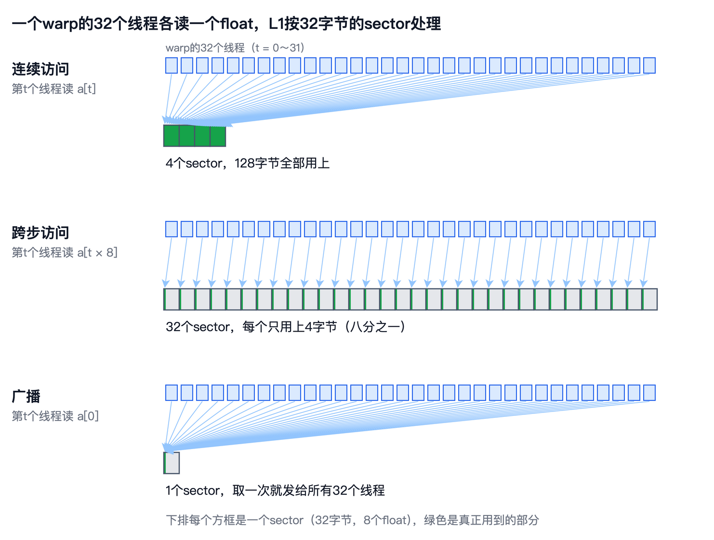
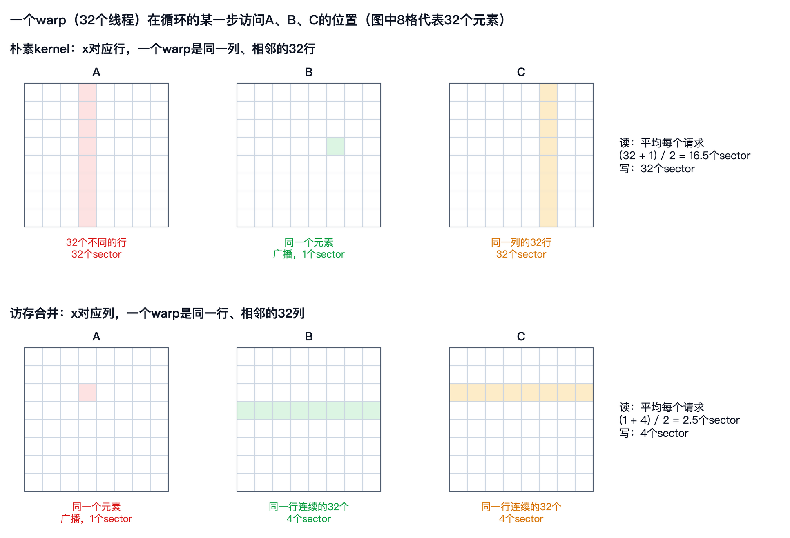

# 第 7 章　访存合并

上一章排除了几个嫌疑：朴素kernel的occupancy是100%，没有分支分歧，block也分配得满满的。剩下的嫌疑只有一个，就是访存的方式。block是 $32 \times 32$ 时，一个warp的32个线程负责 $\mathbf{C}$ 的同一列、相邻的32行；换成 $8 \times 8$ ，一个warp负责8行、4列，速度就快了2.7倍。同样的计算，只是同一个warp里的线程访问的地址不同，差别就这么大。

这一章，我们先请出NVIDIA的性能分析工具Nsight Compute，看看朴素kernel运行时，GPU的哪个部件最忙。然后弄清楚全局内存是怎样被访问的：一个warp的32个访存请求，怎样被合并成少量的数据块。有了这些知识，朴素kernel的问题就一目了然了，而修复它只需要改两行代码。

本章的随书代码在`code/ch07/`目录下。`coalesce.cu`是一个访存合并的微基准，`matmul.cu`包含第5章的朴素kernel和本章修改后的kernel，`bench.sh`跑完全部实验，并用Nsight Compute采集指标。和前两章一样，书中引用的数字都来自`results.txt`。


## 第一次使用Nsight Compute

随CUDA一起提供的，还有NVIDIA的kernel性能分析工具**Nsight Compute**。它可以读出GPU内部的上千个硬件计数器：执行了多少条指令，每一级缓存被访问了多少次，从显存搬了多少字节，各个部件忙到了什么程度。它有图形界面，也有命令行工具`ncu`，Colab上用的是后者。最简单的用法，是把要运行的程序放在`ncu`后面：

```
ncu --section SpeedOfLight ./matmul naive 2048 32 once
```

命令最后的`once`是`matmul`的参数，表示只运行一次kernel、不计时，免得`ncu`把预热和重复测量的每一次都分析一遍。`--section SpeedOfLight`表示只看“Speed Of Light”这一节，它把GPU主要部件的吞吐，表示成峰值的百分比，是分析一个kernel时首先要看的东西。朴素kernel在 $n = 2048$ 时的结果如下：

```
    DRAM Frequency                  Ghz           5.00
    SM Frequency                    Mhz         585.00
    Memory Throughput                 %          49.71
    DRAM Throughput                   %           0.93
    Duration                         ms         761.96
    L1/TEX Cache Throughput           %          99.42
    L2 Cache Throughput               %           0.39
    Compute (SM) Throughput           %           6.03
```

先看第二行，SM的主频只有585MHz，而T4的最高主频是1590MHz。这是`ncu`有意为之：为了让每次分析的结果可以重复，它默认把GPU的主频固定在基础频率上。所以，`ncu`报告的用时761.96毫秒，比第5章正常计时的278毫秒长得多。用`ncu`时，要看的是各种计数和百分比，不要拿它的用时和正常运行的用时比较。

再看各个部件的吞吐。计算单元只用到了峰值的6.03%，这在意料之中。出人意料的是存储：显存只用到了0.93%，L2只用到了0.39%，而L1却高达99.42%，几乎被压满了。也就是说，朴素kernel慢，并不是因为显存的带宽不够，数据其实大都在缓存里。真正的瓶颈是L1：它忙不过来了。`ncu`在最后还给出了一条建议，说这个kernel的计算和显存吞吐都偏低，通常意味着延迟方面的问题。这条建议是自动生成的，参考一下就好，L1的99.42%才是关键的线索。

为什么L1会这么忙？要回答这个问题，需要先弄清楚全局内存的访问是怎样进行的。


## 全局内存是怎样被访问的

上一章说过，一个warp的32个线程总是一起执行同一条指令。执行到一条读全局内存的指令时，32个线程各自给出一个地址，这32个地址被打包成一个**请求**（Request）交给L1。L1以32字节为单位处理这些地址，这个单位叫做**sector**，中文资料里有时译作“扇区”。L1先算出这32个地址一共落在几个不同的sector上，再一个sector一个sector地去取数据：如果数据已经在L1里，就直接取；不在，就向L2要，L2也没有，就向显存要。第2章讲过CPU的缓存行是64字节，GPU的L1缓存行是128字节，正好由4个sector组成。



所以，一个请求的代价，取决于这32个地址分散在多少个sector上。最理想的情况，是32个线程访问32个连续的float，一共128字节，正好落在4个sector里，L1只要处理4次。如果32个线程访问的地址彼此相隔很远，就会落在32个不同的sector里，L1要处理32次，而每个sector里只有4个字节是真正用到的。同一个warp的访问被合并成尽量少的sector，这叫做**访存合并**（Memory Coalescing）。还有一种特殊的情况：32个线程访问同一个地址，只涉及1个sector，L1取一次就可以发给所有线程，这叫做**广播**（Broadcast）。

随书代码中的`coalesce.cu`用一个微基准，直观地展示了合并与不合并的差别。它让第 $t$ 个线程读`a[t * stride]`，`stride`从1增加到32。不管步长是多少，总共用到的数据都是4M个float，16MiB，变的只是这些数据在内存中有多分散。有效带宽是用到的字节数除以时间：

```
stride   1      0.075 毫秒   有效带宽   222.9 GB/s
stride   2      0.131 毫秒   有效带宽   127.8 GB/s
stride   4      0.246 毫秒   有效带宽    68.3 GB/s
stride   8      0.507 毫秒   有效带宽    33.1 GB/s
stride  16      1.007 毫秒   有效带宽    16.7 GB/s
stride  32      1.099 毫秒   有效带宽    15.3 GB/s
```

步长为1时，一个warp读的是32个连续的float，有效带宽是222.9GB/s。步长每翻一倍，有效带宽几乎减半：步长为2时，32个线程的地址分布在256字节里，要搬运的sector多了一倍，其中一半的数据用不上；步长为8时，相邻线程的地址相隔32字节，每个线程独占一个sector，搬来的数据只有八分之一是有用的。

按照sector的道理，步长超过8以后，每个线程已经各占一个sector，有效带宽不该再下降，可实测从8到16又减了一半，从16到32才基本持平。这说明从显存搬运数据时，实际的粒度比32字节还大：L2向显存要数据时，看起来一次总是取64字节，也就是两个相邻的sector。这个细节不影响本章的结论，只是提醒我们，不合并的访问浪费的带宽，可能比按sector算出来的还多。

访问的起始地址没有对齐，影响就小得多。让第 $t$ 个线程读`a[t + offset]`：

```
offset   0      0.075 毫秒   有效带宽   224.4 GB/s
offset   1      0.077 毫秒   有效带宽   216.7 GB/s
offset   8      0.077 毫秒   有效带宽   217.4 GB/s
offset  16      0.079 毫秒   有效带宽   212.4 GB/s
```

起始地址偏移一个float，一个warp的128字节就会跨到5个sector上，多出一个，有效带宽只下降了百分之几。所以，访存合并真正要紧的是同一个warp里相邻的线程访问相邻的地址，至于从哪里开始，没那么重要。


## 朴素kernel的问题

现在用这把尺子量一量朴素kernel。回顾一下它的写法：

```c
int i = blockIdx.x * blockDim.x + threadIdx.x;   // 行
int j = blockIdx.y * blockDim.y + threadIdx.y;   // 列
...
for (int k = 0; k < n; k++)
    sum += A[i * n + k] * B[k * n + j];
C[i * n + j] = sum;
```

当block是 $32 \times 32$ 时，同一个warp的32个线程， $x$ 方向的编号是0到31， $y$ 方向的编号相同，所以它们的 $i$ 是相邻的32个值， $j$ 都一样。循环的每一步，这32个线程要各读一个`A[i * n + k]`和一个`B[k * n + j]`。

读 $\mathbf{A}$ 时，32个线程的 $i$ 各不相同，读的是 $\mathbf{A}$ 的32个不同的行，相邻两个地址之间隔着一整行， $n$ 个float。这正是上面步长最大的情况，32个地址落在32个不同的sector上。读 $\mathbf{B}$ 时，32个线程的 $j$ 相同，读的是同一个地址，是一次广播，只涉及1个sector。平均下来，每个请求涉及 $(32 + 1) / 2 = 16.5$ 个sector。

这个数字可以用`ncu`验证。`bench.sh`让`ncu`采集了两个计数器：`l1tex__t_requests_pipe_lsu_mem_global_op_ld.sum`是读全局内存的请求数（名字里的`mem_global`指的就是全局内存），`l1tex__t_sectors_pipe_lsu_mem_global_op_ld.sum`是这些请求涉及的sector数。朴素kernel在 $n = 2048$ 、block为 $32 \times 32$ 时：

```
l1tex__t_requests_pipe_lsu_mem_global_op_ld.sum                536,870,912
l1tex__t_sectors_pipe_lsu_mem_global_op_ld.sum          sector 8,858,365,615
```

请求数是 $536870912 = 2 \times 2048^3 / 32$ ：每个warp在循环的每一步读一次 $\mathbf{A}$ 、读一次 $\mathbf{B}$ ，一共有 $2048^2 / 32$ 个warp，循环2048步。sector数除以请求数，是16.5，和上面算的一模一样。



每个请求要处理16.5个sector，L1自然忙不过来，这就是L1吞吐99.42%的原因。数据其实大都在缓存里，显存几乎闲着，可L1光是把这些零散的sector一个个找出来，就已经满负荷了。写 $\mathbf{C}$ 时也一样，32个线程写的是同一列的32行，每个写请求涉及32个sector。`ncu`的计数也印证了这一点：写请求131072个，写的sector是4195836个，每个请求正好32个。

再看block为 $8 \times 8$ 的情况。一个warp是8行、4列：读 $\mathbf{A}$ 时涉及8个不同的行，也就是8个sector；读 $\mathbf{B}$ 时是同一行里相邻的4个元素，16个字节，落在1个sector里。平均每个请求 $(8 + 1) / 2 = 4.5$ 个sector。`ncu`测出的sector数是2415753008，除以同样的请求数，正是4.5。每个请求要处理的sector从16.5个降到4.5个，L1的负担减轻了不少，这就是 $8 \times 8$ 的block快2.7倍的原因。第5章留下的谜题，到这里终于有了答案。


## 调整线程映射

既然问题出在同一个warp的线程访问的地址太分散，解决的办法就很明显了：让 $x$ 方向对应列，而不是行。这样，同一个warp的32个线程， $j$ 是相邻的32个值， $i$ 都一样。修改后的kernel只改了前两行：

```c
__global__ void matmul_coalesced(int n, const float *A, const float *B, float *C) {
    int j = blockIdx.x * blockDim.x + threadIdx.x;   // 列
    int i = blockIdx.y * blockDim.y + threadIdx.y;   // 行
    if (i < n && j < n) {
        float sum = 0.0f;
        for (int k = 0; k < n; k++) sum += A[i * n + k] * B[k * n + j];
        C[i * n + j] = sum;
    }
}
```

现在，读 $\mathbf{A}$ 时32个线程的 $i$ 相同，读的是同一个地址，变成了广播，1个sector；读 $\mathbf{B}$ 时是同一行里连续的32个float，128字节，4个sector。平均每个请求 $(1 + 4) / 2 = 2.5$ 个sector。写 $\mathbf{C}$ 时也是同一行的32个连续元素，4个sector。`ncu`的计数完全符合预期：读的sector是1342177280个，正好是请求数的2.5倍；写的sector是524288个，正好是写请求数131072的4倍。

再看吞吐。修改后，L1不再是唯一的瓶颈，`ncu`报告的存储吞吐和计算吞吐都上升到了峰值的85.67%。同样在585MHz的主频下，kernel的用时从761.96毫秒降到了53.61毫秒。

实际的速度如何？在正常的主频下，两个版本的对比如下：

```
naive      n=1024  block=32x32       35.209 毫秒       61.0 GFLOPS
coalesced  n=1024  block=32x32        3.018 毫秒      711.5 GFLOPS
naive      n=2048  block=32x32      278.188 毫秒       61.8 GFLOPS
coalesced  n=2048  block=32x32       29.100 毫秒      590.4 GFLOPS
naive      n=4096  block=32x32     2216.005 毫秒       62.0 GFLOPS
coalesced  n=4096  block=32x32      246.560 毫秒      557.4 GFLOPS
```

只改了两行代码，速度就提高了9到12倍。在基准问题 $n = 4096$ 上，从62.0GFLOPS提高到557.4GFLOPS，是CPU上多线程NumPy的3倍多。这是我们在GPU上的第一次大幅提速，而计算量、算法、occupancy都没有任何变化，变的只是哪些线程被分到了同一个warp里。正确性也没有问题，两个版本和cuBLAS的相对误差都在 $10^{-6}$ 左右，而且彼此完全相同，因为每个线程做的计算和累加顺序一模一样。

换几种block大小看看：

```
naive      n=4096  block=8x8      778.840 毫秒      176.5 GFLOPS
coalesced  n=4096  block=8x8      561.567 毫秒      244.7 GFLOPS
naive      n=4096  block=16x16     1194.633 毫秒      115.0 GFLOPS
coalesced  n=4096  block=16x16      377.829 毫秒      363.8 GFLOPS
naive      n=4096  block=32x32     2216.457 毫秒       62.0 GFLOPS
coalesced  n=4096  block=32x32      267.829 毫秒      513.2 GFLOPS
```

对于修改后的kernel，block越宽越好。block是 $8 \times 8$ 时，一个warp覆盖4行、每行8个元素，读 $\mathbf{A}$ 时涉及4个不同的行，读 $\mathbf{B}$ 、写 $\mathbf{C}$ 时每行只有32字节，只用上了缓存行的四分之一，合并得不充分；block宽到32时，一个warp正好覆盖一行里的32个元素，合并得最充分。这里 $32 \times 32$ 测出的是513.2GFLOPS，和上面的557.4GFLOPS不一样，这两组数据是在不同时刻测的，相差8%左右，在T4上属于正常的波动。

那么，557.4GFLOPS离T4的峰值还有多远？只有7.4%。修改后的kernel虽然合并得很好，但每做一次乘加，仍然要从缓存里读两个数，算术强度太低。第3章说过，提高算术强度的办法，是让数据被反复使用。下一章，我们把 $\mathbf{A}$ 和 $\mathbf{B}$ 的小块搬进共享内存，让同一个block的线程共同使用。


## 补全基准表

把本章的结果加进基准表，峰值占比仍以T4实测的7544.3GFLOPS为基准：

| 版本 | 硬件 | 规模 | GFLOPS | 峰值占比 |
|---|---|---|---|---|
| NumPy，多线程 | CPU | $n = 2048$ | 161.9 | 26.7% |
| 朴素kernel | T4 | $n = 4096$ | 61.9 | 0.82% |
| 访存合并 | T4 | $n = 2048$ | 590.4 | 7.8% |
| 访存合并 | T4 | $n = 4096$ | 557.4 | 7.4% |
| cuBLAS | T4 | $n = 2048$ | 5968.6 | 79.1% |
| cuBLAS | T4 | $n = 4096$ | 3300.9 | 43.8% |

表中朴素kernel和cuBLAS的数字沿用第5章的测量，本章重测的朴素kernel是62.0GFLOPS，差别在测量误差之内。和cuBLAS相比，我们还差得很远：在 $n = 2048$ 时是它的十分之一，在 $n = 4096$ 时是它的六分之一。但比起朴素kernel，已经跨出了一大步。


## 本章小结

这一章，我们第一次用Nsight Compute分析kernel。它的Speed Of Light小节显示，朴素kernel的L1吞吐高达99.42%，而显存只用到了0.93%：瓶颈不在显存的带宽，而在L1处理请求的能力。用`ncu`分析时，GPU的主频被固定在基础频率，所以要看计数和百分比，而不是用时。

对全局内存的访问以warp为单位：32个线程的地址打包成一个请求，L1按32字节的sector处理。32个地址落在的sector越少，请求的代价越低。相邻线程访问相邻地址，叫做访存合并；所有线程访问同一个地址，叫做广播。微基准显示，步长每翻一倍，有效带宽几乎减半；起始地址不对齐则影响很小。

朴素kernel让 $x$ 方向对应行，一个warp读 $\mathbf{A}$ 时涉及32个sector，平均每个请求16.5个sector，和`ncu`的计数完全一致；block换成 $8 \times 8$ 后降到4.5个，这就是第5章那2.7倍的来历。把 $x$ 方向改成对应列，每个请求只涉及2.5个sector，速度提高9到12倍，在 $n = 4096$ 时达到557.4GFLOPS。但这只是T4峰值的7.4%，要再往上走，就要让数据在片上被反复使用，这是下一章的内容。
