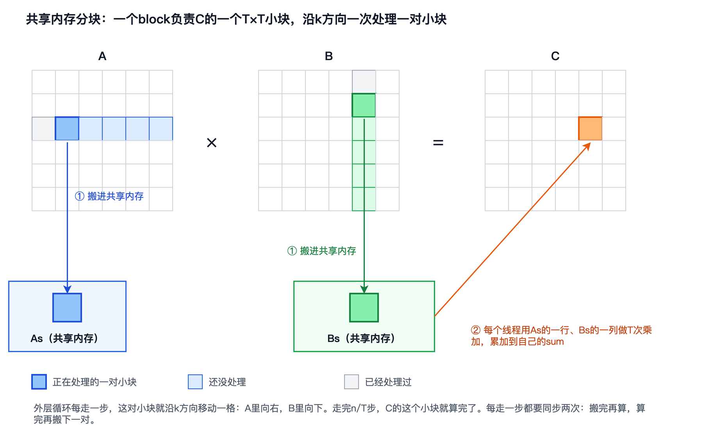
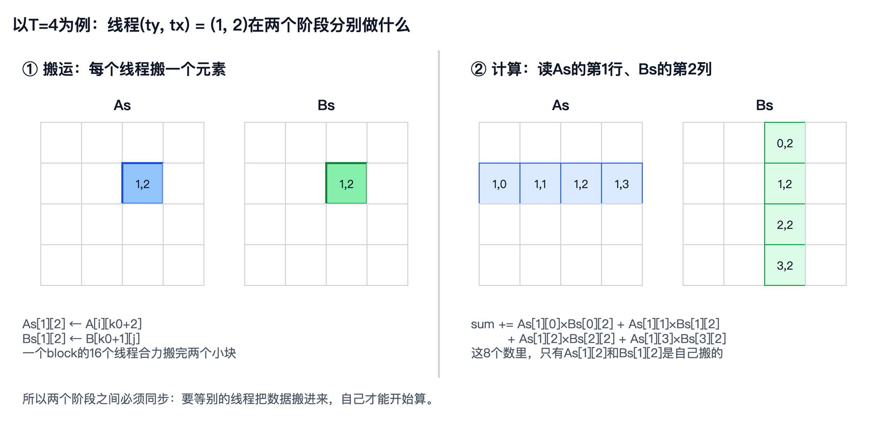

# 第 8 章　共享内存分块

上一章结尾，访存合并后的kernel在 $n = 4096$ 时达到557.4GFLOPS，只有T4峰值的7.4%。它的每个warp每做一次乘加，仍然要发出两个读全局内存的请求，一个读 $\mathbf{A}$ ，一个读 $\mathbf{B}$ 。这些数据大都能在缓存里找到，可光是处理这么多请求，L1就已经很忙了。第2章在CPU上遇到过类似的局面，当时的办法是分块：把一小块数据搬到快的地方，在那里尽可能多地使用它。这一章，我们在GPU上把分块再做一遍。

在GPU上，“快的地方”不止一处。第4章说过，每个SM有96KiB的片上存储，可以划分成L1和共享内存：L1由硬件自动管理，共享内存则由程序员自己决定放什么、什么时候放。本章先用Nsight Compute确认访存合并后的kernel把力气花在了哪里，算一算 $\mathbf{A}$ 和 $\mathbf{B}$ 的每个元素被重复读了多少次；然后认识共享内存和block内的同步，写出分块矩阵乘法kernel，并处理矩阵尺寸不是分块大小整数倍的情况；最后比较几种分块大小，再回到roofline。顺带，我们还会证实第5章的一个推测：cuBLAS在 $n = 4096$ 时只有43.8%的峰值，是因为T4撞上了功耗上限。

本章的随书代码在`code/ch08/`目录下，只有一个程序`matmul.cu`，里面有第7章访存合并后的kernel、本章的分块kernel，以及cuBLAS。`bench.sh`跑完全部实验，并用Nsight Compute采集指标。和前几章一样，书中引用的数字都来自`results.txt`。


## 数据复用

先用`ncu`看一看访存合并后的kernel。在 $n = 2048$ 、block为 $32 \times 32$ 时，Speed Of Light小节的结果如下：

```
    DRAM Throughput                   %          9.81
    Duration                         ms         53.66
    L1/TEX Cache Throughput           %         86.09
    L2 Cache Throughput               %          4.76
    Compute (SM) Throughput           %         85.63
```

和朴素kernel相比，L1的吞吐从99.42%降到了86.09%，但它仍然是最忙的存储部件；显存只用了9.81%，L2只用了4.76%。也就是说，这个kernel读的数据几乎都是从L1拿到的，显存和L2基本闲着。

为什么数据都在L1里？算一算就知道了。线程 $(i, j)$ 要把 $\mathbf{A}$ 的第 $i$ 行和 $\mathbf{B}$ 的第 $j$ 列完整地读一遍。 $\mathbf{C}$ 的第 $i$ 行有 $n$ 个元素，对应 $n$ 个线程，它们都要读 $\mathbf{A}$ 的第 $i$ 行；同样， $\mathbf{B}$ 的第 $j$ 列也要被 $n$ 个线程各读一遍。所以 $\mathbf{A}$ 和 $\mathbf{B}$ 的每个元素都被读了 $n$ 次，一共是 $2n^3$ 次读取。可 $\mathbf{A}$ 和 $\mathbf{B}$ 加起来只有 $2n^2$ 个元素，理论上每个只要从显存读一次就够了。同一个block里的线程，算的是 $\mathbf{C}$ 中相邻的行和列，要读的 $\mathbf{A}$ 的行、 $\mathbf{B}$ 的列大量重叠，所以重复的读取大都落在了L1里。

从`ncu`采集的计数里，也能看出这一点：

```
l1tex__t_requests_pipe_lsu_mem_global_op_ld.sum                 536,870,912
l1tex__t_sectors_pipe_lsu_mem_global_op_ld.sum           sector 1,342,177,280
lts__t_sectors_srcunit_tex_op_read.sum                   sector    67,110,533
dram__bytes_read.sum                                      Gbyte          1.66
```

第一行是读全局内存的请求数，第7章算过，它等于 $2 \times 2048^3 / 32$ ，每个warp每做一次乘加就发两个请求。第二行是这些请求涉及的sector数，平均每个请求2.5个。第三行是L1向L2要的sector数，只有6711万个，比第二行少了20倍，说明20个sector里有19个在L1里就找到了。第四行是从显存读的字节数，1.66GB，而 $\mathbf{A}$ 和 $\mathbf{B}$ 加起来只有32MiB，平均每个元素从显存读了50次左右。

所以，这个kernel的代价主要不在显存的流量上，而在L1要处理的请求数上：5.37亿个请求，13.4亿个sector。要减少请求，就要让读进来的数据在片上被多用几次，而不是每用一次就向L1要一次。L1虽然也在片上，但它由硬件管理，程序没法告诉它“这一块数据接下来还要用32次，先别扔”，每次使用也都要重新发一个请求。我们需要一块由程序自己管理的存储，这就是共享内存。


## 共享内存

**共享内存**和L1是同一块片上存储。T4的每个SM有96KiB，可以划出32KiB或64KiB给共享内存，剩下的归L1，具体怎样划分由驱动根据kernel的需要决定。第6章实测过，从共享内存读一个数只要22个周期，比L1的40个周期还快：缓存要先判断数据在不在、在哪里，共享内存则由程序直接给出位置，省掉了这一步。

共享内存的特点，从名字上就能看出来：它属于一个block，被这个block的所有线程共享。每个block开始执行时分到自己的一份，执行完就收回；一个block的线程看不到别的block的共享内存。在kernel里声明数组时，前面加上`__shared__`，这个数组就放在共享内存里：

```c
__shared__ float As[32][32];
```

这一行声明了一个 $32 \times 32$ 的float数组，占4KiB。虽然这行代码写在kernel里，每个线程都会执行到，但整个block只有一份`As`，所有线程读写的是同一块存储。这和普通的局部变量完全不同，普通的局部变量每个线程各有一份，一般放在寄存器里。像这样在声明时写死大小的共享内存数组，每个block加起来最多可以用48KiB。

有了共享内存，分块的思路就很自然了：一个block的线程先合力把要用的 $\mathbf{A}$ 和 $\mathbf{B}$ 的小块搬进共享内存，每个线程搬一个元素；然后每个线程从共享内存里读数据、做乘加。这样，每个元素只要从全局内存读进来一次，就可以在共享内存里被这个block的线程反复使用。


## 分块矩阵乘法kernel

具体来说，让每个block有 $T \times T$ 个线程，负责 $\mathbf{C}$ 的一个 $T \times T$ 小块，每个线程仍然负责其中一个元素。算这个小块，要用到 $\mathbf{A}$ 的 $T$ 行和 $\mathbf{B}$ 的 $T$ 列。我们沿 $k$ 方向，把这 $T$ 行和 $T$ 列切成 $n / T$ 段，每一段都是一个 $T \times T$ 的小块，一次只处理一对：把 $\mathbf{A}$ 的一个小块和 $\mathbf{B}$ 的一个小块搬进共享内存，每个线程用它们做 $T$ 次乘加，累加到自己的`sum`里；然后移到下一对，直到走完整个 $k$ 方向。



这和第2章CPU上的分块是同一个思路，只是“快的存储”从缓存换成了共享内存，而且搬什么、什么时候搬，都由程序明确地写出来。`matmul.cu`中的分块kernel如下，分块边长 $T$ 是一个模板参数，可以取8、16或32：

```c
template <int T>
__global__ void matmul_smem(int n, const float *A, const float *B, float *C) {
    __shared__ float As[T][T];
    __shared__ float Bs[T][T];
    int tx = threadIdx.x, ty = threadIdx.y;
    int j = blockIdx.x * T + tx;   // 列
    int i = blockIdx.y * T + ty;   // 行
    float sum = 0.0f;
    for (int k0 = 0; k0 < n; k0 += T) {
        As[ty][tx] = (i < n && k0 + tx < n) ? A[i * n + k0 + tx] : 0.0f;
        Bs[ty][tx] = (k0 + ty < n && j < n) ? B[(k0 + ty) * n + j] : 0.0f;
        __syncthreads();
        for (int k = 0; k < T; k++) sum += As[ty][k] * Bs[k][tx];
        __syncthreads();
    }
    if (i < n && j < n) C[i * n + j] = sum;
}
```

线程的编号方式沿用上一章： $x$ 方向对应列 $j$ ， $y$ 方向对应行 $i$ 。外层循环每走一步，`k0`增加 $T$ ，对应图中的一对小块。循环体分成两个阶段。第一个阶段是搬运：线程 $(ty, tx)$ 把 $\mathbf{A}$ 中第 $i$ 行、第 $k_0 + tx$ 列的元素放进`As[ty][tx]`，把 $\mathbf{B}$ 中第 $k_0 + ty$ 行、第 $j$ 列的元素放进`Bs[ty][tx]`；条件表达式处理的是越界的情况，后面再说。第二个阶段是计算：线程 $(ty, tx)$ 用`As`的第 $ty$ 行和`Bs`的第 $tx$ 列做 $T$ 次乘加，这正是它负责的 $c_{ij}$ 在这一段 $k$ 上的部分和。



两个阶段的访存都很规整。搬运时，同一个warp里的线程 $ty$ 相同、 $tx$ 相邻，读的是 $\mathbf{A}$ 同一行里连续的元素，以及 $\mathbf{B}$ 同一行里连续的元素，是合并得很好的访问。分块边长为32时，一个warp正好读一行里连续的32个float，`ncu`测出每个读请求正好涉及4个sector，是最理想的情况。计算时读的是共享内存：一个warp的32个线程读`As[ty][k]`时地址相同，是一次广播；读`Bs[k][tx]`时是同一行里连续的32个元素。

速度如何？在三个规模上，与访存合并的kernel对比如下，两者的block都是 $32 \times 32$ ：

```
coalesced  n=1024  block=32x32        3.698 毫秒      580.6 GFLOPS
smem       n=1024  block=32x32        2.878 毫秒      746.1 GFLOPS
coalesced  n=2048  block=32x32       29.705 毫秒      578.4 GFLOPS
smem       n=2048  block=32x32       19.168 毫秒      896.3 GFLOPS
coalesced  n=4096  block=32x32      237.705 毫秒      578.2 GFLOPS
smem       n=4096  block=32x32      156.601 毫秒      877.6 GFLOPS
```

分块kernel在三个规模上都更快，在 $n = 2048$ 和 $n = 4096$ 上快了1.5倍左右，基准问题达到877.6GFLOPS。结果也是对的：和cuBLAS相比，相对误差在 $n = 1024$ 时是 $1.454 \times 10^{-6}$ ，和访存合并的kernel一模一样。这并不奇怪，每个线程仍然按 $k$ 从小到大的顺序累加，计算的顺序没有变，变的只是数据从哪里读来。

提速从何而来？用`ncu`在 $n = 2048$ 时对比两个kernel：

| 指标（ $n = 2048$ ） | 访存合并 | 共享内存分块 |
|---|---|---|
| 读全局内存的请求数 | 536,870,912 | 16,777,216 |
| 读共享内存的指令数 | 0 | 335,544,320 |
| 执行的指令总数 | 1,230,503,936 | 817,758,208 |
| L1向L2读的sector数 | 67,110,533 | 67,108,864 |
| 从显存读的字节数 | 1.66GB | 1.63GB |
| L1吞吐 | 85.64% | 89.14% |
| 用时（585MHz） | 53.61毫秒 | 42.02毫秒 |

读全局内存的请求数正好降到了原来的1/32：每个元素从全局内存读进共享内存一次，在那里被用了32次。有意思的是，L2和显存的流量几乎没有变化。原来，访存合并的kernel虽然没有显式地分块，L1却已经替它把重复的读取挡在了SM里面，L2和显存看到的流量本来就不大。分块真正省下的，是5亿多个全局内存的读请求，以及随之而来的4亿多条指令。

不过，L1的吞吐反而从85.64%升到了89.14%。这是因为共享内存和L1用的是同一套硬件，`ncu`报告的L1吞吐里也包括了对共享内存的访问。现在，读全局内存的请求少了，读共享内存的指令却有3.36亿条。这个数字是乘加次数 $2048^3 / 32 = 268435456$ 的1.25倍：每次乘加要读一个`Bs[k][tx]`，读`As[ty][k]`的指令却只有它的四分之一。这说明编译器发现`As[ty][k]`在 $k$ 方向上是连续的，就把4次读取合并成了一条一次读16字节的指令，第10章会专门讲这种向量化的读取。即便如此，每做一次乘加，仍然要执行1.25条读共享内存的指令，这些数据要先读进寄存器，乘加才能进行。瓶颈从全局内存的请求，转移到了共享内存的读取上。


## 两次同步

上面的kernel里有两次`__syncthreads()`。它的作用是**栅栏同步**（Barrier Synchronization）：一个block里的所有线程都执行到这一行，才能继续往下走，先到的线程要在这里等着。它只管同一个block里的线程，不同block之间没有办法这样同步，这也正是第5章说的，block之间互不相干。

第一次同步放在搬运之后。从上面的示意图可以看到，线程 $(1, 2)$ 计算时要用到`As`第1行的4个数和`Bs`第2列的4个数，其中只有两个是它自己搬的，其余都是别的线程搬的。那些线程可能在别的warp里，执行得比它慢，还没把数据放进去。没有这次同步，它就可能读到上一轮留下的旧数据，甚至是没有初始化过的数据。

第二次同步放在计算之后，作用正好反过来。执行得快的warp算完这一轮，就会进入下一轮，把新的小块写进`As`和`Bs`；如果这时慢的warp还在用上一轮的数据，就会被覆盖掉。所以要等所有线程都算完，才能开始搬下一对。

为了看看少了同步会怎样，`matmul.cu`里还有两个故意写错的版本：`nosync1`去掉第一次同步，`nosync2`去掉第二次同步。和cuBLAS比较，相对误差是：

```
check  n=1024  smem      分块32  与cuBLAS的相对误差 1.454e-06
check  n=1024  nosync1   分块32  与cuBLAS的相对误差 6.022e-01
check  n=1024  nosync2   分块32  与cuBLAS的相对误差 9.044e-02
```

两个版本都错得很离谱。去掉第一次同步，误差达到60%，大部分乘加都用上了不对的数据；去掉第二次同步，误差是9%，只有一部分数据在用完之前被覆盖了。值得警惕的是，这样的错误不会让程序崩溃，也不会有任何报错，只是算出的结果不对，错多少还取决于各个warp执行的快慢，每次运行都可能不一样。写共享内存的kernel时，把结果和一个可靠的实现对比，是必不可少的一步。

还有一点要注意：一个block里的所有线程都必须执行到同一个`__syncthreads()`。如果把它放在一个只有部分线程会进入的`if`里，其余的线程永远到不了这一行，结果是未定义的，程序可能会卡住。这也是上面的kernel没有在开头写`if (i < n && j < n) return;`的原因，越界的线程也要留下来参加搬运和同步。


## 边界处理

前几章的kernel，只要用一个`if`把越界的线程挡在外面就行了。分块kernel要多想一步：当 $n$ 不是 $T$ 的整数倍时，最后一行和最后一列的block会有一部分超出矩阵，沿 $k$ 方向的最后一对小块也只有一部分在矩阵里。

处理的办法是补零。搬运时，如果要读的元素在矩阵外面，就往共享内存里写一个0。条件`i < n && k0 + tx < n`检查的是 $\mathbf{A}$ 的行和列是否越界，`k0 + ty < n && j < n`检查的是 $\mathbf{B}$ 的。补进来的0参与乘加，不会改变结果，计算阶段的循环因此不需要任何判断，始终是整整 $T$ 次。最后写回 $\mathbf{C}$ 时，再用`if (i < n && j < n)`把越界的线程挡住。

正确性方面，`bench.sh`在 $n = 1000$ 和 $n = 1023$ 上做了检查，它们都不是8、16、32的整数倍，三种分块大小的结果都和cuBLAS一致，相对误差分别是 $1.629 \times 10^{-6}$ 和 $1.420 \times 10^{-6}$ ，同样和访存合并的kernel完全相同。速度方面，比较几个接近4096的尺寸：

```
smem       n=4064  block=32x32      159.744 毫秒      840.4 GFLOPS
smem       n=4095  block=32x32      163.963 毫秒      837.6 GFLOPS
smem       n=4096  block=32x32      162.002 毫秒      848.4 GFLOPS
smem       n=4097  block=32x32      171.717 毫秒      801.0 GFLOPS
```

其中4064是32的整数倍，4095差一点，三者的差别都在测量的波动之内。4097慢了5%左右：它比4096只多一行一列，grid却从 $128 \times 128$ 个block变成了 $129 \times 129$ 个，多出的257个block里，几乎所有线程算的都是补出来的0。不过这只多了1.6%的工作量，其余的差距可能来自测量的波动，同样的 $n = 4096$ ，本章不同时刻测出的结果在848到878GFLOPS之间。总的来说，补零的代价很小，分块kernel可以放心地用在任意尺寸上。


## 分块大小

分块边长取多少合适？在 $n = 4096$ 时比较三种分块大小：

```
smem       n=4096  block=8x8      348.648 毫秒      394.2 GFLOPS
smem       n=4096  block=16x16      221.507 毫秒      620.5 GFLOPS
smem       n=4096  block=32x32      160.177 毫秒      858.0 GFLOPS
```

分块越大越快。分块边长为8时只有394.2GFLOPS，比不分块、只做访存合并的kernel还慢。`ncu`的计数（ $n = 2048$ ）说明了原因：

| 指标（ $n = 2048$ ） | 分块8 | 分块16 | 分块32 |
|---|---|---|---|
| 读全局内存的请求数 | 67,108,864 | 33,554,432 | 16,777,216 |
| L1向L2读的sector数 | 237,901,269 | 134,113,048 | 67,108,864 |
| 从显存读的字节数 | 8.47GB | 4.28GB | 1.63GB |
| 执行的指令总数 | 1,229,455,360 | 1,027,473,408 | 817,758,208 |
| L1吞吐 | 98.54% | 95.43% | 89.14% |

每个元素读进共享内存以后，被用 $T$ 次，所以要从全局内存读 $n / T$ 次。分块边长从32降到8，读全局内存的请求数就多了3倍，L2和显存的流量也随之成倍增加。分块小了，外层循环的步数也多了，每走一步都有搬运、两次同步和循环本身的开销，执行的指令总数因此一路上升，分块8的指令数已经和访存合并的kernel差不多了，L1也几乎被压满。

那么，分块能不能更大？在这个kernel里不行。一个线程负责一个元素，分块边长为 $T$ ，block里就有 $T^2$ 个线程，而一个block最多只能有1024个线程， $T$ 最大只能是32。要用更大的分块，就要让一个线程负责多个元素，这是下一章的内容。


## 回到roofline

第3章用算术强度来判断一个程序受限于计算还是访存。现在算一算分块kernel的算术强度。外层循环每走一步，一个block从全局内存读进两个 $T \times T$ 的小块，共 $2T^2$ 个float，也就是 $8T^2$ 字节；然后做 $T^3$ 次乘加，也就是 $2T^3$ 次浮点运算。两者相除，算术强度是

$$
\frac{2T^3}{8T^2} = \frac{T}{4} \text{ FLOP/字节}
$$

分块边长为32时，算术强度是8FLOP/字节。`ncu`的计数和它完全吻合：L1向L2读了67108864个sector，每个32字节，一共2.15GB，而 $n = 2048$ 时的浮点运算次数是 $2 \times 2048^3$ ，约171.8亿次，两者相除正好是8。

按第5章实测的显存带宽277.5GB/s，算术强度为8时，roofline给出的上限是 $8 \times 277.5 = 2220$ GFLOPS。这比峰值算力低得多，看起来分块kernel仍然受限于显存带宽。可实测只有896.3GFLOPS，连这个上限的一半都不到；`ncu`的Speed Of Light小节也显示，显存的吞吐只有12.28%，L2只有6.03%，都闲得很：

```
    Memory Throughput                 %         75.17
    DRAM Throughput                   %         12.28
    Duration                         ms         42.02
    L1/TEX Cache Throughput           %         89.14
    L2 Cache Throughput               %          6.03
    Compute (SM) Throughput           %         75.17
```

问题出在roofline只画了一条斜线，代表的是显存的带宽。而这个kernel的瓶颈不在显存，而在离计算单元更近的地方：最忙的仍然是L1，也就是共享内存所在的那套硬件，吞吐达到了89.14%。上一节看到，每做一次乘加，要执行1.25条读共享内存的指令；而在执行的8.18亿条指令里，真正做乘加的只有2.68亿条，不到三分之一，其余大都在搬运数据。从共享内存到寄存器这一段，同样存在“搬运多、计算少”的问题。

第2章在CPU上也遇到过同样的情况。分块解决了内存和缓存之间的问题，可每做一次乘加，仍然要从缓存里读数据；NumPy的微内核把 $\mathbf{C}$ 的一个小块留在寄存器里，读进寄存器的每个数都被用上很多次，才把计算单元喂饱。GPU上的下一步也是这样：让一个线程负责 $\mathbf{C}$ 的多个元素，从共享内存读进寄存器的每个数，被用上好几次。这就是第9章的寄存器分块。


## 证实功耗上限

第5章测cuBLAS时，它在 $n = 2048$ 时达到5968.6GFLOPS，是峰值的79.1%，到了 $n = 4096$ 却只有3300.9GFLOPS，掉了将近一半。当时我们推测，这是T4的功耗上限在起作用：cuBLAS满负荷运行时，功耗很快就会顶到70W，GPU只好降低主频。不过，当时的证据只有全部实验结束后的一次降频记录。

这一章的`bench.sh`专门验证了这个推测。先用和第5章相同的方法，再测一次cuBLAS：

```
cublas     n=1024                     0.462 毫秒     4646.0 GFLOPS
cublas     n=2048                     3.228 毫秒     5321.9 GFLOPS
cublas     n=3072                    14.438 毫秒     4015.8 GFLOPS
cublas     n=4096                    38.645 毫秒     3556.4 GFLOPS
```

规模越大越慢的现象依然存在。然后让cuBLAS连续运行10秒，每秒统计一次速度，同时每200毫秒用`nvidia-smi`记录一次SM的主频、功耗和降频的原因。 $n = 2048$ 时的结果如下：

```
hold  cublas    n=2048  第1秒        4.845 毫秒     3546.0 GFLOPS
hold  cublas    n=2048  第2秒        4.929 毫秒     3485.2 GFLOPS
...
hold  cublas    n=2048  第10秒        5.068 毫秒     3389.7 GFLOPS
    采样52次  SM主频 平均771 MHz（最低690，最高1335）  功耗 平均64.0 W
    降频原因出现的比例：功耗上限 88%  温度 0%  硬件 0%
```

只要连续运行一段时间， $n = 2048$ 也只有3400到3500GFLOPS，和 $n = 4096$ 一样慢。SM的主频平均只有771MHz，不到最高主频1590MHz的一半，而且88%的采样时刻，降频的原因都是“功耗上限”。 $n = 4096$ 的情况几乎相同：连续运行时稳定在3410GFLOPS左右，平均主频738MHz，89%的时刻处在功耗上限。

推测得到了证实。第5章的测量方法，是预热一次再连续运行5次，取平均。 $n = 2048$ 时整个测量十几毫秒就结束了，GPU还没来得及降频；而 $n = 4096$ 时整个测量要两百多毫秒，大部分时间都在降频以后。连续运行时，两个规模的速度和主频几乎一样，说明cuBLAS本身在 $n = 4096$ 时并不慢，按738MHz的主频计算，T4的峰值算力是 $2560 \times 2 \times 0.738 \approx 3779$ GFLOPS，cuBLAS的3410GFLOPS已经达到了它的90%。

我们的分块kernel也受功耗上限的约束，但影响小得多。它连续运行10秒时稳定在800GFLOPS左右，比短时间测量的858到878GFLOPS低了7%到9%，平均主频是1240MHz。它的大部分时间在等待共享内存和L1，计算单元没有满负荷运转，耗电也就没那么多。

这件事提醒我们，第5章实测的峰值算力7544.3GFLOPS，是在短时间内、以接近最高主频测出来的。在T4上长时间满负荷计算，功耗上限会把可用的算力压到一半左右。本书的基准表沿用短时间测量的方法，所有版本都按同样的方法测，彼此之间的比较是公平的；但我们的kernel越接近cuBLAS，耗电也会越多，降频的影响就越不能忽略。第11章和cuBLAS做完整对比时，我们会同时给出短时间和连续运行两种结果。


## 补全基准表

把本章的结果加进基准表，峰值占比仍以T4实测的7544.3GFLOPS为基准：

| 版本 | 硬件 | 规模 | GFLOPS | 峰值占比 |
|---|---|---|---|---|
| NumPy，多线程 | CPU | $n = 2048$ | 161.9 | 26.7% |
| 朴素kernel | T4 | $n = 4096$ | 61.9 | 0.82% |
| 访存合并 | T4 | $n = 2048$ | 590.4 | 7.8% |
| 访存合并 | T4 | $n = 4096$ | 557.4 | 7.4% |
| 共享内存分块 | T4 | $n = 2048$ | 896.3 | 11.9% |
| 共享内存分块 | T4 | $n = 4096$ | 877.6 | 11.6% |
| cuBLAS | T4 | $n = 2048$ | 5968.6 | 79.1% |
| cuBLAS | T4 | $n = 4096$ | 3300.9 | 43.8% |

访存合并和cuBLAS的数字沿用前两章的测量。本章重测的访存合并kernel是578GFLOPS左右，cuBLAS在 $n = 2048$ 时是5321.9GFLOPS，差别来自测量时GPU的状态。和cuBLAS相比，共享内存分块在 $n = 2048$ 时是它的15%，在 $n = 4096$ 时是它的27%。上一节说过，cuBLAS在 $n = 4096$ 时的数字受了降频的影响，不能直接看作它的实力。


## 本章小结

这一章，我们在GPU上做了第一次分块。用Nsight Compute分析访存合并后的kernel，发现它读的数据几乎都在L1里，显存和L2都很闲，代价在于L1要处理5亿多个读请求： $\mathbf{A}$ 和 $\mathbf{B}$ 的每个元素被读了 $n$ 次，每次都要发一个请求。

共享内存是SM里由程序员管理的片上存储，属于一个block，被这个block的所有线程共享。分块kernel让一个block的线程合力把 $\mathbf{A}$ 和 $\mathbf{B}$ 的小块搬进共享内存，再各自从那里读数据做乘加。搬运和计算之间、计算和下一轮搬运之间，都要用`__syncthreads()`同步，少了任何一次，结果都会出错，而且不会有任何报错。矩阵尺寸不是分块大小的整数倍时，在搬运时补零即可，代价很小。

分块边长为32时，读全局内存的请求数降到原来的1/32，基准问题达到877.6GFLOPS，是访存合并版本的1.5倍，T4峰值的11.6%。分块越小，数据复用得越少，分块边长为8时甚至比不分块还慢。按算术强度计算，分块kernel的上限远高于实测的速度，瓶颈不在显存，而在共享内存的读取上：每做一次乘加，仍然要执行1.25条读共享内存的指令。我们还证实了cuBLAS在 $n = 4096$ 时变慢的原因：长时间满负荷运行时，70W的功耗上限把T4的主频压到了750MHz左右。

要再往上走，就要让读进寄存器的数据被多次使用，让一个线程负责 $\mathbf{C}$ 的多个元素。这是下一章的内容。
