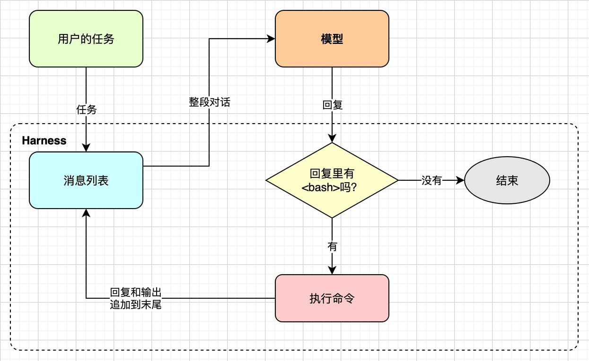

# Agent循环（Agent Loop）

这一章先写一个几十行的Agent，让它真的修好一个bug，再看它还缺什么。后面的二十一章，都是在给这几十行代码补课。


## 我们每天看到的是什么

用过Claude Code、Codex这类Coding Agent的人，对下面的场景应该不陌生。我们在终端里敲一句话，比如“测试没通过，帮我看看”。接着屏幕上开始滚动：模型先说一句“我先跑一下测试”，然后真的跑了测试，红色的报错出现在屏幕上；它又说“问题可能在`stats.py`里”，于是读了这个文件；读完以后改了一行代码，再跑一遍测试，这回全绿了；最后它用几句话总结了改了什么、为什么这么改。

整个过程看起来像是有个人坐在我们的终端前面干活。他会看报错，会翻代码，会动手改，改完还知道回头验证。但如果把屏幕上的内容按时间顺序排一排，就会发现它其实很有规律：模型说一段话，提出要做一件事（跑命令、读文件、改文件）；程序替它做了，把结果显示出来；模型看了结果，再说一段话，再提出下一件事。如此往复，直到模型不再提要求，只给出一段总结。

模型本身并不能跑命令，也不能读文件。读过本系列第一本的读者知道，模型只会做一件事：给它一段文本，它预测下一个token，一个接一个地预测下去，最后得到一段回复。真正去跑命令、读文件的，是包在模型外面的那个程序。这个程序把模型的回复解析出来，照着做，再把结果作为新的文本交给模型。这一章要写的，就是这个程序最简单的样子。


## 什么是Agent

前面看到的是现象，这一节给它一个说法。先找一个大家都认的定义，逐词拆开，再回答一个定义里没明说、写代码时却绕不过去的问题：循环什么时候停。


### 一个通行的定义

“Agent”这个词被用得很滥，几乎什么都可以叫Agent。本书采用Simon Willison在2025年9月给出的定义，这也是目前最通行的一个：

> An LLM agent runs tools in a loop to achieve a goal.

这句话很短，但每个词都有分量，我们逐个拆开来看：

* **An LLM agent**：主角是一个大语言模型。它负责做决定，也就是下一步该干什么。
* **runs tools**：模型自己什么也干不了，它能做的只是“提出”调用某个工具，比如执行一条shell命令。工具由外面的程序真正去执行。
* **in a loop**：不是调用一次就完事，而是一轮接一轮。每一轮的工具结果都会交回给模型，模型据此决定下一轮做什么。
* **to achieve a goal**：循环是有目标的，目标通常就是用户的那句话，比如“修好这个测试”。

这个定义里没有规划、记忆、反思、多智能体协作这些听起来很高级的词。它们不是不重要，后面的章节都会讲到，但它们都是加在这个循环上的东西，而不是循环本身。


### 循环在哪里停

既然是循环，就得有个出口。最自然的出口是：模型不再要求调用工具了。模型每次回复，要么是“我要执行这条命令”，要么是“做完了，结果是这样”。前者让循环继续，后者让循环结束。

换句话说，什么时候停是模型自己决定的。程序不用判断任务到底完成了没有，它也判断不了。这一点很重要，它让循环的代码可以写得非常简单。当然，模型也可能永远不说“做完了”，或者在没做完的时候就说做完了。这些问题我们先记下，后面的章节再处理。


## 最小的Agent

有了定义，就可以动手了。一个Agent至少要有三样东西：一个工具、一种让模型提出调用工具的办法、一个把两者串起来的循环。下面依次写出来，最后找一个真实的bug让它修。


### 一个工具：bash

给模型配什么工具呢？Coding Agent常见的工具有读文件、写文件、改文件、搜索代码、执行命令等等。但如果只能留一个，那就是执行shell命令。有了它，其他工具都可以用命令代替：读文件用`cat`，搜索用`grep`，改文件用`sed`或者重定向，跑测试直接跑。

所以我们的第一个Agent只有一个工具：`bash`。它接收一条命令，执行它，把输出交回给模型：

```python
def bash(command):
    """执行一条命令，把退出码、stdout和stderr拼成一段文本。"""
    try:
        r = subprocess.run(command, shell=True, capture_output=True,
                           text=True, timeout=60)
    except subprocess.TimeoutExpired:
        return "error: command timed out after 60 seconds"
    return f"exit code: {r.returncode}\n{r.stdout}{r.stderr}"
```

这里有几个细节值得说一说。退出码要交给模型，因为模型要靠它判断命令成功了没有，测试失败的时候，退出码往往比输出本身更说明问题。stderr也要一并交给模型，报错信息几乎都在这里。超时设成60秒，是为了防止某条命令卡住，把整个Agent也一起卡住。

还要注意，每次调用`subprocess.run`都会启动一个新的shell。上一条命令里的`cd`，到下一条命令就失效了。这算是一个限制，但也带来了好处：每条命令都是独立的，不会因为前面某条命令改了环境变量而互相影响。


### 怎么让模型“提出”调用工具

模型只能输出文本，那它怎么告诉程序“我要执行这条命令”呢？最简单的办法是约定一种格式。我们在系统提示词里告诉模型：要执行命令，就把命令放在`<bash>`和`</bash>`之间：

```python
SYSTEM = """You are a coding agent working in a terminal.
To run a shell command, put it in a bash tag, one per reply:

<bash>ls -la</bash>

The next message will show you the command's output.
Each command runs in a fresh shell, so `cd` does not persist.
When the task is done, reply with a short summary and no bash tag."""
```

这段提示词一共七行，把约定说清楚了：命令放在哪里，每次只放一条，结果会在下一条消息里，`cd`不会保留，做完了就不要再放标签。最后一条就是循环的出口。程序这边只要用一个正则表达式，从回复里找出第一对`<bash>`标签就行了。

这是一种土办法。现在各家的模型API都支持正式的“工具调用”，用JSON Schema描述工具，模型返回结构化的调用请求，不用我们自己解析。第四章会把这个循环改成正式的工具调用，并且对比两种办法。之所以第一章用土办法，是因为它把事情摆在明面上：工具调用说到底，就是模型按约定输出了一段特殊的文本。


### 调用模型

剩下的就是调用模型了。我们用的是OpenAI的Chat Completions协议，几乎所有的云端模型服务，以及llama.cpp、Ollama、vLLM这些本地推理框架，都提供兼容这个协议的接口。按照本书不用SDK的原则，我们直接用标准库发一个HTTP请求：

```python
def llm(messages):
    """把整段对话发给模型，返回它的回复。细节在第二章。"""
    body = {"model": MODEL, "messages": messages}
    req = urllib.request.Request(
        BASE_URL + "/chat/completions",
        data=json.dumps(body).encode(),
        headers={"Content-Type": "application/json",
                 "Authorization": "Bearer " + API_KEY},
    )
    with urllib.request.urlopen(req) as resp:
        return json.load(resp)["choices"][0]["message"]["content"]
```

这个函数的输入是一个消息列表，输出是模型回复的文本。消息列表里的每条消息都有一个角色：`system`是系统提示词，`user`是用户说的话，`assistant`是模型说过的话。请求和响应里还有很多别的东西，第二章会把它们原样打印出来，一项一项地看。这一章只需要知道一件事：**模型没有记忆**。服务器不会替我们记住之前聊过什么，每次请求都要把整段对话从头发过去。


### 一个循环

工具和模型都有了，把它们串起来就是Agent。整个循环只有十几行，每转一圈做四件事：调用模型、记下回复、从回复里找命令、执行命令并记下输出：

```python
def agent(task):
    messages = [{"role": "system", "content": SYSTEM},
                {"role": "user", "content": task}]
    while True:
        reply = llm(messages)
        print(f"\n[assistant]\n{reply}")
        messages.append({"role": "assistant", "content": reply})
        m = re.search(r"<bash>(.*?)</bash>", reply, re.DOTALL)
        if m is None:  # 模型不再要求执行命令，任务结束
            return reply
        output = bash(m.group(1))
        print(f"\n[bash]\n{output}")
        messages.append({"role": "user", "content": output})
```

在循环开始之前，消息列表里只有两条：系统提示词和用户的任务。每转一圈，先把整段对话发给模型，得到一条回复，追加到列表末尾。接着从回复里找`<bash>`标签：找不到，说明模型认为任务完成了，循环结束；找到了，就执行里面的命令，把输出作为一条`user`消息追加到列表末尾，然后进入下一圈。

这里命令的输出是以`user`的身份交回去的。对模型来说，它分不清这条消息是用户敲的，还是程序执行命令得到的，它只知道“对面”回了一段文本。第四章的正式工具调用会给工具结果一个专门的角色，到时候再看两者有什么区别。

于是，消息列表只会越来越长：系统提示词、任务、回复、输出、回复、输出……每一圈都要把这整个列表重新发一遍。这件事现在看起来无所谓，但到第十三章讲上下文工程时，它会成为最头疼的问题。


### 让它修一个bug

为了检验这个Agent，我们准备了一个小项目，里面只有两个文件。`stats.py`实现了求平均数和中位数两个函数，其中`median`有一个bug：列表长度为偶数时，应该取中间两个数的平均值，它却把下标取错了一位：

```python
def mean(xs):
    return sum(xs) / len(xs)

def median(xs):
    xs = sorted(xs)
    n = len(xs)
    mid = n // 2
    if n % 2 == 1:
        return xs[mid]
    return (xs[mid] + xs[mid + 1]) / 2
```

它的测试写在`test_stats.py`里，没有用任何测试框架，就是几条`assert`：

```python
from stats import mean, median

assert mean([1, 2, 3, 4]) == 2.5
assert median([3, 1, 2]) == 2
assert median([4, 1, 3, 2]) == 2.5
print("all tests passed")
```

排序以后是`[1, 2, 3, 4]`，`mid`等于2，正确的做法是取`xs[1]`和`xs[2]`，也就是2和3，平均值2.5；代码取的却是`xs[2]`和`xs[3]`，得到3.5，最后一条`assert`失败。我们要做的，就是把这个任务交给Agent，看它能不能自己找到并修好这个bug。


## 模型和Harness

在看运行效果之前，我们先停下来，看看这几十行代码里，哪些是模型，哪些不是。答案可能有点出人意料：真正和模型打交道的，只有`llm`函数里发HTTP请求的那几行。其余的一切，包括系统提示词、解析回复、执行命令、维护消息列表、决定什么时候停，都不是模型，而是包在模型外面的程序。这个程序有一个专门的名字，叫**Harness**。这个词本来是马具的意思，套在马身上，让马的力气能拉动车。

下图把本章的循环画了出来。虚线框里的都是Harness，只有模型在框外：Harness把整段对话交给模型，模型给出一条回复，Harness再决定是执行命令、继续下一圈，还是就此结束。




模型负责“想”：看到当前的对话，决定下一步做什么。Harness负责其他一切：把对话整理好交给模型，把模型的决定落实成真实的动作，把动作的结果整理好再交给模型。同一个模型，配上不同的Harness，表现可能天差地别；反过来，Harness写得再好，也替代不了模型的判断力。

本书不训练模型，也不改模型，**本书写的就是Harness**。用Claude Code、Codex时，我们感受到的那些体验，比如命令要先经过我们同意、长对话不会把上下文撑爆、能读懂项目里的`CLAUDE.md`，绝大多数都来自Harness，而不是来自模型。第二十一章会回到这个话题，看看一个真实的Coding Agent，代码都花在了哪里。


## 路线图

这个最小的Agent能干活，但缺的东西很多。下表列出了它的主要毛病，以及后面哪一章来补：

| 毛病 | 补在哪里 |
|------|---------|
| `llm`是个黑盒子，请求里有什么、怎么计费都不知道 | 第2章 |
| 要等模型把整段回复生成完，屏幕上才有字 | 第3章 |
| 工具调用靠自己解析标签，模型稍不按格式就失灵 | 第4章 |
| 只会说一家的协议 | 第5章 |
| 读文件靠`cat`，改文件靠`sed`，输出再长也一股脑交给模型 | 第6章 |
| 模型说执行什么就执行什么，连`rm -rf`也不问一声 | 第7章 |
| 界面就是`print`，没法边看边打断 | 第8～10章 |
| 系统提示词只有七行 | 第11章 |
| 每次运行都从零开始，记不住项目的约定和上次的事 | 第12章 |
| 消息列表只增不减，长任务迟早撑爆上下文 | 第13章 |
| 项目一大，找不到相关的代码 | 第14章 |
| 大任务不会先拆再做 | 第15章 |
| 想加新工具、新能力，只能改源码 | 第16～19章 |
| 改了一处，不知道是变好了还是变坏了 | 第20章 |

最后两章（第21、22章）不再加功能，而是跳出代码，对照几个真实的Agent，看它们在同样的问题上做了什么取舍。


## 代码实现

本章的代码在`code/book/ch01/`目录下，一共只有一个文件`agent.py`，不到七十行，只用了Python标准库。上面已经逐段讲过它的核心部分，剩下的是开头的导入和配置，以及最后的入口：

```python
BASE_URL = os.environ.get("OPENAI_BASE_URL", "https://api.openai.com/v1")
API_KEY = os.environ.get("OPENAI_API_KEY", "")
MODEL = os.environ.get("MODEL", "")
```

```python
if __name__ == "__main__":
    agent(" ".join(sys.argv[1:]))
```

服务地址、密钥和模型名都从环境变量读，这样同一份代码既能连云端的模型，也能连本地的模型，换模型时不用改代码。命令行参数拼起来，就是交给Agent的任务。

在运行之前，有一点必须提醒：**这个Agent会真的执行模型给出的任何命令**，而且不会先问我们。所以一定要先把`demo/`目录复制到别处，在副本里运行，不要在重要的目录里试。第七章会给它加上权限和沙箱。


## 代码效果

把`demo/`复制一份，进入副本，先确认测试确实会失败，再把任务交给Agent：

```bash
cp -r demo /tmp/demo && cd /tmp/demo
python3 test_stats.py
python3 /path/to/agent.py "Run python3 test_stats.py and fix the failing test."
```

（待补：用真实模型跑一遍，把完整输出贴在这里，并注明模型名。）

（待补：根据真实输出，讲一讲模型走了几轮、每轮做了什么，改文件用的是哪种命令。预期它会先跑测试，再读`stats.py`，然后用`sed`或者重定向改掉那一行，最后再跑一遍测试确认。）

不管模型具体走了几轮，消息列表的变化规律都是一样的。第一次请求只有系统提示词和任务两条消息，此后每多一轮就多两条：模型的回复和命令的输出。如果模型走了四轮，最后一次请求就要带上八条消息。


## 对照

本章的Agent小得有点寒酸，但它并不是一个玩具式的特例。真实世界里，就有人把这个思路做到了极致。

拿mini-swe-agent来说，它是SWE-bench和SWE-agent的作者们做的一个极简Agent。据它的README介绍，核心的Agent类只有一百行左右，而且只有bash一个工具，连正式的工具调用接口都不用，而是从模型的回复里解析出命令，和本章的做法如出一辙（待核实）。它的每条命令也都是用`subprocess.run`单独执行的，不保留shell的状态，好处同样是简单，而且容易放进沙箱。

有意思的是，这些作者早先做的SWE-agent，花了很大力气给模型设计专门的工具，比如专门的文件查看器和编辑器。到了mini-swe-agent，他们的看法变了：模型已经足够强，只给它一个bash，在SWE-bench上照样能拿到很高的分数（具体分数待核实）。这说明，当模型足够强时，一个循环加一个bash就已经能走很远了。

那为什么Claude Code、Codex还要写成大得多的程序呢？上面路线图里的每一行，都是一个答案。


## 本章小结

本章写了一个最小的Agent，只有一个`while`循环和一个`bash`工具，不到七十行。它的工作方式可以概括为一句话：把对话发给模型，执行模型要求的命令，把结果追加到对话里，再发给模型，直到模型不再要求执行命令。

这一章最重要的结论有两个。第一，Agent就是一个循环，规划、记忆、多智能体都是加在这个循环上的东西。第二，模型只负责做决定，其余的一切都是Harness，而本书要写的就是Harness。

下一章我们打开`llm`这个黑盒子，不用SDK，看看一次请求和响应里到底有什么。
