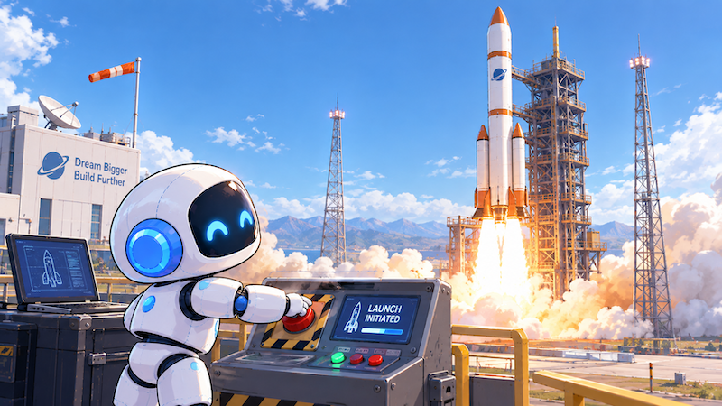

# GPU



在第十三章，我们换上了Qwen3-0.6B，顺着全书的顺序把前十二章回顾了一遍，引擎也第一次和我们用中文对话了。不过从第一章到第十三章，我们的引擎一直跑在CPU上。前言说过，这是故意的：从GPU入手会比较难，从CPU入手就比较简单，然后再去学GPU。现在，是时候去了解一下GPU了。

这一章是本书的最后一章。我们不在总览图上增加任何方框，也不改变任何一步计算，只是把同一个引擎搬到GPU上去，然后把第十一章和第十二章那些“在GPU上才看得出来”的话，一条一条地验证一遍：decode为什么是内存带宽密集型的，批处理为什么能提高吞吐量，FlashAttention为什么在GPU上才快，以及第二章说的“GPU上全程BF16才是常态”。

关于GPU本身，足够写一整本书，这一章不打算把它讲透，只是抛砖引玉，把前面欠下的几句话还上。更多和GPU打交道的事，比如混合精度、显存够不够用、吞吐量怎么往上提，留给下一本书，暂名《自己动手训练LLM》。在那本书里，我们要用一块免费的GPU，从零训练一个自己的小模型，再用这本书写的引擎把它跑起来。

先要坦白一件事：我那台老旧的Intel芯片MacBook，没有NVIDIA的显卡，跑不了CUDA。它只有苹果的MPS（Metal Performance Shaders），也就是PyTorch在苹果电脑上调用GPU的那套接口。所以这一章的代码，我在CPU和MPS上都跑通了，结果也都核对过。NVIDIA显卡上的数字，我统一用Google Colab免费提供的那块T4来跑，书里说到CUDA，指的都是它。

选T4有两个原因：谁都能免费用上，你可以亲手复现每一个数；下一本书的训练也全在它上面做。不过T4是2018年的显卡，比数据中心里的A100老了一代，后面会看到，这一点在半精度和FlashAttention两件事上会显出差别。这一章的每个脚本都不挑显卡，你手边要是有别的NVIDIA显卡，也可以原封不动地跑一下。

我会先简单说说GPU为什么快，然后把引擎搬上GPU，看看要改哪些地方，先用FP32核对一遍。接着讲在GPU上量时间要注意什么，再换成半精度，看看核对的判据要怎么变。最后是两个只有在GPU上才真正显出威力的东西：批处理和FlashAttention。


## GPU为什么快

说到GPU为什么快，不讲硬件细节的话，主要就是两个数。

第一个是**并行度**。我这台笔记本的CPU，PyTorch用了6个线程；而一块GPU上，有成千上万个小的计算单元，可以同时做成千上万次乘法和加法。矩阵乘法恰好就是这种“同时做大量同样的事”的计算，第六章那张注意力分数表里，每一个数都可以独立地算出来。

第二个是**内存带宽**。第十二章引用过FlashAttention论文里的一张表：A100的显存（HBM）带宽是每秒1.5TB，而CPU的内存只有每秒12.8GB，差了一百多倍。第十一章我们量过，decode一个词元，相当于每秒搬12.7GB的权重，正好就是CPU内存带宽的那个量级。decode是内存带宽密集型的，那换到带宽高一百多倍的显存上，它就该快很多。我们要用的T4没有那么快，显存带宽是每秒320GB，不过也是CPU内存的二十多倍。

不过，这两个数都要满足一个前提才能兑现：GPU得有足够多的活可干。只算一个词元的decode，活就很少，这一点后面会看到。


## 把引擎搬上GPU

在PyTorch里，把计算搬到GPU上，说起来只有一个动作：把张量**放到设备上**。一个张量在哪个设备上，它的计算就在哪个设备上做。参与同一次计算的张量，必须在同一个设备上。

这一章的随书源代码在`code/book/ch14/`下面，从第十三章复制过来。`Model`的构造函数多了三个参数，都在构造的时候定一次：

```python
    def __init__(self, model_dir=MODEL_DIR, device="cpu", dtype=torch.float32,
                 attn_impl="manual"):
        self.device, self.dtype = torch.device(device), dtype
        self.config = Config(model_dir)    # 规格说明，读自`config.json`
        self.weights = Weights(model_dir, dtype, device)  # 权重，放到device上
        self.cos, self.sin = self.rope_table()  # (位置数, head_dim)，各层共用
        # 注意力的最后一段用哪一套，和第十、十一章一样，构造时定一次。
        impls = {"manual": self.attend_manual, "sdpa": self.attend_sdpa}
        self.attend = impls[attn_impl]
```

三个参数里，`device`是放在哪：`"cpu"`、`"mps"`（苹果的GPU）或者`"cuda"`（NVIDIA的GPU）。`dtype`是用什么精度算，后面讲半精度时再细说。`attn_impl`是注意力最后那一段用哪一套实现，有两种取值：`"manual"`是第六章起我们手写的那一套；`"sdpa"`是交给PyTorch自带的`F.scaled_dot_product_attention()`，名字取自第六章那个缩放点积注意力的英文Scaled Dot-Product Attention的首字母。PyTorch会在这个函数里按设备和精度挑一个融合好的内核来算，FlashAttention就是其中之一，讲FlashAttention时再细说。三个参数的默认值，正好就是前十三章的样子：CPU、FP32、我们手写的注意力。所以不传参数时，`ch14/`里的引擎和第十三章逐位相同，我核对过，两边算出来的分数一个比特都不差。

然后，凡是要参与计算的张量，都要放到这个设备上。我把这一章所有这类改动列了出来：

| 张量 | 在哪 | 怎么改 |
| --- | --- | --- |
| 权重 | `weights.py` | 读的时候`.to(device=device, dtype=dtype)` |
| 词元ID | `model.py` | 新增`to_ids()`，换成设备上的整数张量 |
| RoPE的cos/sin表 | `model.py` | 在CPU上用FP32算好，再搬过去 |
| 因果掩码 | `model.py` | `torch.ones()`时指定`device` |
| KV缓存 | `kv_cache.py` | 预先分配的空间建在设备上 |
| 分数 | `engine.py` | 搬回CPU，再交给采样器 |

最后一行值得多说一句。采样器里用到了第十章那个自带的随机数生成器，它在CPU上。要么把它也搬到GPU上，要么把分数搬回CPU。我们选了后者：

```python
        logits = self.model.forward(ids, cache) # (T,) → (49152,)，在device上
        # 分数搬回CPU、升回fp32再交给采样器：49152个数，搬一趟不值什么，
        # 换来的是采样器一行不改，而且同一个种子在哪个设备上抽出来都一样。
        return sampler(logits.float().cpu())    # (49152,) → 一个ID
```

每生成一个词元，只搬回最后那一行分数，49152个数，大约200KB，和读一遍权重比起来不值一提。换来的好处是，第十章的采样器一行都不用改，而且同一个种子，在CPU、MPS还是CUDA上抽出来的结果都一样。真正的推理引擎，通常会把采样也放在GPU上做，那是为了把每一点时间都省下来。

相应地，`engine.py`的命令行也多了三个参数，`--device`、`--dtype`和`--attn`。`--device auto`的意思是有什么用什么：

```python
def pick_device(name="auto"):
    """auto就是有什么用什么；别的原样交给PyTorch。"""
    if name != "auto":
        return name
    if torch.cuda.is_available():
        return "cuda"
    if torch.backends.mps.is_available():
        return "mps"
    return "cpu"
```

有一件事和全书正好相反，值得点出来。前面十三章，我们反复遇到“不报错、全算错”的bug，形状错了、配对错了、位置错了，程序都照跑不误。可设备放错了，PyTorch会**直接报错**：一个在CPU上的张量和一个在GPU上的张量做运算，当场就会抛出异常，告诉你两者不在同一个设备上。这是全书少见的“好bug”，漏改了哪一处，一跑就知道。


## 第一次核对：GPU上的FP32

搬完了家，第一件事还是核对。不过这次的基准，不再是`transformers`库，而是我们自己的引擎在CPU上、用FP32算出来的那一份：它在第十三章已经和`transformers`库一字不差地对过了。

这一章的`check_device.py`就是干这个的。它在同一个设备上，换不同的精度和注意力实现，分三项和CPU的那一份比：每一层输出的相对误差、每个位置挑出来的词元，以及贪婪生成的结果从第几个词元开始分叉。下面是SmolLM2在T4上的结果，基准是同一台机器的CPU算出来的那一份：

```
模型 SmolLM2-135M，基准是CPU、float32、manual，贪婪生成100个

  设备  精度      注意力  逐层最大相对误差  argmax      贪婪生成
  cuda  float32   manual           1.0e-05      相同          全部相同
  cuda  float32   sdpa             1.0e-05      相同          全部相同
  cuda  bfloat16  sdpa             1.1e-01      不同       第97个起分叉
  cuda  float16   sdpa             1.3e-02      相同          全部相同
  cpu   bfloat16  manual           1.1e-01      不同       第97个起分叉
```

先看前两行。T4上用FP32，逐层的最大相对误差是1.0e-5，贪婪生成100个词元全部相同。注意它并不是逐位相同：GPU上的矩阵乘法用的是另外一套代码，加法的先后顺序和CPU不一样，最后几位就会有差别。这和第七章那个“cos表算大表和算小表，最后一位偶尔不同”是同一类原因。所以判据还是第七章那个相对误差，而不是逐位相同。差多少也要看是哪块卡：我的Mac上用MPS跑，这个数是2.9e-6，T4上的1.0e-5则刚好碰到第七章定的那条线。

换成Qwen3-0.6B-Base，结果也一样：用FP32，逐层最大相对误差在T4上是3.0e-6，在MPS上是6.7e-6，贪婪生成40个词元全部相同。

后面三行是半精度，我们放到后面再说。


## 量时间要小心

在GPU上量时间，有两件事和CPU不一样。这一节很短，但不讲清楚，后面所有的数字都不可信。

第一，**GPU是异步执行的**。Python那一行代码返回了，并不代表GPU已经算完了，它可能只是把这个计算任务排进了GPU的队列，然后就立刻返回了，真正的计算还在后台进行。所以，在读计时器之前，要先让CPU等一等，等GPU把队列里的活都干完。这一章的`speed.py`里有一个小函数，专门干这件事：

```python
def sync(device):
    """等设备上排着队的计算都做完。CPU上什么都不用做。"""
    if device.type == "cuda":
        torch.cuda.synchronize()
    elif device.type == "mps":
        torch.mps.synchronize()
```

忘了同步，量出来的时间会短得离谱，那只是“把任务交给GPU”所花的时间，而不是“GPU算完”所花的时间。

第二，**第一次调用会特别慢**。GPU第一次执行某种计算时，要做一堆准备工作：加载计算核心、分配显存、选择具体用哪种算法，等等。所以要先热身几次，再开始计时。第十一章那个“带缓存的第一个词元反而更慢”，也有一部分是这个原因。


## 速度

现在我们把第十一章`speed.py`的那组实验，换到GPU上重跑一遍：同样128个词元，prefill一次喂完，decode每次喂1个。下面是SmolLM2在我这台Mac上的结果：

```
模型 SmolLM2-135M，在128个词元上

  设备  精度      注意力       prefill      每个    decode每个  每秒词元
  cpu   float32   manual       118.4ms    0.93ms        38.2ms      26.2
  mps   float32   manual       225.5ms    1.76ms       216.2ms       4.6
  mps   float32   sdpa         225.3ms    1.76ms       194.7ms       5.1
  mps   bfloat16  sdpa       跳过：TypeError: BFloat16 is not supported on MPS
  mps   float16   sdpa         229.3ms    1.79ms       225.4ms       4.4
```

结果可能有点出乎意料：MPS比CPU还慢。prefill慢了将近一倍，decode更是慢了5倍多，CPU上decode一个词元38.2毫秒，MPS上要216.2毫秒。

这不是代码的问题：在这台机器上，对这么小的模型，MPS本来就不比CPU快。一方面，这是一台老旧的Intel芯片MacBook，它的GPU本来就不强，和数据中心里的A100不是一个级别；另一方面，也是更有意思的原因，在于**启动开销**。

每执行一个计算，比如一次矩阵乘法、一次Softmax，GPU都要先等CPU发起一个“启动”，收到之后才开始算。每一次启动，本身就要花上几微秒甚至更多的时间。生成一个词元，30层，每层的注意力和FFN加起来有十几个这样的计算，一共要启动好几百次。对SmolLM2这么小的模型、decode时只有1个词元来说，每个计算本身只需要很短的时间，启动开销反而成了大头。于是，GPU的大部分时间并不是在计算，也不是在搬数据，而是在等CPU一个一个地把任务派过来。这是第十一章说的“计算密集”和“内存带宽密集”之外的第三种瓶颈，在CPU上是看不到的。

换到T4上，这一点看得更清楚。下面是同一个脚本在Colab上的结果，第一行的CPU是Colab分给我们的虚拟CPU，只有1个线程，所以比我的Mac还慢：

```
模型 SmolLM2-135M，在128个词元上

  设备  精度      注意力       prefill      每个    decode每个  每秒词元
  cpu   float32   manual       368.1ms    2.88ms        68.8ms      14.5
  cuda  float32   manual        33.2ms    0.26ms        29.9ms      33.4
  cuda  float32   sdpa          25.4ms    0.20ms        25.2ms      39.6
  cuda  bfloat16  sdpa          42.3ms    0.33ms        36.3ms      27.6
  cuda  float16   sdpa          28.3ms    0.22ms        27.7ms      36.1
```

在T4上，prefill一下子快了，128个词元用FP32只要33.2毫秒，不到我那台Mac上CPU的三分之一。decode就没那么好看了，每个词元29.9毫秒，只比Mac的CPU快了两成多。按T4每秒320GB的带宽算，把538MB的权重读一遍只要1.7毫秒，剩下的二十多毫秒，大部分都花在了启动开销上。

换成Qwen3-0.6B-Base，更能说明问题。它的权重升成FP32有2.38GB，是SmolLM2的4.4倍，第十三章在CPU上量过，它decode一个词元的时间是SmolLM2的3.5倍。可在T4上，它decode一个词元是34.8毫秒，只比SmolLM2多了5毫秒。要读的权重多了几倍，时间却几乎没变，可见时间主要不是花在读权重上。半精度也是一样：权重减半，decode却没有快，用`F.scaled_dot_product_attention()`时，FP32是25.2毫秒，FP16是27.7毫秒。至于BF16那一行，T4没有原生的BF16，是模拟出来的，不必看。

治这种瓶颈的办法，是把许多小计算合并成几个大的，或者把生成一个词元的整个过程“录”下来交给GPU重放，也就是`torch.compile()`和CUDA Graphs在做的事，这里只提一句。小模型的decode很难把GPU喂饱，要让GPU真正忙起来，得给它更多的活干，这就是后面要讲的批处理。


## 半精度

第二章说过，BF16对本书来说只是存储格式，并不是计算格式：我们加载模型时，会统一升成FP32，因为CPU上FP32的算子更快也更全。而GPU上恰恰相反，权重和中间结果全程保持BF16才是常态。现在，我们终于可以兑现这句话了。只是T4不在此列：它的硬件不支持BF16，在它上面，半精度指的是FP16。

换成半精度，好处是显而易见的：每个数从4个字节变成2个字节，权重、KV缓存、中间结果占的内存都减半，要搬的数据也减半，而第十一章说过，decode的时间主要就花在搬数据上。现代的GPU，还专门有为半精度设计的计算单元，算得比FP32快得多。

代码上要改的只有一处，就是在构造时把`dtype`换成`torch.bfloat16`或者`torch.float16`。不过这里有一个坑，第五章就提过。第五章说，HF的RMSNorm会先把输入转成FP32算完再转回去，“我们全程FP32，这一步用不着，但要知道它为什么存在”。现在它用得着了：

```python
        h = x.float()
        variance = h.pow(2).mean(-1, keepdim=True)
        # eps加在根号里面，护着的是均方。加到根号外面结果会悄悄变，不报错。
        # 这个1e-5不是我们定的，是`config.json`里的`rms_norm_eps`。
        h = h * torch.rsqrt(variance + self.config.rms_norm_eps)
        return h.to(x.dtype) * weight
```

在RMSNorm里，576个数要先平方再加起来。第五章量过，主干上的数会漂到几百，一个数平方就是几万甚至几十万；而FP16能表示的最大的数只有65,504，第二章说过这件事，一不小心就溢出成无穷大。BF16倒是不怕溢出，但它的尾数只有7位，几百个数加起来，精度会丢得很厉害。所以，先升到FP32把均方根算完，再降回原来的精度。输入本来就是FP32时，这一升一降什么都不做，结果和前十三章逐位相同。

回到前面`check_device.py`那张表的后三行：

```
  cuda  bfloat16  sdpa             1.1e-01      不同       第97个起分叉
  cuda  float16   sdpa             1.3e-02      相同          全部相同
  cpu   bfloat16  manual           1.1e-01      不同       第97个起分叉
```

先看FP16，逐层相对误差到了1.3e-2，比FP32大了三个数量级，但每个位置挑出来的词元都一样，贪婪生成100个词元也全部相同。BF16更粗糙，逐层相对误差到了1.1e-1，有的位置挑出来的词元已经不同，生成到第97个词元就分叉了。T4上的BF16虽然是模拟出来的，算出来的数照样是BF16的精度。最后一行是同一台机器CPU上的BF16，和T4那一行一模一样，说明精度带来的差别和设备无关。我的Mac上，MPS不支持BF16，跳过了；MPS上的FP16，逐层相对误差是8.4e-3，第94个词元起分叉。同样是FP16，换一块卡，分不分叉、从哪里分叉都会变。

为什么FP16比BF16还准？第二章说过，两者都是16位，FP16把更多的位给了尾数（10位），BF16把更多的位给了指数（8位）。只要不溢出，FP16就比BF16准。推理时有了前面那个先升FP32的RMSNorm，FP16就能放心用，这对没有BF16的T4正好。训练更怕溢出，所以大家偏爱BF16；在T4上只能用FP16训练时要多做些什么，是下一本书要讲的事。

换成Qwen3-0.6B-Base，结果也类似：T4上FP16的逐层相对误差是2.7e-2，BF16是1.4e-1，贪婪生成40个词元都全部相同。

那么，半精度下的核对，判据该怎么定？逐位相同是不可能的，相对误差也不再是第七章那个1e-5的量级。生成的文字迟早会分叉，问题只是什么时候。第八章说过，贪婪生成是一连串的argmax，每一圈的输出都会追加到下一圈的输入里，只要某一圈前两名的分数离得很近，一点舍入误差就可能让它们换个位置，之后整段话就走上了另一条路。所以，对半精度来说，合理的判据是两条：逐层相对误差在半精度应有的量级之内，以及贪婪生成的前若干个词元和FP32相同。前言说过，核对的判据是逐章变化的，这一章，它又变了一次。

还要说明一点：分叉并不等于出错。分叉之后，半精度生成的话照样是通顺的，只是走了另一条路。它和第十一章那种“位置从0起”的bug不一样：那种bug是模型悄悄变笨了，而这里只是两个同样合理的选择，因为舍入误差换了个顺序。


## 批处理

第十一章说过，decode是内存带宽密集型的：每算一个词元，都要把全部权重读一遍，读一遍权重，只算1个词元，太浪费了。办法就是**批处理**：让B条序列一起decode，读一遍权重，B条各算一个词元。权重的那一趟搬运，就被B条序列分摊了。

这需要我们的模型能同时处理好几条序列。到目前为止，主干上的张量一直是`(T, 576)`，一行一个词元。现在要允许它前面多一维**批次**，变成`(B, T, 576)`，B条序列，每条T个词元。好在第五章说过，归一化只看最后一维，第八章的FFN也只看最后一维，词嵌入的查表、出口的线性投影也都只看最后一维，它们本来就不在乎前面有几维。只有注意力需要改一改，因为它要拆头、转置、拼头。

改法是：维度一律**从后往前数**。拆头的时候，原来写的是`transpose(0, 1)`，把第0维和第1维对调；现在改成`transpose(-3, -2)`，把倒数第3维和倒数第2维对调。前面有没有批次那一维，倒数第几维都是同一个：

```python
        *lead, T, _ = x.shape   # lead是批次那几维，一条序列时是空的
```

```python
        # 拆完q是(9, T, 64)，k、v是(3, T, 64)。
        q = q.view(*lead, T, n_heads, head_dim).transpose(-3, -2)
        k = k.view(*lead, T, n_kv_heads, head_dim).transpose(-3, -2)
        v = v.view(*lead, T, n_kv_heads, head_dim).transpose(-3, -2)
```

这里的`lead`是批次那几维，一条序列时它是空的，`*lead`展开之后什么都没有，和第六章的写法一模一样；B条序列时它是`(B,)`。GQA复制K、V时的`dim=0`改成了`dim=-3`，拼头时的`transpose(0, 1)`也改成了`transpose(-3, -2)`。KV缓存预先分配的空间，前面也多了一维批次：

```python
        shape = (*batch, n_kv_heads, max_len, head_dim)  # (3, max_len, 64)
```

这里还有一个难点，我们先避开了：B条序列往往长短不一，要补齐（padding）成一样长，还要配上相应的掩码，让补出来的那些位置不被注意到。这一章的`batch.py`为了不碰这件事，让B条序列用同一个开头，各自按不同的随机种子采样，所以它们永远一样长。

这一章的`batch.py`先验证正确性：4条完全一样的贪婪序列一起生成32个词元，每一条都必须和一条一条单独生成的结果一字不差。这一项在CPU、MPS和T4上都通过了。然后量吞吐量，也就是每秒一共生成多少个词元：

```
模型 SmolLM2-135M，cpu，float32

二  一起生成32个新词元，温度0.8，各用各的随机数
       B        用时        每秒词元       是B=1的几倍
       1     3.36秒         9.5           1.0
       2     2.88秒        22.2           2.3
       4     2.35秒        54.4           5.7
       8     2.56秒       100.1          10.5
      16     3.26秒       157.3          16.5
```

这个结果就在CPU上，不需要GPU也看得出来：16条序列一起生成，用的时间和1条差不多，每秒生成的词元数却是1条时的16.5倍。这就是第十一章那句话最直接的证明：decode的时间主要花在读权重上，多算几条序列，几乎不多花时间。B=1时比B=2还慢，是因为单条序列时，CPU那几个线程本来就吃不饱，计算本身的效率更低。

在MPS上也一样，B=16时是B=1的9.9倍。不过在我这台Mac上，MPS的绝对速度还是比CPU慢，原因就是前面说的启动开销：批次越大，每次启动要干的活越多，启动开销就越不显眼，这也是批处理在GPU上格外重要的原因。

在T4上，我们用FP16，把B一直加到64：

```
模型 SmolLM2-135M，cuda，float16

二  一起生成32个新词元，温度0.8，各用各的随机数
       B        用时        每秒词元       是B=1的几倍
       1     1.33秒        24.1           1.0
       2     1.36秒        47.0           2.0
       4     1.21秒       105.4           4.4
       8     1.40秒       182.3           7.6
      16     1.82秒       281.7          11.7
      32     2.76秒       371.2          15.4
      64     5.39秒       380.1          15.8
```

从B=1到B=16，用时只从1.33秒涨到1.82秒，吞吐量是B=1的11.7倍。到B=32是15.4倍，再翻一倍到64，就几乎不涨了，用时也跟着翻了一倍。用FP32跑，曲线也差不多，B=64时是12.2倍。

批次B也不能无限地加下去。当B大到一定程度，每读一遍权重要做的计算已经多到GPU算不过来，瓶颈就从搬数据变成了计算，吞吐量也就不再随B线性增长了。另外，每条序列都要有自己的一份KV缓存，第十一章算过，它可能比权重还大，B越大，缓存就越多，显存迟早会不够用。真正的推理服务，就是在这几者之间找平衡，比如vLLM的PagedAttention，管的就是这么多份长短不一的缓存。


## FlashAttention

最后，我们兑现第十二章。那一章留下了两笔账没有结清。一笔是内存：FlashAttention不把那张 $T \times T$ 的分数表完整地写出来，T=8192时，一层就能省下2.4GB，可这个数是算出来的，显存的峰值要在CUDA上才量得到。另一笔是速度：FlashAttention本来就是针对GPU显存层级做的优化，它到底能快多少，要到GPU上才看得出来，第十二章末尾也说过，要拿PyTorch自带的`F.scaled_dot_product_attention()`来比一比。这一节就来还这两笔账：先给引擎加一个开关，让注意力的最后一段可以交给`F.scaled_dot_product_attention()`，然后在CPU、MPS和T4上，分别量它和手写的那一套要花多少时间、占多少内存。

第十二章用纯PyTorch写过一个分块版，它算得对、省内存，在CPU上块大小合适时还更快，但那终究是Python循环拼出来的。真正的FlashAttention是一个融合好的GPU内核，PyTorch自带的`F.scaled_dot_product_attention()`，在支持的GPU上就会自动选用它。第六章我们用它核对过注意力，第八章说过`transformers`库默认走的也是它。这一章，我们让引擎自己也能用它。

这就是`Model`构造函数里第三个参数`attn_impl`的作用。我们把注意力的最后一段，也就是“算分数表、掩码、Softmax、加权求和”，单独拿了出来，写成两个方法：`attend_manual()`就是第六章起我们手写的那一套，一行没改，只是搬了个家；`attend_sdpa()`把同一件事交给PyTorch：

```python
    def attend_sdpa(self, q, k, v, start):
        """同一件事交给PyTorch：F.scaled_dot_product_attention。

        缩放默认就是除以√head_dim。没缓存时用is_causal，PyTorch自己知道
        是下三角；带着缓存又一次喂好几个时，得把掩码明着传进去。
        它要的掩码是反的：True表示“能看”，第六章的future里True表示“不能看”。
        """
        # 融合的内核只收四维的(批次, 头, T, 64)。三维的不报错，只是悄悄退回
        # 最朴素的那一套，T×L的表照样整张建出来。一条序列时补上批次那一维。
        if q.dim() == 3:
            return self.attend_sdpa(q[None], k[None], v[None], start)[0]
        T, L = q.shape[-2], k.shape[-2]
        if T == 1 or start == 0:
            return F.scaled_dot_product_attention(q, k, v, is_causal=T > 1)
        future = torch.ones(T, L, dtype=torch.bool, device=q.device)
        future = future.triu(start + 1)
        return F.scaled_dot_product_attention(q, k, v, attn_mask=~future)
```

用哪一个，在构造时定一次，`attn()`里只有一句`self.attend(q, k, v, start)`。这和第十章的采样器、第十一章的缓存、第十三章的QK-Norm，是同一个思路，全书一以贯之。

开头那个`if`值得单独说一句。`F.scaled_dot_product_attention()`里那几个融合好的内核，只收四维的输入，也就是`(批次, 头, T, 64)`；而一条序列时，我们的q是三维的`(9, T, 64)`。它不报错，算出来的结果也对，只是悄悄退回了最朴素的那一套，那张 $T \times T$ 的表照样整张建了出来。我一开始就没注意到，量出来的数一直不对劲，补上批次那一维以后，下面那张表里T=4096那一行，从534毫秒降到了100毫秒。这又是一个不报错的坑，只不过这回错的不是结果，是速度。

前面`check_device.py`那张表的第二行，就是用它跑的：T4上用FP32，结果和手写的那一套一样，逐层相对误差都是1.0e-5，贪婪生成100个词元全部相同。

然后是这一章的`flash.py`。它只拿注意力那一段来比：同样的Q、K、V，形状是SmolLM2一层的`(9, T, 64)`，一个走手写的，一个走`F.scaled_dot_product_attention()`，T从512一路加到4096：

```
一层注意力，9个头，每头64维，cpu，float32

       T       分数表       手写 耗时        峰值     sdpa 耗时        峰值
     512       9MB       9.0ms         -       2.7ms         -
    1024      38MB      37.1ms         -      10.7ms         -
    2048     151MB     294.2ms         -      27.3ms         -
    4096     604MB     794.9ms         -      99.8ms         -
```

“分数表”那一列，是手写的那一套要存下来的那张 $T \times T$ 的表有多大：T=4096时，一层就是604MB，T每翻一倍，它就变成原来的四倍，这就是第十二章说的那堵内存墙。在CPU上，`F.scaled_dot_product_attention()`快得多，T=4096时，手写的要794.9毫秒，它只要99.8毫秒，快了将近8倍。这是因为PyTorch在CPU上也有一份自己的FlashAttention实现，它挑的就是这一份：分块算，那张大表从头到尾不整张建出来，比第十二章那个Python循环拼出来的分块版又快了一大截。MPS上就没有这么好的事，T=4096时，手写的239.8毫秒，`F.scaled_dot_product_attention()`190.2毫秒，只快了两成。

“峰值”那两列，只有在CUDA上才量得到。下面是同一个脚本在T4上的结果，T一直加到16384：

```
一层注意力，9个头，每头64维，cuda，float32

       T       分数表       手写 耗时        峰值     sdpa 耗时        峰值
     512       9MB       1.1ms      29MB       0.5ms       1MB
    1024      38MB       2.8ms      79MB       1.3ms       2MB
    2048     151MB      11.3ms     311MB       4.2ms       5MB
    4096     604MB      40.5ms    1234MB       9.6ms       9MB
    8192    2416MB     159.3ms    4918MB      31.7ms      19MB
   16384    9664MB         放不下               127.6ms      38MB
```

手写的那一套，峰值显存大约是分数表的两倍，因为分数表和Softmax之后的那张权重表都要存下来，T每翻一倍，它就变成原来的四倍。到了T=16384，光一张分数表就要9.7GB，T4放不下了。`F.scaled_dot_product_attention()`的峰值是1MB、2MB、5MB、9MB、19MB、38MB，T翻一倍，它也只翻一倍，那张大表从头到尾都没有出现。耗时也快了好几倍，T=8192时是159.3毫秒对31.7毫秒。换成FP16，差距更大：T=16384时，手写的那一套勉强放得下，要557.2毫秒，`F.scaled_dot_product_attention()`只要27.0毫秒。这正是第十二章用整整一章讲的东西，在这里终于可以量出来了。

不过要说清楚，在T4上，它挑的并不是FlashAttention。PyTorch自带的FlashAttention内核，要求A100那一代及以后的显卡，而且只收FP16和BF16，我在T4上试过，三种精度都用不了。在T4上，它会换用另一个融合内核，叫memory-efficient attention，思路和第十二章一样，也是分块算、边算边归一化，所以同样不建那张大表。名字不同，省下的内存是一样的。


## 本章小结

这一章把同一个引擎搬到了GPU上，没有改变任何一步计算。

搬家本身很简单：`Model`多了`device`、`dtype`和`attn_impl`三个构造参数，权重、RoPE表、掩码、KV缓存都放到同一个设备上，分数搬回CPU再采样。设备放错了会直接报错，这是全书少见的“好bug”。默认参数下，引擎和第十三章逐位相同；换到MPS和T4上用FP32，结果和CPU的相对误差在1e-6到1e-5之间，贪婪生成全部相同。

在GPU上量时间，要先同步、再热身。在我这台老Mac上，MPS反而比CPU慢；在T4上，prefill快了好几倍，decode却只快了两成多，换成大4.4倍的Qwen3也几乎不变。原因都是启动开销：小模型的decode，每个计算都太小，GPU大部分时间在等CPU派活。这是CPU上看不到的第三种瓶颈。

换成半精度，内存减半，但RMSNorm要先升到FP32算，第五章提过的那个细节在这里才派上用场。半精度下逐位相同是不可能的，贪婪生成迟早会分叉，核对的判据又一次变了：看相对误差的量级，再看前多少个词元相同。

批处理兑现了第十一章：让张量前面多一维批次，维度一律从后往前数，16条序列一起生成，在CPU上每秒的词元数就是1条时的16.5倍，在T4上，B=32时是15.4倍。FlashAttention兑现了第十二章：同一个开关，切到`F.scaled_dot_product_attention()`，那张随T平方增长的大表就不再出现，T4上T=16384时，手写的那一套放不下，它的峰值只有38MB。在A100这一代以后的显卡上，它走的是FlashAttention；在T4上，是思路相同的memory-efficient内核。

到这里，全书就真的结束了。我们从第一章那五行调用`transformers`库的代码出发，在一台老旧的笔记本电脑上，用CPU把推理引擎的每一个部件都自己写了一遍，每一步都和`transformers`库对过数；又换了一个模型，和它说了几句话；最后把它搬到了GPU上。前言说：“从训练入手，会比较难；从推理入手，就比较简单，然后再去学训练。从GPU入手，会比较难；从CPU入手，就比较简单，然后再去学GPU。”后一句，这本书只走到了门口；前一句，我们只走了前半段。剩下的那个“然后再去学训练”，后记会先说几句，真正的路留给下一本书：在T4上从零训练一个自己的小模型，存成和SmolLM2一样的目录，再用这本书的引擎把它跑起来。到那时，这一章只开了个头的混合精度、显存和吞吐量，都会再遇到。
