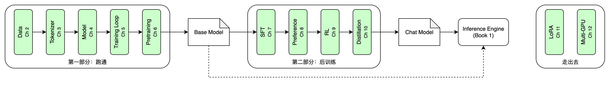

# 训练LLM概览

《自己动手写LLM推理引擎》（下称“第一本”）的结尾，我们手里有了一个自己写的推理引擎。它能读SmolLM2的权重，能分词、能做前向计算、能采样、能用KV缓存加速，生成的每一个词元，都和`transformers`库一模一样。但是，那份权重是别人训好的。它为什么是现在这个样子，那一亿三千多万个数字是怎么来的，第一本一个字都没讲。

这本书就来回答这个问题。我们会从零开始，自己训练一个语言模型：准备数据、训练分词器、搭模型、写训练循环、做预训练，然后再做一系列后训练，让它学会对话、学会听话。最后，把训出来的模型存成和SmolLM2一样的格式，交给第一本的引擎去跑。两本书就这样首尾相接：第一本跑别人的模型，这一本训自己的模型，再用第一本的引擎跑它。

第一本的前言说过一句话：从推理入手会比较简单，然后再去学训练。这本书，就是那个“然后”。

和第一本一样，这一章先不急着讲原理。我们先花几分钟，在自己的电脑上训出一个能“说话”的小模型，看看训练是怎么一回事，看到终点。然后对比一下训练和推理到底有什么不同，再把全书的路线图摊开。最后算一笔账：我们要训的模型有多大、要多少数据、要算多久，以及为什么全书选了Google Colab。

这一章的代码只有一个文件，就是`code/book/ch01/char_gpt.py`，一百七十来行，用来训练上面说的那个小模型。它不依赖本书的任何其他代码，第一次运行时会自动下载训练数据。和第一本一样，本书的代码都放在`code/book/`下面，一章一个目录，每一章都能单独跑。


## 五分钟训一个模型

我们先用一个最简单的例子，把训练的全过程走一遍。数据是Tiny Shakespeare：把莎士比亚的戏剧剧本拼在一起，一共1,115,394个字符，大约1MB的纯文本。它是Karpathy在nanoGPT里用过的经典例子，几乎每个学训练的人都见过它。模型是一个只有几层的小Transformer，而且是**字符级**的：不用分词器，每个字符就是一个词元，词表就是文本里出现过的所有字符，一共只有65个。

整个程序只有一个文件，在笔记本电脑的CPU上就能跑，几分钟就训完。它做的事情，就是本书后面所有章节要做的事情的缩影：

1. 读入文本，找出所有出现过的字符，给每个字符编一个号，把整篇文本变成一串整数；
2. 留出最后一小部分文本，作为验证集；
3. 随机初始化一个小Transformer；
4. 反复从文本里随机截取一些片段，让模型根据前面的字符预测下一个字符，按预测的好坏调整模型的参数；
5. 每隔一段时间，看一看验证集上的loss，再让模型生成一小段文字。

这里的**loss**（损失）是衡量模型预测得有多差的一个数：模型越是把高概率给了正确的那个字符，loss就越低。训练的全部目标，就是让这个数降下来。第五章会仔细讲它是怎么算的。

上面这五步，`char_gpt.py`差不多是按顺序写下来的。开头几十行读文本、建词表、切出验证集；中间是模型，一个`Block`类是一个Transformer块，`CharGPT`类把几个块叠起来，前面加上词嵌入和位置嵌入，后面接一个输出层。它和第一本里的SmolLM2是同一类东西，只是简化了：归一化用的是更老的LayerNorm，位置编码用的是一张直接学出来的表，没有RoPE。最后是训练循环，核心只有这么几行：

```python
    for step in range(1, args.steps + 1):
        x, y = get_batch(train, gen)
        logits = model(x)
        loss = F.cross_entropy(logits.flatten(0, 1), y.flatten())
        opt.zero_grad()
        loss.backward()
        opt.step()
```

每一圈先取一批数据：`x`是从文本里随机截下来的32个片段，`y`是把每个片段往后错一位，也就是每个位置上的“下一个字符”，正好是标准答案。然后前向计算得到每个位置的分数，和标准答案比较算出loss，反向传播算出每个参数该怎么调，最后由优化器把参数调一小步。训练的全部秘密，就藏在这四步里，后面会一章一章拆开来讲。

整个文件很短，建议你从头到尾读一遍，碰到看不懂的地方先跳过去，后面的章节都会讲到。在`code/`目录下运行它：

```bash
uv run python book/ch01/char_gpt.py
```

我们的模型有4层，参数量818,241，不到一百万。每一步随机截32个片段，每段64个字符，一共训1500步。在我那台2019年的Intel MacBook Pro上，只用CPU，一共用了280秒，不到五分钟。

训练开始之前，模型的参数是随机的，验证集上的loss是4.342。这个数有来历：65个字符闭着眼睛乱猜，每个字符猜中的概率是六十五分之一，对应的loss是 $\ln 65 \approx 4.174$ 。随机初始化的模型，差不多就是在乱猜。第五章会把这当成一个检查代码对不对的办法。这时让它从一个换行符开始往下写，写出来的是一串毫无规律的字符：

```
!.y$FsWJW$,mcZSUa?,pyIXqSCJNhLMjHm.hXfobfXXFcsFGwCVoOVcEHPMONY&jaQhv?!aeE,Qu
kYGtgLHqIKCtUkjvtZttklbJtKSgGjbZC&
```

训练300步，用时60秒，验证loss降到2.136。它已经学会了剧本的格式：一个大写的人名，后面跟一个冒号，换一行，然后是一段台词。单词的长度、空格和标点的位置也像英文了，只是大部分单词是编出来的：

```
KICAUSTHES LER:
I tach far 'E hour: thine camol ithee her exems weat
Silfituth coun ush angin dend we wid wry hath
```

训练到1500步，验证loss降到1.753。真的英文单词越来越多，“thou”“my eye”这类莎士比亚味道的用词也出来了。句子依然不通，但一眼看上去，已经很像莎士比亚的剧本了：

```
This body's he moneing, if in the not south did parge for
March so from the webly fantersels.
There the Julight, no loanue, I am doublown,
What from my eye, boyet as sistor,
```

还有一个细节值得留意：训练到最后，训练集上的loss是1.556，比验证集低了0.2。模型在它见过的文本上，比在没见过的文本上表现更好。这个差距要是越拉越大，就说明模型开始死记硬背了，这正是要单独留一份验证集的原因，第二章会再讲。

这个例子虽小，却已经包含了训练的全部要素：数据、词表、模型、loss、参数更新、验证集、生成。这本书接下来的十一章，就是把这里的每一样东西都换成认真的版本：数据换成从网页里挑出来的几亿个token，词表换成自己训练的BPE分词器，模型换成和SmolLM2同一个架构的Transformer，训练从几分钟变成几个小时，最后还要在预训练的基础上，再做一系列后训练。


## 训练和推理有什么不同

读过第一本的读者，对推理的过程已经很熟悉了：输入一串词元ID，经过词嵌入、几十层Transformer块、最后的归一化和输出层，得到下一个词元的分数，再由采样器挑一个。训练用的是同一个模型、同一套前向计算，但它在好几个地方和推理很不一样。

**第一，训练多了三步。** 推理只做前向计算。训练在前向计算之后，还要多做三件事：先根据模型的输出和正确答案算出loss；再算出每一个参数应该往哪个方向调、调多少，这一步叫**反向传播**（Backpropagation）；最后按照算出来的方向，把每个参数调一小步，这一步由**优化器**（Optimizer）完成。训练就是把“前向、算loss、反向传播、更新参数”这四步，重复成千上万次。

**第二，训练一次处理一整段序列，每个位置都在出题。** 推理是一个词元一个词元往外蹦的，第一本花了一整章的KV缓存，就是为了让这个过程快一点。训练则不同：一段长度为 $T$ 的文本送进模型，模型在每一个位置上，都要根据前面的内容预测下一个词元，于是一段文本同时出了 $T$ 道题，一次前向计算就全部算完。这能成立，靠的是第一本第六章讲过的因果掩码：每个位置只能看见它前面的词元，所以在每个位置上做的预测，都没有偷看答案。因果掩码在推理时像是一个约束，在训练时却是让训练变得高效的关键。

**第三，训练还要再加一个batch维。** 一段文本不够，训练每一步都会同时处理好几段，叫一个**批次**（Batch）。第一本里，张量的形状大多是 $(T, d)$ ，到了这本书，前面都要加一维，变成 $(B, T, d)$ 。

**第四，训练要的内存多得多。** 推理时，内存里主要是权重。训练时，除了权重，还要为每个参数存一份梯度，也就是反向传播算出来的“该往哪边调”；优化器还要为每个参数再存两份状态。按fp32算，每个参数要占16字节左右，是推理时的四倍。此外，前向计算的中间结果也要留着，反向传播时还要用。

关于反向传播，这本书和第一本有一样的约定：**不推导**。PyTorch会替我们算出所有参数的梯度，只要一行`loss.backward()`。我们把它当成一个黑盒，只关心它算出了什么：每个参数往哪个方向调，loss会下降得最快。至于它是怎么算出来的，需要用到微积分里的链式法则，这本书不讲。不懂反向传播的原理，完全不妨碍你训出一个模型，就像不懂编译器的原理，不妨碍你写程序一样。


## 训练全流程

一个语言模型从无到有，大致要经过下面这些阶段，也是本书的章节顺序：



第一部分从数据开始，到第六章预训练结束，得到一个只会续写的基座模型。第二部分在基座模型上做后训练，得到一个能对话的模型。两个模型都存成和SmolLM2一样的格式，交给第一本的引擎去跑，图中的虚线表示，第六章训出基座模型后，就会先拿到第一本的引擎里试一试。第十一、十二两章是附加的内容，讨论模型变大以后会遇到的问题。下面逐章简单介绍一下。


### 数据（第二章）

模型学到的一切都来自数据。我们会看看预训练数据从哪里来，以及一份从网上抓下来的原始网页，要经过抽正文、识别语言、规则过滤、去重、质量打分等哪些工序，才能变成可以训练的语料。本书直接使用HuggingFace洗好的FineWeb-Edu，不过我们也会下载一份原始的网页文本，亲手洗一遍，顺便自己实现一个MinHash去重。


### 分词器（第三章）

第一本讲的是怎么用分词器：拿到一份现成的BPE合并规则，把文本切成词元。这一本要讲的是，那份合并规则是怎么来的。我们会先手写一个BPE训练器，在一小份样本上训出合并规则，再用`tokenizers`库在全部语料上训一遍，两边对一对。词表多大也是一个要认真权衡的问题：对小模型来说，词嵌入矩阵很容易占掉一大半参数。


### 模型（第四章）

模型的架构，第一本已经从头写过一遍：RMSNorm、RoPE、分组查询注意力、SwiGLU、残差连接。这一章不再重讲，只讲训练需要改的地方：多一个batch维，不要KV缓存，权重要变成可以训练的参数，还要给它们一个合适的初始值。在开始训练之前，我们会把SmolLM2的权重装进自己的模型，算出的loss和梯度，要和`transformers`库对上。这和第一本每一章都和`transformers`对答案，是同一个习惯。


### 训练循环（第五章）

这一章写一个最小的训练循环，让loss真的降下来。我们会讲清楚交叉熵loss在算什么，优化器怎么用梯度更新参数，学习率为什么要先升后降，以及一个非常实用的检查方法：先只用一批数据反复训练，看模型能不能把它背下来。背不下来，说明代码有bug。


### 预训练（第六章）

把训练循环搬到GPU上，跑几个小时，得到一个会续写文本的**基座模型**（Base Model）。这一章要处理的，主要是“跑大”带来的问题：计算预算怎么算，混合精度怎么用，训练中途断了怎么接着训，训练过程中该盯着哪些指标。训完之后，我们把它交给第一本的引擎，跑出它的第一句话。


### SFT（第七章）

第一本第十章说过，基座模型只会续写，不会对话。这一章用对话数据对模型做**监督微调**（Supervised Fine-Tuning，简称SFT），教它按对话模板一问一答。之后，我们就能在第一本的引擎里和它聊几句了。


### 偏好对齐（第八章）

做完SFT，模型只知道好的回答长什么样，没告诉它什么样的回答不好。**偏好对齐**（Preference Alignment）给模型看成对的回答：同一个问题，一个好一些，一个差一些，让它学会往好的那边靠。业界最有名的做法是RLHF，但它要同时维护四个模型，实在太重，我们只讲原理。动手写的是更轻便的DPO。


### 强化学习（第九章）

前面的训练，都是在模仿人给出的答案。强化学习换了一种思路：不给标准答案，只在模型答完之后，告诉它对还是错，让它自己去摸索。我们用多位数加法当练习题，答案好判对错，难度也好调。几十M参数的模型谈不上推理能力，但足够让我们看清楚，奖励是怎么把正确率一点一点拉起来的。


### 蒸馏（第十章）

**蒸馏**（Distillation）是让大模型当老师，把它会的东西教给小模型。我们请第一本第十三章用过的Qwen3-0.6B来当老师，让它生成一批问答，再拿这些数据训练我们的小模型。


### LoRA（第十一章）

前面的微调，都要更新模型的全部参数。我们的模型很小，这不算什么；可是模型一大，参数、梯度、优化器状态加起来，一张卡就装不下了。**LoRA**（Low-Rank Adaptation）只训练旁边加上的一小部分参数，就能达到和全量微调接近的效果，训练完还能合并回原来的权重，第一本的引擎不用做任何修改。


### 多卡和规模（第十二章）

模型再大一些，连训练本身也装不下一张卡了，就得用很多张卡一起训。这一章介绍数据并行、分片、张量并行、流水线并行这几种思路，并讨论模型从几十M放大到几十亿参数时，哪些事情会变得不一样。我们手头只有一张卡，所以多卡训练只演示机制，不追求真实的加速。


## 算一笔账

动手之前，先算一算我们要训的模型有多大、要多少数据、要算多久。


### 模型多大

本书的模型和SmolLM2是同一个架构，只是小得多。具体配置是：词表8192，隐藏层维度512，8层，每层8个查询头、2个键值头，前馈网络的中间层维度1408，词嵌入和输出层共用一个矩阵。每一部分的参数量是：

| 部分 | 形状 | 参数量 |
|---|---|---|
| 词嵌入 | 8192 × 512 | 4,194,304 |
| 每层注意力 | Q、O各512 × 512，K、V各512 × 128 | 655,360 |
| 每层前馈网络 | 三个512 × 1408 | 2,162,688 |
| 每层两个RMSNorm | 2 × 512 | 1,024 |
| 最后的RMSNorm | 512 | 512 |

每层合计2,819,072个参数，8层就是22,552,576个，再加上词嵌入和最后的RMSNorm，一共26,747,392个，约26.7M。这只有SmolLM2-135M的五分之一左右。词嵌入占了将近六分之一，第三章讲词表大小时，我们会回来讨论这个比例。


### 要多少数据

模型有了，该喂多少数据？2022年DeepMind在论文《Training Compute-Optimal Large Language Models》（arXiv:2203.15556）里给出了一个经验法则：在计算量固定的前提下，训练token数大约取参数量的20倍，最划算。这篇论文训练的模型叫Chinchilla，所以这条经验通常被称为Chinchilla法则。

按这个比例，26.7M参数的模型，大约要训5.3亿个token。今天的大模型往往训练得远比这个比例多，比如SmolLM2-135M训了大约2万亿个token，是参数量的一万多倍，因为它们更在乎训练完之后用起来的效果，而不只是训练本身划不划算。我们预算有限，就按Chinchilla的比例来。


### 要算多久

训练一个模型大约要多少次浮点运算，有一个很好用的估算公式：

$$
C \approx 6ND
$$

其中 $N$ 是参数量， $D$ 是训练的token数。系数6的来历是：每个token的前向计算，每个参数大约要做一次乘法和一次加法，也就是2次运算；反向传播的计算量大约是前向的两倍，也就是4次运算；加起来是6次。这里只用这个结论，不推导。代入我们的模型：

$$
C \approx 6 \times 26{,}747{,}392 \times 534{,}947{,}840 \approx 8.6 \times 10^{16}
$$

也就是大约8.6亿亿次浮点运算。这个数字本身没什么感觉，换算成时间就清楚了。

我先在自己的笔记本电脑上试了试。那是一台2019年的Intel MacBook Pro，用它的独立显卡（PyTorch里叫MPS），实测每秒能训大约1,236个token，训完5.3亿个token要整整五天，CPU就更慢了。显然，笔记本电脑训不了这个模型。

于是本书的训练都放在Google Colab上。Colab免费提供一张NVIDIA T4显卡，fp16的峰值算力约65 TFLOPS，也就是每秒65万亿次。小模型很难把显卡喂饱，实际能发挥出来的只有一小部分。按每秒5到10万亿次估算，训完一遍要两到五个小时。在T4上实际能跑多快，待实测。

这就是本书模型尺寸的由来：它是在一张免费的T4上，几个小时能训完的最大尺寸。如果实测比估算慢得多，我们就把模型再缩小一些。


## 准备环境

本书的代码分成两部分来跑：训练放在Colab上，其余的在自己的电脑上。先说Colab。Colab本质上是一个托管在云上的Jupyter笔记本，打开浏览器就能用，免费版附带一张T4显卡。它有两个特点要事先知道：第一，会话有时长上限，空闲一段时间还会自动断开，GPU也不保证每次都能分到；第二，会话一结束，笔记本所在的机器就被回收，上面的文件全部清空。所以我们把数据和训练过程中保存的checkpoint，都放在Google Drive上，每次连上Colab，先挂载Drive，训练中断了就从最近的checkpoint接着训。第六章会专门讲断点续训。

本书的代码都是普通的Python脚本，不写在笔记本里。Colab笔记本只做三件事：挂载Google Drive、安装缺少的Python包、调用脚本。这样同一份脚本，在Colab上和在你自己的电脑上，跑法是一样的。Colab上预装了新版的PyTorch，不需要我们自己安装。

读代码、调试、和参考实现核对结果，以及最后用第一本的引擎跑训出来的模型，在自己的电脑上就可以。本地的环境和第一本一样，用uv管理。有一个限制要说一下：我的电脑是Intel芯片的Mac，PyTorch从2.3版起就不再提供这类机器的安装包，只能用2.2版。所以本书的代码只用PyTorch 2.2就有的功能，这样在新旧两个版本上都能跑。


## 本章小结

这一章我们先在笔记本电脑上，用几分钟训了一个字符级的小模型。它从随机的乱码开始，最后生成了像模像样的莎士比亚剧本。数据、词表、模型、loss、参数更新、验证集、生成，训练的全部要素，在这个小例子里都已经出现了。

然后我们对比了训练和推理。训练用的是同一个模型、同一套前向计算，但多了算loss、反向传播、更新参数三步；一段序列同时在每个位置上出题，靠因果掩码保证没有偷看答案；张量多了一个batch维；内存要的也多得多。反向传播在本书里当黑盒用，不推导。

接着我们摊开了全书的路线：数据、分词器、模型、训练循环、预训练，得到一个会续写的基座模型；再经过SFT、偏好对齐、强化学习和蒸馏，让它学会对话、学会听话；最后两章讨论模型变大以后的事。

最后我们算了一笔账：模型约26.7M参数，按Chinchilla法则要训约5.3亿个token，总计算量约 $8.6 \times 10^{16}$ 次浮点运算。笔记本电脑要算五天，Colab的T4估计几个小时，所以训练都放在Colab上做。下一章，我们从数据开始。
