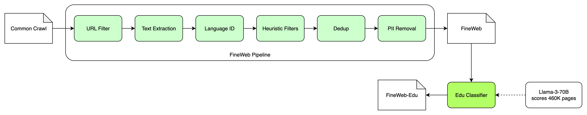

# 数据（Dataset）

第一章我们用几分钟训了一个字符级的小模型，喂给它的是一份现成的小文本，下载下来就能用。真正的预训练可没有这么省事。模型学到的一切都来自数据：它会说什么话、知道哪些事、句子通不通顺，全看喂给它的是什么。所以这一章不急着写模型，先把数据这件事从头到尾走一遍。

我们先看看预训练数据从哪里来，再看看一份网页抓取下来的原始文本，要经过哪些工序，才能变成可以拿来训练的语料。业界做这件事的流程已经相当成熟，我们会以HuggingFace公开的FineWeb为主线，把每一道工序是干什么的、为什么要有它，都讲清楚。然后说说本书为什么直接用现成的FineWeb-Edu，而不是自己从头洗一遍。不过光看别人洗好的数据，很难体会这些工序的分量，所以我们会下载一份真正的原始网页文本，挑其中几道最关键的工序，亲手做一遍。最后把语料切成训练集和验证集，定下它在磁盘上的存储格式，为第三章的分词和第五章的训练做好准备。

这一章的代码在`code/book/ch02/`下面，一共五个脚本，各管一件事：`download.py`下载FineWeb-Edu，`wet_sample.py`下载并解析一份原始网页文本，`clean.py`做规则过滤，`dedup.py`去重，`split.py`切出验证集。它们都很短，只依赖标准库、NumPy和pyarrow，章末的“代码实现”一节会挑关键的部分讲。


## 数据决定上限

做过一阵模型训练的人，大多会得出同一个结论：模型尺寸相同、训练步数相同，换一份更干净、更有信息量的数据，效果往往比调任何超参数都来得明显。架构决定了模型能学多少东西，数据决定了它实际学到的是什么。喂进去的是广告、乱码和重复了上千遍的网页模板，模型就会认真地把这些东西也学进去。

对我们这种小模型来说，这一点更要紧。第一章算过账，我们的模型只有约26M参数，一次能训的token数也有限。参数少，意味着它记不住多少东西；token少，意味着它看不了多少遍。在这样的预算下，每一个token都很珍贵，与其让它花力气去学怎么复述网页的导航栏，不如让它多读几段像样的解释性文字。

后面我们会看到，FineWeb团队做过一个很有说服力的实验：同样的模型、同样的token数，只是把训练数据换成“按教育价值挑选过”的那一部分，模型在各项测试上的表现就有明显提升。这正是本书选FineWeb-Edu的原因，也是第六章对照实验要验证的事情。


## 预训练数据从哪来

预训练要的是海量的、各式各样的文本。今天的大模型动辄训练十几万亿个token，换算成书，是几千万本的量。能凑出这么多文本的来源，其实只有几类。

**网页**是绝对的大头。互联网上的文本取之不尽，话题无所不包，而且有一个公益组织Common Crawl，从2008年起每隔一两个月就把公开网页抓一遍，打包免费提供下载。几乎所有开源的预训练语料，都是从Common Crawl出发的。网页的问题是脏：广告、导航栏、版权声明、自动生成的垃圾页面、成千上万个大同小异的模板页，都混在一起。本章的大部分篇幅，讲的就是怎么从网页里把能用的文字挑出来。

**百科和书籍**质量高、事实准确，但量远远比不上网页。英文维基百科全部加起来，也只有几十亿个token，放在十几万亿的总量里只是一小撮。它们的作用是“提纯”：在训练数据里放大比例，或者放在训练的最后阶段，让模型多看几遍。书籍还有版权的麻烦，公开语料里能合法使用的，主要是已经进入公有领域的老书。

**代码**看起来和自然语言无关，可是把它混进训练数据，模型的推理和结构化表达能力往往会变好。所以现在的预训练语料，基本都会掺一部分代码。我们的小模型不打算写代码，这一部分就不用了。

**合成数据**是这几年的新趋势：让一个能力强的大模型，按照指定的主题和风格，批量写出教科书、故事、问答。HuggingFace的Cosmopedia就是这样一份合成语料，SmolLM2的训练数据里也有它。合成数据干净、可控，缺点是题材和文风受限于出题的那个大模型。第十章讲蒸馏时，我们会自己动手生成一批。

不同来源怎么搭配，叫**数据配比**（Data Mixture）。配比本身是一门学问，大模型的技术报告里，往往会用一整节来讲它。本书只用一种来源，也就是从网页里挑出来的FineWeb-Edu，不碰配比这个话题。


## 从网页到语料

我们以FineWeb为例，看看从Common Crawl抓下来的原始网页，到最后可以训练的语料，中间要经过哪些工序。FineWeb是HuggingFace在2024年发布的英文网页语料，出自论文《The FineWeb Datasets: Decanting the Web for the Finest Text Data at Scale》（arXiv:2406.17557）。它的好处是整个处理流程、每一步的取舍理由、用来验证取舍的实验，全都公开了，很适合拿来当教材。

整条流水线大致是这样的：



方框里的六道工序，把Common Crawl的原始网页变成FineWeb；FineWeb再经过一个质量分类器打分，留下的部分就是FineWeb-Edu。这个分类器是用大模型给几十万篇网页打的分训练出来的，图右下角那条虚线就是这个意思，后面会细讲。

下面一道一道来看，每道工序是干什么的，为什么要有它。


### 抓取：Common Crawl

每次抓取称为一个**快照**（Snapshot），每个快照包含二十多亿个网页，比如2026年10月的快照有21.6亿个网页，不压缩的话有371TiB。它提供三种格式：WARC是原始的HTTP响应，网页的HTML全在里面；WAT是从中抽出来的元数据，比如链接关系；WET是从HTML里粗略抽出来的纯文本。FineWeb用的是WARC，原因下一小节说。

抓取这一步我们什么都不用做，Common Crawl已经替整个行业做了。不过有一件事值得留意：一个快照里的网页，并不全是新的，热门网站每次都会被抓到。所以不同快照之间有大量重复，这是后面去重要面对的问题。

在进入后面的工序之前，FineWeb先按网址做了一次过滤，用一份公开的黑名单，把成人网站之类的域名整个去掉。这一步很粗，但很便宜，先把明显不要的东西扔掉，后面每道工序要处理的量都会小一些。


### 抽正文

一个网页的HTML里，真正有价值的正文往往只占一小部分，其余是菜单、侧边栏、页脚、广告、脚本。把正文抽出来，叫**正文提取**（Text Extraction）。

直接用Common Crawl自带的WET文件最省事，它就是抽好的纯文本。但它的抽法很粗暴，基本是把HTML里所有看得见的文字都留下，菜单项和页脚一行不落。FineWeb团队做过比较：从WARC里用专门的正文提取工具trafilatura重新抽一遍，训练出来的模型明显比直接用WET要好。代价是要处理的数据量大得多，因为原始HTML比纯文本大好几倍。

后面我们亲手洗数据时，为了省事，用的就是WET文件。你会亲眼看到它有多脏，也就能理解为什么值得花大价钱重新抽一遍。


### 识别语言

抓下来的是全世界的网页，什么语言都有。FineWeb只要英文，所以要给每一篇文档判断一下语言，这叫**语言识别**（Language Identification）。

常用的工具是fastText的语言识别模型。它很小，速度很快，对每篇文档给出“属于每种语言的概率”。FineWeb只留下英文概率在0.65以上的文档。中文语料的做法一模一样，只是把要留下的语言换成中文。

语言识别有一个容易被忽略的副作用：判断不出语言的文档，往往本身就是垃圾，比如满屏的数字、代码片段或者乱码。所以这一步除了按语言分拣，顺带也扔掉了一批没法读的东西。


### 规则过滤

抽完正文、认完语言，剩下的英文文本里，依然有大量低质量的内容。最直接的办法，是写一批规则，把明显不像“正常文章”的文档筛掉，这叫**启发式过滤**（Heuristic Filtering）。

这些规则大多来自前人的经验，最有名的两套出自两篇论文。一套是Google训练T5时整理C4语料用的规则，出自《Exploring the Limits of Transfer Learning with a Unified Text-to-Text Transformer》（arXiv:1910.10683）；另一套是DeepMind训练Gopher时用的规则，出自《Scaling Language Models: Methods, Analysis & Insights from Training Gopher》（arXiv:2112.11446）。它们的思路都很朴素，挑几类有代表性的看看：

* **长度：** 太短的文档（几个词）没有信息量，太长的文档往往是拼接出来的列表或者日志。
* **字符和词的统计特征：** 平均词长太短或太长、符号比例太高、很少有“the”“and”这类常用词，都说明它不像正常的英文句子。
* **行的特征：** 大部分行不以句号之类的标点结尾，说明是菜单或列表；很多行以省略号结尾，说明是被截断的摘要。
* **重复：** 文档内部有大量重复的行或重复的片段，多半是自动生成的页面。
* **黑名单词：** 含有“lorem ipsum”这类占位文字、含有“javascript”这类提示，说明抽正文时抽进了不该要的东西。

每条规则单看都很粗糙，会误伤一些正常文档，也会放过一些垃圾。但它们便宜，可以对几十亿篇文档逐一执行，组合起来效果相当可观。FineWeb用了Gopher的全部规则和C4的大部分规则，又用实验挑出了几条自己的规则，每一条都用小模型训练来验证：加上这条规则，模型确实变好了，才留下。这种“每一个取舍都用实验说话”的做法，也是本书想效仿的。


### 去重

网页上的重复内容多得惊人：同一篇新闻被几十家网站转载，同一个模板生成了成千上万个页面，同一个网页在不同快照里被抓了一遍又一遍。如果不处理，模型就会把这些内容看上很多遍。这不仅浪费算力，还会让模型倾向于逐字背诵这些高频内容。所以**去重**（Deduplication）是数据处理里必不可少的一步。

去重分两种。**精确去重**找的是一字不差的重复，做法是给每篇文档算一个哈希值，哈希值相同的只留一份，简单又快。**近似去重**找的是大同小异的重复，比如只有日期、广告或者网站名不同的两个页面。逐字比较是不行的，几十亿篇文档两两比较，算到天荒地老也比不完。业界的标准做法是MinHash，后面亲手洗数据时，我们会自己写一个，到时候再细讲它的原理。

在去重上，FineWeb有一个反直觉的发现：去重不是越狠越好。把全部96个快照放在一起做全局去重，最后只剩4万亿个token，训练出来的模型却几乎没比不去重好多少。他们拿一个早年的快照仔细查看：全局去重之后，这个快照只剩下10%，可这留下来的10%，质量反而比被删掉的90%还差，广告、堆砌的关键词、格式混乱的文本更多。他们的解释是，去重真正的好处，来自删掉那些动辄几十万篇的大簇重复；而对只重复了几次的小簇也赶尽杀绝，反而会伤害模型。最后FineWeb选择每个快照内部单独去重，不跨快照。这个例子很能说明问题：数据处理里的很多直觉，都需要实验来检验。


### 去掉个人信息

网页里难免有电子邮件地址、电话号码、IP地址这类个人信息。模型可能把它们背下来，在生成时原样吐出来。所以公开的语料一般会做一遍**个人信息脱敏**（PII Removal）。FineWeb的做法是用正则表达式找出邮件地址和公网IP地址，替换成固定的占位内容。这一步对模型效果几乎没有影响，但对隐私和合规很重要。它也提醒我们，数据处理不光是技术问题。


### 防止偷看考题

模型训练完要拿各种基准测试来评估。如果测试题恰好也出现在训练数据里，模型的分数就会虚高，这叫**数据污染**（Data Contamination）。网页上流传着大量基准测试的题目和答案，污染很容易发生。

防止的办法是**去污染**（Decontamination）：把训练数据和测试集做一次比对，找出重叠的片段，把相应的文档去掉。比对通常是按一定长度的连续词序列来做的，也就是所谓的n-gram。

本书的小模型不打算去刷基准测试，第六章也会解释为什么这些测试对几十M参数的模型没有意义。所以这一步我们只是知道有这么回事，不去做它。


### 质量打分：用模型挑数据

到这里，FineWeb就做完了。它有大约15万亿个token，已经比原始网页干净得多。但规则过滤只能筛掉“明显不像文章”的东西，没法回答“这篇文章值不值得学”。一篇语法通顺的八卦新闻，和一篇讲光合作用的科普文章，在规则眼里没有区别。

到了FineWeb-Edu，又更进一步：给每篇文档打一个“教育价值”的分数，只留高分的。问题是几十亿篇文档，人工打分是不可能的。他们的办法分三步：

1. 先从一个快照里随机挑出46万篇网页，请一个大模型（Llama-3-70B-Instruct）按一份评分标准，给每篇打0到5分。评分标准问的是，这篇文章对小学到中学阶段的学习有多大帮助。
2. 用这些打好分的网页，训练一个小得多的**质量分类器**：先用一个现成的小模型把文档变成一个向量，再在向量上做一个简单的线性回归。它只需要读一篇文档，输出一个分数。
3. 用这个小分类器，给FineWeb里的所有文档打分，留下3分及以上的部分。

留下来的这部分，就是FineWeb-Edu，大约1.3万亿个token，只有FineWeb的十分之一左右。可是用它训练出来的模型，在知识和推理类的测试上，明显好过用全部FineWeb训练的模型：论文里一个17亿参数的模型，换成FineWeb-Edu之后，考知识的MMLU从33%升到37%，考推理的ARC从46%升到57%。

这个“用大模型给数据打分，再蒸馏成一个小分类器”的思路，是近几年数据处理里最重要的进展之一。它本质上是把大模型的判断力，借来挑选训练数据。下载FineWeb-Edu时你会看到，每篇文档都带着这个分数，一个字段叫`score`，是分类器给出的小数；另一个叫`int_score`，是四舍五入后的整数。


## 本书的选择

看完这条流水线，你大概已经猜到了：本书不会自己从Common Crawl洗一遍数据。一个快照不压缩就有三百多TiB，FineWeb用了96个快照，处理它们要动用一大批机器，这完全不是一本书、一台Colab能做的事。我们直接用HuggingFace洗好的FineWeb-Edu。

数据集还贴心地提供了几个抽样版，其中最小的一个约100亿token（`sample-10BT`），按parquet文件分片存放，每个分片可以单独下载。我们的预算远远用不了这么多。第一章算过，按Chinchilla的经验，26M参数的模型大约配5亿个token，所以只需要下载其中一小部分分片。

这里的parquet，是一种专门存放表格数据的文件格式，出自Apache基金会的开源项目，HuggingFace上的大数据集基本都用它。可以把它想成一个压缩过的CSV文件：一个文件就是一张表，FineWeb-Edu里一行是一篇文档，正文、网址、分数、token数各占一列。和CSV不同的是，它按列存放，同一列的数据挨在一起，所以压缩得很好，只要其中几列时也可以只读那几列；每一列是字符串、整数还是小数，也都写在文件里，读出来不用再转换。一个文件内部还切成了一个个**行组**（Row Group），可以一组一组地读，不必一次把整个文件装进内存。我们用`pyarrow`这个库来读它。

不过这里有一个细节：FineWeb-Edu标注的token数，是用GPT-2的分词器数出来的，它的词表有五万多个词元。我们第三章会训练一个只有8192个词元的分词器，词表小，同一段文本会切出更多的token。所以“5亿token要下载多少个分片”，要等第三章的分词器训练好，实际数一数才知道。

我们先下载第一个分片看看。`sample-10BT`一共切成14个parquet文件，前13个都是2GB出头，第一个是2,152,819,114字节，里面有726,000篇文档、3,451,992,934个字符，按GPT-2的分词器数是754,872,720个token，平均每篇文档4,754个字符。分数的分布是：3分占86.7%，4分占13.2%，5分只有0.1%。可见FineWeb-Edu留下的，绝大部分是刚好过线的3分文档。

一个分片按GPT-2算就有7.5亿个token。我们的分词器词表更小，切出来的token只会更多，所以一个分片应该就够5亿token的预算了。到第三章数完再确认。


## 亲手洗一遍

用现成的语料很省事，但如果只看过洗好的数据，很难体会前面那些工序到底在对付什么。所以我们从Common Crawl下载一个WET文件，挑几道工序亲手做一遍。目标不是洗出能用的语料，而是亲眼看看原始网页文本长什么样，以及每道工序扔掉了什么。


### 一个WET文件

我们用的快照是CC-MAIN-2026-43，它的WET文件清单一共有100,000行，也就是切成了十万个WET文件。我们只下载其中第一个，压缩后64,395,252字节，也就是64MB左右。打开它，你会看到每个网页由一段头部和一段正文组成。头部记录了网址、抓取时间、文本长度；正文就是抽出来的纯文本。随手翻几页，就能看到前面说的各种问题：一行一个的菜单项、“版权所有”和“隐私政策”、各种语言混在一起，还有一些页面通篇是乱码或者商品列表。

这个文件里一共有21,463个网页，138,992,491个字符，平均每页6,475个字符。每个网页的头部里，Common Crawl还标注了它自己识别出来的语言。按这个标注，英文只占43.7%，接下来是俄文、德文、日文、法文、西班牙文、中文，各占百分之五六。换句话说，即使只要英文，一上来就有一半以上的网页用不上。

我们从文件里挑一个网页看看。它是2017年一个学术会议的网站，前面十来行是这个网页的头部，空一行之后是正文，这里只截了正文的前十行：

```
WARC/1.0
WARC-Type: conversion
WARC-Target-URI: http://2017.icser.net.au/Home.aspx
WARC-Date: 2026-10-05T11:26:35Z
WARC-Record-ID: <urn:uuid:e289f277-fae0-42c1-bb8e-3e36416ded07>
WARC-Refers-To: <urn:uuid:01a10bd0-cafc-7b68-bd56-c72454d1e8bb>
WARC-Block-Digest: sha1:YPKND3KAYTXF2RX7GB4SA2J77YZWO3NV
WARC-Identified-Content-Language: eng
Content-Type: text/plain
Content-Length: 3173

iCSER 2017
Home
Call for Papers
Key Dates
Registration
Author's Guideline
Manuscript Preparation
Manuscript Submission
Review Process
Committee
……
```

头部一行一个字段，冒号前面是字段名，后面是值。几个要紧的字段是：`WARC-Type`为`conversion`，表示这条记录是从网页转换出来的纯文本；`WARC-Target-URI`是网页的地址；`WARC-Date`是抓取的时间；`WARC-Refers-To`指向原始WARC文件里对应的那条记录，想看原始的HTML可以顺着它去找；`WARC-Identified-Content-Language`就是前面说的、Common Crawl自己识别出来的语言，这里是`eng`，英文；`Content-Length`说明正文有多少字节，读文件时就靠它知道正文在哪里结束。

再看正文。网页的标题之后，一行一个，全是导航菜单：首页、征稿、重要日期、注册……真正的会议介绍，要翻过这一长串才看得到。这就是前面说的，WET的正文提取很粗糙，把菜单也原样留下了。后面规则过滤时，我们会看到这种一行一个、不带标点的菜单，正是被拦下最多的那一类。


### 规则过滤

我们挑几条有代表性的规则来实现，不求全，只求每条规则都能看清楚它在干什么：

* **语言：** ASCII字符要占到90%以上；
* **长度：** 词数在50到100,000之间；
* **平均词长：** 在3到10之间；
* **停用词：** Gopher列的八个最常见的英文词（the、be、to、of、and、that、have、with），至少要出现两个；
* **符号：** “#”和省略号的个数，不超过词数的10%；
* **行尾标点：** 以句号、问号、感叹号、引号结尾的行，至少要占12%，这一条是FineWeb自己加的；
* **重复行：** 重复的行不超过30%；
* **占位文字：** 不含“lorem ipsum”。

阈值大多照抄Gopher和FineWeb。语言识别用的是一个最简单的近似：只看ASCII字符的比例。它不如fastText准，但不需要额外下载模型，用来演示足够了。一篇网页按顺序过这些规则，被哪一条拦下，就记在哪一条的账上。

关键是每条规则都要**单独计数**：扔掉了多少篇文档，抽几篇被扔掉的看看。这样才能判断一条规则是不是太严、误伤了正常的文档，或者太松、什么都没筛掉。结果如下：

| 规则 | 拦下的网页 |
|---|---|
| 语言 | 5,136 |
| 长度 | 937 |
| 平均词长 | 110 |
| 停用词 | 5,564 |
| 符号 | 10 |
| 行尾标点 | 5,963 |
| 重复行 | 464 |
| 占位文字 | 19 |
| **留下** | **3,260（15.2%）** |

原来的21,463个网页，过完规则只剩3,260个，不到六分之一。拦得最多的是三条：语言、停用词、行尾标点。

语言规则拦下了5,136个，基本都是中文、日文、俄文这类非拉丁字母的网页。可是它也有漏网的：德文、法文、西班牙文大部分字母都是ASCII，躲过了这条规则，靠后面的停用词规则才拦下来。最后留下的3,260个网页里，仍然有587个，Common Crawl认为不是英文。这就是只看字符比例的代价，真正的语言识别还是得靠fastText这样的模型。

拦得最多的是行尾标点规则，5,963个。WET文件的正文是粗略抽出来的，菜单、导航栏、按钮文字都是一行一个，没有标点。一个网页只要菜单够长，正文再正常也会被它拦下。这条规则在FineWeb那里效果很好，因为FineWeb的正文是用trafilatura精心抽出来的；放在WET上，就显得太严了。其实FineWeb自己也遇到过类似的事：C4有一条更严的规则，要求每一行都以标点结尾，FineWeb嫌它删掉的数据太多，没有用，才换成了这条只要求12%的宽松版本。同一条规则，换一个上游，效果可能完全不同。


### 精确去重

精确去重最简单：对每篇文档的正文算一个哈希值，比如MD5，用一个集合记录见过的哈希值，再次见到就扔掉。

做之前最好先把文本规范化一下，比如统一大小写、去掉首尾空白、把连续的空白合并成一个。否则两篇只差一个空格的文档，会被当成不同的文档。在单个WET文件里，完全一样的网页通常不多。我们的3,260个网页里，精确去重只扔掉了7个。精确去重真正发挥作用，是在把多个文件、多个快照放在一起的时候。


### 近似去重：MinHash

近似去重要回答的问题是：两篇文档有多相似？最常用的衡量办法，是先把每篇文档切成一组小片段，然后看两组片段有多少重合。

切片段的办法叫**切片**（Shingling）：把文档按词切开，每连续 $n$ 个词算一个片段。比如 $n=3$ 时，“the cat sat on the mat”就切成“the cat sat”、“cat sat on”、“sat on the”、“on the mat”四个片段。两篇文档的相似度，就用两个片段集合的**Jaccard相似度**（Jaccard Similarity）来衡量：

$$
J(A, B) = \frac{|A \cap B|}{|A \cup B|}
$$

交集越大，相似度越接近1；毫无重合，就是0。问题在于，直接算这个数，要把两个集合拿出来逐个比较，几十亿篇文档两两之间都比一遍，根本算不完。

**最小哈希**（MinHash）这个技巧，出自Broder在1997年的论文《On the Resemblance and Containment of Documents》。它基于一个简单的事实：拿一个哈希函数，给集合里每个片段算哈希值，取其中最小的那个，就是这个集合的最小哈希。那么两个集合的最小哈希恰好相等的概率，正好等于它们的Jaccard相似度：

$$
P\big[\min h(A) = \min h(B)\big] = J(A, B)
$$

道理不难想通：把 $A \cup B$ 里的所有片段按哈希值排个队，排在最前面的那一个，落在交集里的概率，就是交集占并集的比例。只有它落在交集里，两边的最小哈希才会相等。

一个哈希函数只能给出“相等”或“不相等”，太粗了。所以我们准备 $k$ 个不同的哈希函数，每篇文档就得到 $k$ 个最小哈希，这一串数字称为文档的**签名**（Signature）。两篇文档的签名里，有多少比例的位置相同，就是它们Jaccard相似度的一个估计。哈希函数越多，也就是 $k$ 越大，估计越准。这样一来，每篇文档不管多长，都被压缩成了一串固定长度的数字。

签名解决了“比较一次很贵”的问题，可是两两比较的次数还是太多。最后一步叫**局部敏感哈希**（Locality-Sensitive Hashing，简称LSH）：把 $k$ 个最小哈希分成 $b$ 组，每组 $r$ 个。只要两篇文档有任何一组完全相同，就把它们列为“候选的重复对”，再去细看。这样只需要按组建哈希表，相同的组自然会落到同一个桶里，完全不用两两比较。

两篇相似度为 $J$ 的文档，成为候选对的概率是：

$$
P = 1 - (1 - J^r)^b
$$

画出来是一条S形的曲线：相似度低于某个阈值时，概率几乎为0；高于这个阈值，概率迅速接近1。调整 $b$ 和 $r$ ，就能把这个阈值放到想要的位置，比如“相似度超过0.8就算重复”。

我们用纯Python加NumPy写了一个MinHash，参数照抄FineWeb：每连续5个词算一个片段，签名长度 $k=112$ ，分成 $b=14$ 组，每组 $r=8$ 个。代入上面的公式，阈值大约在 $(1/14)^{1/8} \approx 0.72$ ：相似度高于它的两篇网页，大概率会被找出来。FineWeb的说法是，这组参数瞄准的是相似度75%以上的文档，两者说的是同一件事。

在精确去重剩下的3,253个网页上跑一遍，找到40个候选对，连成27簇，每簇只留一篇，一共扔掉36篇，剩下3,217篇。签名估计出来的相似度，和真正算出来的Jaccard相似度非常接近，比如0.91对0.91、0.88对0.84，112个数就把两篇几千词的文档比清楚了。

找出来的近似重复，大多是同一个网站的模板页。最大的一簇有5篇，来自几个不同域名的空调维修网站：页面结构一模一样，只是把公司名和城市名换了。这种网页，正是去重要对付的东西。有意思的是，有几对的真实相似度只有0.65，低于0.72的阈值，也被找了出来。这正是那条S形曲线的含义：阈值附近不是一刀切，而是有一段过渡。


### 和FineWeb-Edu比一比

洗完之后，从我们洗出来的文本里随手抽几篇，再从FineWeb-Edu里随手抽几篇，放在一起读一读。差别会非常明显：前者即使过了规则和去重，也大多是公司主页、商品页和成人网站，正文前面还拖着一长串菜单；后者读起来像是百科条目、科普文章和教材的片段，讲精神分裂症的用药、加州的溶洞、土木工程师是做什么的。

这中间差的，主要就是两样东西：更好的正文提取，以及质量打分。前者让文本更干净，后者让内容更有价值。这也是为什么本书宁可直接用FineWeb-Edu，而不是用自己洗出来的数据。


## 切分

数据准备好之后，在做任何训练之前，先要从里面切出一小部分，作为**验证集**（Validation Set），剩下的作为**训练集**（Training Set）。验证集的数据，训练时一次都不让模型看到，只用来检验模型的效果。

为什么非要单独留一份？因为模型在训练数据上的loss，只能说明它把看过的东西记得怎么样；它对没见过的文本预测得怎么样，才是我们真正关心的。如果用训练数据来评估，模型完全可以靠死记硬背拿到很低的loss，我们却被蒙在鼓里。

切分有两个要点。第一，**按文档切，不按token切**。如果把所有文档拼成一长串token再从中间截一段做验证集，同一篇文档的前半截可能在训练集里，后半截在验证集里，验证集就不算“没见过”了。第二，**一开始就切好，以后不再改**。整本书的所有实验，都用同一份验证集来比较，结果才有可比性。如果每次实验都重新随机切一份，两次实验的验证loss差了一点，你就分不清是模型变了，还是验证集变了。

验证集不需要很大，能让验证loss稳定下来就够了。我们留千分之二。

“以后不再改”怎么做到？我们不随机抽，而是看每篇文档的`id`。FineWeb-Edu给每篇文档一个全局唯一的id，对它算一个MD5，取模1000，落在0和1上的就进验证集。同一篇文档，无论什么时候、在哪台机器上算，结果都一样。这样一来，训练集也不必另存一份，第三章分词时，用同一个规则判断一遍就行。第一个分片切下来，验证集有1,480篇文档，按GPT-2算是1,597,233个token，正好占0.20%。


## 存储格式

最后一个问题：数据在磁盘上怎么存，训练时怎么读。

训练时，模型每一步要的是一批固定长度的token序列，比如8个长度为1024的序列。最简单高效的存法，是把所有文档分词之后，首尾相连拼成一条长长的token序列，存成一个二进制文件。文档和文档之间，插入一个特殊的结束符，让模型知道一篇文档到哪里结束了。

我们的词表只有8192个词元，每个token ID用一个16位无符号整数（`uint16`）就能存下，它最多能表示65535。这样每个token只占2字节，5亿个token约1GB，放在Google Drive上毫无压力。

读的时候，用NumPy的内存映射（`numpy.memmap`）打开这个文件。内存映射的好处是不用把整个文件读进内存，要用哪一段，操作系统就把哪一段读进来。训练时每一步随机挑一些起点，各截一段固定长度的序列，就是一个批次。nanoGPT就是这么做的，简单到几乎没有可以出错的地方。

这样做有一个副作用：截出来的序列，常常会跨过文档边界，前半段是一篇文档的结尾，后半段是另一篇的开头。这在预训练里是被普遍接受的，文档之间的结束符会告诉模型，前后两段没有关系。到第七章做SFT的时候，我们会再回来讨论这个问题。

分词这一步要等第三章的分词器训练好才能做，所以本章只把文本按训练集和验证集存好，`.bin`文件留到第三章末尾生成。


## 代码实现

开头说过，本章的五个脚本在`code/book/ch02/`里，分成两条线：`download.py`和`split.py`处理FineWeb-Edu；`wet_sample.py`、`clean.py`、`dedup.py`处理WET文件，后一个读前一个的输出。下载的东西都放在`code/data/`下，不进入版本控制。

```bash
cd code
uv run python book/ch02/download.py      # 下载FineWeb-Edu的第一个分片
uv run python book/ch02/wet_sample.py    # 下载并解析一个WET文件
uv run python book/ch02/clean.py         # 规则过滤
uv run python book/ch02/dedup.py         # 精确去重加MinHash
uv run python book/ch02/split.py         # 切出验证集
```


### 下载

脚本`download.py`做的事很简单：从HuggingFace下载parquet文件，再用pyarrow读出来统计一下。两个GB的文件，下载到一半断了很常见，所以它先写到一个`.part`文件里，下完才改名；再跑一遍时，用HTTP的`Range`头告诉服务器从第几个字节接着给：

```python
part = path.with_name(path.name + ".part")
have = part.stat().st_size if part.exists() else 0
req = urllib.request.Request(url, headers={"Range": f"bytes={have}-"})
```

这样，文件名对的文件一定是完整的，不会有下了一半、看起来却像完整文件的情况。


### 解析WET

一个WET文件就是一串记录，每条记录是一段头部加一段正文。头部一行一个字段，遇到空行结束；正文有多长，由头部的`Content-Length`说了算。脚本`wet_sample.py`按这个格式逐条读：

```python
def read_records(path):
    """逐条读WARC记录，产出(头部字典, 正文字节)。"""
    with gzip.open(path, "rb") as f:
        while line := f.readline():
            if not line.startswith(b"WARC/"):
                continue
            headers = {}
            while (line := f.readline().strip()):
                key, _, value = line.decode("utf-8", "replace").partition(":")
                headers[key.strip()] = value.strip()
            body = f.read(int(headers["Content-Length"]))
            yield headers, body
```

文件开头有一条`warcinfo`记录，说明这个文件本身，不是网页，所以只留`WARC-Type`为`conversion`的记录。每个网页存成JSON Lines的一行，记下网址、Common Crawl识别的语言和正文。


### 规则过滤

脚本`clean.py`的核心是一张规则表。每条规则是一个名字加一个函数，函数返回真，就说明这篇网页该扔：

```python
RULES = [
    ("非英文（ASCII字符不到90%）", lambda t, w, l: ascii_ratio(t) < 0.9),
    ("太短或太长（词数不在50到100,000之间）",
     lambda t, w, l: not 50 <= len(w) <= 100_000),
    ("平均词长不在3到10之间", lambda t, w, l: not 3 <= mean_word_len(w) <= 10),
    ("停用词不到两个",
     lambda t, w, l: len(STOPWORDS & {x.lower() for x in w}) < 2),
    ("#和省略号太多（超过词数的10%）",
     lambda t, w, l: symbol_ratio(t, w) > 0.1),
    ("以标点结尾的行不到12%", lambda t, w, l: ends_with_punct(l) < 0.12),
    ("重复的行超过30%", lambda t, w, l: dup_line_ratio(l) > 0.3),
    ("含有lorem ipsum", lambda t, w, l: "lorem ipsum" in t.lower()),
]
```

三个参数分别是正文、词的列表和非空行的列表，事先算好一次，每条规则直接用。一篇网页按顺序过这张表，第一条返回真的规则就是拦下它的那一条。加一条规则，只要往表里加一行。


### 去重

脚本`dedup.py`先做精确去重：正文转小写、合并空白之后算MD5，见过的就扔。

近似去重的关键是签名。我们需要112个不同的哈希函数，用的是最经典的一种构造：先给每个片段算一个32位的基础哈希 $x$ ，再用 $h(x) = (ax + c) \bmod p$ 变出不同的函数，其中 $p = 2^{31} - 1$ ， $a$ 和 $c$ 各取112个随机数。用NumPy的广播，一篇文档的签名一行就能算出来：

```python
def signature(shingle_set):
    """K个哈希函数，各取最小值。

    x是(n,)，A和C是(K,)，广播成(n, K)再按列取最小。
    """
    x = np.fromiter((base_hash(s) for s in shingle_set), dtype=np.uint64)
    return ((x[:, None] * A + C) % P).min(axis=0)
```

然后把112个数切成14组，每组8个。对每一组，把8个数拼成一个字节串当作字典的键，落进同一个桶的文档，就是候选的重复对。候选对用并查集连成一簇一簇，每簇只留编号最小的那一篇。


### 切分

脚本`split.py`只有一个关键函数：

```python
def is_val(doc_id):
    h = int(hashlib.md5(doc_id.encode()).hexdigest(), 16)
    return h % 1000 < VAL_PER_MILLE
```

其中`VAL_PER_MILLE`是2。它把验证集的正文另存成一个JSON Lines文件，方便翻看；训练集不另存，第三章分词时，每篇文档用`is_val`判断一下就知道该归哪边。


## 代码效果

前面各节已经把主要的数字报告过了，这里把两个下载脚本的输出放在一起，方便对照。脚本`download.py`的输出：

```
000_00000.parquet
文件大小     2,152,819,114 字节
文档数       726,000
字段         text, id, dump, url, file_path, language, language_score,
             token_count, score, int_score
字符数       3,451,992,934
token数      754,872,720（GPT-2分词器数的）
平均每篇     4,754 字符，1,039 token
分数分布     3分 86.7%，4分 13.2%，5分 0.1%
```

下面是脚本`wet_sample.py`的输出，语言一栏是Common Crawl自己标注的：

```
文件大小     64,395,252 字节（压缩后）
网页数       21,463
字符数       138,992,491，平均每页 6,475
语言（Common Crawl自己识别的，前十）
  eng      9,370  43.7%
  rus      1,352  6.3%
  deu      1,317  6.1%
  jpn      1,033  4.8%
  fra      1,023  4.8%
  spa      1,012  4.7%
  zho        996  4.6%
  ita        548  2.6%
  por        534  2.5%
  pol        397  1.8%
```

在作者的Mac上，下载FineWeb-Edu的分片之后，五个脚本各自跑完都不超过一分半钟。从21,463个原始网页到3,217个，整条小流水线留下了15.0%，而这15.0%读起来，离FineWeb-Edu还差得很远。


## 对照实验

数据处理里的每一个取舍，都应该用实验来验证。我们的实验很简单：用同一个模型、同样的训练token数，分别在两份数据上训练。一份是我们自己从WET文件里洗出来的文本，另一份是FineWeb-Edu。然后在同一份验证集上比较loss，再用同样的提示词，比较两个模型生成的文字。

这个实验要等第六章有了完整的训练循环才能做，到时候再报告结果。我的预期是FineWeb-Edu明显更好，不过既然本书主张用实验说话，就等结果出来再下结论。

还有一个细节要提前想好：两个模型在“哪一份验证集”上比较。如果各用各的验证集，自己洗的数据更脏、更杂，验证loss本来就会更高，比较就不公平。所以要准备第三份数据作为共同的考卷，比如一小份维基百科，两个模型都没见过它。


## 本章小结

这一章我们把预训练数据从头到尾走了一遍。数据决定了模型的上限，对参数和token都很有限的小模型来说更是如此。预训练数据的主要来源是网页，其次是百科、书籍、代码和合成数据，几乎所有开源语料都从Common Crawl出发。

以FineWeb为例，从原始网页到可以训练的语料，要经过抽正文、识别语言、规则过滤、去重、去个人信息这几道工序，每道工序的取舍都用小模型训练来验证。FineWeb-Edu在此之上，用大模型给几十万篇文档打分，训练出一个小分类器，再用它给全部文档打分，只留下有教育价值的部分。数据量少了十倍，训练出来的模型反而更好。

本书直接使用FineWeb-Edu的抽样版。为了体会这些工序在对付什么，我们下载了一个WET文件，亲手做了规则过滤、精确去重，并从Jaccard相似度出发，推导并实现了MinHash和局部敏感哈希。

最后，我们按文档切出了一份固定不变的验证集，定下了存储格式：所有文档分词后首尾相连，文档之间插入结束符，存成`uint16`的二进制文件，训练时用内存映射随机截取。

不过“分词”这一步，我们一直往后推。数据是一串文字，模型要的是一串整数，中间这座桥就是分词器。下一章，我们来训练一个自己的分词器。
