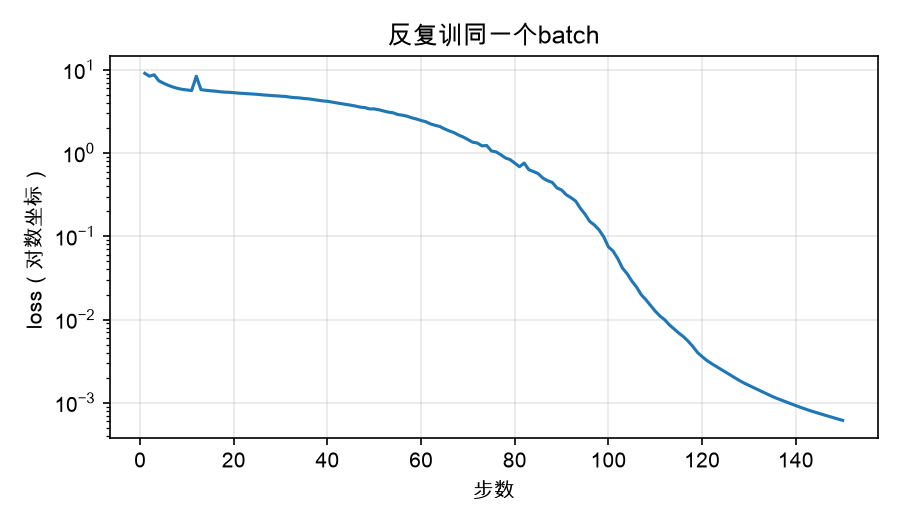
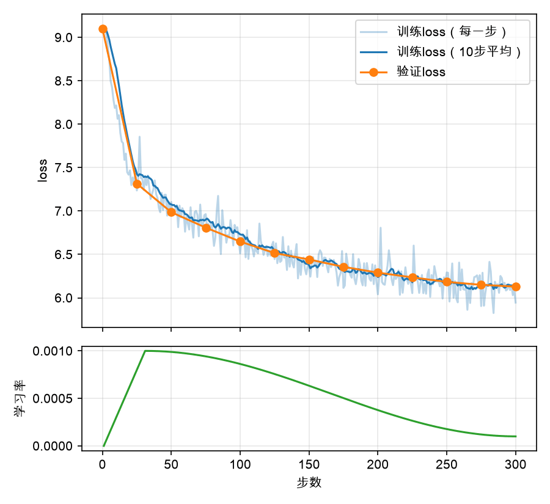
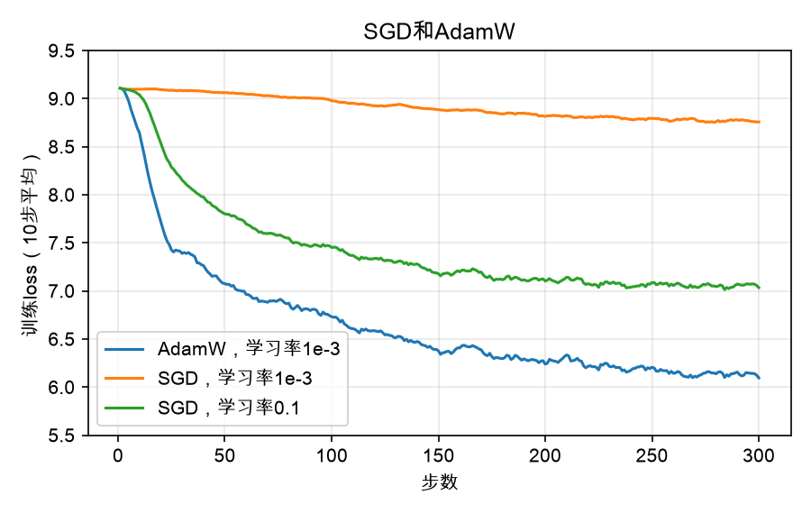
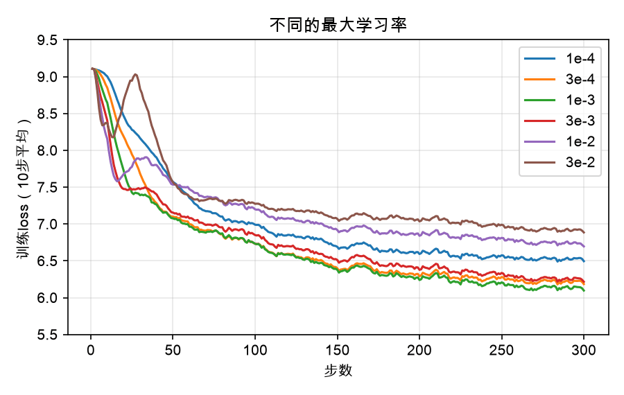
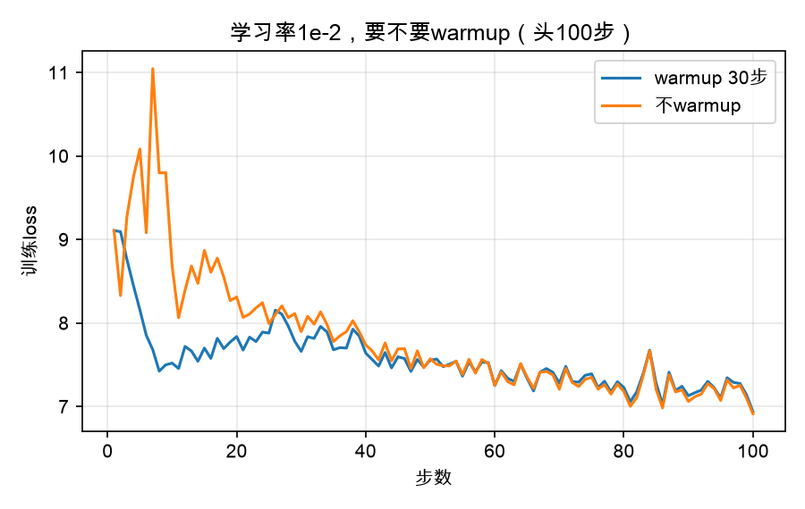
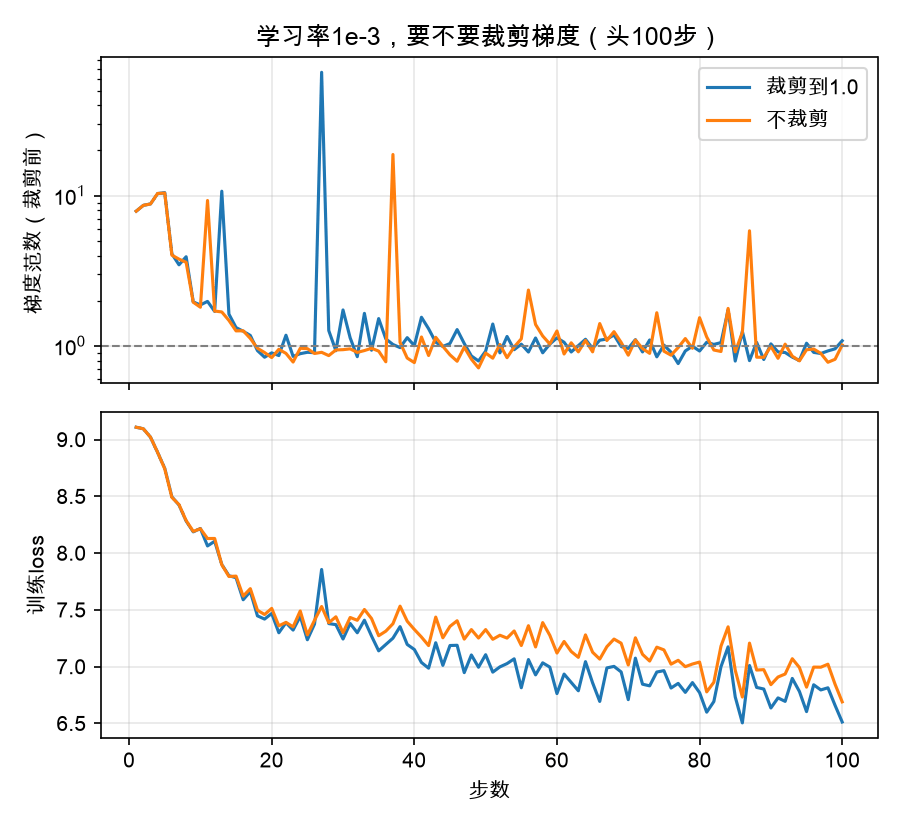

# 训练循环（Training Loop）

上一章搭好了模型，随机初始化以后，它在验证集上的loss是9.09，比闭着眼睛乱猜的 $\ln 8192 \approx 9.01$ 还差一点。这一章要写的，是让这个数降下来的那段代码：训练循环。

第一章那个字符级模型，训练循环的核心只有六行：取一批数据，前向算loss，清空梯度，反向传播，优化器走一步。这一章把这六行一行一行拆开来看。先讲清楚loss到底在算什么，梯度又是什么；再自己写一个AdamW优化器，看它和最朴素的梯度下降差在哪里；然后是学习率，为什么要先慢慢升上去、再慢慢降下来；最后是几个让训练更稳的零件：梯度累积、梯度裁剪，以及中途断了能接着训的checkpoint。和前几章一样，优化器和学习率调度都要先和参考实现核对，对上了才拿来用。

这一章不需要GPU。所有的核对都在CPU上用fp32做，几秒钟到几十秒；训练只跑几百步，用作者那台Intel Mac的GPU，也就是PyTorch里的MPS后端，一次十几分钟。几百步当然训不出一个会说话的模型，但足够看清楚训练循环的每个零件在做什么：学习率太大会怎样，不warmup会怎样，不裁剪梯度又会怎样，这些差别在训练的头几百步里就会显现出来。把训练搬到Colab的T4上、换成fp16、一口气训几个小时，是下一章的事。

这一章的代码在`code/book/ch05/`下面。`config.py`和`model.py`从第四章原样复制过来，一个字没改；`adamw.py`是手写的AdamW，和`torch.optim.AdamW`核对；`schedule.py`是学习率调度，和`transformers`核对；`check_accum.py`检查梯度累积；`overfit.py`拿一个batch反复训；`train.py`是本章的主角，训练循环本身；`plot_loss.py`把训练记录画成图。训练要用到第三章分好词的`train.bin`，如果你删掉了它，要先依次运行第二章的`download.py`和第三章的`encode.py`重新生成。


## 训练在优化什么

训练循环要做的事，一句话就能说清：反复调整模型的参数，让loss变小。所以第一个问题是，loss是怎么算出来的，它小了，为什么就说明模型变好了。


### 预测下一个词元

语言模型的训练数据，不需要任何人工标注。一段文本本身，就同时是题目和答案。

在`train.bin`里随便截一段 $T+1$ 个词元，前 $T$ 个当输入，后 $T$ 个当答案，两者正好错开一位。输入的第1个词元，对应的答案是第2个；输入的前2个词元，对应的答案是第3个；以此类推。第四章讲过，因果掩码让每个位置只能看见它自己和它前面的词元，所以模型一次前向计算，就同时做了 $T$ 道题：看到前1个词元猜第2个，看到前2个猜第3个……看到前 $T$ 个猜第 $T+1$ 个。一个batch有 $B$ 段，一步就是 $B \times T$ 道题。我们在Mac上用的 $B=8$ 、 $T=256$ ，每一步做2048道题。

截取的代码，就是`train.py`里的`get_batch`：

```python
def get_batch(data, B, T, gen, device):
    """随机截B段，每段T+1个词元。错开一位，就是输入和答案。"""
    starts = torch.randint(0, len(data) - T - 1, (B,), generator=gen).tolist()
    chunk = np.stack([data[s:s + T + 1] for s in starts]).astype(np.int64)
    chunk = torch.from_numpy(chunk).to(device)
    return chunk[:, :-1], chunk[:, 1:]
```

这里的`data`是用`numpy.memmap`打开的`train.bin`。`memmap`不会把1.8GB的文件读进内存，而是用到哪一段，操作系统才从磁盘读哪一段，所以随机截几段只需要读几KB。截下来的这一段，不管从哪里开始、到哪里结束，都可能横跨两篇文档，中间夹着一个`<|endoftext|>`。这没关系，模型会学到：看到结束符以后，后面的内容和前面无关。


### 交叉熵

模型对每个位置给出8192个分数，也就是logits，经过softmax变成8192个概率，加起来等于1。如果正确答案是第 $y$ 个词元，模型给它的概率是 $p_y$ ，这个位置的loss就是 $-\ln p_y$ 。把 $B \times T$ 个位置的loss取平均，就是这一步的loss：

$$
\mathcal{L} = -\frac{1}{BT} \sum_{b=1}^{B} \sum_{t=1}^{T} \ln p_{b,t}\left(y_{b,t}\right)
$$

这就是**交叉熵**（Cross Entropy）。它只关心模型给正确答案的那个概率，其他8191个词元各分到多少，它不直接过问；不过概率加起来是1，正确答案分得多，其他的自然就分得少。

正确答案的概率是1，loss就是0；概率是二分之一，loss是 $\ln 2 \approx 0.69$ ；概率越小，loss越大，没有上限。第四章用过一个很好用的换算：把loss取指数， $e^{\mathcal{L}}$ 大约就是模型平均在几个候选里犹豫。均匀猜测的时候，loss是 $\ln 8192$ ，取指数正好是8192，模型在整个词表里犹豫；SmolLM2的loss是2.5，取指数是12，它在十几个候选里犹豫。这个数有个名字，叫**困惑度**（Perplexity），第六章评估模型时会再用到。

在代码里，这一切都由`F.cross_entropy`完成，第四章已经写在了模型的`forward`里：它接收logits和答案，内部先做softmax、再取对数、再取平均，一步算完。分成几步写也可以，但把几步合在一起，可以避开先算出很小的概率、再取对数时的数值问题。


### 为什么是交叉熵

交叉熵不是随便挑的。它背后的道理，是让模型给训练语料的概率尽可能大。

语言模型说到底是一个概率分布：给定前面的词元，它给出下一个词元的概率。把这些条件概率一个一个乘起来，就是一整段文本 $x_1, x_2, \dots, x_N$ 的概率：

$$
p\left(x_1, \dots, x_N\right) = \prod_{t=1}^{N} p\left(x_t \mid x_1, \dots, x_{t-1}\right)
$$

一个好的模型，应该给真实的文本很高的概率，给胡言乱语很低的概率。所以训练的目标很自然：调整参数，让训练语料的概率最大。这叫**最大似然**（Maximum Likelihood）。但是几亿个小于1的数乘在一起，会小到计算机表示不了，所以先取对数，把乘法变成加法：

$$
\ln p\left(x_1, \dots, x_N\right) = \sum_{t=1}^{N} \ln p\left(x_t \mid x_1, \dots, x_{t-1}\right)
$$

对数是单调的，概率最大，对数也最大。再取个负号，把“最大化”变成“最小化”，除以 $N$ 取平均，就正好是上面的交叉熵。所以，把交叉熵降下来，和让模型给训练语料的概率最大，是同一件事。

那为什么不直接用“猜中的比例”当目标？因为它没法指导参数怎么调。猜中没猜中，只看得分最高的是不是正确答案；参数稍微动一点点，得分最高的那个几乎不会变，比例也就不变，梯度处处是0。交叉熵不一样，正确答案的概率哪怕只涨了一点点，loss也跟着降一点点，梯度总能指出方向。它还对“很有把握地猜错”罚得特别重：正确答案的概率是千分之一，loss是 $\ln 1000 \approx 6.9$ 。第四章PyTorch默认初始化的那个模型，loss高达479，就是这个原因。

交叉熵的梯度也格外干净。对一个位置来说，设logits是 $\mathbf{z}$ ，softmax之后的概率是 $\mathbf{p}$ ，正确答案写成一个one-hot向量 $\mathbf{y}$ ，只有正确答案那一维是1，其余都是0。那么loss对logits的梯度就是：

$$
\frac{\partial \mathcal{L}}{\partial \mathbf{z}} = \mathbf{p} - \mathbf{y}
$$

模型给的概率，减去标准答案，差多少，就往回推多少。正确答案那一维是 $p_y - 1$ ，是负的，梯度下降会把它的分数调高；其余每一维是 $p_i$ ，是正的，分数会被调低，概率给得越多的错误答案，被调低得越多。反向传播从这里出发，一路往回传到每一个参数。

最后说说名字。信息论里，**熵**（Entropy）衡量一个分布的不确定性：分布越平，熵越大。**交叉熵**衡量的是，拿模型的分布 $\mathbf{p}$ ，去描述真实的分布 $\mathbf{y}$ ，平均要付出多少：

$$
H\left(\mathbf{y}, \mathbf{p}\right) = -\sum_i y_i \ln p_i
$$

训练时，真实的分布就是那个one-hot的标准答案，求和只剩下正确答案那一项，就变成了 $-\ln p_y$ ，正是我们的loss。交叉熵总是大于等于熵本身，多出来的那部分，叫KL散度，它衡量两个分布差得有多远。第八章的DPO和第九章的强化学习，都会用到它，到时候再细讲。


### loss能降到多低

交叉熵的最小值是0，但在真实的文本上，loss永远降不到0。原因不在模型，而在语言本身。

看到“I went to the”，下一个词可以是“store”，也可以是“park”“doctor”“beach”，都是对的。哪怕一个完美的模型，知道每个词出现的真实概率，它也只能把概率分给这些候选，而不能把全部概率押在其中一个上。语料里实际出现的是“park”，它的概率也许只有百分之五，loss就是3。语言本身的这份不确定性，就是交叉熵的下限，也就是上面公式里的那个熵。我们算出来的loss，等于这个下限，加上模型的分布离真实分布还差多远。训练能做的，只是把后面那部分压小，前面那部分谁也拿不掉。这个下限具体是多少，没有人知道。

后面“先过拟合一个batch”一节，loss会降到0.0006，看上去和这一段矛盾。其实不矛盾：那是在反复训同一批文本，模型把它背了下来，对它来说，这1024个位置都没有任何不确定性了。换一段没见过的文本，loss马上就会回到原来的水平。这也是我们一直要看验证集loss的原因。

还有一点要注意：不同分词器的loss，不能直接比。loss是每个词元的平均，而一个词元有多长，取决于分词器。我们的词表是8192，一个词元平均3.79个字符；SmolLM2的词表是49152，一个词元更长，同一段文本切出来的词元更少，每个词元要预测的内容更多。同样好的两个模型，用大词表的那个，每个词元的loss会更高。SmolLM2的2.5和我们的9.0、6.1，严格说也不在一把尺子上，只是差得太远，不影响结论。要在不同的分词器之间比较，得把loss换算成每个字符或每个字节的平均，第六章评估模型时会用到。


## 梯度

有了loss，下一步是知道每个参数该往哪边调。这就是`loss.backward()`做的事。

模型的2,674万个参数，每一个都会影响loss。对某一个参数来说，把它稍微调大一点点，loss会变大还是变小，变多少，这个变化率就是loss对这个参数的**梯度**（Gradient）。梯度是正的，说明调大这个参数会让loss变大，那就应该把它调小；梯度是负的，就应该调大；梯度的绝对值越大，说明这个参数对loss的影响越大。

所有参数的梯度合在一起，可以看成一个有2,674万维的向量 $\mathbf{g}$ 。它指向的，是让loss上升最快的方向，反过来，就是让loss下降最快的方向。PyTorch的自动求导，会沿着前向计算的路线倒着走一遍，用链式法则，把每个参数的梯度都算出来，存在参数的`.grad`里。具体怎么算，这本书不展开；第四章已经和`transformers`核对过，我们模型的梯度是对的。

后面会经常用到梯度的大小，也就是这个向量的长度，叫**梯度范数**（Gradient Norm）：

$$
\lVert \mathbf{g} \rVert = \sqrt{\sum_i g_i^2}
$$

这里的求和，是对所有参数的所有元素求和。它衡量的是这一步的梯度有多“猛”，训练时要一直盯着它。


## 优化器

梯度告诉我们往哪边走，**优化器**（Optimizer）决定怎么走、走多远。


### SGD

最朴素的走法，是沿着梯度的反方向走一小步：

$$
\boldsymbol{\theta} \leftarrow \boldsymbol{\theta} - \eta \mathbf{g}
$$

其中 $\boldsymbol{\theta}$ 是全部参数， $\eta$ 是**学习率**（Learning Rate），控制步子的大小。这叫**随机梯度下降**（Stochastic Gradient Descent，SGD）。“随机”是说，梯度不是在全部数据上算的，而是在随机截取的一小批数据上算的，它只是真实梯度的一个带噪声的估计。

这种走法很简单，但用来训Transformer，效果很差。问题出在它对所有参数一视同仁，用同一个学习率。而Transformer里，不同参数的梯度大小可以差好几个数量级：词嵌入里，常见词元的那一行每一步都有梯度，罕见词元的那一行一万步也难得有一次；RMSNorm的权重和投影矩阵的梯度，大小也完全不同。学习率定大了，梯度大的参数一步迈过头；定小了，梯度小的参数几乎不动。后面“对照实验”一节会看到，同样的学习率，SGD训了300步，loss几乎没动。


### AdamW

现在几乎所有的大模型，用的都是**AdamW**。它的思路是：给每个参数的每一个数，都单独定一个步长。

为此，它给每个数记两样东西。一样是梯度的滑动平均 $\mathbf{m}$ ，表示梯度最近大致朝哪个方向；另一样是梯度平方的滑动平均 $\mathbf{v}$ ，表示梯度最近大致有多大。每一步，先更新这两个平均：

$$
\begin{aligned}
\mathbf{m} &\leftarrow \beta_1 \mathbf{m} + (1 - \beta_1) \mathbf{g} \\
\mathbf{v} &\leftarrow \beta_2 \mathbf{v} + (1 - \beta_2) \mathbf{g}^2
\end{aligned}
$$

这里的 $\mathbf{g}^2$ 是逐元素平方。 $\beta_1$ 和 $\beta_2$ 是两个接近1的数，我们取0.9和0.95，这是大模型训练里最常见的取值。 $\beta$ 越接近1，平均的窗口越长， $\beta_1=0.9$ 大约是最近10步的平均， $\beta_2=0.95$ 大约是最近20步。

然后，用 $\mathbf{m}$ 除以 $\sqrt{\mathbf{v}}$ 当作这一步要走的方向：

$$
\boldsymbol{\theta} \leftarrow \boldsymbol{\theta} - \eta \lambda \boldsymbol{\theta} - \eta \frac{\hat{\mathbf{m}}}{\sqrt{\hat{\mathbf{v}}} + \epsilon}
$$

其中 $\hat{\mathbf{m}}$ 和 $\hat{\mathbf{v}}$ 是校正过的 $\mathbf{m}$ 和 $\mathbf{v}$ ，下面马上解释； $\epsilon$ 是一个很小的数，取 $10^{-8}$ ，只是为了防止除以0。

关键在 $\hat{\mathbf{m}} / \sqrt{\hat{\mathbf{v}}}$ 这一项。分子是梯度的平均，分母大约是梯度绝对值的平均，两者一除，梯度本身的大小就被约掉了。一个参数的梯度一直很大，分母也大，步子被除小；一直很小，分母也小，步子被放大。如果梯度的方向一直稳定，这一项接近1，每一步大约走 $\eta$ 那么远；如果梯度方向忽正忽负，分子在平均中互相抵消，这一项就小，步子也小。于是，不管一个参数的梯度天生是大是小，它每一步走的距离都在 $\eta$ 这个量级。这正是SGD做不到的。

校正是因为 $\mathbf{m}$ 和 $\mathbf{v}$ 都从0开始。第一步之后， $\mathbf{m}$ 只有 $(1-\beta_1)\mathbf{g} = 0.1\mathbf{g}$ ，比真实的梯度小了十倍。所以要除以 $1-\beta_1^t$ ， $t$ 是第几步：第一步除以0.1，正好校正回来；步数多了， $\beta_1^t$ 趋近于0，校正也就不起作用了。 $\mathbf{v}$ 也一样，除以 $1-\beta_2^t$ 。

最后是中间那一项 $-\eta \lambda \boldsymbol{\theta}$ ，叫**权重衰减**（Weight Decay）：每一步都把参数本身缩小一点点， $\lambda$ 取0.1。它让参数不至于越长越大。原始的Adam优化器（arXiv:1412.6980）是把衰减项加到梯度里，再一起除以 $\sqrt{\mathbf{v}}$ ，结果梯度大的参数衰减得少，梯度小的衰减得多，并不是想要的效果。AdamW（arXiv:1711.05101）把它从梯度里拿出来，直接作用在参数上，名字里的W就是Weight Decay。权重衰减只对矩阵做，RMSNorm的权重是一个向量，它的作用是缩放，衰减到0反而有害，所以不做。

文件`adamw.py`里的`AdamW`类，就是把上面几个公式翻译成代码。它继承了PyTorch的`torch.optim.Optimizer`，这样参数分组、`zero_grad`、`state_dict`都是现成的，用法和torch自带的优化器一模一样。核心是`step`方法里对每个参数做的这几行：

```python
                # 权重衰减：参数自己先缩小一点，和梯度无关。这就是AdamW的W。
                p.mul_(1 - lr * wd)
                # m = β1·m + (1-β1)·g，v = β2·v + (1-β2)·g²
                m.lerp_(g, 1 - beta1)
                v.mul_(beta2).addcmul_(g, g, value=1 - beta2)
                # m、v都从0起步，头几步偏小，除以(1-β^t)校正回来。
                bc1 = 1 - beta1 ** t
                bc2 = 1 - beta2 ** t
                # p -= lr · (m/bc1) / (√(v/bc2) + eps)
                denom = (v.sqrt() / math.sqrt(bc2)).add_(eps)
                p.addcdiv_(m, denom, value=-lr / bc1)
```

这里用的都是PyTorch的原地运算，名字后面带下划线的，直接改写张量本身，不产生新的张量。`m.lerp_(g, 1 - beta1)`是线性插值，算的正是 $\beta_1 \mathbf{m} + (1-\beta_1)\mathbf{g}$ ；`addcmul_`是“加上两个张量的乘积”，`addcdiv_`是“加上两个张量的商”。

运行`adamw.py`，它建两个一模一样的模型，一个交给我们的`AdamW`，一个交给`torch.optim.AdamW`，喂同样的10批数据，每一步之后比较全部参数：

```
第 1步  参数完全相同：True  最大相对误差 0.0e+00
第 2步  参数完全相同：True  最大相对误差 0.0e+00
第 3步  参数完全相同：True  最大相对误差 0.0e+00
第 4步  参数完全相同：True  最大相对误差 0.0e+00
第 5步  参数完全相同：True  最大相对误差 0.0e+00
第 6步  参数完全相同：True  最大相对误差 0.0e+00
第 7步  参数完全相同：True  最大相对误差 0.0e+00
第 8步  参数完全相同：True  最大相对误差 0.0e+00
第 9步  参数完全相同：True  最大相对误差 0.0e+00
第10步  参数完全相同：True  最大相对误差 0.0e+00

参数 26,747,392 个，优化器状态（m和v）53,494,784 个，是参数的2倍
```

跑完10步，两边的2,674万个参数仍然逐位相同。能做到逐位相同，是因为我们的运算顺序和torch的写法完全一样：先衰减，再更新 $\mathbf{m}$ 和 $\mathbf{v}$ ，校正的除法放在分母和步长上。torch的AdamW默认用的是另一种把所有参数打包一起算的写法，结果会有最后几位的出入，核对时我们用`foreach=False`选了逐个参数算的那种。

最后一行提醒了AdamW的代价：每个参数要额外记 $\mathbf{m}$ 和 $\mathbf{v}$ 两个数，优化器的状态是参数的两倍。我们的模型，参数用fp32存是107MB，优化器状态还要再占214MB。对26.7M的模型这不算什么，对几十亿参数的模型，这是显存里最大的一块开销之一。


## 学习率

既然AdamW让每个参数每一步走的距离都在 $\eta$ 这个量级，于是 $\eta$ 的大小，就直接决定了训练的快慢和稳不稳。


### 学习率太大和太小

学习率太小，每一步只走一点点，loss降得很慢，算力都浪费了。学习率太大，每一步迈得太远，越过了loss的谷底，跳到对面更高的地方，loss不降反升，严重时一路涨上去，变成无穷大或NaN，这叫**发散**。

合适的学习率在中间，它和模型的大小、batch的大小都有关系，一般要试几次才能定下来。粗略的经验是：模型越大，学习率越小。GPT-3的论文《Language Models are Few-Shot Learners》（arXiv:2005.14165）里，1.25亿参数的模型用 $6 \times 10^{-4}$ ，1750亿参数的用 $0.6 \times 10^{-4}$ 。我们的模型只有2,674万参数，可以用得更大一些。后面的对照实验会扫一遍。


### warmup和cosine

学习率不必从头到尾都一样。现在几乎所有的大模型训练，都让学习率先升后降：

* **warmup**：训练开始的一小段，从0线性升到最大学习率。
* **cosine衰减**：之后沿着余弦曲线的半个周期，慢慢降到一个很小的值，通常是最大学习率的十分之一。

先升是因为训练刚开始最危险。参数是随机的，梯度又大又乱；AdamW的 $\mathbf{v}$ 只见过几步梯度，估计得很不准；而校正项又让头几步的步长接近 $\eta$ ，几乎每个参数都迈出满满一步。这时学习率要是一上来就很大，模型很容易被这几步推到一个糟糕的地方，再也回不来。warmup让最初的几十步小心一点，等 $\mathbf{m}$ 和 $\mathbf{v}$ 的估计稳定了，再放开走。

后降是因为训练后期需要精细调整。随机截取的batch带着噪声，学习率大的时候，参数会在谷底附近来回晃，降不到底。慢慢把学习率降下来，晃动的幅度变小，loss能再降一截。

写成公式，第 $t$ 步的学习率是：

$$
\eta_t =
\begin{cases}
\eta_{\max} \cdot \dfrac{t}{t_w} & t < t_w \\[2ex]
\eta_{\min} + \left(\eta_{\max} - \eta_{\min}\right) \cdot \dfrac{1 + \cos\left(\pi \cdot \dfrac{t - t_w}{t_{\mathrm{total}} - t_w}\right)}{2} & t \geq t_w
\end{cases}
$$

其中 $t_w$ 是warmup的步数， $t_{\mathrm{total}}$ 是总步数。cosine那一段，分式从1降到0，学习率就从 $\eta_{\max}$ 降到 $\eta_{\min}$ 。`schedule.py`里的`lr_at`函数，是这个公式的直译：

```python
def lr_at(step, max_lr, warmup, total, min_lr=0.0):
    """第step步（从0数）的学习率。"""
    if step < warmup:
        return max_lr * (step / warmup)
    progress = (step - warmup) / max(1, total - warmup)   # 0 → 1
    progress = min(progress, 1.0)
    cosine = 0.5 * (1 + math.cos(math.pi * progress))     # 1 → 0
    # 即 min_lr + (max_lr - min_lr) * cosine。先算出max_lr的几倍再乘，
    # 是为了和transformers的运算顺序一致，每一步逐位相同。
    ratio = min_lr / max_lr
    return max_lr * (cosine * (1 - ratio) + ratio)
```

最后两行没有照公式直接写，而是先算出是 $\eta_{\max}$ 的几倍，再乘上去。数学上是一回事，但浮点数的乘法顺序不同，最后一位可能不一样。一开始作者是照公式写的，和`transformers`核对时，300步里有113步差在小数点后第19位上；改成和它一样的顺序，就全对上了。核对的参考是`transformers`里的`get_cosine_with_min_lr_schedule_with_warmup`，运行`schedule.py`：

```
300步，完全相同的有300步，最大差 0.0e+00

    步          我们  transformers
    0    0.000e+00     0.000e+00
    1    3.333e-05     3.333e-05
   15    5.000e-04     5.000e-04
   29    9.667e-04     9.667e-04
   30    1.000e-03     1.000e-03
   31    1.000e-03     1.000e-03
  100    8.588e-04     8.588e-04
  165    5.500e-04     5.500e-04
  250    1.740e-04     1.740e-04
  299    1.000e-04     1.000e-04
```

第0步的学习率是0，也就是说，第一步什么都不改。这是`transformers`的约定，我们照着来。学习率不需要存进checkpoint：它完全由步数决定，知道训到了第几步，就能算出来。


## batch

### batch大小

每一步用多少数据算梯度，就是**batch大小**。在语言模型里，一般不说几条序列，而是说多少个词元，因为序列长度也是可以变的。我们在Mac上每一步是 $8 \times 256 = 2048$ 个词元。这是一个非常小的batch，只是为了在Mac上跑得动。真正的预训练要大得多，GPT-3论文里1.25亿参数的模型，每一步是50万个词元。

一步用的数据越多，梯度的估计越准，噪声越小。噪声小了，就敢用更大的学习率，走得更快。但batch大到一定程度以后，梯度已经足够准了，再加大，每一步多算的那些数据带来的好处越来越少，反而让一遍数据能走的步数变少。所以batch大小也要和学习率一起调。下一章在T4上训练时，会用大得多的batch。


### 梯度累积

能用多大的batch，受显存的限制。一次前向计算要保存每一层的中间结果，留给反向传播用，batch越大，这部分占的显存越多。显存装不下想要的batch怎么办？

办法是**梯度累积**（Gradient Accumulation）：把一个大batch拆成几个小batch，一个一个地做前向和反向，梯度先不清零，让它们在`.grad`里加起来，全部做完了，优化器才走一步。PyTorch的`backward()`本来就是把新算出的梯度加到`.grad`上，而不是覆盖，所以梯度累积不需要任何额外的机制。`train.py`里是这样写的：

```python
        opt.zero_grad(set_to_none=True)
        loss_sum = 0.0
        for _ in range(args.accum):
            x, y = get_batch(train, args.batch, args.seq, gen, args.device)
            _, loss = model(x, y)
            (loss / args.accum).backward()
            loss_sum += loss.item()
```

唯一要注意的是`loss / args.accum`。每个小batch的loss，已经是它自己那些位置的平均；累积 $k$ 次，梯度就加了 $k$ 份，要先各自除以 $k$ ，加起来才是大batch的平均梯度。忘了除，梯度就大了 $k$ 倍。`check_accum.py`拿同样的8段文本，比较一次算 $B=8$ 和分两次各算 $B=4$ 的梯度：

```
一次算B=8，和累积2次B=4：梯度最大相对误差 1.3e-06
忘了除以2：梯度范数是正确值的2.00倍
```

两种算法的梯度，相对误差在百万分之一的量级，来自浮点数加法顺序的不同。忘了除以2，梯度范数正好大了一倍。对AdamW来说，梯度整体放大一倍，影响其实不大， $\mathbf{m}/\sqrt{\mathbf{v}}$ 会把它约掉；但它会让梯度裁剪提前生效，也会让记录下来的梯度范数对不上，这种错误很难察觉。


## 先过拟合一个batch

训练循环的零件都齐了。开始正式训练之前，还有一个非常实用的检查：只拿一个batch，反复训，看模型能不能把它背下来。

这个检查背后的道理很简单。我们的模型有2,674万个参数，一个batch只有 $4 \times 256 = 1024$ 个词元，要背下来绰绰有余。如果训练循环写对了，loss应该一路降到接近0。如果降不下去，那一定是代码哪里写错了：答案没有错开一位，梯度没有清零，参数没有交给优化器，学习率没有生效……这些错误都不会报错，在正式训练里，它们的表现只是“loss降得比预期慢一些”，很难发现。而在过拟合一个batch这个检查里，它们一眼就能看出来。

脚本`overfit.py`取训练集开头的4段，每段256个词元，学习率固定为 $10^{-3}$ ，不warmup，不衰减，反复训150步：

```
设备 mps，一个batch：4×256，学习率固定为0.001
第   1步  loss 9.0938
第  10步  loss 5.7365
第  20步  loss 5.3207
第  30步  loss 4.8388
第  40步  loss 4.1977
第  50步  loss 3.3989
第  60步  loss 2.4665
第  70步  loss 1.4543
第  80步  loss 0.7591
第  90步  loss 0.3602
第 100步  loss 0.0746
第 110步  loss 0.0126
第 120步  loss 0.0036
第 130步  loss 0.0016
第 140步  loss 0.0009
第 150步  loss 0.0006

训完以后：loss 0.0006，100.0%的位置猜中了下一个词元
```

第一步的loss是9.094，和上一章看到的一样，在 $\ln 8192$ 附近。头10步降得飞快，一下子就到了5.7，之后有二三十步降得很慢，中间第12步还突然跳回了8.4，下一步又落回5.8。这一段，模型学会的是哪些词元常见、哪些罕见：不管上文是什么，都多猜常见的词元，loss就能从9降到5多，这是最容易拿到的一块。再往下，就要真正记住“这个位置后面跟着哪个词元”了。从第40步开始，loss又加速下降，到第100步降到0.07，第150步是0.0006。训完以后，这1024个位置，模型全部猜中了下一个词元，相当于把这一批文本一字不差地背了下来。在作者的Mac上，用MPS跑150步，一共五分多钟。第12步那一下，是因为这里没有warmup，学习率一上来就是 $10^{-3}$ ，后面的对照实验会专门看它。

画成对数坐标的曲线，中间那段先慢后快的过程看得更清楚：




## 梯度裁剪

训练中偶尔会碰到一个特别“怪”的batch，算出来的梯度比平时大好几倍。AdamW对这种突然的大梯度并不完全免疫： $\mathbf{m}$ 会被它带偏，而 $\mathbf{v}$ 跟上它需要几步，在这几步里，步子会比平时大。一步迈得太大，就可能把训练了很久的模型推坏。

**梯度裁剪**（Gradient Clipping）是一道保险：算出梯度以后、优化器更新之前，先看一眼梯度范数，如果超过了一个上限 $c$ ，就把整个梯度按比例缩小，让它的范数正好等于 $c$ ：

$$
\mathbf{g} \leftarrow \mathbf{g} \cdot \min\left(1, \frac{c}{\lVert \mathbf{g} \rVert}\right)
$$

缩小是整体按比例缩的，梯度的方向不变，只是步子变小了。上限 $c$ 通常取1.0。在PyTorch里，这一步是现成的`torch.nn.utils.clip_grad_norm_`，它返回的是裁剪之前的梯度范数，正好记进日志：

```python
        max_norm = args.clip if args.clip > 0 else math.inf
        norm = clip_grad_norm_(model.parameters(), max_norm).item()
```

不裁剪的时候，我们把上限设成无穷大，这一行就只算范数、不做裁剪，日志里照样有梯度范数可看。


## checkpoint

训练动辄几个小时，中途断掉是常事：程序崩了，机器重启了，Colab的会话到时间了。每次都从头再来是不行的，所以要定期把训练的状态存下来，叫**checkpoint**。断了以后，从最近的一个checkpoint接着训。

接着训，要存哪些东西？最先想到的是模型的参数，但只存参数是不够的。AdamW的 $\mathbf{m}$ 和 $\mathbf{v}$ 是从训练开始一步一步累积起来的，如果不存，接着训的时候它们又从0开始，校正项会让头几步每个参数都迈出满满一步，相当于在训练中途又经历了一次没有warmup的开头。所以优化器的状态也必须存。还要存训到了第几步，学习率由它算出来。`train.py`里存和读的代码是这样的：

```python
def save_checkpoint(path, model, opt, step):
    """接着训需要的最少的东西：参数、优化器的m和v、训到了第几步。"""
    torch.save({"model": model.state_dict(),
                "optimizer": opt.state_dict(),
                "step": step}, path)


def load_checkpoint(path, model, opt, device):
    ckpt = torch.load(path, map_location=device)
    model.load_state_dict(ckpt["model"])
    opt.load_state_dict(ckpt["optimizer"])
    return ckpt["step"]
```

我们的`AdamW`继承自`torch.optim.Optimizer`，`state_dict`和`load_state_dict`都是现成的，它会把每个参数的 $\mathbf{m}$ 、 $\mathbf{v}$ 和步数一起存下来。一个checkpoint有321MB，正好是107MB的参数，加上两倍大的优化器状态。

这还不是完整的断点续训。取数据用的随机数状态没有存，接着训时，随机截取的位置和不断的时候不一样，loss曲线不会和没断过的完全重合。第六章在Colab上训练时，还要加上fp16的`GradScaler`的状态，那时再把这些补齐，做到断了接着训的loss曲线和没断过的一模一样。这一章先验证最基本的一点：断了以后接着训，loss是从断掉的地方接着往下走，而不是回到开头。

我们的`train.py`有一个`--stop-at`参数，训到指定的步数就存盘退出，用来模拟中途被打断。先训到第150步停下，再用`--resume`接着训完：

```bash
uv run python book/ch05/train.py --name cut --stop-at 150
uv run python book/ch05/train.py --name cut --resume
```

总步数还是300，所以学习率的调度和不断的时候一模一样：第150步停下时学习率是 $6.3 \times 10^{-4}$ ，接着训的第一步，就从这里继续往下降。把这一组的验证loss，和后面“代码效果”一节里不中断的那一组放在一起：

| 步数 | 不中断 | 第150步断开，再接着训 |
|---|---|---|
| 100 | 6.649 | 6.648 |
| 150 | 6.442 | 6.442 |
| 175 | 6.357 | 6.348 |
| 200 | 6.290 | 6.285 |
| 250 | 6.184 | 6.188 |
| 300 | 6.129 | 6.134 |

前150步，两组跑的是完全相同的计算，验证loss只在第100步差了一点点，这是MPS上的浮点计算不完全确定造成的。断开以后，接着训的那一组第175步是6.348，没有回到9，也没有出现尖峰，而是顺着原来的曲线往下走。后面的数和不中断的那一组有一点出入，因为截取数据的随机数换了，模型看到的是另一批文本；但走势完全一样，最后只差0.005。


## 代码实现

前面几节的零件，`train.py`把它们拼成了一个完整的训练循环。脚本的开头是一组命令行参数，默认值就是我们在Mac上用的配置：每步 $8 \times 256$ 个词元，共300步，AdamW，最大学习率 $10^{-3}$ ，warmup 30步，之后cosine降到最大学习率的十分之一，权重衰减0.1，梯度裁剪到1.0。设备默认按CUDA、MPS、CPU的顺序挑第一个能用的。

准备工作很短：用`memmap`打开`train.bin`和`val.bin`，建模型，建优化器。如果给了`--resume`，就从checkpoint里把参数、优化器状态和步数读回来。然后是循环本身，每一步就是前面讲过的那五件事：

```python
    for step in range(start, args.steps):
        # 1. 学习率
        lr = lr_at(step, args.lr, args.warmup, args.steps, args.min_lr)
        for group in opt.param_groups:
            group["lr"] = lr

        # 2、3. 取数据，前向，反向。累积accum次，每次的loss先除以accum，
        # 梯度加起来，正好是accum倍大的batch的平均梯度。
        opt.zero_grad(set_to_none=True)
        loss_sum = 0.0
        for _ in range(args.accum):
            x, y = get_batch(train, args.batch, args.seq, gen, args.device)
            _, loss = model(x, y)
            (loss / args.accum).backward()
            loss_sum += loss.item()
        loss = loss_sum / args.accum

        # 4. 梯度裁剪。返回的是裁剪之前的总范数；
        # 不裁剪时上限给无穷大，只为算出范数。
        max_norm = args.clip if args.clip > 0 else math.inf
        norm = clip_grad_norm_(model.parameters(), max_norm).item()

        # 5. 更新参数
        opt.step()
```

学习率是每一步现算的，算好了写进优化器的每个参数组里，优化器的`step`读的就是这个值。这样做，学习率调度和优化器互不相干，换一种调度，只要换掉`lr_at`。`opt.zero_grad`放在最前面，清掉上一步留下的梯度；`set_to_none=True`是把`.grad`直接设成`None`，而不是填上0，省一次写内存。

循环剩下的部分是记录。每一步往`runs/<名字>/log.jsonl`里写一行JSON，记下步数、loss、学习率、裁剪前的梯度范数和已经用掉的时间；每隔25步，再在验证集上算一次loss，一起写进这一行。验证用的是`val.bin`开头固定的10批数据，每次都一样，前后才好比较。算验证loss时，用`torch.no_grad()`关掉梯度的记录，省内存也省时间。如果loss变成了无穷大或者NaN，训练已经发散了，再跑下去没有意义，直接停下。

训完以后，存一个checkpoint，再从“Once upon a time”开始生成30个词元，看一眼模型学到了什么。生成用的是第四章写在模型里的`generate`，温度0.8，只在得分最高的50个词元里采样。

脚本`plot_loss.py`读这些日志，画出本章的几张图。它要用matplotlib，这个库只有画图用得到，所以没有加进项目的依赖，而是照第一本的做法，在文件开头用PEP 723的格式声明。这样直接`uv run book/ch05/plot_loss.py`，uv会临时给它建一个装好matplotlib的环境。


## 代码效果

用默认参数运行`train.py`，就是本章的基准训练：

```bash
uv run python book/ch05/train.py --name base
```

在作者的Mac上，输出如下：

```
设备 mps，每步 8×256×1 = 2,048 个词元，共300步
第   0步  验证loss 9.103
第  25步  loss 7.237  验证loss 7.315  梯度范数 0.91  学习率 8.0e-04
第  50步  loss 7.105  验证loss 6.986  梯度范数 0.93  学习率 9.9e-04
第  75步  loss 6.965  验证loss 6.809  梯度范数 1.02  学习率 9.4e-04
第 100步  loss 6.512  验证loss 6.649  梯度范数 1.09  学习率 8.6e-04
第 125步  loss 6.447  验证loss 6.516  梯度范数 0.93  学习率 7.6e-04
第 150步  loss 6.372  验证loss 6.442  梯度范数 0.87  学习率 6.3e-04
第 175步  loss 6.115  验证loss 6.357  梯度范数 0.91  学习率 5.0e-04
第 200步  loss 6.041  验证loss 6.290  梯度范数 0.84  学习率 3.8e-04
第 225步  loss 6.054  验证loss 6.236  梯度范数 0.95  学习率 2.6e-04
第 250步  loss 6.292  验证loss 6.184  梯度范数 0.84  学习率 1.8e-04
第 275步  loss 5.905  验证loss 6.150  梯度范数 0.88  学习率 1.2e-04
第 300步  loss 5.946  验证loss 6.129  梯度范数 0.83  学习率 1.0e-04
用时821秒，平均每秒748个词元（含验证）
checkpoint存到 runs/base/ckpt.pt
生成（折行是为了排版加的）：
  'Once upon a time of the same year of the most of the result.\n- These
  area.\nA.The 16000% of 2'
```

这300步，一共61万个词元，在MPS上用了821秒，不到14分钟。验证loss从9.103降到了6.129。取指数，模型从在8192个词元里犹豫，变成了在四百六十个左右的词元里犹豫。这离一个会说话的模型还差得很远，SmolLM2的loss是2.5，但这一步是实打实的：模型已经知道了哪些词常见，“of the”“the most”这样的搭配常常连在一起出现。

把日志画成图，上面是loss，下面是学习率：



浅蓝色是每一步的训练loss，抖得很厉害。这很正常，每一步只有8段文本，碰上难一点的文本，loss就高一些。深蓝色是10步的滑动平均，橙色的点是验证loss，两者基本贴在一起。这说明模型还没有开始死记硬背：300步只看了61万个词元，不到`train.bin`的千分之一，每一段文本都是第一次见，训练loss和验证loss本来就是同一回事。

再看曲线的形状。头25步，正是warmup的这一段，loss从9.1一路降到7.3，降得最快；这时模型学的，和过拟合那一节一样，是哪些词元常见。之后降得越来越慢，从第100步到第300步，只降了0.5。下面的学习率曲线，先用30步直线升到 $10^{-3}$ ，再沿着余弦曲线降到 $10^{-4}$ ，和`schedule.py`算的一模一样。

生成的文字，和上一章随机初始化的模型比，已经完全是另一个样子了：那时是一串“necessary”，现在是一个个真正的英文单词，还有换行、短横线、百分号这些网页文本里常见的东西。单词和单词之间也有了一点局部的搭配，只是整句话还说不通。要让它说出通顺的句子，得训几万步，那是下一章的事。


## 对照实验

训练循环里的每一个选择，都可以换一个值重跑一遍，看看差别。下面的每一组实验，都只改一个参数，其他和上一节完全相同：同样的初始化，同样的数据顺序，每组300步。在作者的Mac上，每组十一到十六分钟。


### SGD和AdamW

先看优化器。把AdamW换成SGD，学习率先用同样的 $10^{-3}$ ，再试一个大一百倍的0.1：

```bash
uv run python book/ch05/train.py --name sgd-1e-3 --optimizer sgd --lr 1e-3
uv run python book/ch05/train.py --name sgd-1e-1 --optimizer sgd --lr 1e-1
```

三组都训300步，最后的验证loss，以及训练loss的10步平均曲线如下：

| 优化器 | 最大学习率 | 第300步的验证loss |
|---|---|---|
| AdamW | $10^{-3}$ | 6.129 |
| SGD | $10^{-3}$ | 8.778 |
| SGD | 0.1 | 7.028 |



同样的学习率，SGD几乎原地不动，300步只从9.10降到8.78。原因从公式里就能看出来：SGD每一步走的距离是学习率乘以梯度，而这一组的梯度范数一直在9左右，超过了裁剪的上限1.0，每一步都被裁成了1.0。于是全部2,674万个参数加在一起，每一步一共只走 $10^{-3}$ 那么远，分到每个参数上，几乎等于没动。AdamW就不一样了，每个参数各走 $10^{-3}$ 左右，加起来是几千倍的距离。

把SGD的学习率加大一百倍，它确实快多了，但300步之后还是比AdamW差了将近0.9。SGD的问题不只是步子小，更是所有参数共用一个步子：学习率加到0.1，梯度小的那些参数终于开始动了，梯度大的参数又嫌步子太大。这正是AdamW要解决的问题。


### 学习率

再看学习率。AdamW不变，把最大学习率从 $10^{-4}$ 到 $10^{-2}$ ，每隔大约三倍试一个：

| 最大学习率 | 第300步的验证loss |
|---|---|
| $10^{-4}$ | 6.514 |
| $3 \times 10^{-4}$ | 6.214 |
| $10^{-3}$ | 6.129 |
| $3 \times 10^{-3}$ | 6.238 |
| $10^{-2}$ | 6.707 |



结果是一个U形。学习率太小， $10^{-4}$ 那一组从头到尾都在稳稳地下降，但每一步走得太少，300步之后还停在6.5。加到 $3 \times 10^{-4}$ 和 $10^{-3}$ ，降得快多了，在这个设置下， $10^{-3}$ 最好。再往上，结果反而变差了。

学习率大了，坏处从曲线上看得很清楚。 $10^{-2}$ 那一组，前8步降得最快，loss已经到了7.42；但随着warmup把学习率继续往上推，loss不降反升，到第26步回到了8.15。 $3 \times 10^{-2}$ 更夸张，第20步loss回到了9.55，比训练开始时还高，相当于前面学到的东西全丢了。这就是步子迈得太大，越过了谷底。好在warmup结束以后学习率开始下降，两组都没有彻底发散，慢慢降了回来，只是300步之后，离 $10^{-3}$ 那一组还差得很远。

所以最大学习率不是越大越好，也不是越小越稳妥。在正式训练之前，用少量的步数扫一遍学习率，挑出U形的谷底，是很常见的做法。不过这里的结论只对这个设置成立：batch更大，梯度噪声更小，最合适的学习率往往也更大。下一章在T4上换成大得多的batch，要重新扫一遍。


### warmup

前面 $10^{-2}$ 那一组，warmup是30步。现在把warmup去掉，学习率从第一步起就是 $10^{-2}$ ，再随cosine慢慢降下来：

```bash
uv run python book/ch05/train.py --name lr-1e-2-nowarmup --lr 1e-2 --warmup 0
```

头100步的训练loss，不做平滑：



有warmup的那一组，头8步平稳地从9.1降到7.4。没有warmup的那一组，第2步降到8.3，接着就开始往上冲，第7步到了11.05，比随机初始化的模型还差，整整20步loss都在8以上。这就是前面说的：训练开始时，参数是随机的，AdamW的 $\mathbf{m}$ 和 $\mathbf{v}$ 也还不准，每个参数一上来就迈出 $10^{-2}$ 那么大的一步，模型被推到了一个很糟的地方。

不过，结果也要如实说：到第50步，两条曲线就几乎重合了；300步之后，没有warmup的那一组验证loss是6.675，有warmup的是6.707，反而还好一点点。我们的模型小，训练又短，被推坏了也很快就能救回来。模型越大、学习率越高，开头这一下就越危险，有时候会直接训崩，再也降不下来。warmup只花几十步，买的是一份保险。


### 梯度裁剪

最后看梯度裁剪。 $10^{-2}$ 这一组，裁剪和不裁剪，300步之后的验证loss分别是6.707和6.654，看不出差别，因为这两组恰好都没有遇到梯度的尖峰。尖峰出现在 $10^{-3}$ 那一组：第27步，梯度范数突然到了66.2，是平时的几十倍。于是我们把 $10^{-3}$ 那一组去掉裁剪，跑前100步：

```bash
uv run python book/ch05/train.py --name noclip --clip 0 --stop-at 100
```



上面是裁剪之前的梯度范数，虚线是裁剪的上限1.0，下面是训练loss。先看有裁剪的那一组：第27步的梯度被裁到了1.0，这一步的loss是7.86，下一步就回到了7.38，这个尖峰没有造成任何影响。

不裁剪的那一组，并没有在第27步遇到同样的尖峰。头4步，两组的loss完全一样：这几步的梯度范数都在8到10之间，有裁剪的那一组每一步都被裁到1.0，可AdamW要拿 $\mathbf{m}$ 除以 $\sqrt{\mathbf{v}}$ ，梯度整体缩小了多少，都被约掉了。从第5步开始，两组有了细微的差别；第11步，不裁剪的那一组碰上了一个9.3的梯度，从此走上了不同的路，到第27步，同一批数据在两个模型上算出来的梯度也就不一样了。它在第37步遇到了自己的尖峰，梯度范数18.8，也没有闹出大事，loss只涨了0.15。

真正的差别在别处。从第25步到第50步，不裁剪的那一组loss几乎是平的，有裁剪的那一组却在稳稳地下降，到第100步，验证loss一个是6.862，一个是6.649。原因在训练的头20步：这时梯度范数在2到10之间，有裁剪的那一组，每一步的梯度都被裁成了一样的大小1.0；不裁剪的那一组，这些大梯度原样进了 $\mathbf{v}$ 。等梯度回落到1左右， $\mathbf{v}$ 里还记着前面那些大梯度，按 $\beta_2=0.95$ 要二三十步才能忘掉，这段时间里 $\sqrt{\mathbf{v}}$ 偏大，每一步都被压小了。

所以梯度裁剪做了两件事：一是挡住偶尔出现的尖峰，二是让训练开头那段大梯度不至于把AdamW的 $\mathbf{v}$ 撑大。300步的短训练里，尖峰的危害还看不太出来；训练几万步时，碰上一个坏batch的机会多得多，这份保险就更值得了。


## 本章小结

这一章写了一个最小的训练循环，每一步做五件事：按进度算出学习率；从`train.bin`里随机截一个batch，错开一位当答案；前向算交叉熵，反向算梯度；梯度裁剪；优化器更新参数。

优化器我们自己写了一个AdamW。它给每个参数记两个滑动平均，一个是梯度，一个是梯度的平方，用前者除以后者的平方根，让每个参数每一步都走 $\eta$ 这个量级的距离，再加上直接作用在参数上的权重衰减。它和`torch.optim.AdamW`跑了10步，两千多万个参数逐位相同。学习率先用30步线性升到最大，再沿余弦曲线降到最大值的十分之一，和`transformers`的调度器300步逐位相同。梯度累积把一个大batch拆成几次算，每次的loss要先除以次数。checkpoint要存参数、优化器的状态和步数，接着训的loss会顺着原来的曲线往下走。

正式训练之前，先拿一个batch反复训：150步之后loss降到0.0006，模型把这一批文本一字不差地背了下来，说明训练循环没有写错。

在Mac上训300步，验证loss从9.10降到6.13。对照实验里，SGD用同样的学习率几乎不动，学习率扫下来是一个U形，在这个设置下 $10^{-3}$ 最好；去掉warmup，头几步loss冲到了11；去掉梯度裁剪，开头的大梯度撑大了AdamW的 $\mathbf{v}$ ，前100步慢了一截。有的差别300步之后就追平了，warmup和梯度裁剪都更像是保险，训练越长、模型越大，越用得上。

训练循环有了，下一章把它搬到Colab的T4上：换成fp16的混合精度，加大batch，把checkpoint补齐成真正的断点续训，一口气训完5亿个词元，得到一个会续写的基座模型。
