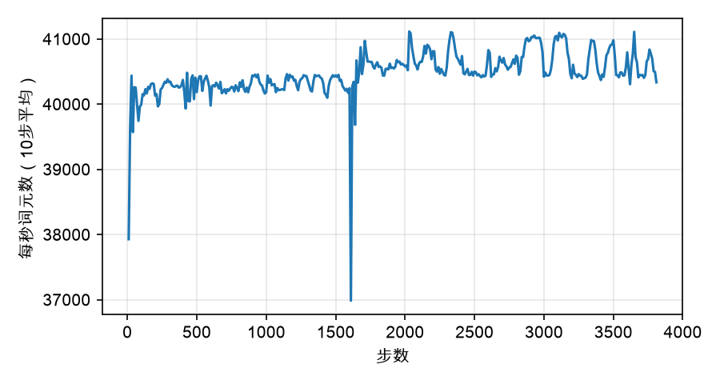
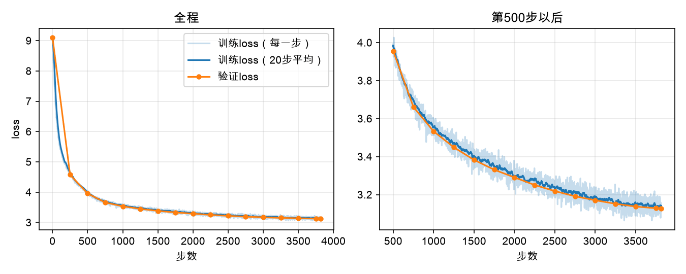
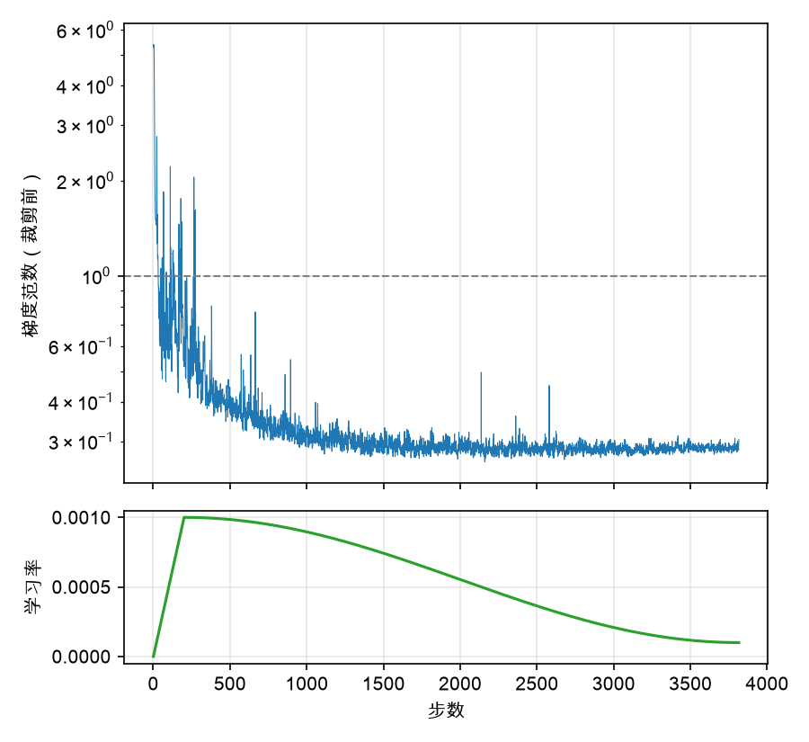

# 预训练（Pretraining）


上一章在Mac上训了300步，61万个词元，验证loss从9.10降到了6.13，模型学会了哪些词常见，但还说不出一句通顺的话。这一章把同一个训练循环搬到Colab的T4上，一口气训3,815步、5亿个词元，得到一个会续写英文的**基座模型**（Base Model）。它还不会对话，也不会回答问题，只会顺着开头往下写，但写出来的已经是像样的句子了。

训练循环本身，上一章已经写完了。这一章要处理的，是“跑大”带来的新问题。先算账：5亿个词元要算多少次浮点运算，T4要跑多久。再提速：T4的fp16比fp32快得多，但fp16的范围很窄，要用损失缩放把梯度保护起来。然后是Colab本身：免费版会断线，会话一结束，机器上的文件全部清空，断点续训必须真正做到断了接着训、和没断过一模一样。最后是看结果：训练时盯哪几条曲线，训完以后怎么评估，以及最重要的一步，把模型交给第一本的引擎，跑出第一句话。

这一章的代码在`code/book/ch06/`下面。`config.py`、`model.py`、`adamw.py`和`schedule.py`从第五章原样复制，`export.py`从第四章原样复制，一个字没改。`train.py`是本章的主角，在第五章的基础上加了混合精度、吞吐量、定期生成和完整的checkpoint；`bench.py`单独测吞吐量；`check_resume.py`比较两份训练日志，检查断了接着训是不是和没断过一样；`eval.py`评估训完的模型，和SmolLM2-135M比一比；`plot_log.py`把训练日志画成图；`colab.ipynb`是在Colab上运行这些脚本的笔记本。


## 计算预算

在Mac上训300步，几分钟就有结果，训坏了重来就是。搬到T4上就不一样了：一次完整训练要三个多小时，免费Colab的额度，一个账号还不够训完一次，训到一半才发现设置不对，代价就大了。所以按下运行之前，先把账算清楚。这笔账有三项：一共要做多少次浮点运算，由参数量和训练的词元数决定；词元数取多少合适，Chinchilla法则给了一个参考；这么多运算，T4要跑多久，取决于它的峰值算力，以及我们能用上其中的几成。三项都算出来，这次训练要花多少时间、多少额度，心里就有数了。


### 6ND

第一章给过一个估算训练计算量的公式：

$$
C \approx 6ND
$$

其中 $N$ 是参数量， $D$ 是训练的词元数。每个词元经过模型一次，每个参数在前向时做一次乘法和一次加法，反向的计算量大约是前向的两倍，加起来是6次浮点运算。这里的 $N$ 包括词嵌入矩阵：我们的输出层和词嵌入共用一个矩阵，输出层在每个位置都要拿隐藏向量去乘它，这部分计算实打实地发生了，第三章讨论词表大小时算过这笔账。

这个公式没有算注意力里 $\mathbf{Q}\mathbf{K}^\top$ 和乘 $\mathbf{V}$ 的那部分。那部分的计算量和参数无关，而和序列长度成正比：每个词元在每一层，要和前面的每个位置各做一次 $d$ 维的点积、再加权求和一次，因果掩码下平均只看前面一半，前向大约多出 $2Td$ 次运算。对我们的模型来说， $T=1024$ 、 $d=512$ 、8层，每个词元前向多出约840万次，相当于 $2N$ 的16%左右。序列越长，这部分越大；模型越大，它占的比例越小。下面的TFLOPS都是按 $6N$ 折算的，所以是略微低估的，这是大家通用的算法，前后比较时没有影响。

我们的训练，每一步用 $32 \times 1024 \times 4 = 131{,}072$ 个词元：每次前向32条序列，每条1024个词元，梯度累积4次再更新一次参数。3,815步一共是500,039,680个词元，于是：

$$
C \approx 6 \times 26{,}747{,}392 \times 500{,}039{,}680 \approx 8.0 \times 10^{16}
$$

第一章按5.3亿个词元估算的是 $8.6 \times 10^{16}$ ，这里取了个整，训5亿个词元。


### Chinchilla

为什么是5亿？第一章介绍过Chinchilla法则：计算量固定的前提下，训练的词元数大约取参数量的20倍最划算。26.7M参数的20倍是5.3亿，我们训的5亿是参数量的18.7倍，差不多就在这个点上。

“最划算”指的是训练本身：同样多的算力，按这个比例分给参数和数据，训完的loss最低。它不管训完以后用起来划不划算。今天的小模型大多远远超过这个比例，SmolLM2-135M训了大约2万亿个词元，是参数量的一万多倍。多训的那些数据，让一个小模型变得更好用，推理时也更省，代价是训练时花了几百倍的算力。我们只有一张免费的T4，就按Chinchilla的比例来。

还有一个问题：数据够不够。第三章把FineWeb-Edu的一个分片切成了9.09亿个词元，存在`train.bin`里。5亿个词元，是它的55%左右。`get_batch`是随机截取的，不是从头到尾按顺序读，所以并不是前55%的数据各看一遍、后45%没看。可以算一下：每个位置被截到的次数，大致服从平均值为0.55的泊松分布，没被截到的概率是 $e^{-0.55} \approx 58\%$ ，恰好截到一次的约32%，两次以上的约11%。也就是说，模型看到的绝大部分文本都是第一次见，这也是为什么下面训练loss和验证loss始终贴在一起。


### 本书的预算

有了计算量，就能估算时间。T4的fp16峰值算力是65 TFLOPS，也就是每秒65万亿次。如果能跑满，算完 $8.0 \times 10^{16}$ 次运算只要20分钟。

实际上远远跑不满。峰值只有在很大的矩阵乘法里才能接近，而我们的模型很小：隐藏维度只有512，一次矩阵乘法太小，喂不饱GPU；RMSNorm、softmax、SwiGLU里的逐元素运算，计算量小但要读写整个张量，速度受限于显存带宽而不是算力；优化器每一步还要把2,674万个参数和两倍大的状态读写一遍。第一章按每秒5到10万亿次估算，训完一遍要两到五个小时。

实测的结果是：稳定下来以后，每秒约40,500个词元，按 $6N$ 折算是6.5 TFLOPS，大约是峰值的10%。纯训练的时间一共12,355秒，3.43小时（不算验证、生成和存盘），正好落在估算的范围里。实际跑多快、慢在哪里，是下一节的话题。


## 跑得更快

上一节算出来，T4如果能跑满，20分钟就能训完；实际上我们只用上了峰值的十分之一，训了三个多小时。这个差距，有一部分是小模型的天性，怎么也省不掉，也有一部分是可以争取的。这一节先讲怎么量快慢：看吞吐量，每秒训多少个词元。再讲两个提速的办法。一个是混合精度，把矩阵乘法换成fp16，用上T4的Tensor Core，这是最大的一笔，本章的训练就靠它。另一个是`torch.compile`，把零碎的运算合并成大的GPU内核，本书只把它当作一个可以打开的开关。


### 吞吐量

训练快不快，看的是**吞吐量**（Throughput）：每秒能训多少个词元。它比“每一步多少秒”更好用，因为步子的大小可以变，换一个batch大小，每一步的时间就变了，而每秒多少个词元，可以直接拿来算训完要多久，也可以按 $6N$ 折算成每秒多少次浮点运算，和峰值比一比。

训练时，`train.py`每隔10步打印一次吞吐量，算的是这10步里训练了多少个词元，除以它们用掉的时间。时间只算训练本身：从取数据开始，到优化器更新完为止，用`time.perf_counter()`计时。验证、生成和存盘的时间都不算，它们和训练快不快无关。

在GPU上计时有一个坑。PyTorch往GPU上派发计算是异步的：Python这边的一行代码执行完，只是把任务交了出去，GPU上可能还没算完。这时读时间，测到的只是派任务的速度。要等GPU真的算完，得调用`torch.cuda.synchronize()`。`train.py`里没有显式地调用它，因为每一次前向之后都有一个`loss.item()`，要把loss从GPU拷回CPU，这一步必须等GPU算完，相当于每次都同步了一下。

吞吐量和batch大小、精度、要不要用`torch.compile`都有关系。在正式训练之前，`bench.py`把这些设置挨个测一遍。它不读数据，用随机的词元，每种设置先空跑3步热身，再计时10步，前后各同步一次。热身的时间也单独记下来，用`torch.compile`时，编译就发生在热身的第一步里：

```bash
python book/ch06/bench.py --compile
```

> TODO：插入T4上`bench.py`的输出表格（fp32、fp16、fp16加compile，B从8到64，每秒词元数、TFLOPS、显存）。第一次运行的输出没有保存下来，要重新跑一遍。根据表格说明为什么选B=32：显存放得下、每秒词元数不再明显上升的那一档。

正式训练时，吞吐量非常稳定，日志里每10步记一次，画出来是这样的：



整个训练，每一步131,072个词元，用时3.16到3.80秒，中位数是3.24秒。曲线上只有两处慢了一截：最开头的10步，每秒不到38,000个词元，那是GPU刚开始干活，CUDA要初始化、分配显存；第1,601到1,610步，掉到了每秒36,986个，原因和开头一样，这是额度用完、换了一个账号从第1,600步接着训，又从冷启动开始。第1,600步之前，每秒约40,300个词元，之后约40,600个，接着训分到的那台机器稍快一点。3,815步平均下来，每秒40,472个词元。


### 混合精度

先看三种浮点数。它们都由三部分组成：一位符号，几位指数，几位尾数。指数决定能表示的范围，尾数决定精度：

| 格式 | 符号 | 指数 | 尾数 | 最大值               | 最小的正规数          | 有效数字 |
| ---- | ---- | ---- | ---- | -------------------- | --------------------- | -------- |
| fp32 | 1    | 8    | 23   | $3.4 \times 10^{38}$ | $1.2 \times 10^{-38}$ | 约7位    |
| fp16 | 1    | 5    | 10   | 65504                | $6.1 \times 10^{-5}$  | 约3位    |
| bf16 | 1    | 8    | 7    | $3.4 \times 10^{38}$ | $1.2 \times 10^{-38}$ | 约2位    |

两种16位格式都比fp32省一半的内存和带宽，在支持它们的显卡上，矩阵乘法也快得多。T4的fp32峰值只有约8 TFLOPS，fp16用上Tensor Core，峰值是65 TFLOPS。

两种16位格式的取舍不一样。bf16把8位指数原样留下，范围和fp32一样大，牺牲的是精度；fp16的指数只有5位，精度比bf16高一点，范围却窄得多：最大只能表示65504，比 $6.1 \times 10^{-5}$ 更小的数，精度会越来越差，比 $6 \times 10^{-8}$ 还小，就直接变成0。训练用bf16省心得多，范围够大，基本不会溢出，可惜T4是2018年的图灵架构，硬件不支持bf16。我们只能用fp16。

**混合精度**（Mixed Precision）的意思是，不是所有的东西都换成16位。模型的参数、AdamW的 $\mathbf{m}$ 和 $\mathbf{v}$ ，一直是fp32；只有前向和反向里的计算，在合适的地方换成fp16。PyTorch的`torch.autocast`会自动做这件事：矩阵乘法这类运算，先把输入转成fp16再算；softmax、求平方和、交叉熵这类对精度和范围敏感的运算，留在fp32。第四章的RMSNorm先把输入转成fp32再求平方，就是为这一天准备的：一个512维向量，只要有一个数到了256，它的平方就是65536，在fp16里已经是无穷大了。

范围窄，会带来两个方向的问题。往大的方向，是**上溢**：数太大，变成无穷大。往小的方向，是**下溢**：数太小，变成0。训练时真正麻烦的是后者。梯度往往非常小，很多参数的梯度在 $10^{-6}$ 、 $10^{-8}$ 这个量级，存成fp16，有效数字所剩无几，甚至直接变成0，这些参数就不更新了。下面几行代码演示一下：

```python
import torch
g = torch.tensor([1e-3, 1e-5, 1e-7, 1e-8])
print(g.half())
print((g * 65536).half())
print((g * 65536).half().float() / 65536)
print(torch.tensor(256.0).half() ** 2)
```

四行分别是：直接存成fp16；先放大65536倍再存成fp16；放大、存成fp16以后，转回fp32再缩回来；以及256的平方：

```
tensor([1.0004e-03, 1.0014e-05, 1.1921e-07, 0.0000e+00], dtype=torch.float16)
tensor([6.5562e+01, 6.5527e-01, 6.5536e-03, 6.5517e-04], dtype=torch.float16)
tensor([1.0004e-03, 9.9987e-06, 1.0000e-07, 9.9972e-09])
tensor(inf, dtype=torch.float16)
```

直接存， $10^{-7}$ 变成了 $1.19 \times 10^{-7}$ ，差了两成； $10^{-8}$ 干脆变成了0。先放大65536倍，四个数都落在了fp16舒服的范围里，缩回来以后，误差都在万分之五以内。

这就是**损失缩放**（Loss Scaling）的思路：反向传播之前，先把loss乘上一个很大的数 $S$ 。梯度和loss成正比，于是反向传播里算出来的每一个梯度，也都放大了 $S$ 倍，不再下溢。算完以后，在优化器更新之前，再把梯度除以 $S$ ，缩回原来的大小。参数和梯度最后是用fp32存的，缩回来不会有问题。

$S$ 取多大？太小，护不住小梯度；太大，大梯度又会上溢成无穷大。PyTorch的`GradScaler`用了一个动态的办法：从 $2^{16}=65536$ 开始；每一步检查一下梯度里有没有无穷大或NaN，有，说明 $S$ 太大了，这一步不更新参数，直接跳过，把 $S$ 减半；连续2000步都没有溢出，说明还有余地，把 $S$ 翻一倍。这样 $S$ 会自己停在“刚好不溢出”的附近。跳过的那一步不会造成什么损失，它的梯度本来就是坏的。

用上`GradScaler`，训练循环里第五章的反向、裁剪、更新三步，变成了这样：

```python
            scaler.scale(loss / args.accum).backward()
            loss_sum += loss.item()
        loss = loss_sum / args.accum

        # 4. 裁剪之前，先把梯度缩回原来的大小。梯度里有inf或nan时，
        # 算出来的范数也是inf或nan，这一步会被scaler跳过。
        scaler.unscale_(opt)
        max_norm = args.clip if args.clip > 0 else math.inf
        norm = clip_grad_norm_(model.parameters(), max_norm).item()

        # 5. 更新参数。梯度溢出了，scaler就跳过这一步，并把放大倍数减半；
        # 连续2000步没溢出，再翻一倍。
        scale = scaler.get_scale()
        scaler.step(opt)
        scaler.update()
        skip = scaler.get_scale() < scale
        skipped += skip
```

其中，`scaler.scale`把loss乘上 $S$ 再反向。`scaler.unscale_`把梯度除以 $S$ ，顺便检查有没有溢出，它必须放在梯度裁剪之前：裁剪的上限1.0，说的是梯度原本的大小，用放大了65536倍的梯度去和它比，每一步都会被裁得面目全非。`scaler.step`在没有溢出时调用优化器，有溢出时什么都不做；`scaler.update`调整 $S$ 。这一步有没有被跳过，`GradScaler`没有直接告诉我们，所以比较一下更新前后的 $S$ ：变小了，就是溢出了。

在Mac上用fp32训练时，`GradScaler`建的时候传了`enabled=False`，上面这几个调用都原样放行，`scale`不放大，`step`就是`opt.step()`。同一份代码，两种精度都能跑。

我们的模型，整个训练过程中有没有溢出过？日志里每一步都记了放大倍数：前2,000步是65536，从第2,001步起是131072，也就是 $2^{17}$ ，之后再没变过，也没有一步被跳过。连续2,000步没有溢出，倍数翻了一倍；后面的1,815步还不够下一个2,000步，所以没有再翻。整整3,815步，梯度一次都没有溢出。这主要归功于第四章的几个选择：RMSNorm在fp32里算，残差分支的初始化缩小了，梯度裁剪又挡住了偶尔的大梯度。


### `torch.compile`

默认情况下，PyTorch是一个运算一个运算地执行：算一次矩阵乘法，结果写回显存；再读出来做一次逐元素运算，结果再写回去。对我们这样的小模型，很多时间花在了这些来回读写和Python的调度上，而不是计算本身。`torch.compile`会先把整个模型的计算追踪一遍，把能合并的运算合成一个GPU内核，一次读进来，算完几步再写回去，省掉中间的读写。

它的用法很简单，`train.py`里只有一行：给了`--compile`，就用`torch.compile(model)`包一层，训练时调用包过的那个，存盘和生成仍然用原来的模型，两者共用同一份参数。

坑也有几个。第一，它要PyTorch 2.x的新版本，作者那台Intel Mac只能装2.2，所以只能在Colab上用。第二，第一次调用要花几十秒甚至几分钟编译，Colab每次断线重连都要重新编译一遍。第三，输入的形状一变，它就要重新编译，好在训练时的形状是固定的。第四，出了错，报错信息往往很长、很难读。所以本书的代码默认不用它，只把它当作一个可以打开的开关。

> TODO：补上T4上`bench.py`里有无compile的对比，说明能快多少，以及第一次编译用了多久。本章的完整训练没有用compile。


## 在Colab上跑

在Mac上训练，机器是自己的，训多久、文件放哪儿，都不用操心。Colab的机器是借来的：会话有时长上限，空闲久了会断，免费的额度用完了也会断；会话一结束，机器就被收回，上面的文件一个不留。所以这一节要解决两件事。一是东西放在哪儿：数据、checkpoint和日志，哪些放Drive，哪些放Colab本地的磁盘。二是断了以后怎么办：接着训，并且和没断过的那一次一模一样。本章的完整训练就断过一次，靠的正是这一节的做法接上的。


### 数据和checkpoint放Drive

会话一结束，Colab机器上的文件全部清空，所以凡是要留下来的东西，都得放在Google Drive上。

笔记本`colab.ipynb`只做几件杂事，真正的训练都在`train.py`里，和在Mac上用`uv run`跑的是同一份脚本。用之前，先把第三章生成的三个文件传到Drive的`toyllm2/data/`下面：`train.bin`、`val.bin`和`tokenizer.json`，一共约1.8GB。然后在Colab里把运行时类型选成T4，“全部运行”。笔记本依次做这几件事：

* **检查环境**：打印GPU的型号和显存、torch和CUDA的版本，确认分到了GPU。
* **挂载Drive**：`drive.mount("/content/drive")`之后，Drive就像一个普通的目录。
* **拉代码**：从GitHub上的公开仓库稀疏克隆，只取`book/ch06/`这一个目录。仓库里有好几本书，没必要全部下载。
* **复制数据**：把三个数据文件从Drive复制到Colab本地的`/content/data/`。训练时要从`train.bin`里随机截取，每一步截128段，本地磁盘比挂载的Drive快得多。
* **训练**：调用`train.py`，数据从本地读，训练记录写到Drive的`toyllm2/runs/pretrain/`下面。

所以数据放了两份：Drive上的那份是长期保存的，本地的那份是训练时用的，每次会话开始都重新复制一遍。训练记录则直接写在Drive上，会话断了也不丢。Colab自带了PyTorch、numpy、safetensors和tokenizers，我们的脚本只用到这几个库，不需要另外安装。


### 断了接着训

免费版的Colab一定会断线。第五章已经有了checkpoint，断了以后，接着训的loss能顺着原来的曲线往下走；但它也说了，那还不是完整的断点续训。这一节把它补齐，目标是：断了接着训，和没断过的那一次，loss逐位相同。

要做到逐位相同，接着训的时候，所有影响计算结果的状态都要和没断时一模一样。第五章存了参数、优化器状态和步数，这一章再补上几样：

* **`GradScaler`的状态**：当前的放大倍数，以及连续多少步没溢出。不存的话，接着训时放大倍数又从65536开始。
* **取数据的随机数状态**：`get_batch`用一个单独的`torch.Generator`决定截取的位置。存下它，接着训时截到的就是同样的文本。
* **全局的随机数状态**：CPU和GPU各一份，模型里用到随机数的地方都靠它们。
* **已经用掉的时间**：吞吐量和总用时要接着算。
* **到这一步为止的全部日志**：这一样的来历，下面会讲。
* **命令行参数**：接着训时，如果batch大小、学习率这些影响训练结果的参数和原来不一样，打印一句提醒。

存的代码是这样的：

```python
def save_checkpoint(path, model, opt, scaler, gen, step, elapsed, records,
                    args):
    """接着训需要的全部东西。先写到临时文件，写完再改名：
    写到一半会话断了，原来那个checkpoint还是好的。

    日志也存在里面。log.jsonl是一直在改的文件，在Colab挂载的Drive上，
    会话一断，它不一定保得住；checkpoint保住了，到这一步为止的日志就在。"""
    ckpt = {
        "model": model.state_dict(),
        "optimizer": opt.state_dict(),
        "scaler": scaler.state_dict(),
        "step": step,
        "elapsed": elapsed,
        "data_rng": gen.get_state(),
        "cpu_rng": torch.get_rng_state(),
        "log": records,
        # 路径存成字符串：checkpoint里只放基本类型，新版torch默认的
        # weights_only=True也能读。
        "args": {k: str(v) if isinstance(v, Path) else v
                 for k, v in vars(args).items()},
    }
    if torch.cuda.is_available():
        ckpt["cuda_rng"] = torch.cuda.get_rng_state_all()
    tmp = path.with_suffix(".tmp")
    torch.save(ckpt, tmp)
    os.replace(tmp, path)
```

最后三行值得说一下。checkpoint有321MB，写一次要几秒钟，如果正好在写的时候断了，文件只写了一半，原来那个好的checkpoint也被覆盖了，就什么都没了。所以先写到一个临时文件里，写完了，再用`os.replace`改名，盖掉原来的文件。改名是一步完成的，要么还是旧的，要么已经是新的，不会出现写了一半的checkpoint。

我们每200步存一次checkpoint。断线发生在两次存盘之间，最后一次存盘之后训的那些步就白训了，接着训时从checkpoint那一步重新训。因为随机数状态也恢复了，重新训的这些步，和断线之前训的那些步完全一样，只是多花了一点时间。200步大约11分钟，最多损失这么多。

日志为什么也要存进checkpoint？这是第一次完整训练时踩的坑。最初的写法和第五章一样：训练开始时用追加模式打开`log.jsonl`，每一步往后写一行，一直不关；接着训时，先把日志里比checkpoint新的那些行删掉，再接着往后写。在Mac上，这个写法没有任何问题。可是在Colab上训完以后，Drive上的`log.jsonl`只剩下最后一次会话的600多步，前面三千多步全没了，而每次断线前存的`ckpt.pt`一个都没丢。

原因在Drive的同步方式。Colab挂载的Drive，写进去的文件要先缓存在本地，再上传到云端，而一个一直开着、不停追加的文件，往往要等它关闭了才会上传。会话一断，机器被回收，这个从没关闭过的文件就没能传上去。下一次会话找不到它，就从一个空文件开始往后写。只有最后一次会话训完了、正常退出、文件关闭了，它那一段才上传成功。`ckpt.pt`没有这个问题，它每次都是写完一个临时文件、关闭、再改名。

修改的办法有两处。第一，日志先记在内存里，存checkpoint时连同日志一起存，接着训时从checkpoint里取出来，不再依赖`log.jsonl`。第二，`log.jsonl`每10步整个重写一遍，也是先写临时文件再改名，这样它每次都是一个关闭了的完整文件，Drive会及时上传，训练时随时可以打开看进度：

```python
def write_log(path, records):
    """把日志整个重写一遍。和checkpoint一样，先写临时文件再改名，
    读到的log.jsonl总是完整的。"""
    tmp = path.with_suffix(".tmp")
    tmp.write_text("".join(json.dumps(r, ensure_ascii=False) + "\n"
                           for r in records))
    os.replace(tmp, path)
```

现在`log.jsonl`就算丢了也没关系，下一次接着训时，它会从checkpoint里的日志重新生成。修好以后，整个训练从头重训了一遍，本章的数字、曲线和例句都来自重训的这一次。

接着训对不对，可以在Mac的CPU上验证。用很小的配置训60步，每20步存一次checkpoint，先不间断地训一遍；再训一遍，第30步时用`--kill-at`模拟断线，直接退出、不存盘，并且把`log.jsonl`删掉，模拟Drive没保住它；接着训，第50步再断一次、再删一次；最后接着训完。然后用`check_resume.py`逐步比较两份日志：

```bash
S=(--device cpu --batch 4 --seq 128 --accum 2 --steps 60 --warmup 6
   --eval-every 20 --eval-batches 4 --sample-every 30 --ckpt-every 20)
uv run python book/ch06/train.py --name ch06-full "${S[@]}"
uv run python book/ch06/train.py --name ch06-cut "${S[@]}" --kill-at 30
rm runs/ch06-cut/log.jsonl
uv run python book/ch06/train.py --name ch06-cut "${S[@]}" --resume --kill-at 50
rm runs/ch06-cut/log.jsonl
uv run python book/ch06/train.py --name ch06-cut "${S[@]}" --resume
uv run python book/ch06/check_resume.py ch06-full ch06-cut
```

两次接着训，开头分别打印“从第20步接着训，之前已经训了0.4分钟”和“从第40步接着训，之前已经训了0.8分钟”：第30步和第50步断开时，最近的checkpoint分别在第20步和第40步。最后的比较结果是：

```
共61步
  训练loss    完全相同
  梯度范数    完全相同
  验证loss    完全相同
  生成样例    完全相同
```

一共61行，是第0步的验证loss，加上60步训练。断了两次，日志也删了两次，训练loss、梯度范数、验证loss、生成的句子，每一步都和没断过的那一次逐位相同。

在GPU上就做不到逐位相同了。GPU上有些运算的累加顺序是不固定的，比如词嵌入的反向，同一个词元在一个batch里出现很多次，它那一行的梯度要把这些位置的梯度加起来，几千个线程同时往一个地方加，谁先谁后每次都不一样。浮点数的加法不满足结合律，顺序不同，最后几位就不同。所以在T4上，即使不断线，同样的代码跑两遍，loss也只能做到非常接近，不能逐位相同。断了接着训，也是这个程度。

本章的完整训练断过一次，原因不是网络，而是额度。免费版的Colab除了会话时长，还有一个用量限额，GPU用到一定程度，就会提示“已达到Colab的使用量限额”，会话被断开，要等大约24小时才能再分到GPU。我们的训练要3个多小时，一个账号的额度，在作者这里只够训一个半小时左右。第一次会话训到第1,630步，额度用完了，最近的checkpoint在第1,600步，后面的30步白训了。剩下的路有两条：等24小时，或者换一个Google账号接着训。作者选了后者，几个小时以后，用另一个账号打开同一个Drive目录，从第1,600步接着训，一直训完。checkpoint里的东西和账号无关，换了账号、换了机器，照样能接上。前面吞吐量那张图上，第1,601步附近的那个缺口，就是接着训时的冷启动。

作者没有一直盯着，具体的时间是事后从Drive上`log.jsonl`的版本记录里查出来的：它每隔两三分钟就上传一个新版本。第一次会话，第一个版本在下午3点56分，最后一个在5点24分，一个半小时，和日志里第1,630步时记下的纯训练时间5,307秒，也就是88分钟，几乎一样。第二次会话，晚上10点58分开始，凌晨0点58分结束，正好两个小时，日志里这一段的纯训练时间是119分钟。两次会话加起来约3.5小时，和纯训练时间只差几分钟，验证、生成和存盘的开销都很小。

断线之前，日志里第1,630步的那一行已经显示过一次，正好可以和接着训以后重训的第1,630步比一比：

| 第1,630步  | 训练loss           | 梯度范数            | 学习率                |
| ---------- | ------------------ | ------------------- | --------------------- |
| 断线之前   | 3.3558252453804016 | 0.2757963538169861  | 0.0006953650404983639 |
| 接着训以后 | 3.3558257818222046 | 0.27579715847969055 | 0.0006953650404983639 |

学习率是按步数算出来的，逐位相同；loss和梯度范数从第7位有效数字起就不一样了，相对误差在百万分之几。这就是上面说的GPU上的累加顺序：同样的数据、同样的参数，重训30步，最后几位已经对不上，但差别小到在曲线上完全看不出来。除了吞吐量的那个缺口，loss、梯度范数和验证loss的曲线，在那里都是连续的。


## 训练时看什么

训练要跑三个多小时，不可能盯着每一步看，也不需要。`train.py`把每一步的情况都记进了日志，训练中途随时可以打开看进度，训完以后用`plot_log.py`画成图，从头到尾看一遍。要看的东西有三样：loss曲线，看训练是不是在正常地往下走；梯度范数和学习率，看每一步的更新是不是稳当；定期生成的句子，看模型实际学会了什么。前两样是数字，能告诉我们训练好不好；第三样是文字，能告诉我们模型变成了什么样子。下面的图和例句，都来自本章的完整训练。


### loss曲线

最先要看的是loss曲线，它正常的样子，第五章已经见过了：开头降得飞快，之后越来越慢，训练loss抖得厉害，滑动平均是一条平滑下降的曲线，验证loss和它贴在一起。

我们这一次的loss曲线如下。左边是全程，右边从第500步开始，把纵轴放大：



验证loss每250步算一次。第0步是9.10，和随机猜的 $\ln 8192 \approx 9.01$ 差不多；第250步降到4.58，warmup刚结束，loss已经降掉了一半；第500步3.96，第1,000步3.53，第2,000步3.29，第3,000步3.17，最后停在3.127。越往后降得越少：头500步降了5.1，接下来的500步降了0.43，再往后的1,000步降了0.24，又1,000步降了0.12，最后的815步只降了0.04。到了最后，学习率已经降到了最大值的十分之一，曲线已经很平了。

训练loss每一步都在抖，第3,000步以后在3.06到3.25之间，20步的平均和验证loss一路贴在一起，相差不过百分之一二，没有过拟合的迹象：前面算过，模型看到的文本绝大部分都是第一次见，对它来说，训练集和验证集一样，都是没见过的新文本。

训练出问题的时候，loss曲线会是另外几种样子：

* **尖峰**：loss突然往上跳一下，几步之后又回来。通常是碰上了一批特别的数据，或者一步更新迈得太大。偶尔出现一两个不要紧，第五章的梯度裁剪就是为它准备的。如果尖峰越来越频繁、越来越高，往往是学习率太大了。
* **平台**：loss很长一段时间不降。训练刚开始时，从“只会猜常见词”到“开始利用上下文”，中间常有一段平台，第五章过拟合一个batch时就见过；训练中途出现平台，可能是学习率太小，也可能是数据出了问题，比如反复读到同一段。
* **发散**：loss一路往上涨，最后变成无穷大或NaN，再也回不来。这时继续训练没有意义，`train.py`检测到loss不是有限的数，就直接停下。用fp16训练时，还要先排除损失缩放的问题：`GradScaler`偶尔跳过几步是正常的，但如果放大倍数一路减半到了很小，就说明前向里已经有数溢出了，不只是梯度的问题。

我们的训练，这几种问题一个都没有出现。


### 梯度范数和学习率

除了loss，日志里每一步还记了两样东西：裁剪之前的梯度范数，和这一步的学习率。

学习率是按调度算出来的，本来不需要看，但画出来对一下，能确认调度没有写错：前200步从0线性升到 $10^{-3}$ ，之后沿余弦曲线降到 $10^{-4}$ ，最后一步正好是 $10^{-4}$ 。第五章在Mac上扫出来的最好的学习率是 $10^{-3}$ ，这一章的batch大了64倍，按理说最合适的学习率也会更大一些，笔记本里留了扫描学习率的开关，完整训练直接用了 $10^{-3}$ 。

梯度范数要和loss一起看。正常的训练里，它开头比较大，很快降下来，之后在一个范围里慢慢变化；它突然变大，往往就是loss尖峰的前兆。下面上图是梯度范数（对数坐标，虚线是裁剪的上限1.0），下图是学习率：



头几步，梯度范数在5左右，随后很快降到1以下。warmup期间，学习率一路往上升，梯度范数时不时冲过1.0，这样的步一共有66步，全在前274步里，梯度裁剪就是在这时起作用的。过了第1,000步，它稳定在0.27到0.40之间，最后的100多步在0.27到0.31之间，远低于裁剪的上限，后期梯度裁剪基本没有起作用。中间第2,137步和第2,580步各有一个孤立的尖峰，冲到0.5和0.45，loss却没有跟着跳，下一步就回去了。第五章在Mac上的梯度范数在0.9左右，这一章小得多，原因之一是batch大了64倍，每一步的梯度是更多数据的平均，噪声小了，范数也就小了。


### 定期生成

光看loss是不够的。它只是一个数，降了多少，模型能写出什么样的句子，从数字上很难想象。所以`train.py`每隔500步，用三句固定的开头各续写40个词元，存进日志：

* Once upon a time
* The capital of France is
* Photosynthesis is the process

生成用的种子是固定的，每次都一样，不同阶段的样例才好比。但生成要用随机数，如果直接用全局的随机数，就会改变训练本身的随机数序列，生成与不生成，训练结果就不一样了。所以`sample`函数用`torch.random.fork_rng`分叉出一个临时的随机数状态，在里面生成，用完还原，训练完全不受影响。前面验证断了接着训时，“生成样例”这一项也逐位相同，这一点也一并验证了。

第3,815步，也就是训练结束时，三句话续写出来是这样的（折行是为了排版加的）：

```
'Once upon a time, a new group of young men, who are likely to have trouble
eating the fruits of the food, are at a higher risk of developing obesity and
diabetes.\nThere are many things, but the'
"The capital of France is\nin the southwestern corner of France.\nRussia is
home to four European countries\nand the largest parts of the Russian
province\nand about 5% of the world's population"
'Photosynthesis is the process of photosynthesis.\nThe Philosophy of Biology is
one of the main themes of natural science. Biochemist, the physicist and the
biologist, used the'
```

和第五章300步时那句“Once upon a time of the same year of the most of the result.”比，进步是明显的：每一句都是完整的、合乎语法的英文句子，主语、谓语、宾语都在。“Once upon a time”后面，写的是年轻人吃什么、肥胖和糖尿病的风险；说到光合作用，接着就是生物学、自然科学、生物化学家，这正是FineWeb-Edu这种教育网页的样子。但内容是错的、空的，法国的首都“在法国的西南角”，接着又扯到俄罗斯。语法学会了，知识还没有。

同一句开头，在不同的阶段续写成什么样，能看出模型先学会什么、后学会什么。下表是“The capital of France is”在各个阶段续写出的第一句：

| 步数  | 续写                                                         |
| ----- | ------------------------------------------------------------ |
| 500   | the largest expendent in the world, and of the modern history, the U.S. government has already received \$1.3. |
| 1,000 | the largest and important component of the world.            |
| 1,500 | the largest port of power in the world - the largest private investor. |
| 2,000 | the largest of the EUs.                                      |
| 2,500 | in the southwestern corner of the United States.             |
| 3,000 | known to have been a very small town in the northeastern part of France, which is named after the French who ruled it. |
| 3,815 | in the southwestern corner of France.                        |

第500步，句子已经大体通顺，还造出了一个不存在的词“expendent”，内容和法国毫无关系，只是“capital”这个词常和“世界最大”“政府”“美元”一起出现。第1,000步到1,500步，句子更短更干净，但说的还是“世界上最大的什么”。到了第2,000步，第一次出现了和法国沾边的东西：欧盟。第2,500步以后，它开始说地理位置，“西南角”“东北部”，第3,000步还说出了“法国的东北部”。它始终没说出巴黎，但能看出顺序：先学会词怎么拼、句子怎么连，再学会紧扣话题，最后才慢慢沾上一点事实。

还有一个细节：第3,000步和第3,500步，这句的续写一字不差，因为生成用的随机数种子是固定的，而这500步里模型变化很小，每一步挑出的词都没变。学习率降下来以后，模型就是这样一点一点地收尾的。


## 评估

训完了，模型到底有多好？这个问题比看上去难回答。验证loss是现成的，但它只能和自己比，换一个分词器，同样的数就不是一个意思了。所以这一节分三步走。先看验证loss和困惑度，再换算成每字节比特数，和SmolLM2-135M放在同一把尺子上比一比。然后自己出几道探针题，看模型具体会什么、不会什么。最后说一说大模型论文里常见的基准测试，以及为什么它们对我们这么小的模型几乎没有用。


### 验证集loss和困惑度

最基本的指标是验证集上的loss。`train.py`每250步算一次，用的是`val.bin`开头固定的20批数据，每批 $32 \times 1024$ 个词元，一共65万多个词元。训练结束时，验证loss是3.127。

第五章说过，把loss取指数，就是**困惑度**（Perplexity），它大约表示模型平均在几个候选里犹豫。 $e^{3.127} \approx 22.8$ ，模型在二十几个候选里犹豫。随机初始化时，这个数在8192上下，第五章300步之后是460左右，现在是23。

能不能拿它和SmolLM2比？第五章提醒过，不能直接比：loss是每个词元的平均，而两个模型的分词器不一样，一个词元的长短不同。要比，得换成按字节算，叫**每字节比特数**（Bits Per Byte）：把一段文本上所有词元的loss加起来，换算成以2为底，再除以这段文本的字节数：

$$
\mathrm{bpb} = \frac{N_{\mathrm{tok}} \cdot \mathcal{L}}{N_{\mathrm{byte}} \cdot \ln 2}
$$

其中 $N_{\mathrm{tok}}$ 是词元数， $\mathcal{L}$ 是每个词元的平均loss， $N_{\mathrm{byte}}$ 是文本的UTF-8字节数，除以 $\ln 2$ 是把自然对数换成以2为底。分母只和文本有关，和分词器无关，两个模型就在同一把尺子上了。它的意思也很直观：平均每个字节，模型要用几个比特来编码。

脚本`eval.py`做的就是这件事。它从`val.bin`里按结束符切出文档，取前100篇不超过1023个词元的，还原成文字，两个模型各用各的分词器，每篇前面加一个起始符，从第一个词元起就开始猜。参考的SmolLM2-135M是第四章用`download_model.sh`下载的那一份，用`transformers`加载；`transformers`只在这个检查脚本里用，训练的代码不用它。在Mac的CPU上运行，两分钟左右：

```bash
uv run python book/ch06/eval.py
```

输出的前半段是这样的：

```
和transformers核对：logits最大相对误差 0.0e+00

验证集前100篇文档，共199,605个字节

模型            词元数  每词元loss  困惑度  每词元字节  每字节比特
我们的模型      51,419       3.139    23.1        3.88       1.167
SmolLM2-135M    43,182       2.769    15.9        4.62       0.864
```

第一行是一个顺手的检查：用`transformers`加载我们导出的目录，同一句话算出的logits和我们自己的`model.py`完全相同，后面“用第一本的引擎跑”一节会用到它。

同样的文本，SmolLM2的词表大，切出来的词元少了16%，每个词元平均4.62个字节；它每个词元的loss是2.769，按字节算是0.864比特。我们的模型每个词元的loss是3.139，和训练时的验证loss差不多，按字节算是1.167比特，多了35%。SmolLM2的参数是我们的5倍，训练的词元是我们的4,000倍，这个差距并不意外。要注意的是，SmolLM2的训练数据里也有FineWeb-Edu，这100篇文档它可能见过，对它略有利。


### 探针问题

验证loss说明模型整体上预测得有多准，但说不清它到底“知道”些什么。一个简单的办法，是自己出几道题：写一句话的开头，答案就是下一个词，看模型能不能接对。这叫**探针**（Probe）。`eval.py`的后半段出了10道题，两个模型都用贪婪解码，续写12个词元。下面的表里只摘了每个回答的第一句：

| 开头                                         | 我们的模型                          | SmolLM2-135M                        |
| -------------------------------------------- | ----------------------------------- | ----------------------------------- |
| The capital of France is                     | the capital of the world.           | the capital of the country.         |
| Water is made of hydrogen and                | oxygen.                             | oxygen.                             |
| The largest planet in the solar system is    | the Sun.                            | Jupiter.                            |
| The chemical symbol for gold is              | the gold.                           | Au.                                 |
| The opposite of hot is                       | the same as the hot is hot.         | cold.                               |
| Monday, Tuesday, Wednesday,                  | Wednesday, Wednesday, Wed           | Thursday, Friday, Saturday, Sunday  |
| 1, 2, 3, 4, 5,                               | 6, 7, 8, 9,                         | 6, 7, 8, 9,                         |
| 2 + 3 =                                      | 10000000000                         | 10                                  |
| The first president of the United States was | to be elected to the United States. | John Adams, who was elected in 1796 |
| A cat is an animal that                      | is not a human.                     | is not a mammal.                    |

我们的模型答对了两道：氢和氧，数数。这两道有一个共同点，答案就在上文的统计规律里：“hydrogen and”后面跟“oxygen”的搭配在教育文本里太常见了，数数则只要接着往下数。可同样是接着往下数，星期几它就接不上了，只会把Wednesday一遍遍重复下去：一串数字在文本里随处可见，把星期几挨个列出来的文字要少得多。需要真正记住一个事实的题，比如木星、金的化学符号，它都答错了，但答错的方式很有意思：最大的行星，它说是太阳，至少是太阳系里的一个大天体；金的化学符号，它说是“the gold”。它知道该接一个名词，也知道这个名词和前面的话题有关，但不知道正确的那个是什么。

再看SmolLM2，它答对了6道，但也不是全对：法国的首都，它绕开了；美国第一任总统，它说是约翰·亚当斯；2加3，它说是10；猫，它说不是哺乳动物。一个135M的模型，训了2万亿个词元，常识题仍然时对时错。基座模型只是在续写，它接出来的是“这里最可能出现什么”，不是“正确答案是什么”。

> TODO：可以考虑把`eval.py`的题目扩充到几十道，按类别（常识、语法、计数）统计正确率。


### 基准测试

大模型的论文里，总会列一张基准测试的表：MMLU、HellaSwag、ARC，中文的有C-Eval，每一项一个分数。我们的模型要不要也测一测？

这些测试大多是选择题，四个选项选一个，闭着眼睛猜也有25%。几千万参数的模型，在这些测试上的分数，几乎都贴着这条随机线，差别只在一两个百分点上，而一两个百分点，换一下提示词的格式、选项的顺序，就能变出来。所以这些测试，对我们的模型给不出有用的信息：它不会告诉你模型好在哪里、差在哪里，只会告诉你它“和随机差不多”。C-Eval这类中文测试就更不用说了，我们的模型只见过英文。

这并不是说小模型没法测。前面的每字节比特数，就是一个对小模型很灵敏的指标：差0.01，就是实打实的差别。探针问题虽然粗糙，但能看出模型具体会什么、不会什么。第九章用强化学习训练做加法时，加法的正确率本身也是一个我们自己设计的测试。

> TODO：TODO.md里有一个未定的问题：要不要单独一章讲评估（在同一个测试上比较我们的模型、SmolLM2-135M和Qwen3-0.6B，看分数随规模怎么变；或者挑一个对小模型有区分度的测试，看预训练过程中分数怎么一点点离开随机线）。定下来以后，这一节相应地压缩或展开。


## 用第一本的引擎跑

训练结束时，`train.py`带着`--export`，会把模型存成第四章写好的格式：`toyllm2/runs/pretrain/model/`下面四个文件，`config.json`、`generation_config.json`、`model.safetensors`和`tokenizer.json`，和SmolLM2的目录长得一样。权重是fp32，107MB。

这个目录就是两本书之间唯一的接口。把它从Drive上下载下来，复制到第一本的`code/models/toyllm2/`，第一本的引擎一行代码都不用改，用第十三章的`--model`参数指定目录名就能跑：

```bash
cd toyllm_book1/code
uv run python book/ch13/engine.py "Once upon a time" --model toyllm2 \
    --max-new-tokens 40
```

引擎先打印输入的词元和采样器的设置，然后一个词元一个词元地往外吐，最后报告用时。中间生成的那一段是这样的（折行是为了排版加的）：

```
Once upon a time, the first thing that we can do is to make sure that we are
not going to be able to do so.
The first thing that we can do is to make sure that we are not

40个新词元，到了上限停下，用时0.7秒，每个0.018秒
```

这是我们自己训练的模型，跑在自己写的引擎上，说出的第一句话。第一本的引擎是为SmolLM2写的，词表49152、30层、576维，现在换成词表8192、8层、512维，它照样读`config.json`建模型、读`tokenizer.json`分词，一切都对上了。能跑还不等于算得对。不过这一点已经有了保证：`eval.py`的第一行说明，`transformers`加载这个目录，算出的logits和我们的`model.py`完全相同；而第一本的引擎，每一章都和`transformers`核对过。两边对上的是同一个参照，算的就是同一个模型。

第一本讲过，贪婪解码容易原地打转，这里看得很清楚：第一句话说完，第二句又从“The first thing that we can do”原样说了一遍。换成第一本第十章的采样，温度0.8，只在前50个候选里抽：

```bash
uv run python book/ch13/engine.py "Once upon a time" --model toyllm2 \
    --max-new-tokens 50 --temperature 0.8 --top-k 50 --seed 0
```

这次就不再重复了：

```
Once upon a time, it is essential to make sure the brain has enough energy to
function properly.
What are the benefits of a simple brain-boosting treatment?
The benefits of a single brain-boosting treatment at home from a single brain-
```

从“Once upon a time”这样一个讲故事的开头，它写出来的却像一篇讲怎么保养大脑的科普文，还自问自答起来。这不奇怪：FineWeb-Edu是按教育价值挑出来的网页，里面很少有童话故事，模型只是在写它见过最多的那种文字。每个词元不到0.02秒，在笔记本电脑的CPU上，比SmolLM2快得多，模型小了五倍。


## 代码实现

和第五章的版本相比，`train.py`循环的骨架没有变：算学习率，取数据，前向，反向，裁剪，更新。变的是下面几处。

**优化器**换成了`torch.optim.AdamW`。第五章已经核对过，我们手写的AdamW和它逐位相同，现在换回torch自带的，是因为它在CUDA上有一个`fused=True`的实现，把所有参数的更新合成一个GPU内核，快一些。参数分组仍然用`adamw.py`里的`param_groups`：矩阵做权重衰减，RMSNorm的权重不做。

**混合精度**是三样东西：前向套在`torch.autocast`里，反向之前用`GradScaler`放大loss，裁剪之前缩回来。在Mac上默认用fp32，这三样都关掉，代码不用改。

**吞吐量**：每一步用`time.perf_counter()`计时，累加到一个窗口里，每10步算一次每秒多少个词元，再乘以 $6N$ 折算成TFLOPS，记进日志。

**验证和生成**：每250步在验证集的前20批上算一次loss，每500步续写三句固定的开头，训练结束时都再做一次。

**checkpoint**：每200步存一次，内容和写法在“断了接着训”一节已经讲过。给了`--resume`，有checkpoint就接着训，没有就从头开始，所以在Colab上每次都带着它，第一次运行和断线后重连，用的是同一条命令。还有一个`--kill-at`参数，训到指定的步数直接退出、不存盘，专门用来模拟断线。

**日志**先记在内存里，每10步整个重写一遍`log.jsonl`，存checkpoint时也存一份。每一步一行JSON，记下步数、loss、学习率、梯度范数、用掉的时间，fp16时还有`GradScaler`的放大倍数；每10步多一个吞吐量，在GPU上还有到当时为止的显存峰值，每250步多一个验证loss，每500步多三句生成的样例。

**位置**都可以从命令行指定：`--data`是数据目录，`--runs`是训练记录的目录。在Mac上用默认值，在Colab上分别指向本地的`/content/data`和Drive上的`toyllm2/runs`。训练结束时，`--export`把模型存成第一本能读的目录。

所有的默认值，就是在T4上的完整预训练：每步 $32 \times 1024 \times 4$ 个词元，3,815步，最大学习率 $10^{-3}$ ，warmup 200步，cosine降到 $10^{-4}$ ，权重衰减0.1，梯度裁剪1.0，CUDA上用fp16。所以在Colab上，什么参数都不用加：

```bash
python book/ch06/train.py --name pretrain --data /content/data \
    --runs /content/drive/MyDrive/toyllm2/runs --resume --export
```

在Mac上想试一试，就把batch和步数改小，用CPU或MPS跑几十步，几分钟就能看到完整的流程，验证、生成、存盘、接着训都会走一遍。


## 代码效果

完整训练的结果汇总如下：

| 项目                 | 数值                                  |
| -------------------- | ------------------------------------- |
| 步数                 | 3,815                                 |
| 每步词元数           | $32 \times 1024 \times 4 = 131{,}072$ |
| 训练词元数           | 500,039,680                           |
| 计算量（按 $6ND$ ）  | $8.0 \times 10^{16}$                  |
| 纯训练时间           | 12,355秒，3.43小时                    |
| Colab上的墙钟时间    | 两次会话，约1.5小时加2小时            |
| 稳定时的吞吐量       | 每秒约40,500个词元，约6.5 TFLOPS      |
| 梯度溢出、跳过的步数 | 0                                     |
| 最后的验证loss       | 3.127                                 |
| 困惑度               | 22.8                                  |
| 每字节比特数         | 1.167                                 |

整个训练过程没有发散，也没有出现过梯度溢出。从验证loss看，模型从随机初始化的9.10，降到了3.127；从生成的句子看，它学会了英文的语法，学会了教育网页的文风，但几乎没有记住什么事实。

表里没有显存峰值。`train.py`训完时会打印它，可是这一行只出现在Colab笔记本的输出里，没有保存下来，日志里也没有记。这本书不打算为一个数字再花一个账号的额度重训一遍，所以现在的`train.py`每10步把到当时为止的显存峰值也记进日志，读者自己在T4上跑一遍，就能在日志里看到。各种batch大小各要多少显存，`bench.py`的表格里有。


## 对照实验

前面几章留下了几个要等到这一章才能做的实验。它们都用同一个模型配置，只改一样东西，训练的词元比完整训练少，几千万个词元就足以拉开差别：

* **fp16溢出**：用很大的`--init-scale`跑一段，看`GradScaler`怎样处理溢出。
* **权重共享**：输出层和词嵌入共用一个矩阵，和各用各的比，参数少了四百多万，效果差多少。
* **数据量**：同一个模型，训不同数量的词元，看验证loss怎样随数据量下降，Chinchilla的20倍是不是真的划算。
* **词表大小**（第三章）：用4096、8192、16384三种词表各训一个模型，按每字节比特数比较。
* **数据来源**（第二章）：用自己从WET文件里洗的数据和FineWeb-Edu各训一个模型，在第三份共同的验证集上比较。

> TODO：这些实验都还没有跑。权重共享和数据量现在还没有命令行开关，词表和数据来源需要先准备对应的`train.bin`。


## 本章小结

这一章把第五章的训练循环搬到了Colab的T4上，训了3,815步、5亿个词元，得到了本书的基座模型。

先算账。按 $6ND$ ，5亿个词元是 $8.0 \times 10^{16}$ 次浮点运算；按Chinchilla法则，这个数据量是参数量的18.7倍，正好在最划算的位置附近。T4的fp16峰值是65 TFLOPS，我们的小模型只用上了大约10%，每秒约40,500个词元，纯训练3.43小时。

再提速。T4不支持bf16，只能用fp16的混合精度：参数和优化器状态留在fp32，矩阵乘法在fp16里算。fp16的范围窄，小梯度会下溢成0，所以要用`GradScaler`做损失缩放：反向之前把loss放大，裁剪之前把梯度缩回来，溢出了就跳过这一步、把放大倍数减半。我们的训练里，放大倍数在第2,000步从65536翻到了131072，整个训练一次都没有溢出。

然后是Colab。数据和checkpoint都放Drive，训练时把数据复制到本地盘。checkpoint补齐了`GradScaler`、随机数状态、用掉的时间和日志，先写临时文件再改名；在CPU上断了两次、删了两次日志，接着训的每一步仍然和没断过的逐位相同。日志也存进checkpoint，是因为第一次训练时，一直开着追加的`log.jsonl`在Drive上没保住。

最后是看结果。验证loss是3.127，困惑度22.8；换算成每字节比特数，我们的模型是1.167，SmolLM2-135M是0.864。生成的句子合乎语法，但内容空洞，常识题大多答错；基准测试对这么小的模型给不出有用的信息。模型存成和SmolLM2一样的目录，第一本的引擎一行不改就能读，跑出了我们自己训练的模型说的第一句话。

这个基座模型只会续写。下一章做监督微调，教它按照“问题、回答”的格式说话。
