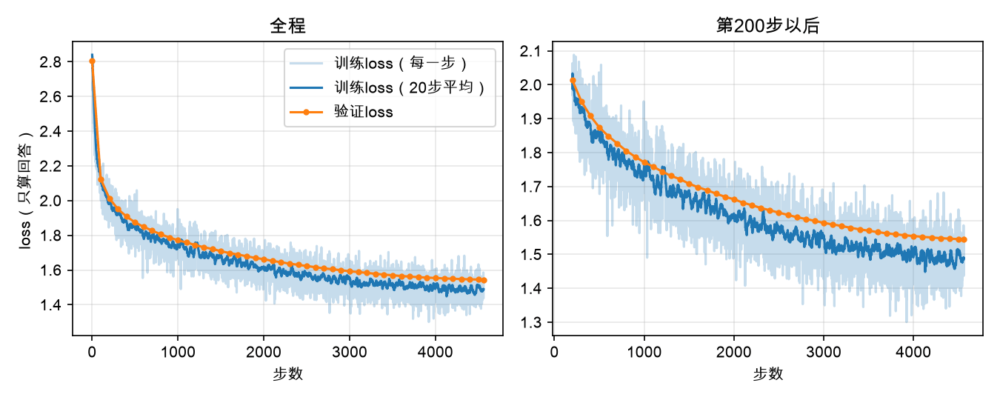

# 监督微调（Supervised Fine-Tuning）


上一章训出的基座模型只会续写：给它一个开头，它顺着往下写，写出来的句子合乎语法，却不管你想要什么。问它一个问题，它多半把问题再抄一遍。这一章用对话数据接着训它，教它一问一答：用户说一句，它答一句，答完了就停下。这一步叫**监督微调**（Supervised Fine-Tuning，简称SFT）。

和预训练比，SFT的训练循环几乎没有变：还是预测下一个词元，还是交叉熵，还是AdamW，第六章的`train.py`改几处就能用。变的是喂给它的数据。先要定一个**对话模板**（Chat Template），把一段多轮对话拼成一串词元，标出谁在说话；再挑一份对话数据，我们用的是SmolLM2的对话版用过的smol-smoltalk，46万段英文对话；最后，loss只在助手的回答上算，问题部分只当上下文。这三样准备好，在T4上训了4,559步、3亿个位置，纯训练1.34小时，验证loss从2.807降到1.544。训完的模型交给第一本的引擎，第一次真正回答了我们的问题。

这一章的代码在`code/book/ch07/`下面。`config.py`、`model.py`、`adamw.py`、`schedule.py`和`export.py`从第六章原样复制。新写的有五个：`chat_template.py`把对话拼成词元，同时算出掩码；`prepare_sft.py`下载数据、分词，把对话装进定长的行；`sft.py`是第六章`train.py`改出来的训练脚本；`chat.py`按对话模板问模型问题，可以把SFT之前和之后的模型放在一起比；`plot_log.py`画训练曲线。`colab.ipynb`是在Colab上运行它们的笔记本。


## 基座模型和对话模型

先看看基座模型面对一个问题会怎样。`chat.py`把问题按下一节的对话模板包好，让模型往下写：

```bash
uv run python book/ch07/chat.py "What is 12 plus 7?" \
    --model runs/pretrain/model --max-new 40
```

输出先打出问题，方括号里是模型目录的名字，下面缩进的是它接着写出的40个词元：

```
问：What is 12 plus 7?
[pretrain]
  What is 12 plus 7?
  12 plus 7?
  12 plus 7?
  12 plus 7?
  12 plus 7?
  12
```

它没有回答，而是把问题抄了一遍又一遍。这不是因为它算不出12加7，而是它根本不知道这里应该回答。预训练的语料是网页，网页里的一个问句后面，可能跟着答案，也可能跟着另一个问句、一段无关的文字。模型学到的是网页里接下来最可能出现什么，而对一个只训了5亿个词元的小模型来说，最保险的猜测，就是把刚才那句话再说一遍。

第一本第十章讲过这件事：基座模型只会续写，能对话的是**对话模型**（Chat Model），也叫指令模型（Instruct Model）。两者的架构一模一样，只是权重不同；对话模型是在基座模型的基础上，用大量对话数据接着训出来的。这一步统称**后训练**（Post-training），SFT是后训练的第一步，后面几章的偏好对齐、强化学习、蒸馏，都从SFT之后的模型出发。

说起来，SFT要教的东西很少：一段对话里，用户说完以后轮到助手，助手要针对用户的话来答，答完要说一声“说完了”。知识它在预训练时已经学了一些，SFT不指望再教给它多少知识，要教的是格式和行为。这也是为什么SFT用的数据比预训练少得多：我们的预训练用了5亿个词元，SFT用了3亿个位置，其中真正算loss的不到四分之三；大模型的差距更大，预训练动辄十几万亿个词元，SFT通常只有几十亿。


## 对话模板

模型只认识一串词元，一段对话要先拼成一串，才能喂给它。拼的规则就是对话模板。模板要回答三个问题：每一轮是谁说的，一轮从哪里开始、到哪里结束，以及推理时怎么告诉模型“现在轮到你了”。


### 角色和特殊词元

我们用的格式叫ChatML，是Chat Markup Language（对话标记语言）的缩写。它是OpenAI在2023年3月开放ChatGPT的API时提出的，当时在官方Python库的文档`chatml.md`里介绍过；后来很多开源模型照搬了这个格式，SmolLM2和Qwen3的对话版用的都是它。每一轮写成这样：

```
<|im_start|>角色
内容<|im_end|>
```

开头是`<|im_start|>`，后面紧跟角色的名字和一个换行，然后是这一轮的内容，最后是`<|im_end|>`，再跟一个换行，接着下一轮。角色有三种：`user`是用户，`assistant`是模型自己，`system`是系统提示，放在最前面，交代一些全局的要求，比如“你是一个乐于助人的助手”，或者“回答不要超过三句话”。我们的数据里，大约15%的对话以系统提示开头。

这两个特殊词元，`<|im_start|>`和`<|im_end|>`，是第三章训练分词器时预留的，编号1和2。当时说过，它们在预训练里一次也不会出现，对应的那两行词嵌入还保持着随机初始化的样子。到了这一章，它们才第一次出现在训练数据里。特殊词元的好处是边界清楚：普通文本永远不会被切成它们，所以模型看到`<|im_start|>`，就知道新的一轮开始了，不会和正文里碰巧出现的什么字符串混淆。

结尾的`<|im_end|>`还有一个更重要的用处：它是助手的结束符。模型答完一轮写出`<|im_end|>`，推理引擎抽到它就停下。预训练时，结束符是`<|endoftext|>`，表示一篇文档写完了；SFT之后，模型在对话里该停下的地方，写的是`<|im_end|>`。所以导出模型时，`generation_config.json`里的`eos_token_id`要从0改成2，第一本的引擎读这个文件，才知道该在哪里停。


### 模板长什么样

拼对话的是`chat_template.py`里的`ChatTemplate`。它拼一段对话的同时，给每个词元记一个**掩码**（Mask）：1表示这个词元是助手说的，模型要学着说出来；0表示它只是上下文。为什么要掩码，后面专门有一节，这里先看拼出来的样子。运行`chat_template.py`，它拼一段两轮的对话，再逐个词元列出掩码：

```bash
uv run python book/ch07/chat_template.py
```

输出分两部分：上面是拼好的整段文字，特殊词元原样显示；下面逐个词元列出掩码、编号和词元本身，`Ġ`和`Ċ`分别代表空格和换行。留意掩码在哪里从0变成1，又在哪里变回0：

```
<|im_start|>user
What is the capital of France?<|im_end|>
<|im_start|>assistant
The capital of France is Paris.<|im_end|>
<|im_start|>user
And of Italy?<|im_end|>
<|im_start|>assistant
Rome.<|im_end|>

共45个词元，其中12个算loss

  掩码  编号  词元
     0     1  '<|im_start|>'
     0   382  'us'
     0   266  'er'
     0   201  'Ċ'
     0  1557  'What'
     0   313  'Ġis'
     0   264  'Ġthe'
     0  3124  'Ġcapital'
     0   282  'Ġof'
     0  4015  'ĠFrance'
     0    33  '?'
     0     2  '<|im_end|>'
     0   201  'Ċ'
     0     1  '<|im_start|>'
     0   557  'ass'
     0  7996  'istant'
     0   201  'Ċ'
     1   457  'The'
     1  3124  'Ġcapital'
     1   282  'Ġof'
     1  4015  'ĠFrance'
     1   313  'Ġis'
     1  6076  'ĠParis'
     1    16  '.'
     1     2  '<|im_end|>'
     0   201  'Ċ'
     0     1  '<|im_start|>'
     0   382  'us'
     0   266  'er'
     0   201  'Ċ'
     0  3213  'And'
     0   282  'Ġof'
     0  5938  'ĠItaly'
     0    33  '?'
     0     2  '<|im_end|>'
     0   201  'Ċ'
     0     1  '<|im_start|>'
     0   557  'ass'
     0  7996  'istant'
     0   201  'Ċ'
     1    52  'R'
     1   461  'ome'
     1    16  '.'
     1     2  '<|im_end|>'
     0   201  'Ċ'
```

一段只有四句话的对话，拼出来是45个词元，其中只有12个算loss：两个回答的内容，加上各自结尾的`<|im_end|>`。有几个细节值得看一看。

第一，`user`被切成了`us`和`er`两个词元，`assistant`被切成了`ass`和`istant`。我们的分词器是在FineWeb-Edu上训的，这两个词在教育网页里不算常见，没有挤进8192个词元的词表。这没有关系，它们在每一轮的开头反复出现，模型很快就会把这几个词元当成一个整体来认。

第二，`Ċ`就是换行符。第三章讲过，字节级的BPE把每个字节映射成一个可见的字符，换行符对应的就是`Ċ`，空格对应的是`Ġ`。

第三，回答的内容是单独分词的。`ChatTemplate.render`把每一轮分成开头、内容、结尾三块，各自分词再接起来：

```python
    def render(self, messages, bodies=None):
        """一段对话 → (ids, mask)，两个一样长的列表。

        每轮分三块分词再接起来：开头、内容、结尾。内容单独分词，
        回答的边界才不会和前后的字符粘成一个词元。bodies是事先分好词的
        内容，批量处理时用，省得一条一条地分。"""
        if bodies is None:
            bodies = [self.tok.encode(m["content"]).ids for m in messages]
        ids, mask = [], []
        for m, body in zip(messages, bodies):
            learn = int(m["role"] == "assistant")
            ids += self.header[m["role"]] + body + [IM_END] + self.newline
            mask += ([0] * len(self.header[m["role"]]) + [learn] * len(body)
                     + [learn] + [0] * len(self.newline))
        return ids, mask
```

如果把整段对话先拼成一个字符串再分词，BPE可能把开头的换行和回答的第一个字符合成一个词元，这个词元就一半是模板、一半是回答，掩码不知道该标0还是标1。分开分词，边界就清清楚楚。推理时也一样：`prompt`方法拼好前面的对话，再接上`<|im_start|>assistant\n`这几个词元，等模型开口。训练和推理拼出来的词元必须一模一样，模型在训练时见过什么，推理时就该给它什么。


## SFT数据

对话模板定好了，接下来是数据。SFT的数据要有两个特点：形式上是对话，有问有答；内容上，回答要好，因为模型学的就是这些回答，回答写得啰嗦，它就学得啰嗦，回答里有错，它就学着犯错。


### 从哪来

我们用的是smol-smoltalk，HuggingFace训练SmolLM2-135M和360M的对话版时用的SFT数据，许可证是Apache 2.0。它是SmolTalk的精简版，专门给10亿参数以下的小模型挑的。训练集有460,341段对话，测试集24,229段，我们拿测试集当验证集。对话按来源分成十个子集，最大的一个占了近六成：

| 子集                    | 对话数  | 占比  | 内容                   |
| ----------------------- | ------- | ----- | ---------------------- |
| smol-magpie-ultra-short | 270,838 | 58.8% | 各种话题的多轮问答     |
| self-oss-instruct       | 48,071  | 10.4% | 写代码                 |
| openhermes-50k          | 47,492  | 10.3% | 综合问答               |
| smol-contraints         | 34,433  | 7.5%  | 带格式要求的回答       |
| smollm-rewrite-30k      | 26,657  | 5.8%  | 改写文字               |
| smol-summarize-20k、5k  | 24,021  | 5.2%  | 写摘要                 |
| 其他三个                | 8,829   | 1.9%  | 长文档、改写、日常闲聊 |

这些对话大多是用更大的模型合成的，不是人写的。看一段日常闲聊子集里的对话，`chat.py`默认问题里的那句“Hi! How are you today?”，学的就是这种样子：

```
user:      Hey!
assistant: Hello! How can I help you today?
user:      I'm looking for a healthy breakfast option. What's a good choice?
assistant: Oatmeal is a nutritious and popular breakfast choice. It's high
           in fiber and can help lower cholesterol.
user:      What's the best way to prepare oatmeal?
assistant: You can cook oatmeal with milk or water and add your favorite
           fruits, nuts, or spices for extra flavor.
```

为什么不用中文的对话数据？我们的预训练语料是英文的FineWeb-Edu，分词器也是在它上面训的，8192个词元几乎全是英文的片段，一个汉字要切成两三个字节级的词元。模型没见过中文，SFT再教它用中文回答，等于同时教它一门新语言，3亿个位置远远不够。预训练用什么语言，SFT就用什么语言。


### 数据质量

对SFT的数据来说，质量比数量重要。《LIMA: Less Is More for Alignment》（arXiv:2305.11206）是一个常被引用的例子：作者只用了一千条精心挑选的问答，就把一个650亿参数的基座模型微调成了相当好用的对话模型。他们的解释是，模型的知识和能力几乎都是在预训练里学到的，SFT只是教它用哪种格式、哪种语气把这些东西说出来，这件事用不着很多数据，但每一条都得是好的示范。

这个结论对小模型要打个折扣。我们的模型只有2,674万个参数，预训练时学到的东西很有限，格式本身也要多看一些例子才学得会，所以我们没有只挑一千条，而是把smol-smoltalk整个过了一遍。不过“回答要好”这一条，对谁都一样。smol-smoltalk适合我们，正是因为它为小模型挑过：从SmolTalk里拿掉了对小模型太难的部分，留下的对话也偏短。


### 截短和装行

数据下载下来，是五个parquet文件，每一行是一段对话，一个由`role`和`content`组成的列表。`prepare_sft.py`把它们变成训练能直接读的两个文件：词元编号和掩码，都是每行1025个，和预训练时一样，1024个输入，错开一位就是答案。这里有两个问题要处理。

第一，有的对话太长，超过了1025个词元。整段扔掉可惜，从中间随便一刀切开又不对：切在回答的半截，模型就学会了话说一半就停。所以`fit`函数只在回答结束的地方截：每个回答末尾都是一个可以截断的位置，取放得下的最后一个。连第一个回答都放不下的，才整段扔掉：

```python
def fit(chat, messages, bodies, limit):
    """拼好一段对话；超过limit个词元，就截到放得下的最后一个回答为止。
    返回(ids, mask, 状态)，状态是“完整”“截短”“扔掉”之一。"""
    ids, mask = chat.render(messages, bodies)
    if len(ids) <= limit:
        return ids, mask, "完整"
    # 每个回答末尾的换行符就是一个可以截断的位置。
    ends, n = [], 0
    for m, body in zip(messages, bodies):
        n += len(chat.header[m["role"]]) + len(body) + 1 + len(chat.newline)
        if m["role"] == "assistant" and n <= limit:
            ends.append(n)
    if not ends:
        return None, None, "扔掉"
    return ids[:ends[-1]], mask[:ends[-1]], "截短"
```

第二，大部分对话比1025短得多，一行只放一段，后面就要补很多`<|endoftext|>`。补齐的位置掩码是0，不算loss，可前向和反向一样要算，算力就白花了。所以一行可以装几段对话，首尾相连。这和第二章预训练时的做法一样：一行里后面的对话能看到前面的对话，就像预训练时一篇文档能看到前一篇的结尾，影响不大，换来的是几乎不浪费算力。

怎么装，差别很大。我最开始的写法是按顺序装，当前这一行放不下了就换一行，结果四分之一的位置是补齐的：截短的对话都接近一整行长，它们后面跟来的对话塞不进剩下的一点空间，只好另起一行。现在的`pack`换成了装箱问题里一个经典的办法：先按长度从长到短排好，每一段放进“剩下的空间最少、但还放得下”的那一行，叫做best fit：

```python
def pack(convs, row, seed):
    """把对话装进长row的行，行尾空着的地方补<|endoftext|>。

    按顺序装、装不下就换行，四分之一的位置会空着：截短的对话都接近一整行，
    后面跟来的放不进去。所以先装长的，每段放进“剩下的空间最少、但还放得下”
    的那一行（装箱问题里的best fit）。先只看长度定下位置，再一次填好，
    最后把行的顺序打乱。"""
    free = [[] for _ in range(row + 1)]     # free[f]：还剩f个空位的那些行
    places, n = [], 0
    for c in sorted(range(len(convs)), key=lambda c: -len(convs[c][0])):
        size = len(convs[c][0])
        for f in range(size, row + 1):
            if free[f]:
                r = free[f].pop()
                break
        else:
            r, f, n = n, row, n + 1
        places.append((c, r, row - f))
        free[f - size].append(r)
```

找“剩下的空间最少、但还放得下”的那一行，用不着把几十万行挨个看一遍。`free[f]`记着还剩`f`个空位的那些行，一段长`size`的对话，从`free[size]`开始往上找，找到的第一个非空的桶就是。行的长度只有1025，最多找一千来次，46万段对话几秒钟就装完了。这一段只定下每段对话放在第几行、从哪一列开始；函数的后半段再按这些位置，把词元和掩码一次填进两个numpy数组，空着的地方是`<|endoftext|>`和0。最后把行的顺序打乱，否则长对话都挤在前面，训练前期看到的全是长的。

在Mac上运行，下载约1GB，分词和装行八九分钟：

```bash
uv run python book/ch07/prepare_sft.py
```

它先处理验证集，再处理训练集。训练集分成4个parquet文件，每读完一个，报一次累计的对话数。每一份的最后打印几行统计：完整放得下的、截短的、扔掉的对话各有多少，装成了多少行，以及行里的位置有多少是对话、多少算loss、多少是补齐：

```
下载 test-00000-of-00001.parquet ...
下载 train-00000-of-00004.parquet ...
下载 train-00001-of-00004.parquet ...
下载 train-00002-of-00004.parquet ...
下载 train-00003-of-00004.parquet ...
  test-00000-of-00001.parquet：累计24,229段
val：24,229段对话，用时26秒
  完整     11,840段   48.9%
  截短     11,686段   48.2%
  扔掉        703段    2.9%
  装成15,240行，共15,621,000个位置
  对话占94.3%，算loss的占73.1%，补齐的占5.7%
  train-00000-of-00004.parquet：累计115,086段
  train-00001-of-00004.parquet：累计230,171段
  train-00002-of-00004.parquet：累计345,256段
  train-00003-of-00004.parquet：累计460,341段
train：460,341段对话，用时488秒
  完整    224,971段   48.9%
  截短    222,121段   48.3%
  扔掉     13,249段    2.9%
  装成291,750行，共299,043,750个位置
  对话占94.0%，算loss的占72.8%，补齐的占6.0%
```

验证集先处理，用了26秒；训练集用了488秒，八分钟多。两边的比例几乎一样：一半的对话放得下，一半要截短，扔掉的不到3%。装成的行里，补齐的位置只占6%，比按顺序装时的四分之一好得多。算loss的位置占72.8%：对话本身占94%，其中问题、系统提示和每一轮的开头都不算，剩下的才是回答。训练集最后装成291,750行，一共2.99亿个位置，下一节的训练就是把它们过一遍。


## 只在回答上算loss

数据里每个位置都有一个掩码，训练时怎么用它？`sft.py`的`to_batch`把一批行错开一位，变成输入和答案，再把掩码是0的位置的答案换成-100：

```python
def to_batch(rows, mask, device):
    """错开一位是输入和答案；掩码是0的位置，答案换成-100，不算loss。"""
    rows = torch.from_numpy(rows.astype(np.int64))
    learn = torch.from_numpy(mask[:, 1:].astype(bool))
    x, y = rows[:, :-1], rows[:, 1:].masked_fill(~learn, -100)
    return x.to(device), y.to(device)
```

所谓-100，是PyTorch的`F.cross_entropy`默认的`ignore_index`：答案是-100的位置，既不算loss，也不计入求平均的个数。用第五章的记号写出来，给每个位置一个掩码 $m_{b,t}$ ，答案要学就是1，换成了-100就是0，这一步的loss变成：

$$
\mathcal{L} = -\frac{\sum_{b=1}^{B} \sum_{t=1}^{T} m_{b,t} \ln p_{b,t}\left(y_{b,t}\right)}{\sum_{b=1}^{B} \sum_{t=1}^{T} m_{b,t}}
$$

和第五章的公式比，变了两处。一是分子里每一项乘上了 $m_{b,t}$ ：掩码是0的位置，模型猜得再离谱，贡献也是0，反向传播时也就没有梯度从这些位置出发。问题照样作为上下文参与前向，回答的梯度会经过注意力流回问题所在的位置，模型学的是怎么利用问题，而不是怎么写出问题。二是分母从 $BT$ 换成了掩码里1的个数，平均只在要学的词元上取。如果分母还是 $BT$ ，一批里回答占得少，loss就被摊薄了，它的大小会跟着问题占多少忽高忽低，前后没法比。

数字-100本身没有什么特别，只是一个不可能是词元编号的数，`F.cross_entropy`默认把它当成“这里不算”的记号，所以模型的`forward`一行都不用改，loss就只在回答的词元上取平均了。注意掩码要跟着答案走，取的是`mask[:, 1:]`：位置 $t$ 的输入是第 $t$ 个词元，答案是第 $t+1$ 个，这个答案该不该学，看的是第 $t+1$ 个词元的掩码。

为什么问题不算loss？因为我们要模型学的是怎么回答，不是怎么提问。问题部分如果也算loss，模型就会花力气去预测用户会说什么，这对回答没有帮助，还会把梯度分走一块：一段对话里，问题常常比回答还长，比如“把下面这篇文章写个摘要”，后面跟着整篇文章。另外，推理时问题是用户给的，模型从来不用自己写问题，学了也用不上。

模板的开头`<|im_start|>assistant\n`也不算loss，它是推理时我们替模型写好的。要算的是回答本身，以及回答结尾的那个`<|im_end|>`。后者尤其重要：模型就是从这里学会答完了要停。如果`<|im_end|>`的掩码是0，模型从来没被要求写出它，推理时就会一直写下去，直到撞上长度上限。

不加掩码，也就是所有位置都算loss，会怎样？这是一个值得做的对照实验。直觉上，模型照样能学会格式，但用在回答上的梯度少了，学得慢一些，而且可能在回答之后自己接着写一个`<|im_start|>user`，替用户提下一个问题。这个实验本书还没有做，留给读者：在`to_batch`里去掉`masked_fill`那一步，就是不加掩码的版本。


## 训练设置

训练循环和预训练是同一个，`sft.py`是从第六章的`train.py`改出来的，混合精度、梯度裁剪、checkpoint和断点续训一模一样。改的只有四处：起点从随机初始化换成第六章导出的基座模型，用`--init`指定目录；数据从随机截取一段换成随机取几行，答案里不算loss的位置换成-100；定期生成从续写开头换成按对话模板问几个问题；导出时把结束符改成`<|im_end|>`。

超参数也有几处和预训练不一样：

| 设置         | 预训练                                | SFT                                  |
| ------------ | ------------------------------------- | ------------------------------------ |
| 起点         | 随机初始化                            | 基座模型                             |
| 最大学习率   | $10^{-3}$                             | $3 \times 10^{-4}$                   |
| warmup       | 200步                                 | 50步                                 |
| 最小学习率   | $10^{-4}$                             | $3 \times 10^{-5}$                   |
| 每步词元数   | $32 \times 1024 \times 4 = 131{,}072$ | $32 \times 1024 \times 2 = 65{,}536$ |
| 步数         | 3,815                                 | 4,559                                |
| 训练的位置数 | 500,039,680                           | 298,778,624                          |

学习率小了三倍多。模型已经会说话了，SFT只是在它学到的东西上做些调整，步子太大，会把预训练学到的东西冲掉，后面讲灾难性遗忘时再说。warmup也短了：随机初始化的模型一开始梯度很乱，要慢慢热身；基座模型的参数已经在一个不错的位置上，50步就够了。

每一步的词元数减了一半，是为了多走几步。训练集一共291,750行，每一步64行，过一遍是4,559步。如果像预训练那样每步128行，一遍只有2,280步，更新的次数少了一半。SFT的数据比预训练少得多，与其每一步看得多，不如多更新几次。

数据只过一遍，`--epochs`默认是1.0。和预训练一样，`get_batch`每次随机抽行，不是从头到尾按顺序读，所以“一遍”只是说抽的总行数等于训练集的行数。第六章算过，这样抽，每一行被抽到的次数大致服从泊松分布，这里的平均值是1：大约37%的行一次也没被抽到，37%恰好一次，26%两次以上。


### 在Colab上跑

笔记本`colab.ipynb`的结构和第六章的一样。起点是第六章存在Drive上的基座模型目录`toyllm2/runs/pretrain/model/`；数据不用从Mac上传，第一次运行时在Colab上下载、分词、装行，存一份到Drive的`toyllm2/data/sft/`，以后再运行就直接复制。训练那一格调用的是：

```bash
python book/ch07/sft.py --name sft --init .../runs/pretrain/model \
    --data /content/data/sft --runs .../runs --compile --resume --export
```

这一次打开了`--compile`。第六章的`bench.py`测过，在T4上它能把吞吐量从每秒46,000个词元提到71,000个左右；第六章的对照实验开过它，完整预训练没有开，这一次也开上了。每秒的词元数，中位数是62,300个，比预训练快了一半多；显存峰值6.6GiB。4,559步纯训练用了80.5分钟，加上验证、生成和存盘，一次会话就训完了，没有断线。`GradScaler`的放大倍数在第2,000步和第4,000步各翻了一倍，从65536翻到262144，一次也没有溢出。


### loss曲线

训练loss和验证loss都只在回答的词元上算：



第0步，基座模型在验证集上的loss是2.807。这已经比预训练结束时的3.127低了，不难理解：回答都是规整的说明文字，比网页好猜，而且回答前面有问题，问题里的词，回答里常常会再出现一次。

最陡的是前100步，验证loss从2.807降到2.125，降了0.68，比之后4,400多步加起来降的还多。这100步里，模型学的主要是格式：`<|im_start|>assistant`后面该说话了，话要针对问题来说，说完了写`<|im_end|>`。这些东西在每一段对话里都出现，几十步就学得会。之后的下降就慢了，第1,000步1.771，第2,000步1.662，最后1.544，学的是回答本身：怎么组织一段解释，怎么列要点，怎么写代码。

训练loss一直比验证loss低一点，前期差0.03左右，到最后差0.05左右。验证集和训练集的来源比例几乎一样，各个子集的占比相差不到0.5个百分点，所以不是两边的题目不一样。差距里有一部分来自重复：越到后面，抽到的行里见过的越多，到最后一步，大约63%的行是之前抽到过的，模型对见过的回答自然猜得更准。不过前期重复还很少，差距已经有了，所以另一部分多半在验证集本身：验证只用了开头的640行，这640行比平均难一点，也很正常。验证loss一直在降，没有过拟合的迹象。

训练时每200步问三个问题，记在日志里。同一个问题“What is the capital of France?”，在第0步，模型答的是“What is the capital? girths, girths and girths in wages?”，还是在抄问题；第200步，第一句就是“The capital of France is Paris”，可紧接着又说它在加勒比海；从第1,000步起，回答一直是对的，还会接着介绍卢浮宫和这座城市的历史。另一个问题“Hi! How are you today?”，第0步它在讲自己的下巴，第400步变成了“I'd be happy to help you”，最后是“What's on your mind?”，和训练数据里那些日常闲聊一个口气。


## 灾难性遗忘

对话数据和预训练的网页很不一样。模型在对话上训了3亿个位置，会不会把预训练学到的东西忘掉一部分？这叫**灾难性遗忘**（Catastrophic Forgetting）：在新数据上训练，旧任务上的表现变差。微调得越猛，学习率越大、训得越久，遗忘越严重。

量一量很简单：拿第六章的验证集，也就是没见过的FineWeb-Edu网页，比较SFT之前和之后的每字节比特数。第六章的`compare_bpb.py`就是干这个的：

```bash
uv run python book/ch06/compare_bpb.py runs/pretrain/model runs/sft/model
```

它把验证集的前100篇文档交给两个模型，各算一遍每词元的loss和每字节比特数，再列出两个模型的词表大小、参数量和切出的词元数：

```
验证集前100篇文档，共199,605个字节

模型                  词表          参数    词元数   每词元loss   每字节比特
pretrain             8,192    26,747,392    51,419        3.139        1.167
sft                  8,192    26,747,392    51,419        3.744        1.391
```

两个模型用的是同一个分词器，每词元的loss可以直接比：SFT之后，从3.139涨到了3.744；换成每字节比特数，从1.167涨到了1.391，差了19%。第六章的预训练里，验证loss在第500步是3.956，第750步是3.661，所以SFT之后的模型，续写网页的本事大致退回到了预训练训到六百步上下的水平。这不是一个小的退步。

原因不难想。我们的模型只有2,674万个参数，装不下太多东西；SFT在对话上训了3亿个位置，比预训练的5亿个词元少不了多少，学习率也不算小，模型就把一部分本事从写网页挪到了写回答上。对一个聊天助手来说，这笔交易是划算的，我们要它答问题，不要它续写网页；可是如果后面还要靠这个模型续写长文，或者在别的任务上接着微调，就要当心了。

减轻遗忘的办法有好几种：学习率再小一些，或者少训几步；在SFT的数据里掺一些预训练的语料，让模型时不时复习一下；或者干脆不动原来的参数，只训练一小部分新加的参数，这是第十一章的LoRA。这几种办法本书都没有在这里试，有兴趣的读者，可以用`--lr`和`--epochs`换几种设置，再跑一次`compare_bpb.py`，看看验证loss和遗忘之间怎么取舍。


## 用第一本的引擎聊天

训练结束时，`sft.py`带着`--export`，把模型存成和第六章一样的目录，四个文件，大小也一样，唯一的区别在`generation_config.json`里：

```json
{
  "bos_token_id": 0,
  "eos_token_id": 2
}
```

结束符从0换成了2，也就是`<|im_end|>`。把这个目录复制到第一本的`code/models/toyllm2-sft/`，就能用第一本第十三章的`chat.py`和它对话。那个脚本是为Qwen3写的，按ChatML拼问题，和我们的模板一字不差。只有一点要注意：Qwen3有一个思考模式，不想让它思考时，`chat.py`会在助手那一轮的开头替它写上一段空的`<think></think>`。我们的模型没见过这两个标签，所以要加上`--think`，让`chat.py`别替它写；再加上`--greedy`，因为我们的`generation_config.json`里没有推荐的采样参数：

```bash
cd toyllm_book1/code
uv run python book/ch13/chat.py "Hi! How are you today?" \
    --model toyllm2-sft --think --greedy
```

输出的前几行是引擎打印的设置：哪个模型、哪种采样器、EOS是哪个编号，以及拼好的提示词有多少个词元；空一行之后是模型的回答，最后一行说写了多少个词元、为什么停下：

```
模型     toyllm2-sft
采样器   GreedySampler()
EOS      [2]
提示词   '<|im_start|>user\n'
         'Hi! How are you today?<|im_end|>\n'
         '<|im_start|>assistant\n'
         18个词元

I'm here to help you with any questions or concerns you have about a
particular topic or topic. Would you like to know more about a particular
topic or topic?

34个新词元，抽到EOS停下，用时0.8秒
```

引擎从`generation_config.json`里读到EOS是2，模型答完写出`<|im_end|>`，引擎就停下了。这段回答，和我们自己的`chat.py`用贪婪解码答的一字不差：两边拼出的提示词是同一串词元，模型是同一个，第一本的引擎又和`transformers`核对过，结果自然一样。第一本最后拿别人训好的Qwen3对话，现在，我们自己训的模型也能在同一个引擎里对话了。


## 代码实现

先说`chat_template.py`，它定义了三个特殊词元的编号和`ChatTemplate`：构造时检查分词器里`<|im_start|>`和`<|im_end|>`的编号是不是1和2，再把三种角色的开头和换行先分好词；`render`把对话拼成词元和掩码；`prompt`在后面接上助手那一轮的开头，推理时用。

数据由`prepare_sft.py`下载，和第二章一样先写到`.part`，下完再改名，断了重跑接着下。分词时一次拿1000段对话，把所有轮次的内容放在一起调用`encode_batch`，比一条一条地分快得多。分好的对话存成numpy数组，而不是Python的整数列表：3亿个词元，存成列表，每个数要占几十个字节，16GB内存的Mac放不下。`--shards`可以只用训练集的前几个文件，想快点试一试时用。

训练脚本`sft.py`在第六章`train.py`的基础上，加了`read_rows`、`to_batch`、`get_batch`三个读数据的函数；`evaluate`在验证集开头固定的20批上算loss；`sample`调用`chat.py`的`reply`问三个问题，温度0.8，只在前50个候选里抽，每个最多答60个词元。生成用的随机数在一个分叉出来的状态里，用完还原，所以生成不会改变训练本身，断点续训和没断过仍然逐位相同。

对话靠的是`chat.py`的`reply`，它每次调用模型的`generate`往后写一个词元，抽到`<|im_end|>`或者`<|endoftext|>`就停：

```python
@torch.no_grad()
def reply(model, chat, messages, max_new=200, temperature=0.0, top_k=None):
    """接着对话往下写，写出<|im_end|>或者<|endoftext|>就停。返回回答的文字。"""
    device = next(model.parameters()).device
    ids = torch.tensor([chat.prompt(messages)], device=device)
    start = ids.shape[1]
    for _ in range(max_new):
        ids = model.generate(ids, 1, temperature=temperature, top_k=top_k)
        if ids[0, -1].item() in (IM_END, EOT):
            ids = ids[:, :-1]
            break
    return chat.tok.decode(ids[0, start:].tolist())
```

我们的模型没有KV缓存，每写一个词元都把整段重新算一遍，回答一两百个词元，在CPU上也就几秒钟。`--model`可以给几个模型目录，同一个问题挨个回答；不给问题，就用默认的五个；加上`--chat`，就是多轮对话，前面的问答都会拼进下一轮的提示词。


## 代码效果

把基座模型和SFT之后的模型放在一起，问同样的问题，用贪婪解码。为了排版，每个回答最多写80个词元：

```bash
uv run python book/ch07/chat.py --model runs/pretrain/model runs/sft/model \
    --max-new 80
```

输出按问题分组，五个问题依次是首都、健康建议、写诗、算术和打招呼。每个问题下面，`[pretrain]`是基座模型的回答，`[sft]`是SFT之后的回答：

```
问：What is the capital of France?
[pretrain]
  What is the capital of France?
  The capital of France is the capital of France.
  What is the capital of France?
  The capital of France is the capital of France.
  What is the capital of France?
  The capital of France is the capital of France.
  What is the capital of France?
  The capital of France is the capital of France.
  What is the capital
[sft]
  The capital of France is Paris. It is a city known for its historical
  landmarks, cultural institutions, and cultural institutions. Paris is a
  city known for its historical landmarks, cultural institutions, and
  cultural institutions. Paris is a city known for its historical landmarks,
  cultural institutions, and cultural institutions.
  
  The city is famous for its historical landmarks, such as the

问：Give me three tips for staying healthy.
[pretrain]
  Give me three tips for staying healthy.
  - Keep your weight in a healthy weight.
  - Keep your weight in a healthy weight.
  - Keep your weight in a healthy weight.
  - Keep your weight in a healthy weight.
  - Keep your weight in a healthy weight.
  - Keep your weight in a healthy weight.
  - Keep your weight in a healthy weight.
[sft]
  Staying healthy is a crucial part of maintaining a healthy lifestyle. It's
  essential to maintain a healthy weight, stay healthy, and maintain a
  healthy weight. Here are three key tips to help you stay healthy:
  
  First, focus on the good things: **Breakfast and granulated sugar into
  your meals**. This will help you feel more energized

问：Write a short poem about the sea.
[pretrain]
  The poem is a poem about the sea. It is a poem about the sea.
  The poem is a poem about the sea. It is a poem about the sea.
  The poem is a poem about the sea. It is a poem about the sea.
  The poem is a poem about the sea.
  The poem is a poem about the sea.
  The poem is a poem about
[sft]
  In the heart of the sea, where the sky is shining,
  A sea's gentle breeze whispers secrets,
  A tapestry of twilight's gentle breeze,
  A whispered promise of a life's gentle breeze,
  A whispered promise of a life's gent

问：What is 12 plus 7?
[pretrain]
  What is 12 plus 7?
  12 plus 7?
  12 plus 7?
  12 plus 7?
  12 plus 7?
  12 plus 7?
  12 plus 7?
  12 plus 7?
  12 plus 7?
  12 plus 7?
  12 plus 7?
[sft]
  To find the total number of 12 plus 7, we need to first find the total
  number of 12 plus 7. This is a combination problem, where we are given
  that 7 is the total number of 12 plus 7.
  
  The total number of 12 plus 7 is 7 + 7 = 14.

问：Hi! How are you today?
[pretrain]
  Hi! How are you? Well, you are not alone.
  Hi! How are you? Well, you are not alone.
  Hi! How are you? Well, you are not alone.
  Hi! How are you? Well, you are not alone.
  Hi! How are you? Well, you are not alone.
  Hi! How are
[sft]
  I'm here to help you with any questions or concerns you have about a
  particular topic or topic. Would you like to know more about a particular
  topic or topic?
```

基座模型的五个回答，没有一个是回答：要么把问题抄一遍，要么把一句话翻来覆去地说。它并不是什么都不懂，“Keep your weight in a healthy weight”也算是保持健康的一条建议，只是它不知道这里该回答，更不知道该在哪里停。

做过SFT，变化一眼就能看出来。每个回答都是助手的口气，针对问题来答：首都的问题，第一句就是“The capital of France is Paris”；要三条建议，它先说“Here are three key tips”，再用加粗的小标题一条一条地列；要一首诗，它就分行写；打招呼，它就回一句“有什么可以帮你的”。最后一个回答只有34个词元，写完自己就停了，没有撞上80个词元的上限。这些都是SFT教会的：格式、语气，以及答完要停。

小模型的毛病也都还在。首都那个回答，“historical landmarks, cultural institutions”说了一遍又一遍；三条建议里冒出了“把砂糖加进早餐”这样的怪话；诗写到第四行就开始重复；12加7，它像模像样地说要“先求出总数”，算出来的却是“7 + 7 = 14”。重复是贪婪解码的老毛病，第一本第十章讲过，加上`--temperature 0.8 --top-k 50`换成采样，会好一些。算错数则是模型本身的能力问题，2,674万个参数、5亿个词元的预训练，学不会两位数的加法，SFT也教不会。


### Paris是从哪学来的

前面说过，SFT教的是格式，知识是预训练时学的。可是回头看第六章的探针问题，基座模型续写“The capital of France is”，一次也没写出过Paris。那么SFT之后的这个Paris，是从哪来的？`probe_fact.py`看了两样东西：同一个开头之后，下一个词元是“ Paris”的概率；以及SFT的训练集里，有多少个回答写着这句话：

```bash
uv run python book/ch07/probe_fact.py
```

它做两件事。先让两个模型接着“The capital of France is”往下猜一个词元，看“ Paris”的概率有多大、在8192个词元里排第几；开头分两种，“直接续写”是把这句话原样交给模型，“对话里回答”是先按对话模板问完，再让助手这样开口。再去SFT的训练集里数一数，有多少个回答写着这句话：

```
“The capital of France is”之后，下一个词元是“ Paris”的概率和排名

  模型       开头            概率   排名
  pretrain   直接续写       0.03%    460
  pretrain   对话里回答     0.07%    179
  sft        直接续写       0.36%     44
  sft        对话里回答    50.52%      1

SFT训练集的1,031,866个回答里，有506个写着“capital of France is Paris”
```

基座模型几乎不知道这件事：直接续写，“ Paris”在8192个词元里排第460，概率万分之三；放进对话里，排第179，也没好到哪去。SFT之后，在对话里回答时，它的概率超过了一半，排在第一。而SFT的训练集里，有506个回答写着“capital of France is Paris”，这是对话数据里最爱举的例子之一。所以这个Paris主要是SFT教的，不是预训练学的。

这和LIMA的说法并不矛盾，只是规模不同。大模型在预训练时就把这类常识学得很牢了，SFT只需要教它怎么说出来；我们的小模型预训练时学到的常识很少，SFT的数据里反复出现的事实，它也会顺便记住。还有一个细节值得注意：同样是SFT之后的模型，直接续写时，“ Paris”只排第44，概率不到百分之一。它学到的不是“法国的首都是巴黎”这条知识本身，而更像是“在对话里被问到法国首都时，这样回答”。同一件事，换一种问法，模型就不一定答得出来了。

这就引出了后面几章。SFT只给模型看了好的回答，没有告诉它什么样的回答不好，啰嗦、重复、说错，它都不知道要避开，第八章的偏好对齐做的就是这件事。至于算术这样要一步一步推的事，第九章用强化学习，让模型自己去试，答对了给奖励；第十章换一个思路，让一个大模型当老师，用它的回答来做SFT。


## 本章小结

这一章在第六章的基座模型上做了SFT，训了4,559步、3亿个位置，T4上纯训练1.34小时，得到了本书第一个能对话的模型。

先定对话模板。我们用ChatML，每一轮是`<|im_start|>`、角色、换行、内容、`<|im_end|>`，两个特殊词元是第三章预留的，到这一章才第一次出现在数据里。拼的时候，开头、内容、结尾分开分词，同时给每个词元记一个掩码，只有助手的回答和它结尾的`<|im_end|>`是1。导出时，`eos_token_id`从0改成2，推理引擎抽到`<|im_end|>`就停。

再准备数据。smol-smoltalk有46万段英文对话，是给小模型挑过的SFT数据。太长的对话只在回答结束的地方截，截不了的才扔；对话按best fit装进1025个词元的行，补齐的位置从按顺序装时的四分之一降到6%。训练时，掩码是0的位置答案换成-100，`F.cross_entropy`跳过它们，模型一行不用改，loss就只在回答上算。

然后是训练。训练循环和第六章一样，起点换成基座模型，学习率从 $10^{-3}$ 降到 $3 \times 10^{-4}$ ，每一步的词元数减半，好多走几步。验证loss从2.807降到1.544，最陡的是前100步，那是模型在学格式。

最后看结果。SFT之后，模型用助手的口气回答问题，会列要点，会分行写诗，答完自己停下；导出的目录交给第一本的引擎，和我们自己的`chat.py`答得一字不差。它答出了法国的首都是Paris，可这条常识主要是从SFT的数据里学的，基座模型并不知道。代价是灾难性遗忘：在网页上的每字节比特数从1.167涨到1.391，续写网页的本事退回到了预训练六百步上下的水平。重复、说错、算错数，这些毛病SFT都没有治好。

到这里，模型只见过好的回答。下一章做偏好对齐，让它知道哪种回答更好、哪种回答更差。
