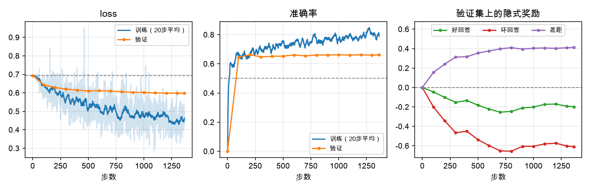

# 偏好对齐（Preference Alignment）


上一章的SFT教会了模型一问一答：用助手的口气回答，答完了就停。可SFT只给它看好的回答，从没告诉它什么样的回答不好，所以重复、跑题、说错，它都不知道要避开。这一章给模型看成对的回答：同一个问题，一个好一些，一个差一些，让它学会往好的那边靠。这一步叫**偏好对齐**（Preference Alignment）。

偏好对齐最有名的做法是RLHF：先训一个奖励模型给回答打分，再用强化学习让模型去追高分。它太重了，本书只讲原理。我们动手写的是DPO，它绕过了奖励模型，直接在成对的回答上训练，训练循环和SFT几乎一样，只是loss换了。数据用的是UltraFeedback，SmolLM2的对话版做偏好对齐时用的也是它。在T4上训了1,364步、43,648对，纯训练37分钟，验证集上分辨好坏回答的准确率从0升到了66.2%。

结果并不全是好消息。模型确实学会了偏向好回答，可它同时学会了写得更长、更不愿意停下。这一章会花不少篇幅弄清楚这件事是怎么发生的，以及控制它的那个超参数`beta`。

这一章的代码在`code/book/ch08/`下面。`config.py`、`model.py`、`adamw.py`、`schedule.py`、`export.py`、`chat_template.py`和`chat.py`从第七章原样复制。新写的有：`prepare_dpo.py`下载偏好数据，把每一对回答按对话模板分好词；`dpo.py`是第七章`sft.py`改出来的训练脚本；`check_dpo.py`按公式手算，核对DPO的loss；`plot_log.py`画训练曲线；`length_bias.py`、`answer_len.py`和`compare_beta.py`分析训练的结果。`colab.ipynb`是在Colab上运行它们的笔记本。


## SFT之后还缺什么

回头看第七章最后那几个回答。首都的问题，模型答对了Paris，然后把“historical landmarks, cultural institutions”说了一遍又一遍；三条健康建议里冒出了“把砂糖加进早餐”；12加7，它算出了14。这些毛病有的是能力不够，12加7算不对，再怎么教格式也没用；有的却是“不知道什么样的回答不好”：同一句话重复三遍，显然比说一遍差，可SFT从没告诉过它。

问题出在SFT的loss上。它只做一件事：让训练数据里那个回答的概率变大。模型看到的永远是好的示范，至于别的写法有多差，它没有任何信息。好比学写作文只看范文，从没有人在你的作文上圈出哪里写得不好。范文看多了，大体的样子学得会，可是哪些毛病最该避开，范文本身不会告诉你。

偏好数据补上的就是这一块。它不是一个标准答案，而是一对回答加一个判断：这一个比那一个好。这样的数据还有一个好处：比起写出一个好回答，判断两个回答哪个更好要容易得多。让人写一首好诗很难，让人从两首诗里挑出更好的那首，几秒钟就够了。所以偏好数据可以收集得又多又快，也能覆盖那些连标注的人自己都写不好的问题。


## 偏好数据

一条偏好数据有三样东西：一个问题，一个好一些的回答，一个差一些的回答。按惯例，好的那个叫chosen，差的那个叫rejected，代码和日志里沿用这两个词，正文里就说好回答、坏回答。注意“坏”只是相对的：坏回答未必很糟，只是没有好回答好。


### 从哪来

我们用的是UltraFeedback，出自《UltraFeedback: Boosting Language Models with Scaled AI Feedback》（arXiv:2310.01377）。它收集了六万多个问题，每个问题从十几个不同的模型里挑四个，各答一遍，再让GPT-4按指令遵循、真实性、诚实、有用这几个方面给每个回答打分。打分的不是人，而是一个更强的模型，这样的偏好数据叫AI反馈。

原始的UltraFeedback每个问题有四个回答，HuggingFace的H4团队把它整理成了binarized版：分数最高的那个当chosen，剩下三个里随机取一个当rejected，每个问题只留一对。SmolLM2的对话版做偏好对齐用的就是这一份，许可证是MIT。训练集`train_prefs`有61,135对，测试集`test_prefs`有2,000对，我们拿测试集当验证集。

看一对验证集里的例子。问题是一个改写好的任务说明：给一段维基百科的文字，写一个能用对或错回答的问题，前面还附了一个示范，这里略去：

```
user:      In this task, you are given Wikipedia articles on a range of
           topics, we ask you to write a question based on the content of
           the articles that can be answered in a binary manner i.e. True
           or False. …… Q: Bill & Ted's Excellent Adventure -- Bill & Ted's
           Excellent Adventure is a 1989 American science fiction comedy
           film directed by Stephen Herek …… A:
chosen:    Sure, here's a question based on the given Wikipedia article:

           Q: Is Bill & Ted's Excellent Adventure a science fiction film
           that features time travel?

           True or False
rejected:  is history presentation in the movie Bill & Ted's Excellent
           Adventure
```

好回答写出了一个能用对或错回答的问题；坏回答连问句都不是。两个回答的差别，正是SFT的数据里体现不出来的东西：同样是“回答”，有的切题，有的不切题。

这份数据并不干净。GPT-4打的分有它自己的偏好，也会打错；有的问题，好回答其实也错了，只是错得少一点。偏好数据天生就带着这样的噪声，后面会看到，它限制了模型在验证集上能做到多好。


### 处理

处理数据的是`prepare_dpo.py`。它下载两个parquet文件，把每一对按第七章的对话模板拼成两段对话：问题相同，一段以好回答结尾，一段以坏回答结尾，掩码只在回答上是1。有两种要扔掉：一是两个回答分数相同，分不出好坏；二是任何一段超过1025个词元，放不进模型。超长的不截短，因为截掉回答的结尾，好坏可能就变了，好回答的精华也许正在最后。

和SFT不同，这里不把几段对话装进一行。DPO要分别算出每个回答的概率，一段对话必须独占一行。所以`prepare_dpo.py`只把所有对话首尾相连存起来，另存一个数组记下每段从哪里开始，第 $2i$ 段是第 $i$ 对的好回答，第 $2i+1$ 段是坏回答。训练时，一批一批地取出来再补齐。

在Mac上运行，下载约230MB，分词要几分钟：

```bash
uv run python book/ch08/prepare_dpo.py
```

```
下载 train_prefs-00000-of-00001.parquet ...
train：61,135对，用时328秒
  留下     43,626对   71.4%
  分数相同  7,387对   12.1%
  太长     10,122对   16.6%
  长度中位数：好回答那一段419个词元，坏回答那一段353个
  好回答那一段更长的占56.5%
下载 test_prefs-00000-of-00001.parquet ...
val：2,000对，用时11秒
  留下      1,412对   70.6%
  分数相同    272对   13.6%
  太长        316对   15.8%
  长度中位数：好回答那一段401个词元，坏回答那一段338个
  好回答那一段更长的占57.5%
```

训练集留下了43,626对，七成多。扔掉的里面，分数相同的占12.1%，太长的占16.6%：UltraFeedback里有不少长问题和长回答，我们的模型只有1025个词元的窗口，放不下。验证集的比例差不多，留下1,412对。

最后两行值得记住：好回答那一段的长度中位数是419个词元，坏回答是353个；好回答更长的，训练集里占56.5%，验证集里占57.5%。也就是说，这份数据有**长度偏差**：GPT-4打分时，偏爱写得更长、更详细的回答。这不全是坏事，详细的回答往往确实更有用；可是对模型来说，“写长一点”就成了一条能多对一些的捷径。后面会一次次碰到它。


### 不是我们的模型写的

还有一件事要先说清楚。这些回答，好的坏的，都出自别的大模型，有的是GPT-4，有的是几十亿参数的开源模型。我们的模型自己写不出这样的回答：它的回答，比这里的坏回答还要差得多。

这样的数据叫**离线策略**（Off-policy）数据：训练用的回答不是正在训练的模型自己生成的。模型学的是在两个都比自己强的回答之间分辨哪个更好，然后把这个判断用到自己的回答上。这一步有没有效，要看两者有多像。第九章的强化学习走的是另一条路，叫**在线策略**（On-policy）：让模型自己写回答，再看自己写的好不好。离线策略的好处是简单，数据准备好了就能训，用不着在训练时生成；代价是学到的东西，不一定能完整地搬到模型自己的回答上。


## RLHF

在说DPO之前，先看看偏好对齐原本是怎么做的。ChatGPT之前的InstructGPT，出自《Training language models to follow instructions with human feedback》（arXiv:2203.02155），把后训练分成三步：先做SFT；再用人标的偏好数据训一个奖励模型；最后用强化学习，让模型去追奖励模型的高分。后两步合起来，就是**基于人类反馈的强化学习**（Reinforcement Learning from Human Feedback，简称RLHF）。


### 奖励模型

**奖励模型**（Reward Model）给一个问题和一个回答打分，输出一个数 $r(x, y)$ ，其中 $x$ 是问题， $y$ 是回答。它通常就是一个语言模型，去掉最后预测下一个词元的那一层，换成一个只输出一个数的线性层。

偏好数据只说哪个更好，没有给分数，奖励模型怎么学？用的是一个很早的统计模型，叫Bradley-Terry模型：两个回答的分数差，经过sigmoid函数，就是好回答胜出的概率。记好回答为 $y_w$ ，坏回答为 $y_l$ （w和l是winner和loser），这个概率是：

$$
P\left(y_w \succ y_l \mid x\right) = \sigma\left(r(x, y_w) - r(x, y_l)\right)
$$

训练奖励模型，就是让这个概率在偏好数据上尽量大，loss取负的对数：

$$
\mathcal{L}_{\mathrm{RM}} = -\ln \sigma\left(r(x, y_w) - r(x, y_l)\right)
$$

分数差越大，sigmoid越接近1，loss越接近0；分数差是负的，说明奖励模型判反了，loss就大。注意这里只有分数的差在起作用，给两个回答都加上同一个数，loss不变。所以奖励模型的分数本身没有绝对的意义，只有比较才有。这个式子下面还会再出现一次。


### PPO

奖励模型训好以后，就可以拿它当裁判了：让模型针对一批问题写回答，奖励模型给每个回答打分，再更新模型，让高分回答的概率变大，低分回答的概率变小。更新的算法通常是《Proximal Policy Optimization Algorithms》（arXiv:1707.06347）提出的**PPO**（Proximal Policy Optimization）。在强化学习里，模型叫**策略**（Policy），记作 $\pi$ ：给定问题 $x$ ，它给出每一个可能的回答 $y$ 的概率 $\pi(y \mid x)$ 。

只追高分是危险的。奖励模型是在有限的数据上训的，它的判断在训练数据附近还算靠谱，离得远了就不一定了。模型会找到奖励模型的漏洞：比如它发现奖励模型偏爱长回答，就把回答越写越长，写出来的东西人看了并不满意，分数却很高。这叫**奖励黑客**（Reward Hacking）。

所以RLHF的目标里还有一项约束：不许离出发时的模型太远。出发时的模型就是SFT之后的模型，在这里叫**参考模型**（Reference Model），记作 $\pi_{\mathrm{ref}}$ 。离得多远，用第五章提到过的KL散度来量：

$$
\max_{\pi} \; \mathbb{E}_{y \sim \pi}\left[r(x, y)\right] - \beta \, \mathrm{KL}\left(\pi \,\|\, \pi_{\mathrm{ref}}\right)
$$

其中KL散度是：

$$
\mathrm{KL}\left(\pi \,\|\, \pi_{\mathrm{ref}}\right) = \mathbb{E}_{y \sim \pi}\left[\ln \frac{\pi(y \mid x)}{\pi_{\mathrm{ref}}(y \mid x)}\right]
$$

第五章说过，KL散度衡量两个分布差得有多远：两个模型给每个回答的概率都一样，它就是0；差得越多，它越大。这里的意思是：从模型自己写的回答里取样，看新模型给这个回答的概率，比参考模型给的高了多少倍，取对数再平均。 $\beta$ 控制这项约束有多紧： $\beta$ 大，模型只能在参考模型附近小心地调整； $\beta$ 小，它可以为了高分走得更远。记住这个式子和这个 $\beta$ ，DPO就是从这里出发的。


### 为什么不在本书实操

训练时，RLHF要同时用到四个模型：要训的策略模型；冻住的参考模型，算KL散度用；奖励模型，打分用；还有PPO自己要的一个**价值模型**（Value Model），它估计一个回答写到一半时，最后能得多少分，用来降低更新的波动。四个模型里有两个要训，每一步还要先生成一批回答，再打分、再更新。

对我们来说，这太重了。四个模型放进T4的显存不难，难的是调稳：PPO的超参数很多，奖励模型和价值模型本身的好坏又决定了训练的成败，大实验室做RLHF，也要花大量的功夫调参。我们只有2,674万参数，用这个尺寸训出的奖励模型，判断力也很有限。所以RLHF本书只讲原理，下面动手写的是DPO；第九章的强化学习会写一个简化的版本，它不需要奖励模型，也不需要价值模型。


## DPO

**直接偏好优化**（Direct Preference Optimization，简称DPO）出自2023年的《Direct Preference Optimization: Your Language Model is Secretly a Reward Model》（arXiv:2305.18290）。论文的副标题就是它的核心想法：你的语言模型，其实就是一个奖励模型。


### 不要奖励模型

论文的作者从RLHF的那个目标出发：追高分，同时不离参考模型太远。他们证明了，这个目标的最优解有一个现成的形式，最优的策略 $\pi^*$ 和奖励 $r$ 之间满足：

$$
r(x, y) = \beta \ln \frac{\pi^*(y \mid x)}{\pi_{\mathrm{ref}}(y \mid x)} + \beta \ln Z(x)
$$

推导要用到变分法，这里不展开，只看结论。等号右边第二项 $\beta \ln Z(x)$ 只和问题 $x$ 有关，和回答是什么无关。也就是说，只要知道最优的策略和参考模型，就能反过来写出奖励：一个回答的奖励，是最优策略给它的概率比参考模型高了多少倍，取对数再乘以 $\beta$ ，再加上一个只看问题的常数。

接下来是关键的一步。把这个式子代进奖励模型的loss，也就是上一节的Bradley-Terry：那里只用到两个回答的分数差，同一个问题下， $\beta \ln Z(x)$ 在两个回答里是一样的，一减就消掉了。剩下的式子里只有策略模型和参考模型，没有奖励模型了。于是不用先训奖励模型再做强化学习，直接用偏好数据训练策略模型就行，这就是“直接”二字的意思。

训练中的模型 $\pi_\theta$ 给一个回答定下的这个量，叫**隐式奖励**（Implicit Reward）：

$$
\hat{r}(x, y) = \beta \ln \frac{\pi_\theta(y \mid x)}{\pi_{\mathrm{ref}}(y \mid x)}
$$

它不是谁打的分，只是模型自己的概率比参考模型的高了多少。比参考模型更偏爱这个回答，隐式奖励就是正的；更嫌弃它，就是负的。训练前，策略模型和参考模型是同一个，所有回答的隐式奖励都是0。


### 一个回答的概率

隐式奖励要用到 $\pi(y \mid x)$ ：给定问题，模型写出整个回答的概率。语言模型一次只预测一个词元，整个回答的概率是每个词元的概率连乘，取对数就是相加。设回答有 $n$ 个词元 $y_1, \ldots, y_n$ ：

$$
\ln \pi(y \mid x) = \sum_{t=1}^{n} \ln p\left(y_t \mid x, y_{<t}\right)
$$

只在回答的词元上加，问题和模板的部分不算。这正是第七章的掩码做的事：掩码是0的位置答案换成-100，掩码是1的位置是回答。不同的是，第七章要的是所有回答词元的平均，这里要的是每一行各自的和。`dpo.py`的`sequence_logps`这样写：

```python
def sequence_logps(model, x, y):
    """每一行回答部分的对数概率：每个词元的log p加起来。

    cross_entropy算的就是-log p，reduction="none"让它每个位置给一个数，
    答案是-100的位置给0，正好不算。所以一行加起来，取负号就是这一行
    回答的对数概率。在fp32里算。"""
    logits = model(x)[0].float()
    nll = F.cross_entropy(logits.flatten(0, 1), y.flatten(),
                          reduction="none")
    return -nll.view(y.shape).sum(-1)
```

默认情况下，`F.cross_entropy`把所有位置的loss平均成一个数，`reduction="none"`让它原样返回每个位置的 $-\ln p$ ，`ignore_index`的位置返回0。形状从`(B*T,)`变回`(B, T)`，按行加起来，取负号，就是每一行回答的对数概率，形状`(B,)`。logits先转成fp32：几百个词元的对数概率加起来，是几百上千的负数，在fp16里精度不够。

一个回答的对数概率是很大的负数。几百个词元，每个词元的 $\ln p$ 平均在-1到-3之间，加起来就是几百。回答越长，这个和越负。这一点马上就会用到。


### loss长什么样

有了隐式奖励，DPO的loss就是把它代进Bradley-Terry：

$$
\mathcal{L}_{\mathrm{DPO}} = -\ln \sigma\left(\beta \ln \frac{\pi_\theta(y_w \mid x)}{\pi_{\mathrm{ref}}(y_w \mid x)} - \beta \ln \frac{\pi_\theta(y_l \mid x)}{\pi_{\mathrm{ref}}(y_l \mid x)}\right)
$$

括号里是好回答的隐式奖励减去坏回答的隐式奖励，我们管这个差叫**差距**（Margin）。要让loss变小，差距就要变大：好回答的概率相对参考模型上升，坏回答的概率相对参考模型下降，或者两样一起。写成代码，只有三行：

```python
def dpo_loss(pc, pr, rc, rr, beta):
    """DPO的loss。pc、pr是策略模型给好回答、坏回答的对数概率，
    rc、rr是参考模型给的。隐式奖励是beta乘以“比参考模型高了多少”：

        loss = -log σ( beta·(pc - rc) - beta·(pr - rr) )

    返回loss（B对的平均）和两个隐式奖励（每对一个，不求梯度）。"""
    chosen = beta * (pc - rc)
    rejected = beta * (pr - rr)
    loss = -F.logsigmoid(chosen - rejected).mean()
    return loss, chosen.detach(), rejected.detach()
```

对数相除就是对数相减，所以 $\ln \frac{\pi_\theta}{\pi_{\mathrm{ref}}}$ 写出来就是`pc - rc`。`F.logsigmoid`一步算出 $\ln \sigma$ ，比先算sigmoid再取对数稳：差距是很大的负数时，sigmoid会小到下溢成0，再取对数就是负无穷。

训练开始时，策略模型就是参考模型，两个隐式奖励都是0，差距也是0，loss是 $-\ln \sigma(0) = -\ln \frac{1}{2} = \ln 2 \approx 0.693$ 。这是DPO的起点，每一次都一样，和数据无关。

再看loss对差距的梯度，它有一个直观的样子（推导很短，这里只说结论）：它等于 $-\sigma(-\text{差距})$ 。差距已经很大的一对，模型早就分对了， $\sigma(-\text{差距})$ 接近0，几乎不再推它；差距是负的一对，模型分反了， $\sigma(-\text{差距})$ 接近1，推得最用力。所以DPO自动地把力气花在还没分对的那些对上。


### 参考模型

为什么要拿参考模型来比？直接让好回答的对数概率大于坏回答的，不行吗？

不行，原因就在上一节最后那句话：回答越长，对数概率越负。看验证集的头两对，好回答分别有722个和50个词元，坏回答分别有230个和19个（下一节`check_dpo.py`的输出）。SFT模型给它们的对数概率是-1229和-120，-636和-57：每一对里，都是坏回答的对数概率更大，只因为它短。直接比对数概率，比的主要是长短，长回答永远吃亏。

除以参考模型的概率，这个问题就没了。隐式奖励看的不是“模型给这个回答的概率有多大”，而是“这个概率比训练前变了多少”。一个722个词元的回答，概率本来就小，只要训练后比训练前大了，隐式奖励就是正的。

参考模型还有第二个作用，就是RLHF里那个KL约束。仔细看隐式奖励：它就是KL散度里那个 $\ln \frac{\pi}{\pi_{\mathrm{ref}}}$ 乘以 $\beta$ 。偏离参考模型，是DPO衡量一切的尺子；loss只要求差距拉开，并不要求某一个回答的概率涨到多高，模型不需要走很远，就能让loss变小。

参考模型自己从不更新。代码里，它从同一个SFT模型目录读进来，调用`requires_grad_(False)`冻住，前向时包在`torch.no_grad()`里，不存激活值，也没有梯度。它每一步只做一件事：给这一批回答算出 $\ln \pi_{\mathrm{ref}}$ 。


### `beta`

$\beta$ 就是RLHF目标里KL约束的那个系数，在代码里叫`beta`。它在DPO的loss里出现的方式很简单：差距等于`beta`乘以“好回答和坏回答各自偏离参考模型的程度之差”。

要让loss降到同样的水平，差距要达到同样的值。`beta`大，偏离的程度乘上一个大数，模型只要稍微动一动，差距就够了；`beta`小，偏离要大得多，才能把差距撑起来。所以`beta`越小，模型走得越远。`beta`常用的取值是0.1，我们也用0.1，本章最后的对照实验会换几个值看看。


## 训练时看什么

训练时，DPO的loss从 $\ln 2$ 开始往下降，可是降到多少算好，并不好说：它的大小和`beta`有关，换一个`beta`，loss就不能直接比了。所以除了loss，`dpo.py`还记下几个更好懂的数，都是一批里各对的平均：

- **准确率**：好回答的隐式奖励高于坏回答的比例。训练开始时两者都是0，没有一对是“高于”，所以准确率从0起步。瞎猜是50%，这个数越高，模型越会分辨好坏。
- **差距**：好回答的隐式奖励减去坏回答的。它和准确率说的是一件事，只是它还看分得有多开。
- **好回答、坏回答的隐式奖励**：各自偏离参考模型多少，也就是差距是怎么来的，是好回答涨了，还是坏回答跌了。
- **好回答、坏回答的对数概率**：不除参考模型的原值。

最后一项有一个常见的现象：训练时，好回答和坏回答的对数概率往往一起下降。直觉上，DPO应该让好回答的概率上升才对。可是loss只要求差距拉开，坏回答跌得比好回答多，差距一样会拉开。而在离线策略的数据上，这几乎是必然的：这些回答都不是模型自己写的，模型训练时把概率挪到了哪里，不一定是这些回答上。好回答的概率跌了一点，坏回答跌了更多，模型自己的概率去了别处。去了哪里，后面的代码效果会给出答案。


## 代码实现

训练脚本`dpo.py`是第七章`sft.py`改出来的，混合精度、梯度裁剪、checkpoint和断点续训一模一样，改的是这几处：

- **两个模型**：`--init`指向第七章导出的SFT模型，策略模型和参考模型都从它读进来，参考模型冻住。checkpoint里只存策略模型，参考模型没变过，不用存。
- **数据**：`read_pairs`读进`prepare_dpo.py`写的三个文件；`to_batch`每次取 $B$ 对，好回答的 $B$ 段在前，坏回答的 $B$ 段在后，补齐到同样长，再和第七章一样错开一位，掩码是0的位置答案换成-100。
- **loss**：`step_pairs`让参考模型和策略模型各算一遍`sequence_logps`，前 $B$ 行是好回答，后 $B$ 行是坏回答，再交给`dpo_loss`。
- **日志**：多记了准确率、差距、两个隐式奖励和两个对数概率；验证时用全部1,412对。

补齐时，`to_batch`把长度向上取到64的倍数。这一批里最长的那段决定了整批的长度，短的那些后面全是补齐，大约一半的位置都是白算的。同样的原因，这里没有打开`--compile`：每一批的长度都在变，`torch.compile`遇到新的形状要重新编译，取到64的倍数，形状也还有十几种。想再快一些，可以把长度相近的对放进同一批，补齐就少了，这留给读者。

超参数和SFT比，变化最大的是学习率：

| 设置       | SFT                | DPO                  |
| ---------- | ------------------ | -------------------- |
| 起点       | 基座模型           | SFT模型              |
| 最大学习率 | $3 \times 10^{-4}$ | $5 \times 10^{-6}$   |
| 最小学习率 | $3 \times 10^{-5}$ | $5 \times 10^{-7}$   |
| warmup     | 50步               | 100步                |
| 权重衰减   | 0.1                | 0                    |
| 每步       | 64行               | 32对，也就是64段     |
| 步数       | 4,559              | 1,364                |
| `beta`     | 无                 | 0.1                  |

学习率小了60倍。DPO是在SFT模型上做很小的调整，它的loss只看差距，模型稍微一动，差距就能拉开，学习率大了，很快就会走出参考模型附近，把SFT学会的东西冲掉。DPO的学习率一般都比SFT小一两个数量级。权重衰减关掉了：它每一步都把参数往0拉，和“别离参考模型太远”是两回事。训练集43,626对，每步32对，过一遍是1,364步。

先在Mac上核对loss。`check_dpo.py`做三件事：取一组手编的对数概率，按公式一步一步手算；用真模型、真数据，一个词元一个词元地取 $\ln p$ 再加起来，和`sequence_logps`比；让策略模型就是参考模型，看loss是不是 $\ln 2$ ：

```bash
uv run python book/ch08/check_dpo.py
```

```
1. 手编的一对：好回答 -10（参考 -11），坏回答 -12（参考 -11），beta 0.1
   隐式奖励  好 +0.100  坏 -0.100
   手算 0.598139   dpo_loss 0.598139

2. 验证集前两对，四段回答的对数概率（前两段好，后两段坏）
   词元数     逐个加起来   sequence_logps
      722     -1228.9402       -1228.9402
       50      -119.5027        -119.5027
      230      -636.0702        -636.0702
       19       -57.4662         -57.4662
   最大相对误差 9.1e-08

3. 策略模型就是参考模型：验证集前8对
   隐式奖励最大的绝对值 0
   loss 0.693147   log 2 = 0.693147
```

第一项，好回答比参考模型高了1，坏回答低了1，乘上0.1，隐式奖励是+0.1和-0.1，差距0.2，loss是 $-\ln \sigma(0.2) = 0.598$ ，比起点的0.693小了一点。手算和函数一致。第二项，逐个加起来和一次算出的结果，相对误差在 $10^{-7}$ 的量级，这是fp32里求和顺序不同带来的。第三项，策略模型和参考模型是同一个，隐式奖励一个不差地都是0，loss正好是 $\ln 2$ 。


## 代码效果

笔记本`colab.ipynb`的结构和第七章的一样：起点是Drive上的`toyllm2/runs/sft/model/`，数据第一次运行时在Colab上下载、分词，存一份到Drive。训练那一格调用的是：

```bash
python book/ch08/dpo.py --name dpo --init .../runs/sft/model \
    --data /content/data/dpo --runs .../runs --resume --export
```

训练一共1,364步，纯训练用了36.9分钟，每秒19.7对，显存峰值5.67GiB。`GradScaler`在第16步和第58步各溢出了一次，跳过了这两步，放大倍数从65536降到16384，此后再没有溢出。


### 训练曲线



左边是loss，虚线是起点的 $\ln 2$ 。中间是准确率，虚线是瞎猜的50%。右边是验证集上好回答、坏回答的隐式奖励，以及两者的差距。

最陡的是前100步。验证集上的准确率从0跳到了64.5%，之后就几乎不动了，最后是66.2%。差距涨得慢一些，第100步是0.155，到第700步左右涨到0.4，然后也停住了，最后是0.412。验证loss从0.693降到0.597。

训练集上的曲线就不一样了：准确率一路涨到80%左右，loss降到0.45上下，和验证集越拉越开。一部分原因和第七章一样，越到后面，抽到的对里见过的越多；另一部分是DPO的老毛病，容易过拟合：偏好数据有噪声，有的好回答其实并不好，模型硬记住了训练集里的这些判断，却没法用到新的对上。验证集上的66%，大概就是这份数据、这个尺寸的模型能做到的上限了。

右边那张图回答了上一节的问题。好回答的隐式奖励是负的，最后是-0.198；坏回答跌得更多，是-0.610。换成对数概率，验证集上好回答平均从-638.4降到-640.4，坏回答从-511.7降到-517.8。正如前面说的，两个都在跌，坏回答跌得多，差距就是这么来的。

日志里每200步问三个问题。首都的问题，从第0步到最后，回答几乎一字不变，还是“Paris is the City of Light”那一段。打招呼的问题，第0步模型说自己在玩一个游戏，第600步说自己叫Ryan，是个持证的调查员，最后一步又在说要帮你“建立技能”；三条健康建议，最后一步在讲“建立体重追踪器”。这几次采样用的是温度0.8，回答本来就会变，单看几个例子，看不出DPO到底改了什么。


### 是不是只学会了长

先排除一个嫌疑。好回答更长的占了57%，如果模型只学会了“长的就是好的”，它在验证集上也能对57%。66%比57%高，但高得不多，有必要查一查。`length_bias.py`拿验证集的每一对，看DPO之后的模型。在CPU上，两个模型各过一遍验证集，要半个小时左右：

```bash
uv run python book/ch08/length_bias.py
```

```
验证集1,412对，准确率66.3%
好回答更长的812对（57.5%），准确率67.6%
好回答更短的600对，准确率64.5%
长度差（好减坏）和差距的相关系数 +0.16
平均每个词元的对数概率变化：好回答-0.013，坏回答-0.088
```

如果模型只看长短，好回答更长的那些对它都会判对，好回答更短的那些对它都会判错。实际上，两组的准确率差不多：好回答更长时是67.6%，更短时也有64.5%。长度差和差距之间的关系也很弱，相关系数是+0.16：好回答长得越多，差距略大一点，但远谈不上由长短决定。所以在分辨好坏这件事上，DPO学到的不只是长短。第一行的66.3%和训练日志里的66.2%差了一点，是因为这里在CPU上用fp32算，训练时在T4上用的是fp16。

最后一行换了一个角度：把对数概率的变化摊到每个词元上。好回答平均每个词元跌了0.013，坏回答跌了0.088，后者是前者的近七倍。模型主要做的，是压低坏回答里那些词元的概率。


### 回答对比

还是第七章的五个问题，用贪婪解码，每个回答最多80个词元，看DPO之后的模型怎么答。SFT之后的回答，就是第七章最后那一段：

```bash
uv run python book/ch08/chat.py --model runs/dpo/model --max-new 80
```

```
问：What is the capital of France?
[dpo]
  The capital of France is Paris. It is a city known for its historical
  landmarks, cultural institutions, and cultural institutions. Paris is a
  city known for its historical landmarks, cultural institutions, and
  cultural institutions, and it is a major center of art, architecture, and
  culture.
  
  The capital of France is Paris, a city known for its historical landmarks,
  cultural institutions

问：Give me three tips for staying healthy.
[dpo]
  Staying healthy is a crucial part of maintaining healthy health. Here are
  three key tips to help you stay healthy:
  
  1. **Reduce the Risk of Ad homelessness**: Losing a healthy lifestyle can
  lead to a decline in your mental and physical health. This can be
  especially challenging for individuals with mental health conditions or
  those who are struggling with chronic

问：Write a short poem about the sea.
[dpo]
  In the heart of the sea, where the sky is shimmering with the soft, golden
  light of the ocean,
  A world of wonder and wonder, where the sea is the only place where the
  world is so vast and unforgiving.
  
  The sea's gentle breeze, a gentle breeze, and the soft, golden light

问：What is 12 plus 7?
[dpo]
  To find the 12 plus 7, we need to find the total number of 12 plus 7. We
  are given that 12 + 7 equals 12.
  
  The total number of 12 plus 7 is 12 + 7 = 24.
  
  Therefore, the 12 plus 7 is

问：Hi! How are you today?
[dpo]
  I'm here to help you with your query. I'm here to help you refine your
  writing, and I'll provide you with constructive feedback and suggestions
  to improve your writing.
  
  I'm here to help you refine your writing, whether it's a sentence,
  paragraph, or a full essay. I'll provide you with constructive feedback,
  suggesting improvements to grammar
```

和第七章比，变化不大，有好有坏。首都的回答开头一模一样，重复也一样，只是多了一句“a major center of art, architecture, and culture”。三条建议换成了带编号的列表，这是UltraFeedback里好回答最常见的样子，可内容还是怪话。诗的用词丰富了一些，“shimmering”“golden light”“vast and unforgiving”，比第七章那首一直在重复“gentle breeze”的强一点。12加7还是算错，这次是24。

最明显的变化在最后一个问题。第七章的模型回了一句“有什么可以帮你的”，34个词元就停了；DPO之后，它说要帮你改文章，说完又说一遍，一直写到80个词元的上限。这不是一个例外，下一节量一量。


### 回答变长了

量长度的是`answer_len.py`，它取验证集里前100个不太长的问题，每个模型各答一遍，比三样：平均长度，在上限之前自己停下的比例，以及回答里四个词元一组的片段有多少是重复出现的，原地打转越厉害，这个数越大。贪婪解码容易原地打转，所以这里用采样，温度0.8，只在前50个候选里抽，每个回答最多300个词元：

```bash
uv run python book/ch08/answer_len.py runs/sft/model runs/dpo/model \
    --temperature 0.8 --top-k 50 --n 100
```

```
验证集的前100个问题，温度0.8，top-k 50，每个最多300个词元

模型              平均长度   自己停下   重复
sft                    257        36%    13%
dpo                    290        13%    17%
```

做过DPO，自己停下的比例从36%降到了13%，不到原来的一半。平均长度从257涨到290，看着不多，那是因为上限只有300，大多数回答都撞上了上限。重复也略多了一些。

这和上一节的结论放在一起，就看清了长度偏差是怎么起作用的。在分辨好坏的时候，模型并不只看长短；可是在生成的时候，它确实学会了写得更长、更不愿意停下。训练时，好回答更长的那57%的对里，好回答的结尾都在更后面，坏回答早早就写出了`<|im_end|>`。压低坏回答里词元的概率，很可能也就压低了“在这里停下”的概率。前面说两个对数概率一起跌，模型把概率挪到了别处，挪去的地方之一，就是“接着写”。

这是偏好对齐里一个出了名的问题，大模型也躲不开：用AI或人的偏好训出来的模型，回答普遍越来越长，因为打分的人和模型都偏爱详细的回答。常见的对策有几种：准备数据时控制长度，让好回答更长和更短的对数差不多；在loss里加一项惩罚长度的项；或者把隐式奖励除以回答的长度，用每个词元的平均对数概率来算。这几种本书都没有试，留给读者。


## 对照实验

最后换几个`beta`看看。每次从SFT模型出发，只训400步，warmup 40步，别的设置和主训练一样，`beta`取0.05、0.1和0.5。每次在T4上训12分钟多一点。`compare_beta.py`从三次的日志里取出最后一次验证的结果：

```bash
uv run python book/ch08/compare_beta.py
```

```
beta    准确率    差距   差距/beta   好回答变化   坏回答变化
0.05     64.9%   0.211         4.2         -3.4         -7.6
0.1      65.5%   0.293         2.9         -1.1         -4.1
0.5      65.7%   0.524         1.0          0.3         -0.7
```

准确率几乎一样，都在65%上下。`beta`不影响模型能不能分出好坏，影响的是它为此走了多远。

差距随`beta`变大，这是`beta`乘出来的，不说明什么。除以`beta`，就是好坏两个回答各自偏离参考模型的程度之差，这个数反过来了：`beta`是0.05时是4.2，0.5时只有1.0。后两列是验证集上的对数概率比起点变了多少，也是一样的趋势：`beta`越小，两个回答的对数概率都跌得越多。三个里面，只有`beta`是0.5的那次，好回答的对数概率涨了，虽然只涨了0.3。验证loss这里没有列，它的大小和`beta`有关，三次之间不好比。

再量一量回答的长度，和前面的设置一样：

```bash
uv run python book/ch08/answer_len.py runs/exp-beta0.05/model \
    runs/exp-beta0.1/model runs/exp-beta0.5/model \
    --temperature 0.8 --top-k 50 --n 100
```

```
验证集的前100个问题，温度0.8，top-k 50，每个最多300个词元

模型              平均长度   自己停下   重复
exp-beta0.05           294         7%    17%
exp-beta0.1            290        13%    18%
exp-beta0.5            275        32%    16%
```

结果是`beta`越小，回答越长，越不肯停。`beta`是0.5时，自己停下的比例是32%，和SFT的36%差不多，基本还是SFT的样子；0.1时降到13%，和1,364步的主训练一模一样，可见这个变化在前400步里就完成了；0.05时只有7%，几乎每个回答都写到了上限。重复在三个之间差别不大。

所以`beta`决定的，是模型会被偏好数据带偏多少。准确率上看不出差别，三个`beta`分辨好坏的本事一样；差别全在离参考模型多远，而离得越远，数据里“好回答更长”的那个偏差，就越多地变成了生成时的“不肯停”。`beta`取多少，没有一个对所有数据都合适的答案，要看你愿意为了偏好付出多少别的代价。


## 本章小结

这一章在第七章的SFT模型上做了DPO，训了1,364步、43,648对，T4上纯训练37分钟。

偏好对齐用的是成对的回答：同一个问题，一个好一些，一个差一些。我们用UltraFeedback，GPT-4打分，分最高的当好回答。分数相同的、放不进1025个词元的扔掉，留下43,626对。这份数据有长度偏差，好回答更长的占了57%；而且它是离线策略的，回答都出自别的大模型。

经典的RLHF先用偏好数据训一个奖励模型，再用PPO追高分，同时用KL散度约束模型别离参考模型太远。它要四个模型，本书只讲原理。DPO从同一个目标出发，发现奖励可以用模型自己的概率写出来：隐式奖励是 $\beta \ln \frac{\pi_\theta}{\pi_{\mathrm{ref}}}$ 。代进Bradley-Terry，奖励模型就消失了，loss只用到策略模型和冻住的参考模型给两个回答的对数概率。一个回答的对数概率，是它每个词元的 $\ln p$ 之和，用第七章的掩码和`reduction="none"`就能算出来。参考模型让长短不同的回答可以放在一起比，`beta`控制模型能走多远。

训练时看准确率和差距。验证集上的准确率从0很快升到65%左右，最后是66.2%，再往上就受限于数据的噪声。好回答和坏回答的对数概率一起下降，坏回答降得更多，差距就是这样拉开的。分辨好坏时，模型不只看长短；可生成时，它学会了写得更长：自己停下的比例从36%降到了13%。`beta`越小，这个偏差越重，0.5时几乎没有，0.05时只有7%的回答自己停下。

到这里，模型学的都是别人写的回答：SFT模仿好的回答，DPO在别人的两个回答之间分高下。12加7它还是算不对。下一章换一个思路：不给标准答案，只告诉它答对了没有，让它自己去试。
