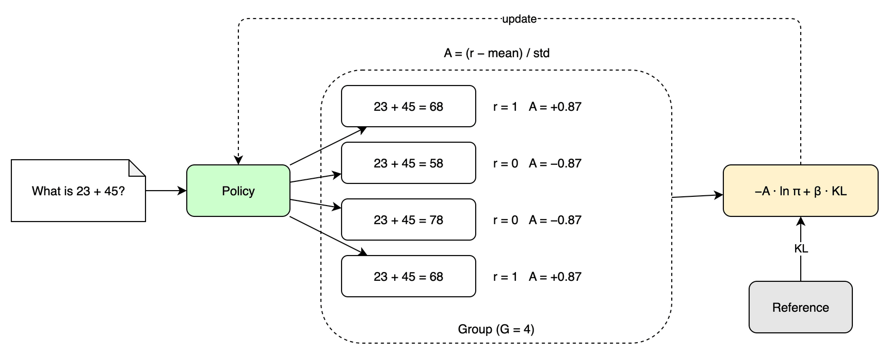
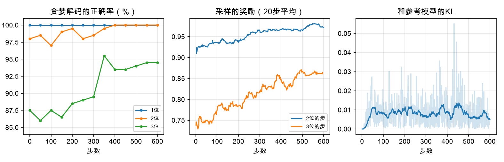
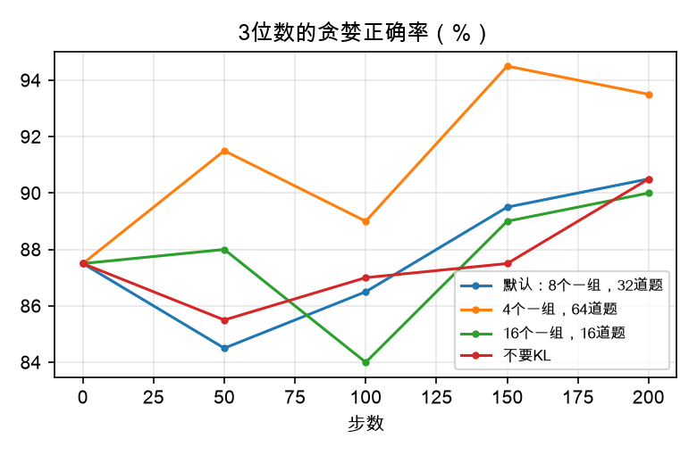

# 强化学习（Reinforcement Learning）


到上一章为止，模型学的都是别人写好的回答：SFT模仿好的回答，DPO在别人写的两个回答之间分高下。这一章换一个思路：不给标准答案，让模型自己写，写完了只告诉它对还是错，让它从自己的尝试里学。这就是**强化学习**（Reinforcement Learning，简称RL）。

练习题选的是多位数加法，答案一算就知道对不对。可第七章的模型连12加7都算不对，一组回答全错，强化学习就无从学起，所以先用加法题做一次短短的SFT，教会它答题的格式，这一步叫冷启动。然后用GRPO训练：每道题让模型写8个回答，比同组平均好的加强，差的削弱。在T4上训了600步，纯训练5分钟，3位数加法的贪婪正确率从87.5%升到了94.5%。

同样清楚的，是它做不到的事：4位数、5位数的题，训练前一道也做不对，训练后还是一道也做不对。强化学习能把模型“偶尔做对”的事变成“总能做对”，却很难教会它从来没做对过的事。这一章的后半部分就是在量这条边界。

这一章的代码在`code/book/ch09/`下面。`config.py`、`adamw.py`、`schedule.py`、`export.py`和`chat_template.py`从第八章原样复制；`model.py`加了KV缓存，`chat.py`改用它。新写的有：`addition.py`出题和判分；`rollout.py`让模型做一批题、量正确率；`cold_start.py`是冷启动；`grpo.py`是强化学习的训练脚本；`check_cache.py`和`check_grpo.py`核对KV缓存和GRPO；`compare.py`、`errors.py`和`compare_runs.py`分析结果；`plot_log.py`画训练曲线。`colab.ipynb`是在Colab上运行它们的笔记本。


## 从模仿到试错

前两章的SFT和DPO有一个共同点：训练数据是现成的，回答出自人或者别的大模型。模型学的是“别人在这里会怎么写”。这样学，上限就是数据本身，数据里没有的本事，模仿不出来；而且像第八章说的，数据是离线策略的，别人写得好，不等于模型自己写得好。

强化学习反过来：回答由正在训练的模型自己写，也就是上一章说的在线策略。写完以后，有一个裁判给它打分，模型根据分数调整自己，分高的写法多用，分低的少用。它不需要知道标准答案长什么样，只需要知道自己写得好不好。好比学骑车，看再多别人骑车的录像也学不会，得自己骑上去，摔了就知道刚才那样不行。

第八章讲RLHF时，这一步已经出现过：它的第三步就是强化学习，裁判是奖励模型，算法是PPO。我们当时没有动手，因为它要四个模型，太重。这一章动手写一个轻得多的版本，四个模型去掉了两个。


## 可验证的奖励

在RLHF里，裁判是一个奖励模型，它是在人的偏好上训出来的，会犯错，也会被钻空子，第八章说的奖励黑客就是这么来的。有一类任务用不着它：答案能自动判对错的任务，比如算术题、有标准答案的数学题、能跑测试的代码。判分就是一段普通的程序，不会累，不会偏心，也钻不了空子。这样的奖励叫**可验证的奖励**（Verifiable Reward）。

在2025年初，DeepSeek发布的《DeepSeek-R1: Incentivizing Reasoning Capability in LLMs via Reinforcement Learning》（arXiv:2501.12948），让这条路一下子出了名。它在数学和代码题上，只用“最后的答案对不对”这样的奖励做强化学习，模型就学会了先写一大段思考再作答，第一本说的思考模型就是这么训出来的。用到的算法叫GRPO，出自更早的《DeepSeekMath: Pushing the Limits of Mathematical Reasoning in Open Language Models》（arXiv:2402.03300）。

我们的判分在`addition.py`里，只有三行：

```python
def reward(text, a, b, stopped):
    """1：自己停下，而且最后一个数是a + b；否则0。"""
    numbers = re.findall(r"\d+", text)
    return float(stopped and bool(numbers) and int(numbers[-1]) == a + b)
```

它只看两件事：回答自己停下了，也就是写出了`<|im_end|>`；回答里最后一个数等于正确答案。对了给1，错了给0，没有部分分。中间写了什么不管，“345 + 678 = 1023”和“The answer is 1023.”都算对。没停下的不算对，否则模型可以把答案写对以后接着胡写，一直写到长度上限。运行`addition.py`，它出几道题，再给几个手写的回答判分：

```bash
uv run python book/ch09/addition.py
```

上半部分是各种位数的题目和标准回答，标准回答冷启动时要用；下半部分是五个回答的判分，留意第四行：

```
1位 + 1位  What is 6 + 6?            6 + 6 = 12
2位 + 1位  What is 15 + 4?           15 + 4 = 19
2位 + 2位  What is 75 + 72?          75 + 72 = 147
3位 + 3位  What is 514 + 902?        514 + 902 = 1416
4位 + 4位  What is 5969 + 8808?      5969 + 8808 = 14777

  奖励 1  停下  345 + 678 = 1023
  奖励 1  停下  The answer is 1023.
  奖励 0  停下  345 + 678 = 1013
  奖励 0  没停  345 + 678 = 1023
  奖励 0  没停  To add these two numbers, we
```

第四行的答案写对了，可回答没停下，奖励还是0。最后一行是第七章的模型最常见的样子：一开口就是铺垫，写不到答案。


## 本章的任务

练习题选多位数加法，有三个理由。一是答案好判，上面那三行就够了。二是难度可调，位数越多越难，1位数是背口诀，3位数要连着进好几次位。三是小模型能学：第三章的分词器把每个数字单独切成一个词元，“345”是三个词元，模型可以一位一位地写，不用在一个词元里同时算出好几位。


### 第七章的模型不会做

先看看起点。`compare.py`给每种位数出200道固定的题，两个加数位数相同，量两个数：一是贪婪解码的正确率；二是**pass@k**，每道题采样 $k$ 个回答，至少有一个做对的题占多少。前者是模型“一次就做对”的本事，后者是它“试几次能做对”的本事。强化学习靠的是后者：一道题采样8次，只要有对有错，就有信号。下面这张表是冷启动前后几个模型的结果，第一行就是第七章的SFT模型：

```bash
uv run python book/ch09/compare.py runs/sft/model runs/cold/step-250 \
    runs/cold/step-500 runs/cold/step-750 runs/cold/model
```

表里每个模型占两行，上一行是贪婪正确率，下一行是pass@8。模型的名字取自目录名，`step-250`这样的是冷启动中途的存档，`cold`是训完的那个：

```
每种位数200道题，两个加数位数相同；pass@8采样温度1.0

模型                       1位     2位     3位     4位     5位
sft           贪婪        0.0%    0.0%    0.0%    0.0%    0.0%
              pass@8      0.0%    0.0%    0.0%    0.0%    0.0%
step-250      贪婪       92.5%   23.0%    2.0%    0.0%    0.0%
              pass@8     98.5%   58.0%    9.0%    0.0%    0.0%
step-500      贪婪      100.0%   86.0%   46.0%    0.0%    0.0%
              pass@8    100.0%   97.0%   79.5%    0.0%    0.0%
step-750      贪婪      100.0%   91.5%   74.5%    0.0%    0.0%
              pass@8    100.0%   99.0%   93.0%    0.0%    0.0%
cold          贪婪      100.0%   98.0%   87.5%    0.0%    0.0%
              pass@8    100.0%  100.0%   98.0%    0.0%    0.0%
```

第七章的SFT模型一道也做不对，1位数也不行，采样8次也不行。回头看第七章最后问的12加7，它先写“To find the total number of 12 plus 7, we need to first find the total number...”，一大段铺垫，每个回答最多24个词元，写不到答案就到了上限；侥幸写到了，算的也不对。这时候做强化学习，每一组回答都是0分，组内没有差别，模型什么也学不到。


### 冷启动

在强化学习之前先做一次SFT，DeepSeek-R1也是这么做的，只是原因不太一样。它的第一个版本直接在基座模型上做强化学习，学是学会了，可写出来的东西语言混杂、难以阅读。正式版先用几千条写好的长思考示范做一次SFT，再做强化学习，这一步叫**冷启动**（Cold Start）。

我们的冷启动更简单：用加法题做一次SFT，题是现出的，回答就是上一节那种标准回答“a + b = c”。`cold_start.py`每一步出64道题，两个加数各取1到3位，按第七章的对话模板拼好，只在回答上算loss，训1,000步。4位、5位数的题一道也不给它看，最后看强化学习能不能把本事推到没见过的位数上。

冷启动不能训得太狠。它要做的是让模型“有时候做对”，不是“总能做对”：3位数要是已经全对了，强化学习就没事可做了。所以`cold_start.py`每250步存一个模型目录，好挑一个合适的起点，上面那张表的后四行就是这几个存档。

位数越少学得越快。1位数在第250步就对了九成多，第500步全对；2位数从23%涨到98%；3位数最慢，第250步只对2%，到训完是87.5%。每一行的pass@8都比贪婪高出一截，第500步的3位数最明显：一次就做对的只有46%，采样8次能做对的有79.5%。4位、5位数从头到尾都是0，采样8次也一样，那里没有信号，强化学习也帮不上忙，这件事后面还会再说。

按说，第500步或第750步的存档，3位数离全对还远，给强化学习留的余地更大。我们还是用了训完的那个模型，最后一行：2位数已经差不多全对，3位数还没有，一次就做对的87.5%和采样8次能做对的98%之间，隔着十个百分点。选更早的存档，强化学习做的事里，有一部分其实是冷启动没做完的，分不清哪些是它的功劳。

这张表是在Mac的CPU上量的。Colab上同样的冷启动模型，3位数的pass@8是99.5%，贪婪正确率一模一样：贪婪解码每一步都取概率最大的词元，换了设备结果也不变；采样用的随机数在CPU和GPU上不一样，抽到的回答不同，pass@8就差了几道题。后面的结果都来自Colab。


## GRPO

**GRPO**（Group Relative Policy Optimization）是在PPO的基础上简化出来的。先回忆一下第八章的PPO：策略模型写回答，奖励模型打分，价值模型估计“这道题平均能得多少分”，用来判断这个回答比平均好还是差，再根据好坏更新策略模型。GRPO去掉了价值模型，“平均能得多少分”换了一种算法。我们的奖励是可验证的，奖励模型也不需要，剩下的只有策略模型和参考模型。画成图是这样的，颜色和第八章的两张图一样：



图里画的是一道题。策略模型写4个回答，判分，组内比较，算出每个回答的优势，再连同参考模型给的KL，算出loss，更新策略模型。下面一样一样讲。


### 一组采样

一个回答得了1分，说明什么？说明不了多少：也许这道题太简单，怎么写都对。一个回答得了0分，也许是这道题太难。要判断一个回答写得好不好，得拿它和同一道题的其他回答比。

所以GRPO每道题让模型写 $G$ 个回答，叫一组。我们每一步出32道题，每题8个回答，一共256个。采样用温度1.0，不做top-k，让同一组的回答尽量不一样。


### 组内比较

比较的办法是减去组内平均，再除以组内标准差，得到每个回答的**优势**（Advantage）：

$$
A_i = \frac{r_i - \mathrm{mean}\left(r_1, \ldots, r_G\right)}{\mathrm{std}\left(r_1, \ldots, r_G\right)}
$$

比同组平均好的，优势是正的；差的，是负的。这就是PPO里价值模型干的活：价值模型估计“这道题平均能得多少分”，GRPO直接拿同一组回答的平均分来当这个估计，不用再训一个模型。代价是每道题要多写几个回答，好在写回答比训一个价值模型便宜得多。写成代码：

```python
def advantages(rewards, G):
    """组内比较：减去组内平均，除以组内标准差。rewards (P*G,)。"""
    r = rewards.view(-1, G)
    adv = (r - r.mean(-1, keepdim=True)) / (r.std(-1, keepdim=True) + 1e-4)
    return adv.flatten()
```

一组8个回答全对或者全错，每个回答都等于平均，优势全是0，这一组对更新没有贡献。这正是前面说的“没有信号”。分母加的那个很小的数，就是为了这种情况不除以0。训练日志里专门记了一个数：一步的32组里，有对有错的组占多少。它太低，这一步就白算了。


### loss

有了优势，loss的样子和第五章的交叉熵很像。回答 $y_i$ 的每一个词元，都按它的优势加权：

$$
\mathcal{L} = \frac{1}{PG} \sum_{i=1}^{PG} \frac{1}{\left|y_i\right|} \sum_{t=1}^{\left|y_i\right|} \left(-A_i \ln \pi_\theta\left(y_{i,t} \mid x_i, y_{i,<t}\right) + \beta \, \mathrm{KL}_{i,t}\right)
$$

先看前一项。优势是正的，最小化 $-A_i \ln \pi_\theta$ ，就是把这个回答每个词元的概率往上推，和SFT在标准答案上做的一样；优势是负的，就是往下压。优势越大，推得越用力。一个回答先在自己的词元上平均，再在所有回答上平均，长回答和短回答的分量一样。

第八章的PPO，loss比这个复杂：它用同一批回答更新好几次，第二次更新时，模型已经不是写这批回答的那个模型了，所以要乘一个新旧模型的概率之比，再把这个比值截断在1附近，防止一步走太远。我们每批回答只用来更新一次，写回答的就是正在训练的模型，这个比值恒等于1，截断也就用不上了，loss只剩下上面这个样子。


### KL约束

后一项是KL约束，和第八章RLHF的目标里那一项是一个意思：不许离参考模型太远。参考模型是冷启动之后的模型，冻住不动。这里的KL不是对所有可能的回答求期望，而是在模型自己写出的每个词元上估计一个值：

$$
\mathrm{KL}_{i,t} = \frac{\pi_{\mathrm{ref}}\left(y_{i,t}\right)}{\pi_\theta\left(y_{i,t}\right)} - \ln \frac{\pi_{\mathrm{ref}}\left(y_{i,t}\right)}{\pi_\theta\left(y_{i,t}\right)} - 1
$$

这是DeepSeekMath用的写法，为了简短，括号里省掉了前面的条件。它有两个好处：总是大于等于0；两个模型给这个词元的概率一样时，正好是0。代码把两项放在一起：

```python
def grpo_loss(logp, ref_logp, adv, learn, beta):
    """每个词元：-优势 × log p + beta × KL，先在回答内平均，再在回答间平均。

    KL用的是k3估计：exp(ref - logp) - (ref - logp) - 1，总是非负，
    策略和参考模型一样时是0。"""
    diff = ref_logp - logp
    kl = torch.exp(diff) - diff - 1
    per_token = -adv[:, None] * logp + beta * kl
    m = learn.float()
    per_answer = (per_token * m).sum(-1) / m.sum(-1)
    kl_mean = ((kl * m).sum(-1) / m.sum(-1)).mean()
    return per_answer.mean(), kl_mean.detach()
```

参数里的`logp`和`ref_logp`是两个模型给每个词元的对数概率，形状`(P*G, 回答长度)`，算法和第八章的`sequence_logps`一样，只是不按行加起来。`learn`是掩码，标出回答里要算进loss的词元：到`<|im_end|>`为止，包括它，后面多写的不算。`beta`取0.04，和DeepSeekMath一样。


### 核对

脚本`check_grpo.py`核对三件事：优势和手算的一样；策略模型就是参考模型时，KL是0；在一组回答上走一小步，对的回答概率变大，错的变小。

```bash
uv run python book/ch09/check_grpo.py
```

它每一项打印一段，第三项是同一道题的四个回答，只有第一个是对的，列出走一步之前和之后的对数概率：

```
1. 奖励 [1 0 0 1] [1 1 1 1]
   手算  +0.8659 -0.8659 -0.8659 +0.8659
   函数  +0.8659 -0.8659 -0.8659 +0.8659 +0.0000 +0.0000 +0.0000 +0.0000

2. 策略模型就是参考模型：KL 0

3. 走一小步，每个回答的log p
   回答                奖励   优势       之前       之后
   23 + 45 = 68         1  +1.500   -19.0625   -18.4330
   23 + 45 = 58         0  -0.500   -18.3216   -18.4648
   23 + 45 = 78         0  -0.500   -18.8869   -18.9857
   23 + 45 = 67         0  -0.500   -18.3073   -18.2206
```

第一项，两对两错的一组，平均0.5，标准差是 $\sqrt{1/3} \approx 0.577$ ，优势是 $\pm 0.866$ ；全对的一组，优势全是0。第二项不用多说。第三项最有意思：对的“68”概率涨了，错的“58”和“78”跌了，可错的“67”也涨了一点。“67”和“68”前面的词元全都一样，只差最后一个数字，推高“68”时，共用的那几个词元也一起被推高了，“67”跟着沾了光。这是一步更新的副作用，组里的回答多了，这种互相牵连会慢慢抵消。


## 采样又回来了

前几章的训练，生成只是顺带的：隔几百步写几句话，看一眼模型学到了什么。强化学习不一样，每一步都要先写256个回答，生成成了训练的一部分，它的速度直接决定训练的速度。

第一本第十一章讲过KV缓存：生成时，每写一个新词元，前面那些词元的键和值都已经算过，存起来接着用，不必把整段重算一遍。第七、八章的`generate`没有缓存，写一两句话无所谓，这一章就不行了。`model.py`加了一个`KVCache`，每层存一份键和值，注意力接着缓存往下算；`generate`先把提示词整段算一遍，之后每步只算刚抽出的那一个词元：

```python
    def generate(self, ids, n, temperature=1.0, top_k=None, stop=()):
        """接着ids (B, T)往下写最多n个词元，用KV缓存。

        先把ids整段算一遍，之后每步只算刚抽出的那一个词元。B行一起写，
        所以每行的提示词要一样长。每一行都写出过stop里的词元，就提前停下；
        先写完的行后面接着写，多出来的词元由调用的人截掉。
        """
        cache = KVCache(self.config.num_hidden_layers)
        done = torch.zeros(ids.shape[0], dtype=torch.bool, device=ids.device)
        for step in range(n):
            new = ids if step == 0 else ids[:, -1:]   # prefill，然后decode
            logits = self(new, cache=cache)[0][:, -1, :].float()
            if temperature == 0:
                nxt = logits.argmax(-1, keepdim=True)
            else:
                logits = logits / temperature
                if top_k is not None:
                    kth = torch.topk(logits, top_k).values[:, -1:]
                    logits = logits.masked_fill(logits < kth, float("-inf"))
                nxt = torch.multinomial(F.softmax(logits, dim=-1), 1)
            ids = torch.cat([ids, nxt], dim=1)
            for s in stop:
                done |= nxt[:, 0] == s
            full = ids.shape[1] >= self.config.max_position_embeddings
            if done.all() or full:
                break
        return ids
```

第一本的引擎一次只写一行，这里是 $B$ 行一起写，所以每行的提示词要一样长，否则缓存里每行的位置对不上。好在我们的题很规整：数字是一位一位切的，两个加数的位数一样，提示词的词元数就一样。所以`grpo.py`每一步只挑一种位数出题，这一步全是2位数，下一步也许全是3位数。

脚本`check_cache.py`核对两件事：一段对话整段算一遍，和先算前12个词元、再一个一个接着算，logits是不是一样；贪婪解码时，带缓存和不带缓存写出的词元是不是一个不差，再比一比速度：

```bash
uv run python book/ch09/check_cache.py
```

第一项是logits的相对误差。第二项先看两种写法写出的词元是不是一样，再比用时；最后一行加上了`stop`，看遇到`<|im_end|>`停下时写了多少个词元，开头和前面是不是一样：

```
1. 24个词元：整段算，和先算12个、再一个一个算，logits的相对误差 3.8e-07
2. 贪婪解码4行、各100个词元：写出的词元完全相同
   每步重算 7.62秒   KV缓存 1.62秒
   遇到<|im_end|>就停：写了35个词元，和前面的开头一样
```

两种算法的logits差在 $10^{-7}$ 的量级，这是fp32里加法顺序不同带来的舍入误差；贪婪解码写出的400个词元一个不差，带缓存的快了4倍多。最后一行是`stop`的作用：4行的提示词一样，写的也一样，写到第35个词元都写出了`<|im_end|>`，就提前停下了，不用写满100个。回答越短，提前停下省的越多，加法题的回答只有十几个词元。


## 代码实现

训练脚本`grpo.py`的结构和前几章的一样，混合精度、梯度裁剪、checkpoint和断点续训都在。不同的是每一步的内容：

- **出题**：从2位、3位里挑一种位数，出32道题。
- **写回答**：`rollout.py`的`rollout`让策略模型每题写8个回答，最多24个词元，判分，记下每个回答哪些词元要算进loss。写回答时不需要梯度，模型切到`eval()`。
- **算优势**：交给`advantages`。
- **算loss**：策略模型和参考模型各给这256个回答算一遍每个词元的对数概率，参考模型不要梯度，再交给`grpo_loss`。
- **更新**：和SFT一样反向传播、裁剪、走一步。

训练题只有2位和3位：1位数冷启动以后就全对了，出了也没有信号。每50步用1到5位数各200道固定的题，量一次贪婪正确率。

超参数和冷启动比，变化最大的还是学习率：

| 设置       | 冷启动             | GRPO               |
| ---------- | ------------------ | ------------------ |
| 起点       | SFT模型            | 冷启动之后的模型   |
| 最大学习率 | $1 \times 10^{-4}$ | $1 \times 10^{-5}$ |
| warmup     | 20步               | 20步               |
| 权重衰减   | 0.1                | 0                  |
| 每步       | 64道题             | 32道题，各8个回答  |
| 步数       | 1,000              | 600                |
| `beta`     | 无                 | 0.04               |

算下来，GRPO的学习率比冷启动小10倍，比DPO大一倍。强化学习的信号很嘈杂：一个回答对了，并不说明它的每个词元都写得好，学习率大了，模型很容易被几次走运带偏。

在Colab上，笔记本先跑两个核对，然后是冷启动、量起点、GRPO、再量一次。训练那一格调用的是：

```bash
python book/ch09/grpo.py --name grpo --init .../runs/cold/model \
    --runs .../runs --resume --export
```

这一次，600步纯训练用了5.0分钟，每步半秒左右，其中写回答约0.24秒，占了一半。这在前几章是不敢想的：一个26.7M参数的模型，提示词只有十几个词元，回答也只有十几个，256个回答一起写，T4几乎没怎么用力。整个笔记本跑下来十几二十分钟，大部分时间花在每50步一次的正确率上。


## 代码效果

训练跑完了，这一节看三样东西：训练过程中正确率、奖励和KL怎么变；训练前后的两个模型放在一起比；剩下的错题错在哪里。数字都来自Colab上那次600步的训练，日志和模型下载到本地以后，画图和错题分析在Mac上做。


### 训练曲线

训练日志`log.jsonl`下载到`runs/grpo/`以后，用`uv run book/ch09/plot_log.py`画成三张小图。正确率每50步量一次，用的是贪婪解码；奖励是训练时采样的回答的平均分，2位数的步和3位数的步分开画，都是20步的滑动平均；KL是每一步的平均，深色的线是20步的滑动平均：



左边，1位数一直是100%。2位数从98%升到第400步的100%，之后一直全对。3位数涨得最多，从87.5%到94.5%，中途有起伏：第50步和第150步比起点还低，第350步冲到95.5%，最后停在94.5%。每种位数只有200道题，一道题就是0.5%，上下一两个百分点的起伏，多半是噪声。

中间是采样的奖励，比贪婪正确率涨得更平稳：2位数的步从0.93升到0.98，3位数的步从0.75升到0.86。采样用的是温度1.0，模型越确定，抽到错答案的机会越少，平均分就越高。这是训练时最直接的信号：奖励在涨，模型就在学。

右边是KL。它从0开始，几十步以后升到0.01上下，就不再涨了，最后一百步还略有回落。模型学会把3位数做得更对，并没有离开冷启动的模型多远。

训练日志里还记了“有信号的组”，也就是有对有错的组占多少。前100步，2位数的步平均是33%，3位数的步是67%；最后100步，分别降到了15%和46%。模型越做越对，全对的组越来越多，能学的东西也就越来越少。


### 前后对比

最后用`compare.py`把冷启动之后和GRPO之后的模型放在一起比，这是Colab上笔记本的输出：

```
每种位数200道题，两个加数位数相同；pass@8采样温度1.0

模型                       1位     2位     3位     4位     5位
cold          贪婪      100.0%   98.0%   87.5%    0.0%    0.0%
              pass@8    100.0%  100.0%   99.5%    0.0%    0.0%
grpo          贪婪      100.0%  100.0%   94.5%    0.0%    0.0%
              pass@8    100.0%  100.0%   99.5%    0.0%    0.0%
```

贪婪正确率涨了，3位数从87.5%到94.5%；pass@8一点没变，3位数两边都是99.5%。也就是说，GRPO没有让模型学会新的题：训练前采样8次能做对的，训练后还是那些；变的是，原来要试几次才碰得上的，现在一次就做对了。

错的那些是什么样？`errors.py`用同样的200道3位数题，把做错的按进位的次数分开数，再看看4位数的前四道题它写了什么：

```bash
uv run python book/ch09/errors.py runs/cold/model runs/grpo/model
```

输出先把200道题按进位次数数一遍。然后每个模型一段：做错几道，按进位次数各错几道，第一道错题长什么样，以及4位数的四道题它写出的回答，右边是正确答案：

```
3位数200道题，按进位次数分： 0次 18道  1次 75道  2次 70道  3次 37道

cold  3位数做错25道，按进位次数： 0次 0/18  1次 8/75  2次 8/70  3次 9/37
  128 + 962 = 1180      正确是1090
  4位数：
  6601 + 7949 = 1409    正确是14550
  8785 + 1613 = 1008    正确是10398
  847 + 7828 = 1625     正确是16304
  9855 + 633 = 1518     正确是16190

grpo  3位数做错11道，按进位次数： 0次 0/18  1次 4/75  2次 4/70  3次 3/37
  128 + 962 = 1180      正确是1090
  4位数：
  6601 + 7949 = 1409    正确是14550
  8785 + 1613 = 1008    正确是10398
  847 + 7828 = 1624     正确是16304
  985 + 633 = 1518      正确是16190
```

不进位的题，两个模型都全对。错题都在要进位的题上，冷启动之后，进3次位的题错了四分之一。GRPO把错题从25道减到11道，减得最多的正是进3次位的题。两个模型都把128加962写成了1180，十位和百位都错了，像是进位进错了地方。

到了4位数，就完全是另一回事了。模型写出的和最多只有4位，正确答案的5位它写不出来：6601加7949是14550，它写1409。有时连题目都抄错，8476加7828抄成了847加7828，9855加6335抄成了9855加633，GRPO之后还抄成了985加633。冷启动只见过最多3位的加数、最多4位的和，它不会写这么长的数。


## 小模型的边界

把前面的结果放在一起看，强化学习在这一章做到的，是把采样8次里偶尔出现的正确答案，变成贪婪解码时的第一选择。它做不到的，是让模型写出它从来没写对过的答案：4位、5位数的题，训练前采样8次全错，就算拿它们来训练，每一组也都是0分，没有信号。

这不只是小模型的毛病。强化学习的信号，来自模型自己写出的回答之间的差别，模型写不出对的，就没有差别可比。大模型上也有类似的观察，《Does Reinforcement Learning Really Incentivize Reasoning Capacity in LLMs Beyond the Base Model?》（arXiv:2504.13837）比较了强化学习前后的模型：pass@1涨了，可当 $k$ 取到几十、几百时，强化学习之前的模型反而做对得更多。DeepSeek-R1能用强化学习练出长长的思考过程，是因为它的基座模型本来就很强，偶尔能写出好的思考，强化学习把这种偶尔变成了常态。

我们这个26.7M参数的模型，练不出这样的推理能力。这一章能看到的，是正确率怎么被奖励一点一点拉起来，以及拉不动的地方在哪里。要让它学会4位数，办法也很朴素：在冷启动里加进4位数的题，让它至少偶尔做对，强化学习才有东西可学。这个实验留给读者。


## 对照实验

最后换两个设置看看。每次都从同一个冷启动模型出发，训200步，学习率按200步重新排，所以要和同样200步的默认设置比：

- **组的大小**：每步的回答总数不变，都是256个。默认是一组8个、32道题；一组4个、64道题，题多了，每题的比较粗了；一组16个、16道题，反过来。
- **不要KL**：`--beta 0`。

脚本`compare_runs.py`读四次的日志，列出最后一次量的正确率、有信号的组占多少，以及KL：

```bash
uv run python book/ch09/compare_runs.py
```

表里每次实验一行，KL平均取的是最后50步，KL最大是全程最大的那一步：

```
一组几个回答 × 几道题，每步都是256个回答，各训200步

实验                 2位     3位  有信号   KL平均   KL最大
8 × 32             99.5%   90.5%     46%   0.0055   0.0259
4 × 64            100.0%   93.5%     31%   0.0056   0.0188
16 × 16            98.5%   90.0%     63%   0.0059   0.0420
8 × 32，不要KL     99.5%   90.5%     46%   0.0067   0.0363
```

画图的`plot_log.py`顺便把四次的3位数正确率画在一起：



先看组的大小。一组越大，有信号的组越多：一组16个时，63%的组有对有错；一组4个时只有31%，4个回答全对的机会大得多。可有信号的组多，不等于学得快。一组4个、64道题的那次，3位数最后是93.5%，比默认的90.5%高了3个百分点，曲线也一路领先；一组16个的那次和默认差不多。看起来，在我们这个任务上，多见几道不同的题，比在同一道题上多比几次更有用。不过每种位数只有200道题，3个百分点是6道题，每个设置又只跑了一次，这个差别能不能站得住，还得换几个随机种子再跑几次。

再看KL。不要KL的那次，最后的正确率和默认的一模一样，KL也没有失控，只比默认的稍大一点。这不难理解：前面看到，默认设置下KL本来就只有0.01上下，200步、学习率 $10^{-5}$ ，模型还来不及跑远，约束也就一直没怎么起作用。KL约束真正要防的，是训练久了、学习率大了，模型为了追分走到参考模型管不到的地方，或者像第八章的奖励黑客那样钻判分的空子。我们的判分是三行代码，钻不了空子，这个实验也就看不出它的作用。


## 本章小结

这一章在第七章的SFT模型上，先做冷启动，再做GRPO，让模型学做加法。

强化学习不给标准答案，只给分数：模型自己写回答，写完判对错，对的多写，错的少写。答案能自动判对错的任务，用不着奖励模型，一段程序就够了，这叫可验证的奖励。我们的判分只有三行：回答自己停下，而且最后一个数等于正确答案，给1分，否则0分。

强化学习要靠“有时候对”才学得到东西。第七章的模型做加法一道也做不对，所以先用1到3位数的加法题做了1,000步的冷启动，教会它“a + b = c”的格式。冷启动之后，3位数的贪婪正确率是87.5%，采样8次至少对一次的有99.5%，这中间的差距就是强化学习的地盘。

算法用的是GRPO：每道题让模型写一组回答，用组内平均当基准，减去平均、除以标准差就是优势，不需要价值模型。loss是每个词元的 $-A_i \ln \pi_\theta$ ，加上和参考模型的KL。每批回答只更新一次，PPO的概率比和截断都用不上。每一步都要写256个回答，第一本的KV缓存在这里派上了用场。

在T4上训600步，纯训练5分钟，3位数的贪婪正确率从87.5%升到94.5%，pass@8不变。强化学习把“试几次能对”变成了“一次就对”，却没有教会模型新的东西：4位、5位数训练前全错，训练后还是全错。对照实验里，一组4个回答、多出几道题，比默认的学得快一些；去掉KL约束，在200步里看不出区别。

到这里，模型学的东西有了三个来源：别人写的好回答，别人写的两个回答之间的好坏，以及自己的尝试。下一章换一个老师：请一个大得多的模型来写回答，让我们的小模型照着学，这就是蒸馏。
